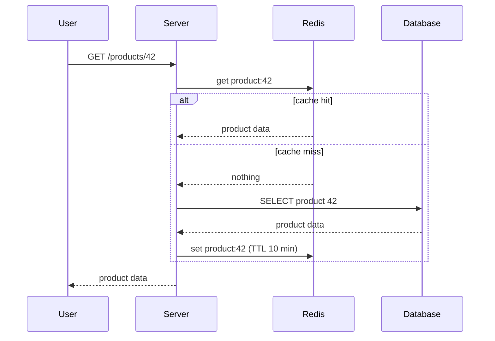

# CLAUDE.md — Backend Interview Playbook

> Working name: **Backend Interview Playbook**. Rename freely; update `<title>`, the header, and `README.md` together.

You are building a static study website, hosted on GitHub Pages, for preparing for **backend-heavy full-stack developer interviews**. The owner is a React developer who moved into backend work. He now writes Node.js code (often with AI coding tools), deploys with Docker, and manages servers over SSH. He will share the site with other people preparing for interviews, so **a complete beginner must be able to learn from it**.

Read this whole file before starting any work. It is the source of truth for goals, architecture, content rules, and quality bar.

---

## 1. The goal (read this twice)

After reading any topic page, the reader should be able to:

1. **Understand it**, even if they have never heard of it before.
2. **Explain it out loud** to another person in simple words.
3. **Answer an interviewer**, including the follow-up questions interviewers usually ask next.

Every decision about content, design, and features serves these three outcomes. If a paragraph does not help with one of them, cut it.

The second goal is **never losing your place**. The reader can always see what they have finished, what they are in the middle of, and exactly where to continue.

---

## 2. Tech stack and constraints

- **Plain HTML, CSS, and vanilla JavaScript.** No framework, no bundler, **no build step**. GitHub Pages serves the repo as-is.
- **Hash-based routing** (`#/topic/redis-caching`, `#/path`, `#/revise`). This avoids 404s on refresh with GitHub Pages.
- Topic content lives in **Markdown files** and is rendered in the browser.
- Libraries are loaded from **jsDelivr or cdnjs** with **exact pinned versions**. Never use `@latest`, ranges, or bare names. Look up a real stable version on npm before pinning, and choose one that is at least two weeks old.
  - `marked` for Markdown to HTML
  - `DOMPurify` to sanitize rendered HTML
  - `mermaid` for diagrams
  - `highlight.js` (or Prism) for code highlighting
- **All user state lives in `localStorage`** (see section 6). There is no backend and no login.
- Add a `.nojekyll` file at the repo root so GitHub Pages serves every file untouched.
- The site must work on **mobile** (people study on their phones), in **light and dark mode**, and when **printed**.
- Local preview: `python3 -m http.server 8000` (Markdown is fetched, so opening `index.html` directly from disk will not work). Document this in `README.md`.

---

## 3. File structure

```
/
├── index.html              # single page shell
├── .nojekyll
├── README.md               # what this is, how to run locally, how to deploy, how to add a topic
├── CLAUDE.md               # this file
├── assets/
│   ├── css/main.css
│   └── js/
│       ├── app.js          # boot, router
│       ├── render.js       # markdown → HTML, callouts, diagrams, code
│       ├── progress.js     # all localStorage reads/writes (only file that touches storage)
│       ├── revise.js       # spaced revision + explain-aloud drill + mock interview
│       └── search.js
├── data/
│   ├── curriculum.json     # phases, topics, order, metadata (source of truth for ordering)
│   └── glossary.json       # term → short plain-English definition
└── content/
    └── <phase-slug>/<topic-slug>.md
```

`curriculum.json` shape:

```json
{
  "version": 1,
  "phases": [
    {
      "id": "p01-internet",
      "title": "How the internet works",
      "summary": "What actually happens between typing a URL and seeing a page.",
      "topics": [
        {
          "id": "url-to-page",
          "title": "What happens when you type a URL",
          "file": "content/p01-internet/url-to-page.md",
          "level": "beginner",
          "priority": "must-know",
          "minutes": 12,
          "tags": ["dns", "tcp", "http"],
          "related": ["dns", "http-basics", "tls-https"]
        }
      ]
    }
  ]
}
```

- `level`: `beginner` | `intermediate` | `advanced`
- `priority`: `must-know` | `good-to-know`. This lets someone with only a few days left study only the must-knows.
- `minutes`: honest reading time estimate.

The curriculum in section 9 is the **seed list**. After Phase A of the build plan, `curriculum.json` becomes the source of truth for the order of topics.

---

## 4. Features

### 4.1 Home / dashboard (`#/`)
- **Continue button** at the top: "Continue: <topic title>". It opens the last topic the reader was on and **scrolls to where they stopped**. This is the most important button on the site.
- Overall progress (topics done / total) and progress per phase.
- **Revise today** list (see 4.6), shown only if something is due.
- Recently read topics (last 5, with relative time like "2 days ago").
- A short "How to use this site" for first-time visitors. It is dismissible, and the dismissal is remembered.

### 4.2 The learning path (`#/path`) — the signature element
Show the curriculum as a **route map**, like a metro map. Each phase is a line, and each topic is a station on it.
- Station states are visually distinct: **not started**, **reading**, **done**, **needs revision**.
- A clear **"You are here"** marker sits on the current topic.
- Tapping a station opens the topic.
- It must remain readable on a phone. On narrow screens, lay the lines out vertically.
- Below or beside the map, also offer a plain list view with checkboxes, for people who prefer lists. Keep the map as the default.

This map is where the design spends its boldness. Keep everything else calm (see section 8).

### 4.3 Topic page (`#/topic/<id>`)
- Sticky mini-header with the topic title, its phase, and a status control: **Not started / Reading / Done / Revise later**.
- Opening a topic automatically sets it to **Reading** (if it was not started) and records it in history.
- **Scroll position is saved** (throttled) and restored on return.
- A table of contents built from the `##` headings. It sits in a side panel on desktop and in a collapsible panel on mobile.
- **"Mark done & next topic"** button at the bottom. It follows the path order.
- **Previous / Next** links that follow path order.
- **My notes**: a text area per topic, auto-saved to localStorage.
- Glossary terms are underlined on first use and show their definition on tap or hover.
- Each `##` section gets a copyable deep link (`#/topic/redis-caching/how-it-works`).

### 4.4 Search (`#/search?q=`)
Client-side search over titles, summaries, tags, and glossary terms. The first time search is opened, also fetch and index the full Markdown bodies. Show the matching snippet in each result.

### 4.5 Status meanings (must be consistent everywhere)
| Status | Meaning |
|---|---|
| Not started | Never opened |
| Reading | Opened, not finished |
| Done | Reader says they understand it and can explain it |
| Revise later | Reader marked it or failed a drill; it needs another pass |

### 4.6 Revision: making it stick (`#/revise`)
Reading once is not enough to explain something in an interview. Add three light tools:

1. **Spaced revision.** When a topic is marked Done, schedule revision reminders at +3, +10, and +30 days. Due topics appear in "Revise today".
2. **Explain-it-aloud drill.** Shows one interview question from the topic and a 60-second timer. The prompt reads: "Explain this out loud as if to an interviewer." Then it reveals the model answer, and the reader rates themselves: **Nailed it / Shaky / Couldn't**.
   - Nailed it → push the next revision further out.
   - Shaky → keep the schedule.
   - Couldn't → set status to **Revise later**.
3. **Mock interview mode.** Picks 5 random questions from topics marked Done (optionally filtered by phase). Each question gets the same timer, reveal, and self-rating flow. At the end, show a summary listing the weak topics, each with a link.

Keep these simple. No points, badges, or leaderboards.

### 4.7 Progress portability
localStorage is **per browser, per device**. Opening the site on a phone will not show progress made on a laptop. Be honest about this in the UI (one line in settings) and provide:
- **Export progress** → downloads a `.json` file.
- **Import progress** → loads that file. Merge rule: for each topic, keep the most recently updated entry.
- **Progress code** → a compact string (JSON → compressed → base64url) the reader can copy on one device and paste on another.

### 4.8 Settings (`#/settings`)
Theme (system / light / dark), export/import, progress code, reset all progress (with confirmation), and a "only show must-know topics" toggle that filters the path and the dashboard counts.

---

## 5. Content rules (the most important section)

### 5.1 Topic template
Every topic file uses these sections, in this order. Section titles may be phrased naturally, but the order and purpose must hold. Callouts use GitHub-style alert syntax (`> [!TIP]`, `> [!INTERVIEW]`, `> [!MISTAKE]`, `> [!NOTE]`), and `render.js` styles each one distinctly.

1. **In one line**: a single plain-English sentence. If you need two sentences, the idea is not clear yet.
2. **The problem it solves**: why this exists. What breaks or hurts without it? Start from a concrete situation.
3. **Everyday analogy**: one real-world analogy, used consistently. State where the analogy breaks down, in one line.
4. **How it works**: step by step, numbered, short sentences. Include **one diagram** (see 5.3).
5. **Real example**: a concrete scenario with real commands or code (see 5.4). Show the input and what happens.
6. **How to say it in an interview**:
   - **30-second answer**: a short spoken answer the reader could say word for word.
   - **2-minute answer**: deeper; includes a tradeoff and a real-world example.
7. **Follow-up questions interviewers ask**: 4–8 questions. Each answer is hidden in a `<details>` element so the reader tries first.
8. **Common mistakes and misconceptions**: wrong beliefs and wrong answers people actually give, each with the correct version.
9. **Tradeoffs: when NOT to use it**: interviewers love this. Always include it.
10. **Check yourself**: 3 quick questions with hidden answers.
11. **Go deeper**: 1–3 links to official docs or highly reputable sources only.

### 5.2 Writing rules
- Write for a **smart beginner**: someone intelligent who has never heard the term.
- **Define every technical term the first time it appears**, in plain words, even "obvious" ones like *port*, *process*, or *latency*. Add it to `glossary.json`.
- Short sentences. One idea per paragraph. Active voice.
- Prefer concrete numbers and scenarios over abstract statements. Write "a DB query taking 80 ms vs a Redis read under 1 ms on the same network", not "Redis is fast".
- Use one running example app across topics where it fits: a **video streaming and e-commerce style app** (users, products, orders, video uploads, live streams). Shared context makes topics connect.
- **Accuracy is non-negotiable.** Do not invent statistics, benchmarks, or quotes. When a number is a rough rule of thumb, say "roughly" or "typically". If you are not sure something is correct, leave it out or flag it with `<!-- VERIFY: ... -->` so the owner can check it.
- Explain the **why** before the **how**. Interviewers test understanding, not memorized definitions.
- No filler intros ("In today's world…"). Start with the point.

### 5.3 Diagram rules
Diagrams exist to make hard things obvious at a glance. A confusing diagram is worse than none.
- Use **Mermaid** inside ` ```mermaid ` fences. Prefer:
  - `sequenceDiagram` for request/response flows (who talks to whom, in order)
  - `flowchart TD` (top-down) for decisions and architecture
- **At most 8 boxes** per diagram, with labels of **5 words or fewer**. If you need more, split it into two diagrams.
- Use top-down layouts. Left-right layouts overflow on phones.
- **One idea per diagram.**
- Every diagram has a one-sentence caption below it saying what to notice.
- Diagrams must read correctly in **both light and dark themes**. Re-initialize Mermaid with the matching theme when the theme changes.
- Diagrams scroll horizontally inside their own container on small screens. The page itself never scrolls sideways.

### 5.4 Code and command rules
- Backend examples use **Node.js + Express**, **PostgreSQL**, **Redis**, and **Docker**, unless the topic needs something else. Shell commands use **bash on Ubuntu**.
- Keep snippets short (under 30 lines). Comment the lines that matter, not every line.
- Show realistic names (`getUserById`, `orders`, `video_uploads`), not `foo`/`bar`.
- Code must actually work. If a snippet depends on setup, say what the setup is.

### 5.5 Gold-standard example (match this quality and tone)

The following excerpt from `redis-caching.md` shows the expected depth. A full topic also includes the remaining template sections.

````markdown
## In one line
Redis caching means keeping a copy of frequently requested data in fast memory, so most requests never have to touch the slower database.

## The problem it solves
Your product page is opened 5,000 times a minute. Each visit runs the same database query for the same product. The database does identical work thousands of times, gets slower under load, and every user waits for it, even though the answer almost never changes.

## Everyday analogy
A shopkeeper keeps the most-sold items on the counter instead of walking to the storeroom every time. The counter is Redis; the storeroom is the database. Where it breaks down: the counter is small (memory is limited), and if the storeroom stock changes, the counter can show an outdated item until someone updates it.

## How it works (cache-aside pattern)
1. A request asks for product 42.
2. The server checks Redis for the key `product:42`.
3. **Cache hit**: the data is there. Return it immediately; the database is not touched.
4. **Cache miss**: the data is not there. Query the database.
5. Save the result in Redis with an expiry (TTL), for example 10 minutes.
6. Return the result. The next request for product 42 will be a hit.


*Notice: on a hit, the database is never contacted.*

## Real example
```js
async function getProduct(id) {
  const key = `product:${id}`;
  const cached = await redis.get(key);
  if (cached) return JSON.parse(cached);          // hit: skip the DB

  const product = await db.query('SELECT * FROM products WHERE id = $1', [id]);
  await redis.set(key, JSON.stringify(product), { EX: 600 }); // expire in 10 min
  return product;
}
```

## How to say it in an interview
> [!INTERVIEW]
> **30 seconds:** "I use Redis as a cache in front of the database with the cache-aside pattern. The app checks Redis first; on a miss it reads from the database and stores the result with a TTL. This cuts database load and response time for read-heavy data. The main challenge is keeping the cache fresh, so I set TTLs and delete the key whenever the underlying data is updated."

## Common mistakes
> [!MISTAKE]
> "Redis replaces the database." No. By default Redis keeps data in memory and is used here as a copy. The database remains the source of truth.
````

### 5.6 Self-review checklist (run on every topic before marking it complete)
- [ ] Could someone who has never heard this term understand the first three sections?
- [ ] Is every technical term defined at first use and present in the glossary?
- [ ] Does the diagram have 8 or fewer boxes, a caption, and render in both themes?
- [ ] Is the 30-second answer something a person could actually say out loud naturally?
- [ ] Are there at least 4 follow-up questions, with answers hidden?
- [ ] Is there a "when NOT to use it" section?
- [ ] Is every number either accurate or clearly marked as approximate?
- [ ] Does the code run as written?

---

## 6. Progress storage (localStorage)

Only `progress.js` reads or writes storage. Wrap every access in `try/catch`, and render correctly when storage is empty or unavailable (for example, in private browsing).

Key: `bip:v1`. Value (JSON):

```json
{
  "schema": 1,
  "lastTopic": "redis-caching",
  "topics": {
    "redis-caching": {
      "status": "reading",
      "scroll": 0.42,
      "notes": "",
      "updatedAt": 1767000000000,
      "doneAt": null,
      "nextReview": null,
      "reviewStep": 0
    }
  },
  "history": [{ "id": "redis-caching", "at": 1767000000000 }],
  "settings": { "theme": "system", "mustKnowOnly": false, "introDismissed": false }
}
```

- `scroll` is a **fraction (0–1)**, not pixels, so it survives font and screen changes.
- Cap `history` at 50 entries.
- Include a `migrate()` function so future schema changes do not wipe anyone's progress.

---

## 7. Accessibility and quality floor
- Fully keyboard-usable, with visible focus states.
- Status is never shown by color alone. Pair color with an icon or shape (for example: hollow, half, filled, or ringed station).
- Respect `prefers-reduced-motion`.
- Body text line length under about 75 characters.
- Text contrast meets WCAG AA in both themes.
- A print stylesheet: printing a topic gives clean pages, with hidden answers expanded and navigation hidden.

---

## 8. Visual design

The subject is backend engineering, which is about networks, routes, and requests moving through systems. The route-map path (4.2) is the one memorable visual element. Everything else stays quiet so long reading sessions are comfortable.

- **Typography:** one clean, highly readable family for body and headings (for example IBM Plex Sans, with a system-ui fallback stack), plus a monospace family for code (for example JetBrains Mono or IBM Plex Mono). Load them from Google Fonts with proper fallbacks. Use a clear type scale. Body size should be generous (about 17–18px on desktop).
- **Color:** define a small set of CSS variables on `:root`. Give each phase its own line color for the route map (like metro lines), and use those colors subtly elsewhere (the phase label on a topic page). Redefine the variables for dark mode under `@media (prefers-color-scheme: dark)` and under `[data-theme="dark"]`.
- **Avoid generic AI-site defaults:** cream background with a terracotta accent, near-black with a neon green accent, ALL-CAPS eyebrow labels above every heading, identical rounded cards with soft grey shadows everywhere, gradient decoration, and `→` appended to every link.
- **Motion:** only in response to user actions (expanding an answer, marking done). No entrance animations on scroll.
- **Copy:** plain, specific, sentence case. Buttons say exactly what they do ("Mark done & next topic", "Export progress"). Empty states tell the reader what to do next ("Nothing to revise today. Continue with <topic>.").

---

## 9. Curriculum (seed list)

Ordered as a learning path, from foundations to advanced topics. ★ marks must-know topics. Split or merge topics if it makes the explanations clearer, but keep the order logical: never use a concept before the topic that explains it.

**If you have a web search tool available**, check for current (recent-year) backend and full-stack interview question trends before Phase C and propose additions. Do not add anything without telling the owner first.

### P01 — How the internet works
- ★ What happens when you type a URL (the full journey, as an overview that links to the topics below)
- ★ IP addresses, ports, and localhost
- ★ DNS: how domain names become IPs (records: A, CNAME, MX, TXT; TTL; propagation)
- ★ TCP vs UDP (handshake, reliability, when to use which)
- ★ HTTP basics: methods, status codes, headers, request/response anatomy
- ★ HTTPS and TLS: what the padlock actually means, certificates
- HTTP/1.1 vs HTTP/2 vs HTTP/3
- ★ Cookies, sessions, and local storage
- ★ CORS: why the browser blocks requests, and how to fix it correctly

### P02 — Linux and servers
- ★ What a server actually is (it's just a computer; VPS vs dedicated vs managed)
- ★ Linux essentials: filesystem layout, navigation, and the commands you'll actually use
- ★ Users, groups, and file permissions (`chmod`, `chown`, `sudo`, the 755/644 numbers)
- ★ Processes, ports, and services (`ps`, `top`, `kill`, `systemd`, `ss`/`netstat`)
- ★ SSH: how it works, key-based login, `~/.ssh/config`, disabling password login
- SSH tunnels and port forwarding; `scp` and `rsync`
- ★ Firewalls and open ports (`ufw`, security groups)
- ★ Nginx as a reverse proxy (and why Node apps sit behind one)
- ★ Domains and SSL certificates on a server (Let's Encrypt, Certbot, auto-renewal)
- ★ Environment variables and secrets (`.env`, never committing secrets)
- Process managers: PM2 vs systemd vs Docker
- ★ Reading logs and debugging a server (`journalctl`, `tail -f`, disk full, out of memory)

### P03 — Node.js and backend fundamentals
- ★ The Node.js event loop (why one thread can handle many requests; blocking vs non-blocking)
- ★ Callbacks, promises, and async/await (including error handling)
- Streams and buffers (why you stream large files instead of loading them)
- ★ Express: routing, middleware, and the request lifecycle
- ★ REST API design: resources, naming, status codes, pagination, filtering, versioning
- ★ Input validation and centralized error handling
- ★ Idempotency (why retrying a payment must not charge twice)
- ★ File uploads: multipart, presigned URLs, uploading directly to object storage or a CDN
- GraphQL vs REST: when each makes sense
- ★ Real-time: WebSockets vs Server-Sent Events vs polling
- gRPC and when internal services use it

### P04 — Authentication and security
- ★ Authentication vs authorization
- ★ Sessions vs JWT: how each works and the honest tradeoffs
- ★ Password hashing (bcrypt/argon2; why never plain hashing or encryption)
- ★ OAuth 2.0 and "Login with Google" (and OpenID Connect)
- ★ Role-based access control (RBAC)
- ★ OWASP essentials: SQL injection, XSS, CSRF, broken access control
- ★ Rate limiting and brute-force protection
- Security headers (CSP, HSTS) and secure cookie flags

### P05 — Databases
- ★ SQL vs NoSQL: how to actually choose
- ★ Relational modeling: tables, primary/foreign keys, one-to-many, many-to-many
- Normalization and when to denormalize
- ★ Indexes: how they work (B-tree, simply explained), when they help and when they hurt
- ★ Reading a slow query: `EXPLAIN`/`EXPLAIN ANALYZE`
- ★ Transactions and ACID
- Isolation levels and race conditions (lost updates, locks)
- ★ The N+1 query problem
- ORMs and query builders: benefits and traps
- ★ MongoDB basics: documents, embedding vs referencing
- ★ Connection pooling
- Replication (read replicas) and sharding
- Migrations and zero-downtime schema changes
- Backups and restore (and testing restores)

### P06 — Caching and performance
- ★ Caching layers: browser, CDN, application, database
- ★ Redis caching (cache-aside, TTL); see the gold-standard example in 5.5
- ★ Cache invalidation strategies (and why it's famously hard)
- Redis beyond caching: sessions, rate limiters, pub/sub, leaderboards, queues
- Cache stampede and how to prevent it
- ★ CDNs: how they work, caching static and video content, cache headers
- ★ Finding performance bottlenecks (measure first; latency vs throughput)

### P07 — Async work and messaging
- ★ Why background jobs exist (emails, video processing, reports)
- ★ Message queues: producers, consumers, acknowledgments
- BullMQ (Redis-based) vs RabbitMQ vs Kafka: when to use which
- ★ Retries, exponential backoff, and dead-letter queues
- Scheduled jobs (cron)
- Event-driven architecture and eventual consistency

### P08 — Docker and deployment
- ★ Containers vs virtual machines
- ★ Images, containers, and layers
- ★ Writing a good Dockerfile for a Node app (layer caching, `.dockerignore`, non-root user)
- Multi-stage builds and small images
- ★ Volumes and persistent data
- ★ Docker networking (how containers talk to each other)
- ★ Docker Compose for a multi-service app (app + Postgres + Redis + Nginx)
- ★ Deploying Docker to a server over SSH, end to end
- ★ CI/CD with GitHub Actions (test → build → deploy)
- Deployment strategies: rolling, blue-green, canary, rollback
- Kubernetes: concepts only (pods, deployments, services); what to say if you haven't used it
- Cloud basics: compute (EC2), object storage (S3), managed DBs (RDS), serverless (Lambda)

### P09 — System design
- ★ How to approach a system design interview (a step-by-step framework)
- ★ Vertical vs horizontal scaling
- ★ Load balancers and stateless servers
- ★ CAP theorem and consistency, explained plainly
- ★ Monolith vs microservices (honestly: most companies should start with a monolith)
- API gateway and service-to-service communication
- ★ Design: URL shortener
- ★ Design: rate limiter
- Design: chat application
- Design: notification system
- ★ Design: video upload and streaming platform (upload, transcode, CDN, live streaming basics)
- Designing for failure: timeouts, retries, circuit breakers, graceful degradation

### P10 — Observability and production
- ★ Logging well (structured logs, log levels, what never to log)
- Metrics, monitoring, and alerts
- Distributed tracing (concept)
- ★ Health checks and uptime monitoring
- ★ Scenario: "The site is slow in production. What do you do?" (a step-by-step debugging story)
- ★ Scenario: "The server is down at 2 AM." (an incident response walk-through)

### P11 — Frontend essentials (lighter, interview-focused)
- ★ JavaScript fundamentals interviewers still ask: closures, `this`, hoisting, scope
- ★ The browser event loop, microtasks vs macrotasks
- ★ How the browser renders a page (critical rendering path)
- ★ React: rendering, reconciliation, keys, and when components re-render
- ★ React hooks: `useState`, `useEffect`, `useMemo`, `useCallback`, and common mistakes
- State management: local, context, and external stores
- ★ SSR, SSG, CSR, and React Server Components (Next.js context)
- Web performance: Core Web Vitals, lazy loading, code splitting
- Accessibility basics

### P12 — Engineering in the AI era
- ★ Using AI coding tools well: reviewing and testing AI-written code, and being honest about it in interviews
- ★ Calling LLM APIs from a backend: streaming responses, timeouts, token costs, rate limits
- RAG explained simply: embeddings and vector databases
- Prompt injection and AI-specific security risks

### P13 — Testing, Git, and teamwork
- ★ Unit vs integration vs end-to-end tests (what to test at each level)
- Mocking and testing APIs
- ★ Git: branching, merge vs rebase, resolving conflicts, undoing mistakes safely
- ★ Code review: what good reviewers look for

### P14 — The interview itself
- ★ Explaining your own project (architecture, your role, decisions, what you'd change)
- ★ Behavioral answers with the STAR method
- ★ "Tell me about a production bug you fixed"
- ★ What to say when you don't know the answer
- Questions to ask the interviewer

---

## 10. Build plan (follow in order, and stop at each checkpoint)

**Phase A — Engine.** Build the shell, router, rendering pipeline (Markdown, callouts, Mermaid, code highlighting, `<details>`), progress storage, dashboard, path map, topic page, search, and settings. Create `curriculum.json` from section 9 with **placeholder topic files** so the full map is visible. Commit.
→ **Checkpoint:** tell the owner how to preview locally and wait for feedback on the design and features.

**Phase B — Pilot topics.** Write three complete topics to the full template:
1. What happens when you type a URL
2. SSH: how it works
3. Redis caching
Run the self-review checklist (5.6) on each. Commit.
→ **Checkpoint:** wait for feedback on depth, tone, and diagrams. Adjust the approach before writing more.

**Phase C — Content, one phase at a time.** Write all topics in one curriculum phase, run the checklist, update the glossary, and commit with a message like `content: P05 databases`. Then move to the next phase. Never write many phases in one go. Quality drops when rushing.

**Phase D — Revision tools.** Build the spaced revision, the explain-aloud drill, and mock interview mode, using the interview questions from finished topics.

**Phase E — Polish and deploy.** Test on a phone-sized viewport, in both themes, in print, and with empty storage. Write `README.md`. Explain to the owner how to enable GitHub Pages (Settings → Pages → deploy from the `main` branch, root folder).

---

## 11. Working rules for you (Claude Code)
- Ask before adding any dependency not listed in section 2.
- Keep `progress.js` the only module that touches storage.
- Commit after each meaningful unit of work, with clear messages.
- When unsure about a technical fact, leave a `<!-- VERIFY: ... -->` comment and list all VERIFY items at the end of each phase. Never guess silently.
- Don't pad content to look complete. A shorter, correct, clear topic beats a long, vague one.
- If something in this file conflicts with making the site genuinely better for learners, say so and propose the change. Don't silently deviate.
