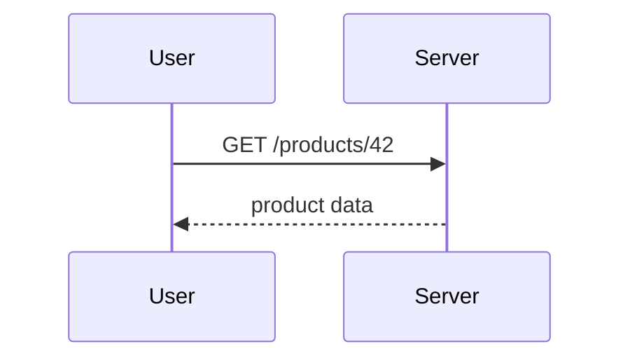

# Backend Interview Playbook

A free study site for **backend-heavy full-stack developer interviews**, written so that a complete beginner can learn from it.

Every topic aims for three outcomes:

1. **Understand it**, even if you have never heard of it before.
2. **Explain it out loud** in simple words.
3. **Answer an interviewer**, including the usual follow-up questions.

The path covers 14 phases and 119 topics. It runs from "what happens when you type a URL" through Linux, Node.js, security, databases, caching, queues, Docker, system design, and production debugging, and ends with the interview itself.

## Features

- **Route map:** each phase is a metro line and each topic is a station. You can always see what you've finished and where to go next.
- **Continue button:** reopens your last topic and scrolls to the spot where you stopped.
- **Topic pages:** a 30-second and a 2-minute spoken interview answer, follow-up questions with hidden answers, diagrams, and a tap-to-define glossary.
- **Spaced revision:** a topic you mark done comes back after 3, 10, and 30 days.
- **Search:** covers every topic and glossary term.
- **Works anywhere:** phones, light and dark mode, and printing.
- **Private progress:** progress stays in your browser. Nothing is sent anywhere. You can export it, or move it between devices with a progress code.

## Run it locally

The site loads its Markdown files with `fetch`. That doesn't work if you open `index.html` straight from disk, so serve the folder over HTTP:

```bash
cd path/to/this/repo
python3 -m http.server 8000
```

Then open <http://localhost:8000>.

There is no build step and nothing to install. The site is plain HTML, CSS, and JavaScript, and it loads pinned library versions from jsDelivr.

## Deploy to GitHub Pages

1. Push this repository to GitHub.
2. Open **Settings → Pages**.
3. Under **Build and deployment**, choose **Deploy from a branch**. Pick `main` and `/ (root)`, then save.
4. After a minute or two, the site is live at `https://<your-username>.github.io/<repo-name>/`.

The `.nojekyll` file tells GitHub Pages to serve every file as-is. Routing uses the URL hash (`#/topic/dns`), so refreshing any page never gives a 404.

## Add or edit a topic

1. Open `data/curriculum.json` and find (or add) the topic entry.
   - `id`: the URL slug. Must be unique.
   - `title`: short. It appears under a station on the map, which shows at most 3 lines.
   - `summary`: one sentence.
   - `file`: path to the Markdown file.
   - `level`: `beginner`, `intermediate`, or `advanced`.
   - `priority`: `must-know` or `good-to-know`.
   - `minutes`: an honest reading-time estimate.
   - `tags`: keywords for search.
   - `related`: ids of related topics.

   The order of topics in this file is the order of the learning path.
2. Write the topic in `content/<phase-id>/<topic-id>.md`.
   - Follow the template in `CLAUDE.md` (section 5.1).
   - Delete the `<!-- placeholder ... -->` line when the topic is real.
3. Add any new technical terms to `data/glossary.json`. The first time each term appears on a page, it gets a dotted underline that shows the definition when tapped.

### Markdown features

**Callouts:**

````markdown
> [!INTERVIEW]
> **30 seconds:** "I use Redis as a cache in front of the database..."

> [!MISTAKE]
> "Redis replaces the database." No. ...

> [!TIP]
> ...

> [!NOTE]
> ...
````

**Hidden answers** (follow-up questions and "check yourself"). Leave a blank line after `<summary>` and before `</details>` so the Markdown inside is rendered:

```html
<details>
<summary>What happens when Redis goes down?</summary>

The app falls back to the **database**, which is slower but still correct.

</details>
```

**Diagrams.** Use a fenced `mermaid` code block. Put a line of italic text immediately after it, and that line becomes the caption:

````markdown

*Notice: the server answers in one round trip.*
````

Each diagram is drawn twice, once for light mode and once for dark mode. Keep diagrams to 8 boxes or fewer, with labels of 5 words or fewer, and use a top-down layout.

**Links:**
- To another topic: `[DNS](#/topic/dns)`
- To a section on the same page: `[the problem](#the-problem-it-solves)`
- External links open in a new tab.

## Project layout

```
index.html              page shell, nav, pinned library <script> tags
assets/css/main.css     all styles: tokens, light/dark, map, topic, print
assets/js/
  app.js                boot + hash router
  progress.js           the ONLY file that touches localStorage
  curriculum.js         loads curriculum + glossary, path order helpers
  render.js             markdown → HTML, callouts, code, diagrams, glossary
  pathmap.js            route map + list view
  topic.js              topic page (status, TOC, scroll restore, notes)
  home.js               dashboard
  search.js             search
  revise.js             revision page
  settings.js           settings, export/import, progress code
  ui.js                 shared helpers and icons
data/curriculum.json    phases and topics (source of truth for order)
data/glossary.json      term → plain-English definition
content/<phase>/<topic>.md
```

## Your progress and privacy

Progress (status, scroll position, notes, history) is saved in your browser's `localStorage` under the key `bip:v1`. It never leaves your device.

Each browser on each device keeps its own copy. To carry progress to another device, use **Settings → Export progress** or **Progress code**. Importing merges the two copies: for each topic, the most recently updated version wins.
