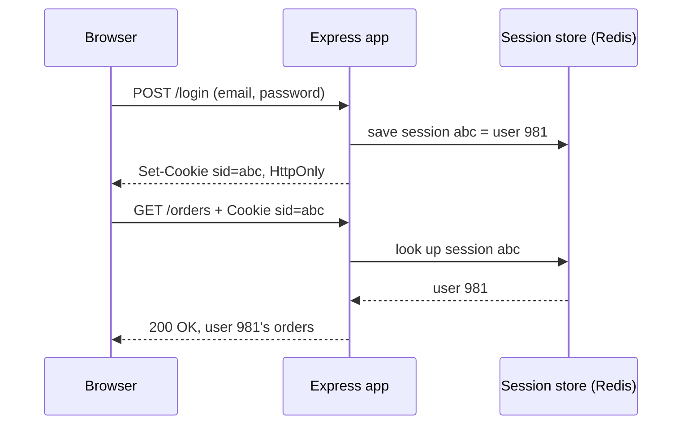

## In one line
Cookies are small values the browser stores and automatically sends back to the server, a session is the server's memory of a logged-in user linked by a cookie, and local storage is a place only the page's JavaScript can read and write.

## The problem it solves
HTTP is **stateless**: every request arrives on its own, and the server doesn't remember the one before (see [HTTP basics](#/topic/http-basics)). But a shop must remember a lot. User 981 logged in five minutes ago. They prefer dark mode. Their cart has two mugs in it.

So something has to carry that memory between requests. There are three common places to keep it, and each has a different security profile:

- **Cookies**: stored by the browser, sent to the server automatically.
- **Sessions**: stored on the server, found through an ID kept in a cookie.
- **Web storage** (`localStorage`, `sessionStorage`): stored by the browser, visible only to the page's JavaScript, never sent automatically.

Choosing the wrong one is a classic security bug: putting a login token where any injected script can read it, or a cookie that any other website can make the browser send.

## Everyday analogy
A coat check. You hand over your coat and get a numbered ticket. The coat stays behind the counter (the **session**, on the server). The ticket is in your pocket (the **cookie**), and you show it every time you come back. Anyone who steals your ticket can collect your coat, which is why the ticket should be hard to copy.

**Local storage** is a notebook you keep in your own bag. Only you read it, and you only show it to the coat check if you choose to.

Where it breaks down: a browser doesn't decide when to show the cookie. It shows it automatically on every matching request, even ones another website triggered. Cookie attributes exist to control exactly that.

## How it works

**Cookies**

1. The server sends a `Set-Cookie` header in a response, for example `Set-Cookie: sid=k3J9...; HttpOnly; Secure; SameSite=Lax; Max-Age=604800`.
2. The browser stores it for that site.
3. On every later request that matches, the browser adds a `Cookie: sid=k3J9...` header by itself. The frontend code does nothing.

Each cookie is limited to roughly 4 KB, and every byte is sent on every matching request.

**Cookie attributes you must know**

| Attribute | What it does |
|---|---|
| `HttpOnly` | Page JavaScript can't read it through `document.cookie`. An injected script can't steal it. |
| `Secure` | Only sent over HTTPS, so it never travels as readable text. |
| `SameSite=Strict` | Never sent on requests started by another site. |
| `SameSite=Lax` | Sent when the user clicks a link to your site, but not on cross-site form POSTs, `fetch` calls, or iframes. Chrome uses this when you don't set `SameSite`. |
| `SameSite=None` | Always sent, even cross-site. Requires `Secure`. |
| `Domain` | Which hosts receive it. Leave it out to send it only to the exact host that set it. `Domain=example.com` also sends it to every subdomain. |
| `Path` | Only sent for URLs under this path, like `/api`. |
| `Max-Age` / `Expires` | How long it lives. Without either, it's a **session cookie**, deleted when the browser closes. |

A "site" here means the main domain, like `example.com`. So `shop.example.com` and `api.example.com` are the **same site**, even though they are different **origins**. An origin is the exact scheme, host, and port, like `https://shop.example.com:443`. See [CORS](#/topic/cors).

**Server-side sessions**

1. The user logs in with a correct password.
2. The server creates a random, unguessable **session ID** and stores `{ userId: 981 }` under it, usually in Redis or the database.
3. It sends the ID in an `HttpOnly; Secure; SameSite=Lax` cookie.
4. On each request, the server reads the ID from the cookie, looks up the session, and knows the user.
5. On logout, the server deletes the session. The cookie becomes a useless ticket.


*Notice: the browser only ever holds a random ID. Who the user is lives on the server, so the server can end the session at any moment.*

**Web storage**

- `localStorage` keeps strings per origin until something deletes them, typically up to about 5 MB.
- `sessionStorage` works the same way but is cleared when the tab closes, and each tab has its own copy.
- Both are read and written by JavaScript (`localStorage.setItem('theme', 'dark')`). They are never sent to the server automatically, and **any** script running on the page can read them.

## Real example
**Setup:** Node.js 18 or later, `"type": "module"` in `package.json`, and `npm install express cookie-parser`. Sessions are kept in a `Map` to keep the example short. Password checking is left out; see [Password hashing](#/topic/password-hashing).

```js
import express from 'express';
import cookieParser from 'cookie-parser';
import crypto from 'node:crypto';

const app = express();
app.use(cookieParser()); // fills req.cookies from the Cookie header

const sessions = new Map(); // demo only: in production, store sessions in Redis

app.post('/login', (req, res) => {
  // Password check left out: assume user 981 just logged in successfully.
  const sessionId = crypto.randomBytes(32).toString('base64url'); // unguessable
  sessions.set(sessionId, { userId: 981 });
  res.cookie('sid', sessionId, {
    httpOnly: true,                  // page JavaScript can't read it
    secure: true,                    // only sent over HTTPS (and localhost)
    sameSite: 'lax',                 // not sent on cross-site POSTs, fetches, iframes
    maxAge: 7 * 24 * 60 * 60 * 1000, // 7 days, in milliseconds
  });
  res.json({ ok: true });
});

app.get('/me', (req, res) => {
  const session = sessions.get(req.cookies.sid); // look up the ID the browser sent
  if (!session) return res.status(401).json({ error: 'Not logged in' });
  res.json({ userId: session.userId });
});

app.listen(3000);
```

Try it with `curl`. `-c` saves cookies to a file, and `-b` sends them back, just like a browser:

```bash
curl -i -X POST http://localhost:3000/login -c jar.txt
# Set-Cookie: sid=23hGz4DQ...; Max-Age=604800; Path=/; Expires=...; HttpOnly; Secure; SameSite=Lax

curl http://localhost:3000/me -b jar.txt   # {"userId":981}
curl http://localhost:3000/me              # {"error":"Not logged in"}
```

In a browser, log in, then type `document.cookie` in the DevTools console. `sid` is not listed, because it is `HttpOnly`. DevTools → Application → Cookies still shows it, with every attribute.

Logging out means deleting the session from the store and clearing the cookie with `res.clearCookie('sid', ...)`, using the same options it was set with.

## How to say it in an interview

> [!INTERVIEW]
> **30 seconds:** "Cookies are small values the server sets with `Set-Cookie`, and the browser sends them back automatically on matching requests. A server-side session stores the user's data on the server, often in Redis, and the cookie only holds a random session ID. Local storage is per-origin browser storage that only JavaScript can access, and it's never sent automatically. For login, I use an `HttpOnly`, `Secure`, `SameSite=Lax` session cookie, and I keep local storage for harmless things like UI preferences."

> [!INTERVIEW]
> **2 minutes:** Start with the 30-second answer, then add:
>
> "The choice is mostly about two attacks. XSS is when an attacker gets their script running on my page. That script can read anything in local storage, so a token stored there can be stolen and used from anywhere. An `HttpOnly` cookie can't be read by script. CSRF is the opposite risk: because cookies are sent automatically, another site could make the browser send a request with them. `SameSite=Lax` blocks that for cross-site POSTs, and I add CSRF tokens for sensitive actions.
>
> The tradeoff of server-side sessions is a lookup on every request and a shared store, like Redis, when I run several servers. In return, I can log someone out instantly, for example after a password change, just by deleting their session. On a video shop, things like the last selected video quality can live in local storage."


## Follow-up questions interviewers ask

<details>
<summary>Should I store a JWT in localStorage or in a cookie?</summary>

In an `HttpOnly`, `Secure` cookie, in most cases. Any script on the page, including one injected through XSS or a compromised npm package, can read local storage and send the token to an attacker. An `HttpOnly` cookie can't be read by script. The cookie brings CSRF risk instead, which `SameSite` and CSRF tokens handle. See [Sessions vs JWT](#/topic/sessions-vs-jwt).

</details>

<details>
<summary>What is the difference between a session cookie and a server-side session?</summary>

Confusing names. A **session cookie** is any cookie without `Max-Age` or `Expires`, so the browser deletes it when it closes. A **server-side session** is user data stored on the server and linked by an ID. The ID often lives in a persistent cookie that lasts days.

</details>

<details>
<summary>How does SameSite help against CSRF?</summary>

In CSRF (cross-site request forgery), an evil page submits a form to `shop.example.com/orders`, and the browser attaches the user's cookies. With `SameSite=Lax` or `Strict`, the browser doesn't attach the cookie to that cross-site POST, so the request arrives logged out. See [OWASP essentials](#/topic/owasp-essentials).

</details>

<details>
<summary>How do sessions work with several servers behind a load balancer?</summary>

If each server kept sessions in its own memory, a user would be logged in on one server and logged out on the next. Store sessions in a shared store like Redis, so any server can look up any session ID. "Sticky sessions" (always sending a user to the same server) also work, but break when that server restarts.

</details>

## Common mistakes and misconceptions

> [!MISTAKE]
> "HttpOnly makes my cookie secure." It only stops JavaScript from reading it. Without `Secure` it can leak over plain HTTP, and without `SameSite` other sites can make the browser send it. Use all three.

> [!MISTAKE]
> Storing data in a cookie and trusting it, like `role=admin`. The user can edit any cookie. Store an ID and keep the real data on the server, or sign the value.

> [!MISTAKE]
> "localStorage is private to my app." It's private to your **origin**, but every script running on your pages, including third-party analytics, can read it.

> [!MISTAKE]
> Logging out by only deleting the cookie in the browser. If the session still exists on the server, a stolen copy of the cookie keeps working. Delete the server-side session too.

## Tradeoffs: when NOT to use it
- **Cookies for large or frequently changing data.** Every byte is sent on every matching request, including image and script requests. Keep cookies small, and keep big data on the server.
- **localStorage for secrets.** Tokens, personal data, and anything an attacker would want shouldn't live there.
- **Server-side sessions for a public API used by other servers.** Machine clients don't have cookie jars. API keys or tokens in the `Authorization` header fit better.
- **`SameSite=None` unless you truly need cross-site cookies.** It switches off the browser's built-in CSRF protection for that cookie.

## Check yourself

<details>
<summary>1. Which cookie attribute stops an injected script from reading the session cookie?</summary>

`HttpOnly`. The cookie is still sent with requests, but `document.cookie` doesn't show it.

</details>

<details>
<summary>2. A user logs in on server A, then their next request goes to server B and they appear logged out. Why, and how do you fix it?</summary>

Sessions are stored in each server's own memory, so server B doesn't know the session ID. Store sessions in a shared store such as Redis.

</details>

<details>
<summary>3. Where would you store a user's preferred video quality, and why?</summary>

In `localStorage`. It's not sensitive, the server doesn't need it on every request, and it should survive closing the tab.

</details>

## Go deeper
- [MDN: Using HTTP cookies](https://developer.mozilla.org/en-US/docs/Web/HTTP/Guides/Cookies)
- [OWASP: Session Management Cheat Sheet](https://cheatsheetseries.owasp.org/cheatsheets/Session_Management_Cheat_Sheet.html)
- [MDN: Web Storage API](https://developer.mozilla.org/en-US/docs/Web/API/Web_Storage_API)
