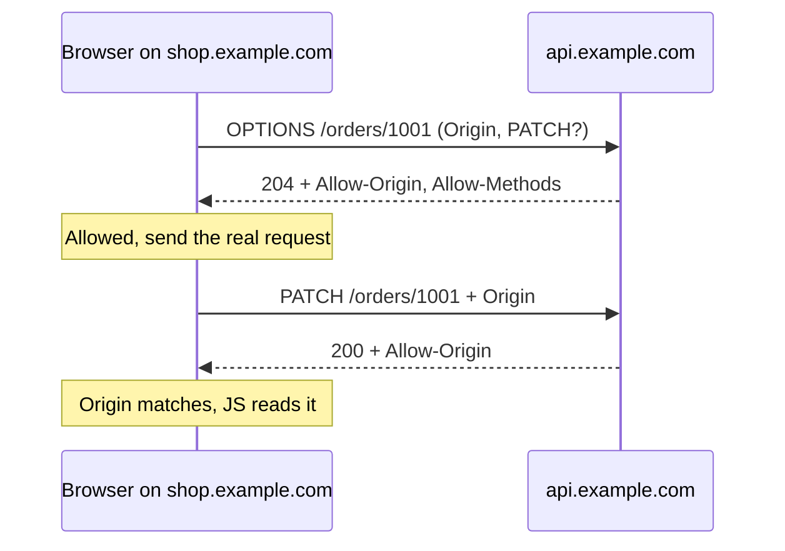

## In one line
CORS is a set of HTTP headers that lets your server tell the browser which other websites' JavaScript is allowed to read its responses.

## The problem it solves
Your React frontend runs at `https://shop.example.com`. Your API runs at `https://api.example.com`. The frontend calls `fetch('https://api.example.com/orders')`, and the browser console shows:

```text
Access to fetch at 'https://api.example.com/orders' from origin 'https://shop.example.com'
has been blocked by CORS policy: No 'Access-Control-Allow-Origin' header is present
on the requested resource.
```

The same request works in `curl` and Postman. So what is blocking it?

The browser is. It follows the **same-origin policy**: JavaScript on one **origin** may not read responses from a different origin. An origin is the exact combination of scheme, host, and port:

| Page origin | Request to | Same origin? |
|---|---|---|
| `https://shop.example.com` | `https://shop.example.com/api` | Yes |
| `https://shop.example.com` | `https://api.example.com` | No: different host |
| `https://shop.example.com` | `http://shop.example.com` | No: different scheme |
| `http://localhost:5173` | `http://localhost:3000` | No: different port |

Why the rule exists: you're logged in to your bank in one tab. In another tab, you open `evil.example`. Without the rule, that page's JavaScript could call `fetch('https://bank.example/account', { credentials: 'include' })`, and your browser would attach your bank cookies and hand the evil page your balance. The same-origin policy stops the evil page from **reading** the reply.

**CORS** (Cross-Origin Resource Sharing) is the controlled exception. Your API says, through response headers: "JavaScript from `https://shop.example.com` may read my responses." The browser checks and obeys.

## Everyday analogy
A receptionist at an office building (the browser) who passes messages between visitors and companies. A visitor from Company A asks for a document from Company B. Before handing it over, the receptionist checks Company B's guest list: "Is Company A allowed to see this?" If A isn't on the list, the document stays at the desk.

For risky requests, like "please shred these files", the receptionist calls Company B **first** to ask whether such a request is even allowed. That call is the **preflight**.

Where it breaks down: anyone who walks around the receptionist (`curl`, Postman, another server) reaches Company B directly. The guest list protects the visitor's browser session, not Company B's door.

## How it works
The browser adds an `Origin` header, like `Origin: https://shop.example.com`, to every cross-origin request. What happens next depends on the request type.

**Simple requests: sent directly**

1. A request is "simple" if it uses `GET`, `HEAD`, or `POST`, adds no custom headers, and, for a body, uses only a form-style `Content-Type` (like `text/plain` or `application/x-www-form-urlencoded`).
2. The browser sends it straight away. **The server receives it and runs it.**
3. The browser then checks the response for `Access-Control-Allow-Origin`. If it matches the page's origin (or is `*`), JavaScript gets the response. If not, the browser hides it and throws an error.

**Preflighted requests: ask first**

Anything else triggers a **preflight**: a `PUT`, `PATCH`, or `DELETE`, an `Authorization` header, or `Content-Type: application/json`. That covers most real API calls.

1. The browser first sends an `OPTIONS` request with no body:
   - `Origin: https://shop.example.com`
   - `Access-Control-Request-Method: PATCH`
   - `Access-Control-Request-Headers: content-type`
2. The server answers, usually `204 No Content`, with what it allows:
   - `Access-Control-Allow-Origin: https://shop.example.com`
   - `Access-Control-Allow-Methods: GET,POST,PATCH,DELETE`
   - `Access-Control-Allow-Headers: Content-Type,Authorization`
   - `Access-Control-Max-Age: 600` (cache this answer for 10 minutes)
3. If everything matches, the browser sends the real request. If not, the real request is **never sent**.
4. The real response must also carry `Access-Control-Allow-Origin`.

**Cookies (credentials)**

- By default, cross-origin `fetch` doesn't send cookies. The frontend must ask with `credentials: 'include'`.
- The server must then reply with `Access-Control-Allow-Credentials: true` **and** an exact origin. The wildcard `*` is not allowed with credentials.
- When the server picks the origin based on the request, it should also send `Vary: Origin`, so caches don't serve one origin's answer to another.

**Reading response headers.** By default, JavaScript can only read a few basic response headers. To expose others, like `X-Total-Count` for pagination, list them in `Access-Control-Expose-Headers`.


*Notice: the browser asks permission before sending the real request, and checks the headers again on the real response.*

## Real example
**Setup:** Node.js 18 or later, `"type": "module"` in `package.json`, and `npm install express cors`. `cors` is the standard Express middleware for these headers.

**The API** (`api.example.com`):

```js
import express from 'express';
import cors from 'cors';

const app = express();

app.use(cors({
  origin: ['https://shop.example.com', 'http://localhost:5173'], // allowlist, never "*" with cookies
  credentials: true,                         // let the browser send and read cookies
  methods: ['GET', 'POST', 'PATCH', 'DELETE'],
  allowedHeaders: ['Content-Type', 'Authorization'],
  maxAge: 600,                               // browser may cache the preflight for 10 minutes
}));
app.use(express.json());

app.patch('/orders/:id', (req, res) => {
  // Real code would check the session and update the database here.
  res.json({ id: Number(req.params.id), quantity: req.body?.quantity });
});

app.listen(3000);
```

`cors` must run before your routes, so it can answer `OPTIONS` preflights itself.

**The frontend** (`shop.example.com`):

```js
const res = await fetch('https://api.example.com/orders/1001', {
  method: 'PATCH',                                  // not simple: triggers a preflight
  credentials: 'include',                           // send the session cookie
  headers: { 'Content-Type': 'application/json' },  // also triggers a preflight
  body: JSON.stringify({ quantity: 3 }),
});
```

**Pretend to be the browser** and send the preflight with `curl`:

```bash
curl -i -X OPTIONS http://localhost:3000/orders/1001 \
  -H 'Origin: https://shop.example.com' \
  -H 'Access-Control-Request-Method: PATCH' \
  -H 'Access-Control-Request-Headers: content-type'
```

```text
HTTP/1.1 204 No Content
Access-Control-Allow-Origin: https://shop.example.com
Vary: Origin
Access-Control-Allow-Credentials: true
Access-Control-Allow-Methods: GET,POST,PATCH,DELETE
Access-Control-Allow-Headers: Content-Type,Authorization
Access-Control-Max-Age: 600
```

Change the origin to `https://evil.example` and run it again. The `Access-Control-Allow-Origin` line disappears, so a browser would refuse to send the `PATCH`. But send the `PATCH` itself with `curl`, and the server still answers `200`. `curl` doesn't enforce CORS. Only browsers do.

**The other common fix: avoid cross-origin entirely.** Serve the API under the same origin, such as `https://shop.example.com/api`, with Nginx routing `/api` to Node. In development, Vite's `server.proxy` setting does the same, so no CORS headers are needed at all.

## How to say it in an interview

> [!INTERVIEW]
> **30 seconds:** "Browsers enforce the same-origin policy: a page's JavaScript can't read responses from a different scheme, host, or port. CORS lets the server opt in with headers like `Access-Control-Allow-Origin`. For non-simple requests, like JSON bodies, PATCH, or an Authorization header, the browser first sends an OPTIONS preflight, and only sends the real request if the server allows that origin, method, and headers. With cookies, the server must allow credentials and name an exact origin, not a wildcard."

> [!INTERVIEW]
> **2 minutes:** Start with the 30-second answer, then add:
>
> "An important point is that CORS is enforced by the browser, not the server. It protects users' logged-in sessions from being read by other sites. It doesn't protect my API from attackers. Anyone can call it with curl, so I still need authentication, authorization, and rate limiting. And for simple requests, the server actually runs the request, the browser just hides the response, so state-changing endpoints also need CSRF protection.
>
> In practice, for a frontend on `shop.example.com` and an API on `api.example.com`, I use an explicit allowlist of origins, allow credentials, and set `Max-Age` so the browser caches preflights. The tradeoff is the extra round trip for each preflight that isn't cached. When I can, I avoid that cost by serving the API under the same origin, like `/api` behind Nginx.
>
> The fix I avoid is reflecting any `Origin` back with credentials allowed. That effectively turns the protection off."

## Follow-up questions interviewers ask

<details>
<summary>Why does my request work in Postman but fail in the browser?</summary>

Postman and `curl` are not browsers. They don't apply the same-origin policy, so they never check CORS headers. The server answered both. Only the browser refused to give the response to your JavaScript.

</details>

<details>
<summary>What triggers a preflight request?</summary>

Any method other than `GET`, `HEAD`, or `POST`; any custom or non-safelisted header such as `Authorization`; or a `Content-Type` other than `text/plain`, `application/x-www-form-urlencoded`, or `multipart/form-data`. So sending JSON always triggers one.

</details>

<details>
<summary>Why can't I use Access-Control-Allow-Origin: * with cookies?</summary>

The spec forbids it, because it would let every website on the internet read responses made with the user's cookies, which is exactly what the same-origin policy prevents. With credentials, the server must name one exact origin and send `Access-Control-Allow-Credentials: true`.

</details>

<details>
<summary>Does CORS protect my API from attacks?</summary>

No. It protects **users** in their browsers. Attackers can call your API directly from scripts or servers, ignoring CORS entirely. Your API still needs authentication, authorization, input validation, and rate limiting. See [OWASP essentials](#/topic/owasp-essentials).

</details>

<details>
<summary>How do you reduce the cost of preflight requests?</summary>

Set `Access-Control-Max-Age` so the browser caches the answer. Browsers cap it, Chrome at 2 hours. Or remove the need: serve the API on the same origin as the frontend, for example under `/api` through a reverse proxy.

</details>

## Common mistakes and misconceptions

> [!MISTAKE]
> Trying to fix CORS in the frontend, for example by adding `Access-Control-Allow-Origin` to the `fetch` request headers. These are **response** headers. Only the server can send them, and adding them to the request just triggers a preflight.

> [!MISTAKE]
> "CORS blocked my request, so the server never ran it." For simple requests, and for any request whose preflight passed, the server ran it. The browser only hid the response. Don't rely on CORS to stop state changes.

> [!MISTAKE]
> Reflecting whatever `Origin` arrives, with credentials allowed. Any site can then read your users' data through their browsers. Use an explicit allowlist.

> [!MISTAKE]
> Registering the CORS middleware after the routes, or having auth middleware reject `OPTIONS` requests with `401`. Preflights carry no cookies or tokens. They must be answered before authentication runs.

## Tradeoffs: when NOT to use it
- **When you can use the same origin.** Serving the frontend and `/api` from one origin removes preflights, CORS configuration, and cross-site cookie problems. It's often the simplest choice.
- **`Access-Control-Allow-Origin: *`** is fine only for truly public, read-only data without cookies, like a public product catalogue. Never for anything tied to a logged-in user.
- **Server-to-server calls.** CORS only exists in browsers. Adding CORS headers to an API only called by other servers changes nothing.
- **As a security layer.** CORS isn't authentication, authorization, or CSRF protection. Don't count it as any of them.

## Check yourself

<details>
<summary>1. Are http://localhost:5173 and http://localhost:3000 the same origin?</summary>

No. The port is different, so they are different origins, and the browser applies CORS checks.

</details>

<details>
<summary>2. The frontend sends a PATCH with a JSON body to another origin. What does the browser send first, and what must the server answer?</summary>

An `OPTIONS` preflight with `Origin`, `Access-Control-Request-Method: PATCH`, and `Access-Control-Request-Headers: content-type`. The server must answer with `Access-Control-Allow-Origin` matching the origin, and allowed methods and headers that include `PATCH` and `Content-Type`.

</details>

<details>
<summary>3. Your API sends Access-Control-Allow-Origin: *, and the frontend uses credentials: 'include'. What happens?</summary>

The browser blocks the response. With credentials, the wildcard isn't allowed. The server must send the exact origin and `Access-Control-Allow-Credentials: true`.

</details>

## Go deeper
- [MDN: Cross-Origin Resource Sharing (CORS)](https://developer.mozilla.org/en-US/docs/Web/HTTP/Guides/CORS)
- [MDN: Same-origin policy](https://developer.mozilla.org/en-US/docs/Web/Security/Same-origin_policy)
- [Express docs: cors middleware](https://expressjs.com/en/resources/middleware/cors.html)
