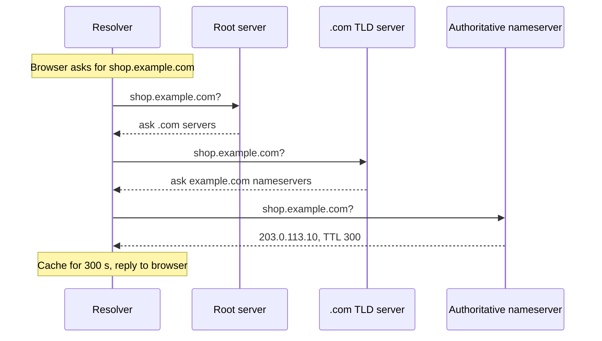

## In one line
DNS is the internet's phone book: it turns a name like `shop.example.com` into the IP address of the server that should answer.

## The problem it solves
Computers find each other by **IP address**, a number like `203.0.113.10` (see [IP addresses, ports, and localhost](#/topic/ip-ports-localhost)). People can't remember numbers like that, and the numbers change. You move your shop to a bigger server, and its IP changes. You put a CDN in front, and now visitors should reach a different server depending on where they live.

If every link and app had the IP written into it, every move would break them all. DNS adds a layer of naming in between. The **domain name** `shop.example.com` stays the same. Only the record behind it changes.

DNS also has to answer billions of questions a day without one central computer becoming a bottleneck. It does that by splitting the work across many servers and caching answers everywhere.

## Everyday analogy
You ask a hotel concierge for the address of a small restaurant. The concierge doesn't know it, so they call the city information desk: "For restaurants, ask the restaurant association." The association says: "That one manages its own listing; call them." The restaurant gives its address. The concierge tells you, and writes it on a sticky note for the next guest, with a date after which to check again.

The concierge is the **resolver**, the information desk is a **root server**, the association is the **TLD server**, and the restaurant is the **authoritative nameserver**. The sticky note is the cache, and its expiry date is the **TTL**.

Where it breaks down: the real chain takes milliseconds, and usually the "sticky note" already exists, so nobody gets called at all.

## How it works

**The servers involved**

- A **DNS resolver** (or recursive resolver) does the lookup on your behalf. It's usually run by your internet provider, your company, or a public service like `1.1.1.1` or `8.8.8.8`.
- **Root servers** know where to find each **top-level domain** (**TLD**): the last part of a name, like `.com` or `.in`. There are 13 root server names (`a.root-servers.net` to `m.root-servers.net`), each run as many copies around the world.
- **TLD servers** know which nameservers are in charge of each domain under them, such as `example.com`.
- The **authoritative nameserver** holds a domain's real records. It's usually run by your DNS provider (Cloudflare, Route 53, your registrar).

**One lookup, step by step**

1. The browser checks its own cache, then asks the operating system, which checks its cache and the local `/etc/hosts` file.
2. Nothing cached, so the OS asks the resolver: "What is the A record for `shop.example.com`?"
3. If the resolver has a fresh cached answer, it replies immediately. Otherwise it walks the chain.
4. It asks a root server, which replies: "I don't know, but here are the `.com` servers."
5. It asks a `.com` TLD server: "`example.com` is handled by these nameservers."
6. It asks the authoritative nameserver, which replies with the IP and a TTL, such as 300 seconds.
7. The resolver caches the answer for the TTL and returns it. The OS and browser cache it too.


*Notice: only the last server knows the real answer. The others just point to the next server, and the resolver does all the walking.*

**Record types you must know**

A **DNS record** is one entry in a domain's settings: a name, a type, a value, and a TTL.

| Type | What it maps | Example |
|---|---|---|
| **A** | Name → IPv4 address | `shop.example.com → 203.0.113.10` |
| **AAAA** | Name → IPv6 address | `shop.example.com → 2001:db8::10` |
| **CNAME** | Name → another name (an alias) | `www.example.com → shop.example.com` |
| **MX** | Where email for the domain goes | `example.com → 10 mail.example.com` |
| **TXT** | Free text, mostly for proving things | `v=spf1 include:_spf.google.com ~all` |
| **NS** | Which nameservers are authoritative | `example.com → ns1.dnsprovider.com` |

- A **CNAME** says "look up this other name instead". CDNs and hosting platforms often ask you to add one pointing at their hostname, so they can change the IPs behind it without asking you.
- **MX** values include a priority number. Lower numbers are tried first.
- **TXT** records carry email security settings (SPF, DKIM, DMARC) and codes that prove you own a domain, for example for a certificate authority.

**TTL and "propagation"**

The **TTL** (time to live) on each record tells every cache how many seconds it may reuse the answer. "DNS propagation" is a misleading name: nothing is pushed out. When you change a record, the authoritative nameserver has the new value immediately, but resolvers keep serving their cached copy until its TTL runs out. With a TTL of 3600, some users can see the old IP for up to an hour.

## Real example
**Setup:** `dig` is a DNS lookup tool. On Ubuntu install it with `sudo apt install dnsutils`. It's built in on macOS. Outputs are trimmed real answers; yours may differ.

**Ask for an A record:**

```bash
dig example.com A
```

```text
;; ANSWER SECTION:
example.com.    271   IN   A   172.66.147.243
example.com.    271   IN   A   104.20.23.154
```

Each line reads: name, seconds left in the cache (counting down from the TTL), class (`IN` = internet), type, value. Two A records means clients may use either server.

**Follow a CNAME:**

```bash
dig www.github.com
```

```text
www.github.com.   483   IN   CNAME   github.com.
github.com.       12    IN   A       20.207.73.82
```

**Watch the whole chain.** `+trace` makes `dig` walk from the root itself, instead of asking your resolver:

```bash
dig +trace example.com
```

```text
.            400999  IN  NS  a.root-servers.net.       <- the root servers
com.         172800  IN  NS  a.gtld-servers.net.       <- step 4: root points to .com
example.com. 172800  IN  NS  hera.ns.cloudflare.com.   <- step 5: .com points to the nameserver
example.com. 300     IN  A   172.66.147.243            <- step 6: the real answer
```

The real output lists every server at each level. This is trimmed to one line per level, with arrows added.

**Planning a server move** from `203.0.113.10` to `198.51.100.20`:

1. A day before, lower the A record's TTL from 3600 to 60. Wait at least the **old** TTL (one hour) so every cache picks up the short one.
2. Change the A record. Within about a minute, most users reach the new server.
3. Keep the old server running for a while, because some clients ignore TTLs.
4. Raise the TTL again once you're happy.

## How to say it in an interview

> [!INTERVIEW]
> **30 seconds:** "DNS turns domain names into IP addresses. The browser asks a recursive resolver. If the resolver hasn't cached the answer, it asks a root server, which points to the `.com` TLD servers, which point to the domain's authoritative nameserver, which returns the record. Every answer has a TTL, and everyone caches it for that long. The main records are A and AAAA for addresses, CNAME for aliases, MX for email, TXT for verification, and NS for which servers are in charge."

> [!INTERVIEW]
> **2 minutes:** Start with the 30-second answer, then add:
>
> "Caching is why DNS scales, and also why changes feel slow. People call it propagation, but old answers just stay in caches until their TTL expires. The tradeoff: a long TTL means fewer lookups and some resilience if the DNS provider has trouble, a short TTL lets you move faster.
>
> So when I move an app to a new server, I lower the TTL a day ahead, wait out the old TTL, switch the A record, and keep the old server up for a while.
>
> For a CDN, I'd add a CNAME to the CDN's hostname, so it can return different IPs in different regions. One gotcha: a CNAME can't sit at the bare domain like `example.com`, so providers offer a flattened alias record for that."

## Follow-up questions interviewers ask

<details>
<summary>What is the difference between an A record and a CNAME?</summary>

An A record maps a name directly to an IPv4 address. A CNAME maps a name to another **name**, which the resolver then looks up. Use A when you control the IP. Use CNAME when someone else (a CDN, a hosting platform) controls the IPs and may change them.

</details>

<details>
<summary>Why can't you put a CNAME on the bare domain (example.com)?</summary>

The DNS rules say a name with a CNAME can't have any other records. But the bare domain, called the **apex** of the zone, must have NS records (and an SOA record). Providers work around this with non-standard "ALIAS", "ANAME", or "CNAME flattening" records: the provider looks up the target itself and serves the result as A records.

</details>

<details>
<summary>Does DNS use TCP or UDP?</summary>

Mostly UDP on port 53, because a lookup is one small question and one small answer, and UDP needs no connection setup. DNS switches to TCP when a response is too large, and for copying whole zones between servers. Newer options encrypt lookups: DNS over HTTPS (DoH) and DNS over TLS (DoT). See [TCP vs UDP](#/topic/tcp-udp).

</details>

<details>
<summary>Can DNS do load balancing or failover?</summary>

Partly. Returning several A records spreads clients across servers, and some providers stop returning a dead server's IP after a health check fails. But clients cache answers for the TTL, and some cache longer, so DNS failover is slow. For fast failover, put a load balancer behind one stable IP. See [Load balancers](#/topic/load-balancers).

</details>

## Common mistakes and misconceptions

> [!MISTAKE]
> "DNS propagation means the change is slowly copied around the world." Nothing is copied. The new value is live on your nameserver at once. Old answers just live in caches until their TTL expires.

> [!MISTAKE]
> Lowering the TTL at the moment of the migration. Caches still hold the old answer with the **old** TTL. Lower it in advance, and wait at least the old TTL before switching.

> [!MISTAKE]
> Moving to a new DNS provider without copying every record first. MX and TXT records get forgotten, and email silently stops arriving.

## Tradeoffs: when NOT to use it
- **Fast failover.** DNS changes take at least a TTL to reach users, and some clients ignore TTLs. Don't rely on DNS alone to move traffic away from a dead server in seconds.
- **Very short TTLs everywhere.** Changes are quick, but every lookup adds latency, and an outage at your DNS provider hurts sooner because caches empty fast.
- **Very long TTLs on records you might change.** A 1-day TTL suits stable records like MX, but in an emergency move users may be stuck on the old IP for a day.
- **Service discovery for short-lived instances.** DNS caching can send traffic to instances that are gone. Docker and Kubernetes run their own short-TTL DNS for this.

## Check yourself

<details>
<summary>1. A resolver has no cached answer for shop.example.com. Which servers does it ask, in order?</summary>

A root server (which points to the `.com` servers), a `.com` TLD server (which points to `example.com`'s nameservers), then the authoritative nameserver, which returns the record.

</details>

<details>
<summary>2. You changed an A record 10 minutes ago. Some users reach the new server, others the old one. Why?</summary>

Those users' resolvers cached the old answer before the change and will keep it until its TTL expires. With a one-hour TTL, it can take up to an hour for everyone.

</details>

<details>
<summary>3. Which record would you add so that email for example.com goes to your mail provider?</summary>

An MX record pointing to the provider's mail server name, with a priority number. You'd usually also add TXT records for SPF, DKIM, and DMARC, so other servers trust your email.

</details>

## Go deeper
- [MDN: DNS (glossary)](https://developer.mozilla.org/en-US/docs/Glossary/DNS)
- [IANA: Root servers](https://www.iana.org/domains/root/servers)
- [RFC 1034: Domain names, concepts and facilities](https://www.rfc-editor.org/rfc/rfc1034)
