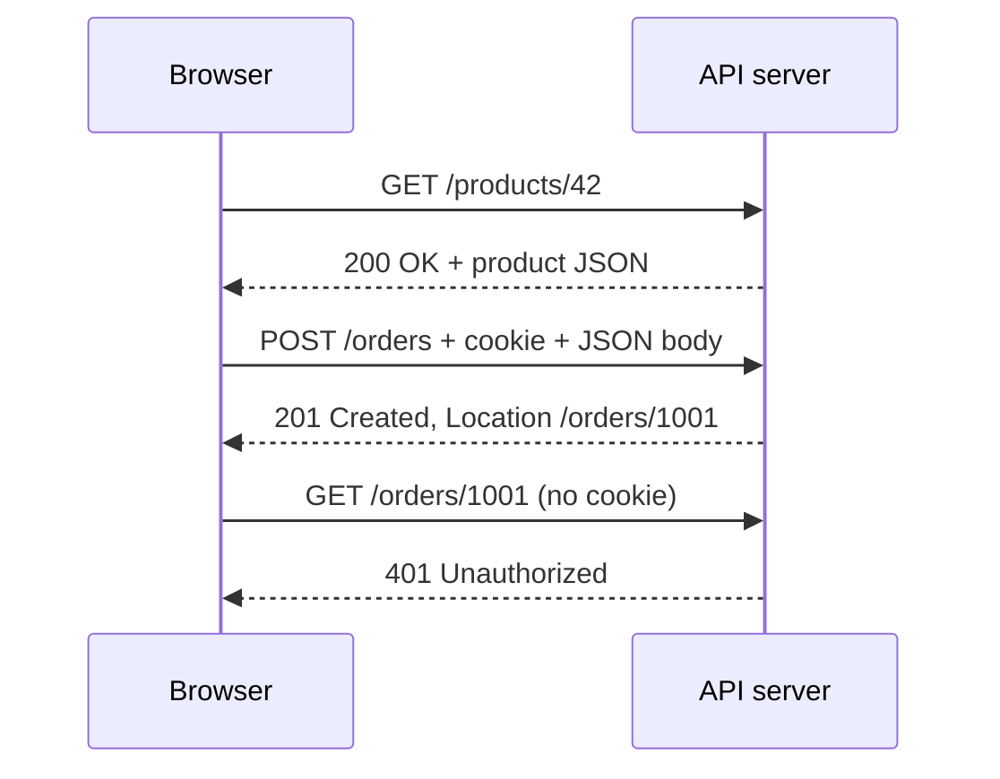

## In one line
HTTP is the request-and-response language of the web: the client sends a method, a path, headers, and maybe a body, and the server answers with a status code, headers, and a body.

## The problem it solves
A browser in Mumbai and a Node.js server in Frankfurt were written by different people, in different languages, years apart. They still need to agree on exactly what "give me product 42" and "here it is" look like as bytes. Without a shared format, every website would need its own custom client.

**HTTP** (Hypertext Transfer Protocol) is that shared format. Every browser, mobile app, `curl`, and backend framework speaks it. When your React app calls `fetch('/api/orders')`, your Express route receives an HTTP request, and whatever it sends back is an HTTP response.

Knowing HTTP well is how you debug half of all backend bugs. "Why is my request body empty?" (a missing `Content-Type` header). "Why does the browser show stale data?" (a `Cache-Control` header). "Why did the frontend think the order failed?" (a wrong status code).

## Everyday analogy
Ordering by mail from a catalogue. You fill in a standard order form: what you want to do (**method**: "buy"), which item (**path**: item 42), extra details in labelled boxes (**headers**: "deliver to", "pay by"), and sometimes a letter attached (**body**). The shop mails back a standard reply slip: a result code at the top ("shipped", "out of stock"), labelled boxes, and maybe the item itself.

Where it breaks down: the shop has no memory of your last order unless you include your customer number on every form. HTTP works the same way: it is **stateless**, so each request must carry everything the server needs, such as a login cookie.

## How it works

**1. A request has three parts.** An **endpoint** is one URL path your API answers, like `/orders`. Here is a raw request to create an order:

```http
POST /orders HTTP/1.1
Host: api.example.com
Content-Type: application/json
Authorization: Bearer eyJhbGciOi...
Content-Length: 29

{"productId":42,"quantity":2}
```

- The **request line**: method (`POST`), path (`/orders`), and protocol version.
- **Headers**: one `Name: value` per line, giving extra information. Header names are case-insensitive.
- A **blank line**, then the optional **body**: the actual data. `GET` requests normally have no body.

**2. A response has the same shape.**

```http
HTTP/1.1 201 Created
Location: /orders/1001
Content-Type: application/json; charset=utf-8
Content-Length: 39

{"id":1001,"productId":42,"quantity":2}
```

- The **status line**: version, **status code** (`201`), and a short reason phrase.
- Headers, a blank line, then the body.

**3. The method says what you want to do.** Two properties matter in interviews. A **safe** method doesn't change anything on the server. An **idempotent** method has the same effect whether you send it once or five times, so it is safe to retry.

| Method | Use | Safe? | Idempotent? |
|---|---|---|---|
| `GET` | Read a resource | Yes | Yes |
| `POST` | Create something, or trigger an action | No | No |
| `PUT` | Replace a resource completely | No | Yes |
| `PATCH` | Change part of a resource | No | Not guaranteed |
| `DELETE` | Remove a resource | No | Yes |
| `HEAD` | Like `GET`, but headers only | Yes | Yes |
| `OPTIONS` | Ask what is allowed (used by CORS) | Yes | Yes |

**4. The status code's first digit tells you who is responsible.**

| Class | Meaning | Codes you must know |
|---|---|---|
| `1xx` | Informational, keep going | `101` Switching Protocols (WebSockets) |
| `2xx` | Success | `200` OK, `201` Created, `204` No Content |
| `3xx` | Look somewhere else | `301` Moved Permanently, `302` Found, `304` Not Modified |
| `4xx` | **Client** made a mistake | `400` Bad Request, `401` Unauthorized, `403` Forbidden, `404` Not Found, `409` Conflict, `422` Unprocessable Content, `429` Too Many Requests |
| `5xx` | **Server** failed | `500` Internal Server Error, `502` Bad Gateway, `503` Service Unavailable, `504` Gateway Timeout |

A useful rule: a 4xx means "retrying the same request won't help, fix the request" (except `429`, which means "wait, then retry"). A 5xx means "the request may be fine, the server had a problem".

**5. Headers you'll meet every day.**

- `Host`: which site you want, since one server can host many.
- `Content-Type`: the format of the body, like `application/json`. Express's `express.json()` only parses bodies with this type.
- `Authorization`: credentials, often `Bearer <token>`.
- `Cookie` (request) and `Set-Cookie` (response): small values the browser stores and sends back. See [Cookies, sessions, and local storage](#/topic/cookies-sessions-storage).
- `Cache-Control`: whether and how long the response may be cached.
- `Location`: where a new resource lives (with `201`) or where to go (with `3xx`).

**6. HTTP is stateless.** The server treats every request on its own. It doesn't remember that this browser logged in a minute ago. That's why login state travels with each request in a cookie or an `Authorization` header.


*Notice: the last request fails even though the same browser just placed the order, because each request must prove who it is.*

## Real example
**Setup:** Node.js 18 or later, `"type": "module"` in `package.json`, and `npm install express`. The data is kept in memory to keep the example short.

```js
import express from 'express';

const app = express();
app.use(express.json()); // parse JSON request bodies into req.body

const products = new Map([[42, { id: 42, name: 'Ceramic mug', priceCents: 1299 }]]);
const orders = new Map();
let nextOrderId = 1001;

app.get('/products/:id', (req, res) => {
  const product = products.get(Number(req.params.id));
  if (!product) return res.status(404).json({ error: 'Product not found' });
  res.set('Cache-Control', 'public, max-age=60'); // browsers may reuse it for 60 s
  res.json(product);                               // 200 OK is the default
});

app.post('/orders', (req, res) => {
  const { productId, quantity } = req.body ?? {};
  if (!products.has(productId) || !Number.isInteger(quantity) || quantity < 1) {
    return res.status(400).json({ error: 'Valid productId and quantity required' });
  }
  const order = { id: nextOrderId++, productId, quantity };
  orders.set(order.id, order);
  res.status(201).location(`/orders/${order.id}`).json(order); // 201 Created
});

app.listen(Number(process.env.PORT) || 3000);
```

Send a request with `curl -v`, which prints the raw conversation. `-H` adds a header and `-d` sends a body:

```bash
curl -v http://localhost:3000/orders \
  -H 'Content-Type: application/json' \
  -d '{"productId":42,"quantity":2}'
```

```text
> POST /orders HTTP/1.1
> Host: localhost:3000
> Content-Type: application/json
> Content-Length: 29
>
< HTTP/1.1 201 Created
< Location: /orders/1001
< Content-Type: application/json; charset=utf-8
< Content-Length: 39
<
{"id":1001,"productId":42,"quantity":2}
```

Lines starting with `>` were sent, and `<` came back. The output is trimmed. Now try the failures:

- `curl -i http://localhost:3000/products/7` returns `404 Not Found`.
- Send `-d '{"productId":42}'` with no quantity, and you get `400 Bad Request`.
- Leave out the `Content-Type` header, and you also get `400`. `curl -d` then labels the body as form data, so `express.json()` skips it and `req.body` stays empty. This is the most common "my body is undefined" bug.

## How to say it in an interview

> [!INTERVIEW]
> **30 seconds:** "HTTP is a stateless request-response protocol. A request has a method, a path, headers, and an optional body. The response has a status code, headers, and a body. Methods describe intent: GET reads, POST creates, PUT replaces, PATCH updates part, DELETE removes. Status codes are grouped: 2xx success, 3xx redirect, 4xx the client got something wrong, 5xx the server failed. Because it's stateless, each request carries its own context, like a session cookie or a token."

> [!INTERVIEW]
> **2 minutes:** Start with the 30-second answer, then add:
>
> "Two properties I design around are safety and idempotency. GET must never change data, because browsers, crawlers, and caches may call it anytime. PUT and DELETE are idempotent, so a client can safely retry them after a timeout. POST isn't, so for something like placing an order, I'd accept an idempotency key so a retry doesn't create a second order.
>
> I'm also careful with status codes, because clients make decisions from them. If my API returns 200 with an error message in the body, a retry library or a monitoring alert can't tell anything went wrong. 400 tells the client to fix the input, 401 means log in, 403 means you're logged in but not allowed, 429 means slow down, and 503 means try again later.
>
> The tradeoff of statelessness is that every request repeats the cookie or token. In return, any server behind a load balancer can handle any request, which makes scaling out simple."

## Follow-up questions interviewers ask

<details>
<summary>What is the difference between 401 and 403?</summary>

`401 Unauthorized` really means "unauthenticated": the server doesn't know who you are. Log in or send a valid token. `403 Forbidden` means "I know who you are, and you're not allowed to do this". For example, a regular user calling an admin-only endpoint gets `403`. See [Authentication vs authorization](#/topic/authn-vs-authz).

</details>

<details>
<summary>PUT vs PATCH vs POST: when do you use each?</summary>

- `POST /orders` creates a new order. The server picks the ID. Sending it twice creates two orders.
- `PUT /users/981` replaces the whole user with what you send. Sending it twice gives the same result.
- `PATCH /users/981` with `{"name": "Asha"}` changes only the name.

See [REST API design](#/topic/rest-api-design).

</details>

<details>
<summary>What is the difference between 502, 503, and 504?</summary>

All three usually come from a proxy or load balancer in front of your app.

- `502 Bad Gateway`: the proxy got an invalid response from the app, or none at all. Often the app crashed or isn't listening.
- `503 Service Unavailable`: the server is overloaded or down for maintenance. Try again later.
- `504 Gateway Timeout`: the proxy reached the app, but the app took too long to answer.

</details>

<details>
<summary>What does "HTTP is stateless" mean, and how do logins work then?</summary>

The protocol doesn't connect one request to the next. To remember a user, the server gives the browser something to send back on every request: a session ID in a cookie, or a token in the `Authorization` header. The server uses it to look up who the user is. See [Sessions vs JWT](#/topic/sessions-vs-jwt).

</details>

<details>
<summary>301 vs 302 (and 307/308)?</summary>

`301` means "moved permanently": browsers and search engines may remember the new URL. `302` means "temporarily somewhere else": keep using the old URL next time. Older clients may change a POST into a GET when following 301 or 302, so `308` (permanent) and `307` (temporary) were added to guarantee the method stays the same.

</details>

<details>
<summary>What does a 304 Not Modified response do?</summary>

It saves bandwidth. The browser says "I have a copy with this version tag", using the `If-None-Match` header with the `ETag` it received earlier. If nothing changed, the server replies `304` with no body, and the browser reuses its cached copy.

</details>

## Common mistakes and misconceptions

> [!MISTAKE]
> Returning `200 OK` with `{"error": "..."}` in the body. Clients, retry logic, and monitoring all look at the status code first. Use the correct 4xx or 5xx code, plus a clear error message in the body.

> [!MISTAKE]
> Changing data with `GET`, like `GET /orders/1001/cancel`. Link previews, browser prefetching, and crawlers can trigger GETs on their own. Use `POST` or `DELETE` for actions.

> [!MISTAKE]
> "HTTP is secure because I use a JSON API." Plain HTTP sends everything, including passwords and cookies, as readable text. Only HTTPS encrypts it. See [HTTPS and TLS](#/topic/tls-https).

> [!MISTAKE]
> Forgetting `Content-Type: application/json` when sending JSON. The server's JSON parser skips the body, and your handler sees `undefined`.

## Tradeoffs: when NOT to use it
Plain request-response HTTP is the right default for APIs, but it has honest limits:
- **The server can't start a conversation.** For live chat, notifications, or a live stream's viewer count, use WebSockets or Server-Sent Events instead of asking every second. See [WebSockets vs SSE vs polling](#/topic/realtime).
- **Statelessness has a cost.** Every request repeats its cookies and auth headers. That is usually fine, but large cookies on every image request add up.
- **Very chatty internal calls.** Between your own backend services, text headers and JSON parsing add overhead. Some teams use gRPC, which runs over HTTP/2 with a compact binary format. See [gRPC](#/topic/grpc).
- **Real-time audio, video, or games.** Request-response over TCP adds delay. These use UDP-based protocols such as WebRTC.

## Check yourself

<details>
<summary>1. What are the parts of an HTTP request, in order?</summary>

The request line (method, path, version), the headers (one per line), a blank line, and then the optional body.

</details>

<details>
<summary>2. A logged-in customer tries to view another customer's order. Which status code fits best?</summary>

`403 Forbidden`: the server knows who they are, but they aren't allowed to see it. Some APIs return `404` instead, so they don't even reveal that the order exists.

</details>

<details>
<summary>3. Why is it safe to retry a timed-out DELETE but risky to retry a POST?</summary>

DELETE is idempotent: deleting order 1001 twice leaves the same result, the order is gone. POST is not: sending "create an order" twice can create two orders. Retrying a POST safely needs an idempotency key. See [Idempotency](#/topic/idempotency).

</details>

## Go deeper
- [MDN: HTTP messages](https://developer.mozilla.org/en-US/docs/Web/HTTP/Guides/Messages)
- [MDN: HTTP response status codes](https://developer.mozilla.org/en-US/docs/Web/HTTP/Reference/Status)
- [RFC 9110: HTTP semantics](https://www.rfc-editor.org/rfc/rfc9110)
