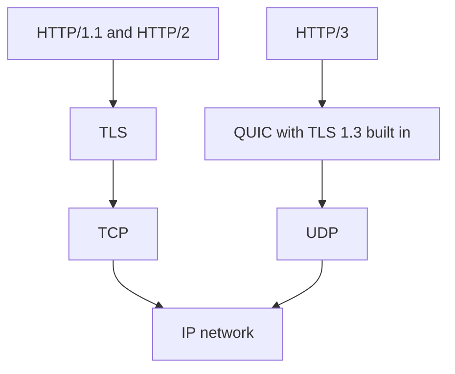

## In one line
HTTP/1.1, HTTP/2, and HTTP/3 all carry the same requests and responses; each newer version just moves them across the network more efficiently.

## The problem it solves
A product page on your shop needs the HTML, 3 stylesheets, 10 scripts, 40 product images, and a few API calls: over 50 requests to one server.

With HTTP/1.1, a connection carries one request-and-response at a time. Browsers open several connections per site (typically about 6), but 50 requests through 6 lanes still queue. On a slow phone network, each wait costs a **round trip** (a message there plus the reply back), and the page crawls.

Each new HTTP version removed one of these bottlenecks. Knowing which one, and why, is what interviewers ask about.

## Everyday analogy
A shop with checkout counters.

- **HTTP/1.1** is a counter that serves one customer at a time. To go faster, you open about six counters.
- **HTTP/2** is one counter where the cashier handles many customers' items at once, interleaved. But it's in a mall with one shared corridor (TCP): if one delivery trolley tips over in the corridor, everyone's items wait until it's cleared.
- **HTTP/3** gives each customer their own small corridor (QUIC streams), so one spill only delays that customer.

Where it breaks down: on the web, the real costs are handshakes and lost packets, not staff.

## How it works

**HTTP/1.1 (1997)**
1. **Keep-alive.** One TCP connection is reused for many requests, instead of one connection per request as in HTTP/1.0. That saves a handshake each time.
2. **One at a time per connection.** A connection carries one request, waits for its full response, then sends the next. A slow response blocks the ones behind it. This is **head-of-line blocking** at the HTTP level.
3. **Text format.** Requests and headers are plain text, and the same headers (cookies, user agent) are re-sent in full on every request.
4. **Workarounds** grew around it: several connections per site, bundling all scripts into one file, and combining icons into one image.

**HTTP/2 (2015)**
1. **Binary framing.** Each message is split into small binary **frames**, labelled with a **stream** ID. A stream is one request-and-response pair.
2. **Multiplexing.** Frames from many streams are interleaved on **one** TCP connection, so 50 requests can be in flight at the same time without waiting for each other.
3. **Header compression (HPACK).** Both sides remember headers already sent, so repeated headers like cookies cost a few bytes instead of hundreds.
4. **The remaining problem.** TCP delivers bytes strictly in order. If one packet is lost, every stream on the connection waits for it to be resent. HTTP/2 moved head-of-line blocking down into TCP.

**HTTP/3 (2022)**
1. **QUIC instead of TCP.** **QUIC** is a transport protocol built on UDP. It adds reliability and ordering itself, but per stream. A lost packet only delays the stream it belongs to.
2. **Faster setup.** QUIC builds TLS 1.3 into its own handshake, so a new connection needs one round trip instead of two (TCP, then TLS). Returning visitors can sometimes send data immediately (0-RTT).
3. **Connection migration.** A QUIC connection is identified by a connection ID, not by IP and port. When a phone switches from Wi-Fi to mobile data, the connection can continue instead of starting over.
4. **Discovery.** A browser usually first connects over HTTP/2 or HTTP/1.1. The server's `alt-svc` header says "HTTP/3 is also available here", and the browser tries it next time. (A newer DNS record type, `HTTPS`, can announce it even before the first visit.) If UDP is blocked, the browser falls back to TCP.


*Notice: HTTP/3 replaces the TCP-plus-TLS pair with QUIC on UDP. That single change is what fixes the handshake cost and the TCP-level blocking.*

The meaning never changed: methods, status codes, and headers work the same in all three, so your Express code stays the same. See [HTTP basics](#/topic/http-basics).

## Real example
**Setup:** `curl` on Ubuntu or macOS. Outputs are real but trimmed. Yours may differ.

**Ask for a specific version.** `-I` fetches headers only:

```bash
curl -sI --http1.1 https://example.com/ | head -1
# HTTP/1.1 200 OK
curl -sI https://example.com/ | head -1
# HTTP/2 200
```

Modern `curl` and browsers ask for HTTP/2 during the TLS handshake and use it when the server agrees.

**Is HTTP/3 offered?**

```bash
curl -sI https://example.com/ | grep -i alt-svc
# alt-svc: h3=":443"; ma=86400
```

This says: "HTTP/3 (`h3`) is available on UDP port 443; remember that for 86,400 seconds (one day)." In Chrome, open DevTools → Network, right-click the column headers, and enable **Protocol** to see `http/1.1`, `h2`, or `h3` per request.

**In your own stack**, your Node app speaks plain HTTP/1.1 to Nginx or a load balancer, which speaks HTTP/2 or HTTP/3 to browsers. Turning those on is a proxy or CDN setting. See [Nginx as a reverse proxy](#/topic/nginx-reverse-proxy).

## How to say it in an interview

> [!INTERVIEW]
> **30 seconds:** "HTTP/1.1 reuses connections, but each one handles one request at a time, so browsers open several connections and requests still queue. HTTP/2 multiplexes many requests over a single TCP connection with binary frames and header compression. But a lost TCP packet still stalls every stream. HTTP/3 runs on QUIC over UDP, which handles loss per stream and combines the transport and TLS handshakes into one round trip. The methods, headers, and status codes are the same in all three."

> [!INTERVIEW]
> **2 minutes:** Start with the 30-second answer, then add:
>
> "The difference shows up on bad networks. On a stable office connection, HTTP/2 and HTTP/3 perform similarly. On a phone with packet loss, HTTP/3 avoids the whole connection stalling, and switching from Wi-Fi to mobile data doesn't drop the connection.
>
> The tradeoff with HTTP/3 is that it's UDP-based, and some corporate networks block or throttle UDP, so browsers must fall back to HTTP/2. QUIC also runs in user space rather than the operating system kernel, which can cost more CPU on the server.
>
> In practice, for a video shop I'd enable HTTP/2 and HTTP/3 at the CDN or load balancer. It's a configuration change, not app code. And I'd drop old HTTP/1.1 tricks like spreading assets across many domains, which defeats HTTP/2's single shared connection."

## Follow-up questions interviewers ask

<details>
<summary>What is head-of-line blocking, and which versions suffer from it?</summary>

It's when one delayed item holds up everything queued behind it. HTTP/1.1 has it at the HTTP level: one slow response blocks the next request on that connection. HTTP/2 fixed that, but still has it at the TCP level: one lost packet stalls all streams. HTTP/3 avoids it because QUIC handles each stream separately. See [TCP vs UDP](#/topic/tcp-udp).

</details>

<details>
<summary>Does HTTP/2 require HTTPS?</summary>

The specification allows unencrypted HTTP/2, but browsers only support HTTP/2 over TLS. So on the public web, HTTP/2 effectively means HTTPS. HTTP/3 always encrypts, because TLS 1.3 is built into QUIC.

</details>

<details>
<summary>What happened to HTTP/2 server push?</summary>

Server push let a server send files, like a stylesheet, before the browser asked. In practice it often pushed files the browser already had cached, wasting bandwidth. Chrome removed support, and it is effectively dead. The `103 Early Hints` status, which tells the browser what to start fetching, is the common replacement.

</details>

<details>
<summary>Does your Node.js app need to speak HTTP/2 or HTTP/3 itself?</summary>

Usually not. In a typical setup, the CDN or Nginx speaks HTTP/2 or HTTP/3 to browsers, then forwards each request to your Node app over plain HTTP/1.1 on the local network. That last hop is short and fast, so head-of-line blocking barely matters there. With Nginx, add `proxy_http_version 1.1;` so it can keep connections to the app open instead of using HTTP/1.0, its default. See [Nginx as a reverse proxy](#/topic/nginx-reverse-proxy).

</details>

## Common mistakes and misconceptions

> [!MISTAKE]
> "HTTP/2 changed how REST APIs work." No. Methods, status codes, and headers mean the same thing. Only the way they are encoded and sent changed.

> [!MISTAKE]
> "HTTP/3 is unreliable because it uses UDP." QUIC adds its own acknowledgments, resending, and ordering on top of UDP. Delivery is as reliable as TCP, just organised per stream.

> [!MISTAKE]
> "HTTP/2 removed head-of-line blocking completely." It removed it at the HTTP level. A lost TCP packet still blocks every stream on the connection. Only HTTP/3 fixes that.

## Tradeoffs: when NOT to use it
- **Don't enable HTTP/3 without HTTP/2 or HTTP/1.1 fallback.** Networks that block UDP would get no service at all, and browsers usually discover HTTP/3 through `alt-svc` on a TCP connection first.
- **Don't add HTTP/2 between your proxy and app for no reason.** On the same machine, HTTP/1.1 is simple and fast. Multiplexing pays off over slow, lossy networks, which is the browser side.
- **Don't expect big wins on fast, stable networks.** HTTP/3's advantages show up with packet loss and mobile networks. Measure before claiming it fixed your performance.

## Check yourself

<details>
<summary>1. Why do browsers open several connections per site with HTTP/1.1 but usually only one with HTTP/2?</summary>

An HTTP/1.1 connection carries one request at a time, so parallel downloads need parallel connections. HTTP/2 multiplexes many requests on one connection, so extra connections only add handshakes.

</details>

<details>
<summary>2. One packet is lost on a connection carrying 20 image downloads. What happens with HTTP/2 vs HTTP/3?</summary>

With HTTP/2, all 20 downloads pause until TCP resends the lost packet, because TCP delivers bytes strictly in order. With HTTP/3, only the one image whose data was in that packet waits. The other 19 continue.

</details>

<details>
<summary>3. Do you need to change your Express routes to support HTTP/3?</summary>

No. The request and response meaning is identical. You enable HTTP/3 at the CDN, load balancer, or proxy in front of your app, which still talks plain HTTP/1.1 to Express.

</details>

## Go deeper
- [MDN: Evolution of HTTP](https://developer.mozilla.org/en-US/docs/Web/HTTP/Guides/Evolution_of_HTTP)
- [RFC 9114: HTTP/3](https://www.rfc-editor.org/rfc/rfc9114)
- [web.dev: Introduction to HTTP/2](https://web.dev/articles/performance-http2)
