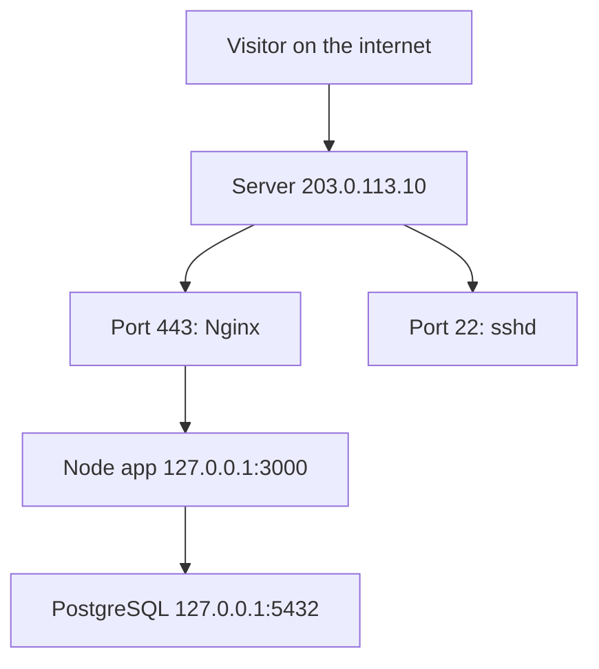

## In one line
An IP address says which computer to reach, a port says which program on that computer should get the message, and localhost means "this same computer".

## The problem it solves
Your video shop runs on one rented server. On that single machine, four programs wait for work at once: Nginx (answering web visitors), your Node.js API, PostgreSQL (the database), and `sshd` (which lets you log in remotely).

A message arriving from the internet needs two answers. **Which computer?** Out of billions online. **Which program on it?** Out of those four. The IP address answers the first question, and the port answers the second. (For how they fit into a full page load, see [What happens when you type a URL](#/topic/url-to-page).)

Some programs, like your database, should only be reachable from the same machine. That is what localhost is for. Get this wrong and you see "connection refused", "address already in use", or a database exposed to the internet.

## Everyday analogy
An apartment building. The **IP address** is the building's street address. The **port** is the apartment number. A letter needs both. **Localhost** is a note passed between neighbours inside the building: it never goes out to the street.

Where it breaks down: a building's address is fixed, but a computer's IP address can change, and one computer can have several at once (say, one for Wi-Fi and one for a cable).

## How it works

**IP addresses**

1. An **IP address** (Internet Protocol address) identifies one **network interface** of a computer: one connection point to a network, like a Wi-Fi card.
2. **IPv4** addresses are four numbers from 0 to 255, like `203.0.113.10`. That allows about 4.3 billion addresses, which the world has run out of.
3. **IPv6** addresses are longer and written in hexadecimal, like `2001:db8::1`. There are enough for practically every device. Most systems run both.
4. **Private IP addresses** are reserved for local networks and never routed on the public internet: `10.x.x.x`, `172.16.x.x` to `172.31.x.x`, and `192.168.x.x`. Your laptop at home probably has one, like `192.168.1.23`.
5. Your home router has one **public IP address** and shares it with all your devices using **NAT** (Network Address Translation): it rewrites outgoing messages to come from its public address, and remembers where each reply belongs.

**Ports**

6. A **port** is a number from 0 to 65535 that picks the program. A program **listens** on a port: it asks the operating system to "send me anything that arrives on port 5432". Only one program can listen on a given IP and port. A second one fails with `EADDRINUSE`.
7. Common services have default ports: 22 for SSH, 80 for HTTP, 443 for HTTPS, 5432 for PostgreSQL, 6379 for Redis. On Linux, ports below 1024 need administrator rights by default, one reason Node apps listen on a high port like 3000 behind Nginx.
8. The client uses a port too. When your browser connects, the operating system picks a temporary **ephemeral port**, like 52814, for replies. A connection is identified by four values: client IP, client port, server IP, server port. That is how one server on port 443 talks to thousands of browsers at once without mixing them up.

**localhost and bind addresses**

9. **Localhost** is a name for the **loopback** address: `127.0.0.1` in IPv4, `::1` in IPv6. Loopback traffic never leaves the computer.
10. A listening program also chooses which of the machine's addresses to listen on, called its **bind address**. `127.0.0.1` means only programs on this machine can connect. `0.0.0.0` means every interface, so other machines can connect too (if the firewall allows).


*Notice: the internet can only reach ports 443 and 22. The app and database listen on localhost, so only programs on the server itself can talk to them.*

## Real example
**Setup:** Node.js 18 or later, `"type": "module"` in `package.json`, and `npm install express`.

A tiny API whose bind address comes from an environment variable (a setting passed in from outside), `server.js`:

```js
import express from 'express';

const app = express();
app.get('/health', (req, res) => res.json({ ok: true }));

const PORT = Number(process.env.PORT) || 3000;
// 127.0.0.1: only programs on this machine can connect.
// 0.0.0.0: any network interface, so other machines can connect too.
const HOST = process.env.HOST || '127.0.0.1';

app.listen(PORT, HOST, () => {
  console.log(`Listening on http://${HOST}:${PORT}`);
});
```

Try it. `192.168.1.23` stands for your laptop's own address on your Wi-Fi:

```bash
node server.js                          # Listening on http://127.0.0.1:3000
curl http://localhost:3000/health       # {"ok":true}
curl http://192.168.1.23:3000/health    # curl: (7) Failed to connect ... refused
node server.js                          # in a 2nd terminal: Error: listen EADDRINUSE
```

The Wi-Fi request is refused because the app only listens on loopback. Restart with `HOST=0.0.0.0 node server.js` and it works.

**On an Ubuntu server**, see who listens where with `ss`. `-t` means TCP, `-l` listening only, `-n` numbers instead of names, `-p` the program (needs `sudo`):

```bash
sudo ss -tlnp
```

```text
State  Recv-Q Send-Q Local Address:Port Peer Address:Port Process
LISTEN 0      511          0.0.0.0:443       0.0.0.0:*    users:(("nginx",pid=812,fd=6))
LISTEN 0      128          0.0.0.0:22        0.0.0.0:*    users:(("sshd",pid=640,fd=3))
LISTEN 0      511        127.0.0.1:3000      0.0.0.0:*    users:(("node",pid=1290,fd=21))
LISTEN 0      200        127.0.0.1:5432      0.0.0.0:*    users:(("postgres",pid=702,fd=7))
```

Example output; your programs, PIDs, and numbers will differ. The "Local Address:Port" column matches the diagram: Nginx and SSH accept connections from anywhere, Node and PostgreSQL only from the server itself. See [Processes, ports, and services](#/topic/processes-ports-services).

## How to say it in an interview

> [!INTERVIEW]
> **30 seconds:** "An IP address identifies a machine on a network, and a port identifies which program on that machine gets the traffic. So `203.0.113.10:443` means Nginx on that server. Localhost, `127.0.0.1`, is the loopback address: traffic never leaves the machine. When a server listens, it picks a bind address. `127.0.0.1` means local only, `0.0.0.0` means reachable from other machines. I keep databases on localhost or a private network and only expose the ports the public needs."

> [!INTERVIEW]
> **2 minutes:** Start with the 30-second answer, then add:
>
> "On a typical server, Nginx listens on 80 and 443, my Node app on 127.0.0.1:3000, and Postgres on 127.0.0.1:5432. Only Nginx and SSH face the internet, and a firewall blocks everything else as a second layer.
>
> The tradeoff shows up with Docker. Inside a container, localhost means the container itself, so the app must listen on 0.0.0.0 or Docker's port mapping can't reach it. Then I control exposure with the port mapping and the firewall instead."

## Follow-up questions interviewers ask

<details>
<summary>What is the difference between 127.0.0.1 and 0.0.0.0?</summary>

`127.0.0.1` is the loopback address. A server bound to it only accepts connections from the same machine. As a bind address, `0.0.0.0` means "listen on every interface", so other machines can connect too. You connect **to** `127.0.0.1`. You listen **on** `0.0.0.0`.

</details>

<details>
<summary>Your Node app works on your laptop but not inside Docker. Why?</summary>

The app probably listens on `127.0.0.1` inside the container. Each container has its own network and its own loopback. Docker forwards published ports to the container's network interface, not its loopback, so the connection is refused. Listen on `0.0.0.0` inside the container. See [Docker networking](#/topic/docker-networking).

</details>

<details>
<summary>What does "EADDRINUSE" mean and how do you fix it?</summary>

Another process already listens on that IP and port, often an old copy of your own app. On Ubuntu, find it with `sudo ss -tlnp | grep :3000`, then stop it or pick a different port.

</details>

<details>
<summary>What does 10.0.0.0/16 mean in a cloud network setting?</summary>

It is **CIDR notation**, a way to write a range of addresses. The `/16` says the first 16 bits (the first two numbers, `10.0`) are fixed, and the rest can vary. So it covers `10.0.0.0` to `10.0.255.255`, 65,536 addresses. A `/24` like `192.168.1.0/24` fixes three numbers and covers 256 addresses. You'll see this in cloud networks and firewall rules.

</details>

## Common mistakes and misconceptions

> [!MISTAKE]
> Binding the database to `0.0.0.0` "to make it work", then forgetting the firewall. The database is now reachable from the internet, and bots scan for open database ports constantly. Keep it on `127.0.0.1` or a private network.

> [!MISTAKE]
> "localhost in my container means my laptop." Inside a container, localhost is the container itself. To reach another container, use its service name on a shared Docker network.

> [!MISTAKE]
> "One port can only serve one connection." Only one program can **listen** on it, but it can serve thousands of connections at once, each told apart by the client's IP and port.

## Tradeoffs: when NOT to use it
- **Binding to `127.0.0.1` when other machines must connect**, such as a load balancer on another machine, or inside a container. Bind more widely and restrict with a firewall.
- **Binding to `0.0.0.0` as a habit.** On a server with a public IP, "everywhere" plus a missing firewall rule means "public". Bind as narrowly as the job allows.
- **Non-default ports as security.** Moving SSH to 2222 cuts log noise, but scanners still find it. Real protection is keys and firewalls. See [Firewalls and open ports](#/topic/firewalls).

## Check yourself

<details>
<summary>1. A server runs Nginx on port 443 and PostgreSQL on 127.0.0.1:5432. Can a laptop on the internet connect to the database?</summary>

No. PostgreSQL only listens on loopback, so only programs on the server can connect.

</details>

<details>
<summary>2. What two pieces of information does a message need to reach the right program?</summary>

An IP address, which picks the computer, and a port, which picks the program on it.

</details>

<details>
<summary>3. You start your app and get "listen EADDRINUSE: address already in use :::3000". What happened?</summary>

Another process already listens on port 3000, often a previous run of the same app. Find it with `sudo ss -tlnp | grep :3000`, then stop it or use another port.

</details>

## Go deeper
- [MDN: IP address (glossary)](https://developer.mozilla.org/en-US/docs/Glossary/IP_Address)
- [Node.js docs: server.listen()](https://nodejs.org/api/net.html#serverlisten)
