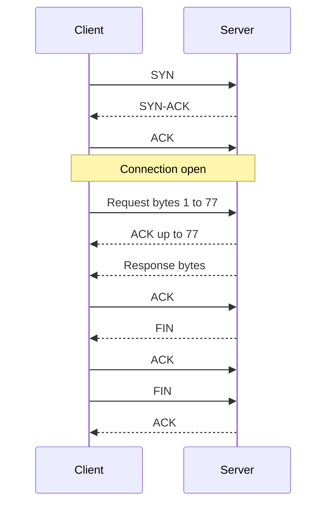

## In one line
TCP delivers data reliably and in order by setting up a connection and confirming everything, while UDP just fires off independent messages with no setup and no guarantees.

## The problem it solves
The internet does not carry your data in one piece. It splits it into **packets**: small chunks, typically up to about 1,500 bytes each, that travel separately. Along the way, packets can be lost, arrive twice, or arrive out of order. The network makes no promises.

For most apps that's a problem: an order JSON with a missing chunk in the middle is garbage. But for some apps, waiting is worse than losing data. In a live video call, a packet that arrives half a second late is useless, and stopping to resend it would make the call freeze.

So there are two **protocols** (agreed sets of rules) on top of IP, for these two needs:

- **TCP** (Transmission Control Protocol) for "every byte, in order, no matter what".
- **UDP** (User Datagram Protocol) for "send it now, and don't wait for anything".

## Everyday analogy
TCP is a phone call. You dial, the other person answers, you both confirm you can hear each other, and then you talk. If something is garbled, they say "sorry, say that again". When you finish, you both say goodbye.

UDP is throwing postcards in a postbox. No setup, no confirmation. Most arrive, some may arrive in a different order, and a few may get lost. Nobody tells you.

Where it breaks down: with UDP, the app itself can choose to resend a lost "postcard" if it cares. And TCP never asks you to repeat yourself: it quietly resends lost data on its own.

## How it works

**TCP, from hello to goodbye**

1. **The three-way handshake opens a connection.** The client sends **SYN** ("let's talk, I'll number my bytes from X"). The server replies **SYN-ACK** ("OK, I got X, and I'll number mine from Y"). The client sends **ACK** ("got Y"). That's one **round trip** (a message there plus the reply back) before any data can flow.
2. **Every byte gets a sequence number.** The receiver uses these numbers to put chunks back in order and to spot gaps.
3. **The receiver acknowledges what it got.** An ACK says "I have everything up to byte N".
4. **Lost data is resent.** If the sender gets no ACK in time, or sees the receiver repeatedly asking for the same byte, it **retransmits** (sends that data again).
5. **TCP controls the speed.** **Flow control** stops a fast sender from overwhelming a slow receiver: the receiver says how much room it has left. **Congestion control** slows the sender down when packets get lost, because loss usually means the network is overloaded.
6. **Closing takes a goodbye from each side.** One side sends **FIN** ("I'm done sending"), the other ACKs it, then sends its own FIN, which gets ACKed. Each direction closes separately.

If nothing listens on the port, the server's operating system replies to the SYN with **RST** (reset). That is what "connection refused" means.


*Notice: three messages pass before any data moves, and every piece of data is confirmed.*

**UDP, by comparison**

1. There is no handshake. The first packet already carries data.
2. Each message, called a **datagram**, stands alone. There is no sequence number, no ACK, no resending, and no ordering.
3. The UDP header is just 8 bytes: source port, destination port, length, and a checksum to detect corrupted data. TCP's header is at least 20 bytes.
4. If the app needs any reliability, the app builds it itself. That's what QUIC, the protocol under HTTP/3, does: it builds its own ordering and resending on top of UDP. See [HTTP/1.1 vs HTTP/2 vs HTTP/3](#/topic/http-versions).

**Who uses which**

| TCP | UDP |
|---|---|
| HTTP/1.1 and HTTP/2 (web pages, APIs) | DNS lookups (small question, small answer) |
| SSH, database connections (PostgreSQL, Redis) | Video and voice calls (WebRTC) |
| Email, file transfer | Online games, QUIC and HTTP/3 |

## Real example
**Watching a real TCP connection.** On an Ubuntu machine with an HTTP server on port 3000, capture the packets with `tcpdump` (a packet-capture tool; `sudo apt install tcpdump`). `-i lo` listens on the loopback interface and `-n` shows numbers instead of names:

```bash
sudo tcpdump -i lo -n 'tcp port 3000'     # terminal 1: watch
curl http://127.0.0.1:3000/               # terminal 2: make one request
```

Real output, trimmed (timestamps and options removed):

```text
58536 > 3000: Flags [S],  seq 111336365                   <- SYN
3000 > 58536: Flags [S.], seq 2703563343, ack 111336366   <- SYN-ACK
58536 > 3000: Flags [.],  ack 1                           <- ACK: connected
58536 > 3000: Flags [P.], seq 1:78, length 77             <- the HTTP request
3000 > 58536: Flags [.],  ack 78                          <- "got bytes up to 78"
3000 > 58536: Flags [P.], seq 1:156, length 155           <- response headers
3000 > 58536: Flags [P.], seq 156:996, length 840         <- response body
3000 > 58536: Flags [F.], seq 996                         <- server: FIN
58536 > 3000: Flags [F.], seq 78, ack 997                 <- client: ACK + its FIN
3000 > 58536: Flags [.],  ack 79                          <- final ACK
```

`S` is SYN, `.` is ACK, `P` means "push this data to the app", and `F` is FIN. After the handshake, sequence numbers are relative, so `seq 1:78` means bytes 1 to 77. The client combined its ACK and FIN into one packet, so this goodbye took three packets instead of four.

**UDP in Node.js.** A live-stream player reports "still watching" every few seconds. A lost report doesn't matter, so UDP fits. **Setup:** Node.js 18 or later, `"type": "module"` in `package.json`. No packages needed.

`udp-receiver.js`:

```js
import dgram from 'node:dgram';

const socket = dgram.createSocket('udp4');
// No connection, no handshake: each message arrives (or not) on its own.
socket.on('message', (msg, from) => {
  console.log(`got "${msg}" from ${from.address}:${from.port}`);
});
socket.bind(41234, '127.0.0.1');
```

`udp-sender.js`:

```js
import dgram from 'node:dgram';

const socket = dgram.createSocket('udp4');
const message = 'viewer 981 is watching stream 7';

// send() reports only local errors. It cannot tell if anyone received it.
socket.send(message, 41234, '127.0.0.1', (err) => {
  console.log(err ? `send failed: ${err.message}` : 'sent (no idea if it arrived)');
  socket.close();
});
```

Run `node udp-sender.js` **without** the receiver running. It still prints "sent". There was no handshake, so the sender never learns that nobody was listening. With TCP, the same attempt fails at once with "connection refused".

## How to say it in an interview

> [!INTERVIEW]
> **30 seconds:** "TCP is connection-based and reliable. It does a three-way handshake, SYN, SYN-ACK, ACK, numbers every byte, acknowledges what arrives, resends what's lost, and delivers everything in order. UDP has no connection. It sends independent datagrams with no delivery or ordering guarantees, so it's lighter and lower latency. I use TCP for anything that must be complete and correct, like HTTP APIs and databases, and UDP where fresh data beats complete data, like voice, video calls, games, or DNS lookups."

> [!INTERVIEW]
> **2 minutes:** Start with the 30-second answer, then add:
>
> "TCP's reliability costs latency. The handshake takes a round trip before any data, and since delivery is strictly in order, one lost packet holds back everything behind it. That's head-of-line blocking.
>
> For a video call, that's the wrong tradeoff. A late frame is useless, so WebRTC uses UDP and simply skips it. For an e-commerce checkout, it's the right tradeoff: I need every byte of the order.
>
> A modern example is HTTP/3. It runs on QUIC, which is built on UDP but adds its own reliability per stream, so one lost packet only delays its own stream."

## Follow-up questions interviewers ask

<details>
<summary>Why is the handshake three steps and not two?</summary>

Each side picks a starting sequence number and needs confirmation that the other side got it. SYN carries the client's number. SYN-ACK confirms it and carries the server's number. The final ACK confirms the server's. With only two steps, the server would never know its number arrived, and old, delayed SYNs could open stray connections.

</details>

<details>
<summary>What is head-of-line blocking?</summary>

If packet 5 is lost, packets 6 to 20 may already be on the receiver, but TCP can't hand them to the app until packet 5 is resent and arrives. Everything waits behind one lost packet. HTTP/2 suffers from this because all its requests share one TCP connection. HTTP/3 avoids it with QUIC.

</details>

<details>
<summary>What is TIME_WAIT?</summary>

After a connection closes, the side that closed first remembers it for a while (on Linux, 60 seconds), so delayed packets from the old connection aren't mistaken for a new one on the same ports. A server opening many short connections, for example to a database without a connection pool, can pile up thousands of these. One more reason to reuse connections.

</details>

<details>
<summary>Is UDP faster than TCP?</summary>

It has lower **latency** (delay before data arrives) at the start, because there's no handshake, and it never stalls waiting for a resend. But on a good network, TCP moves bulk data at full speed too. UDP's real benefit is control: the app decides what to do about loss.

</details>

## Common mistakes and misconceptions

> [!MISTAKE]
> "UDP is unreliable, so it's bad." It's a choice, not a flaw. UDP leaves reliability to the app, which is exactly what real-time apps want, and what QUIC builds on.

> [!MISTAKE]
> "TCP guarantees the data gets there." TCP guarantees that what the app receives is complete and in order, or that it gets an error. If the network is down, TCP retries for a while, then gives up. Your app still needs timeouts and retries.

> [!MISTAKE]
> "Video streaming always uses UDP." Video calls usually do. But most video on demand and many live streams (HLS, DASH) are plain HTTP file downloads over TCP, or over QUIC with HTTP/3. A few seconds of buffering hides any resends.

> [!MISTAKE]
> "One TCP message equals one `data` event." TCP is a byte **stream**, not a sequence of messages. Two writes may arrive as one chunk, or one write as two chunks. Protocols on top, like HTTP, mark where each message ends.

## Tradeoffs: when NOT to use it
**When NOT to use TCP:**
- Real-time audio, video, and games, where a late packet is worthless.
- Tiny one-shot queries like DNS, where a handshake doubles the cost.

**When NOT to use UDP:**
- Anything that must be complete and correct: API calls, payments, database traffic, uploads. You'd end up rebuilding TCP badly.
- Networks that block it. Some corporate firewalls block most UDP, which is why browsers can fall back from HTTP/3 to HTTP/2.

## Check yourself

<details>
<summary>1. Name the three packets of the TCP handshake, in order.</summary>

SYN from the client, SYN-ACK from the server, ACK from the client. Only then can data flow.

</details>

<details>
<summary>2. A UDP sender sends a message, but no program is listening. What does the sender see?</summary>

Usually nothing. The send succeeds locally, and UDP has no acknowledgment, so the sender never learns the message was lost. With TCP, the connection attempt would fail with "connection refused".

</details>

<details>
<summary>3. You're designing a voice chat feature. TCP or UDP, and why?</summary>

UDP (usually through WebRTC). Audio that arrives late is useless, and TCP would pause playback while resending lost packets. It's better to skip a few milliseconds of sound than to freeze.

</details>

## Go deeper
- [MDN: TCP handshake (glossary)](https://developer.mozilla.org/en-US/docs/Glossary/TCP_handshake)
- [RFC 9293: Transmission Control Protocol](https://www.rfc-editor.org/rfc/rfc9293)
- [Node.js docs: UDP/datagram sockets](https://nodejs.org/api/dgram.html)
