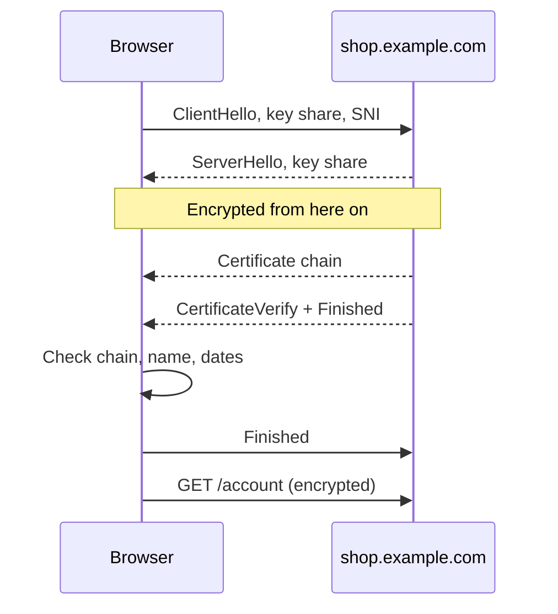

## In one line
HTTPS is HTTP sent inside a TLS connection, which encrypts the traffic and proves, with a certificate, that you are talking to the real owner of the domain.

## The problem it solves
A customer logs in to `shop.example.com` on café Wi-Fi. With plain HTTP, the password, the session cookie, and the card details all travel as readable text. Anyone on the same network, the café's router, or any network along the way could:

1. **Read it**, and steal the password or session cookie.
2. **Change it**, injecting a malicious script or swapping a bank account number.
3. **Pretend to be you**, answering instead of your server with a fake login page.

An attacker sitting between the user and the server like this is called a **man-in-the-middle**. **TLS** (Transport Layer Security) blocks all three. **HTTPS** is simply HTTP running inside a TLS connection. You'll still hear TLS called "SSL", the name of its older, now-insecure predecessor.

## Everyday analogy
Sending valuables by courier. Before handing anything over, you check the courier's ID card, which was issued by a government office you trust (the **certificate**, signed by a **certificate authority**). Then you both lock the package in a box that only the two of you can open (the **encryption**), with a tamper seal that shows if anyone opened it on the way (**integrity**).

Where it breaks down: an ID card only proves the courier's name, not that they're honest. Likewise, a certificate proves you reached the real owner of the domain in the address bar, not that the owner is honest. A look-alike phishing domain can get a valid certificate too.

## How it works
A few terms first:

- **Symmetric encryption** uses one shared secret key to lock and unlock. It is fast, so it protects all the actual data.
- **Asymmetric encryption** uses a **key pair**: a **public key** anyone may have and a **private key** only the owner holds. What the private key signs, the public key can verify. It is slower, so TLS uses it only during setup.
- A **certificate** is a file that says "this public key belongs to `shop.example.com`", digitally signed by a **certificate authority** (CA), an organisation browsers trust to check domain ownership.

**The TLS 1.3 handshake** happens right after the TCP connection opens (see [TCP vs UDP](#/topic/tcp-udp), and step 5 of [What happens when you type a URL](#/topic/url-to-page)):

1. **ClientHello.** The browser sends the encryption methods it supports, the site name it wants (**SNI**, Server Name Indication, so one server can host many sites), and a **key share**: its half of a key exchange.
2. **ServerHello.** The server picks the encryption method and sends its own key share. Each side now combines its own secret with the other's key share and gets the **same** session key. The key itself never crosses the network. From here on, everything is encrypted.
3. **Certificate.** The server sends its certificate, plus the **intermediate** certificates that link it to a trusted root.
4. **CertificateVerify.** The server signs the handshake so far with its private key. This proves it actually owns the certificate's key, not just a copy of the public certificate.
5. **Finished.** Both sides send a check value over the whole handshake, proving nobody tampered with it.
6. **The HTTP request** goes out, encrypted. The whole setup took one **round trip**.

**How the browser checks the certificate:**

1. **Chain of trust.** The site's certificate (the **leaf**) is signed by an intermediate CA, which is signed by a **root CA**. The browser follows the signatures up until it reaches a root in its built-in **trust store**, a list of root CAs shipped with the operating system or browser.
2. **Hostname.** The certificate's list of names (Subject Alternative Names) must include the exact host you typed, such as `shop.example.com` or `*.example.com`.
3. **Dates.** Today must fall between its "not before" and "not after" dates.
4. **Not revoked.** It should not have been cancelled by the CA, for example after a key leak.

If any check fails, the browser shows "Your connection is not private" and stops.


*Notice: the encryption key is agreed before the certificate is even sent, and the server proves it holds the private key by signing the handshake.*

## Real example
**Setup:** `openssl` and `curl`, both preinstalled on Ubuntu and macOS. Outputs are real but trimmed. Yours will differ.

**See the certificate chain a site sends.** `s_client` is OpenSSL's TLS test client:

```bash
openssl s_client -connect example.com:443 -servername example.com </dev/null
```

```text
Certificate chain
 0 s:CN=example.com
   i:C=US, O=SSL Corporation, CN=Cloudflare TLS Issuing ECC CA 3
   v:NotBefore: Sep 26 22:49:11 2026 GMT; NotAfter: Dec 25 22:56:35 2026 GMT
 1 s:C=US, O=SSL Corporation, CN=Cloudflare TLS Issuing ECC CA 3
   i:C=US, O=SSL Corporation, CN=SSL.com TLS Transit ECC CA R2
...
New, TLSv1.3, Cipher is TLS_AES_256_GCM_SHA384
Verify return code: 0 (ok)
```

`s:` is the subject (who the certificate is for), and `i:` is the issuer (who signed it). Certificate 0's issuer is certificate 1's subject: that's the chain. `Verify return code: 0 (ok)` means every check passed. Notice the certificate lasts only about 90 days, which is why renewal must be automatic.

**Check the names and expiry date of your own server's certificate:**

```bash
echo | openssl s_client -connect shop.example.com:443 -servername shop.example.com 2>/dev/null \
  | openssl x509 -noout -subject -enddate -ext subjectAltName
```

**What failures look like.** `badssl.com` hosts deliberately broken test sites:

```bash
curl https://expired.badssl.com/
# curl: (60) SSL certificate problem: certificate has expired
curl https://wrong.host.badssl.com/
# curl: (60) SSL: no alternative certificate subject name matches target host name
```

In a typical setup, Node.js doesn't handle TLS at all. Nginx holds the certificate (often free from Let's Encrypt), **terminates** TLS (decrypts the traffic), and forwards plain HTTP to your app on `127.0.0.1:3000`. See [Domains and SSL on a server](#/topic/domains-ssl).

## How to say it in an interview

> [!INTERVIEW]
> **30 seconds:** "HTTPS is HTTP over TLS. TLS gives three things: encryption so nobody can read the traffic, integrity so nobody can change it, and authentication so you know you reached the real server. In the TLS 1.3 handshake, the client and server exchange key shares to agree on a session key without sending it, and the server sends its certificate and signs the handshake with its private key. The browser checks that the certificate chains up to a trusted CA, matches the hostname, and hasn't expired."

> [!INTERVIEW]
> **2 minutes:** Start with the 30-second answer, then add:
>
> "Asymmetric crypto is only used in the handshake, for the key exchange and the signature. The actual data uses fast symmetric encryption with the session key. A full TLS 1.3 handshake uses fresh, temporary keys for the key exchange, so even if the server's private key leaks later, recorded old traffic can't be decrypted. That's called forward secrecy.
>
> In practice, I terminate TLS at Nginx or a load balancer with a Let's Encrypt certificate that renews automatically, and forward plain HTTP to the app over localhost or a private network. The tradeoff is that traffic behind the proxy is unencrypted, which is fine on the same machine but not across an untrusted network. There I'd use TLS internally too.
>
> One limit to be honest about: the padlock proves identity and privacy, not trustworthiness. A phishing site can have a perfectly valid certificate."

## Follow-up questions interviewers ask

<details>
<summary>Why not use asymmetric encryption for all the data?</summary>

It's much slower than symmetric encryption, and it only works on small amounts of data at a time. So TLS uses asymmetric crypto briefly, to agree on a key and prove identity, then switches to symmetric encryption (like AES) for everything else.

</details>

<details>
<summary>What does a certificate authority actually verify?</summary>

For the most common certificates (Domain Validated), only that the requester controls the domain. For example, Let's Encrypt asks you to serve a specific file at a URL on that domain, or to add a DNS TXT record. It doesn't check that the business is real or honest.

</details>

<details>
<summary>What happens if a site's certificate expires?</summary>

Browsers show a full-page warning, and most users leave. API clients, including `fetch` in Node and `curl`, refuse to connect. Expired certificates are a classic cause of outages, which is why renewal should be automated and monitored. Certbot with a renewal timer, or a managed load balancer, handles this.

</details>

<details>
<summary>What changed in TLS 1.3 compared with TLS 1.2?</summary>

The handshake dropped from two round trips to one. Old, weak algorithms were removed, including the static RSA key exchange, so a full handshake always uses temporary keys that give forward secrecy. More of the handshake is encrypted too, including the certificate. TLS 1.3 also supports "0-RTT" resumption for returning visitors, with the caveat that 0-RTT data can be replayed, so it must only carry safe requests.

</details>

## Common mistakes and misconceptions

> [!MISTAKE]
> "HTTPS means the site is safe." It means the connection is private and you reached whoever owns that domain. Phishing and scam sites routinely have valid certificates.

> [!MISTAKE]
> "HTTPS hides which site I visit." The domain usually stays visible through DNS lookups and the SNI field, unless encrypted DNS and Encrypted Client Hello are both in use. The path, headers, cookies, and body are encrypted.

> [!MISTAKE]
> Turning off certificate checks to "fix" an error, such as `NODE_TLS_REJECT_UNAUTHORIZED=0` or `curl -k`. This silently allows any man-in-the-middle. Fix the cause instead: a missing intermediate certificate, the wrong hostname, or an expired certificate.

> [!MISTAKE]
> Serving only the leaf certificate without the intermediates. Some browsers fill the gap themselves, so it "works on my machine", while other clients, often API clients and older phones, fail. Serve the full chain file (`fullchain.pem` with Certbot).

## Tradeoffs: when NOT to use it
For anything public, there is no real case for plain HTTP today. The honest costs and limits are:

- **Handshake cost.** A new connection pays an extra round trip (about 100 ms for a user far away). Connection reuse, HTTP/2, and HTTP/3 reduce this.
- **Operational work.** Certificates expire, so renewal must be automated and monitored, or your site goes down on a known date.
- **Encrypting every internal hop.** Plain HTTP over localhost behind Nginx is fine and common. Full internal TLS (or mutual TLS, where both sides show certificates) adds certificate management, and is worth it mainly when traffic crosses networks you don't control.
- **It protects data in transit only.** TLS does nothing for data at rest in your database or logs. That needs separate protection.

## Check yourself

<details>
<summary>1. Name the three things TLS gives you.</summary>

Encryption (nobody can read the traffic), integrity (nobody can change it unnoticed), and authentication (you're talking to the real owner of the domain).

</details>

<details>
<summary>2. A certificate is valid and trusted, but it was issued for api.example.com. What happens when a browser visits shop.example.com with it?</summary>

The hostname check fails, because `shop.example.com` isn't in the certificate's list of names. The browser shows a privacy warning and refuses to load the page.

</details>

<details>
<summary>3. How does the server prove it owns the certificate, rather than having just copied it?</summary>

In the CertificateVerify step it signs the handshake data with its private key. Anyone can copy a public certificate, but only the holder of the matching private key can produce a valid signature over this unique handshake.

</details>

## Go deeper
- [MDN: Transport Layer Security](https://developer.mozilla.org/en-US/docs/Web/Security/Defenses/Transport_Layer_Security)
- [RFC 8446: TLS 1.3](https://www.rfc-editor.org/rfc/rfc8446)
- [Let's Encrypt: How it works](https://letsencrypt.org/how-it-works/)
