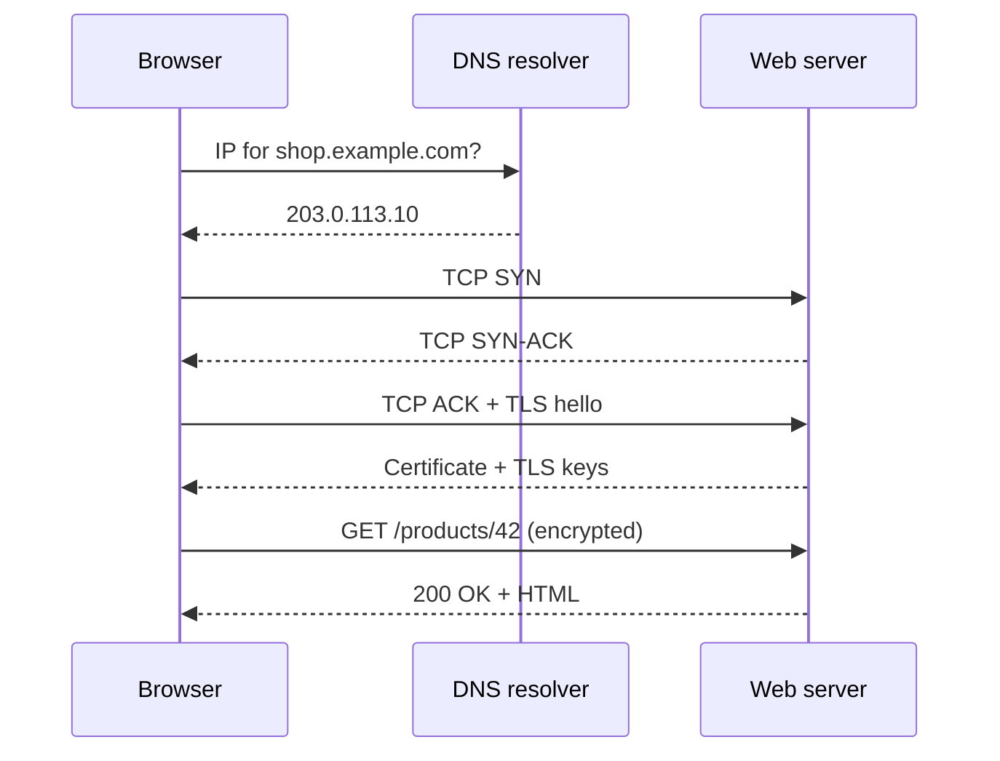

## In one line
When you press Enter, your browser finds the server's address, opens a secure connection to it, asks for the page, and draws the reply on your screen.

## The problem it solves
This topic is a map, not one single technology. It answers the most common opening question in web interviews: "What happens when you type a URL and press Enter?"

A few words first, in plain terms:

- A **URL** (Uniform Resource Locator) is a web address, like `https://shop.example.com/products/42`.
- A **server** is a computer that waits for requests and sends back responses. Your browser is the **client**: the side that asks.
- A **protocol** is an agreed set of rules for how two programs talk, like the unwritten rules of a phone call: say hello, take turns, say goodbye.

Interviewers love this question because every step is a place where real apps break. Imagine users of your shop, `shop.example.com`, report four different problems:

- "This site can't be reached." The browser could not find the server, or could not connect to it.
- "Your connection is not private." It connected, but the security check failed.
- "502 Bad Gateway." Your server was reached, but the app behind it did not answer properly.
- The page loads, but takes six seconds.

Each symptom points to a different step below. Know the journey, and you know where to look.

## Everyday analogy
Ordering food at a restaurant you have never visited:

1. You look up its address. (DNS)
2. You go there and knock, to check someone answers. (TCP)
3. You check the licence on the wall, and agree a private code with the waiter so nobody can eavesdrop. (TLS)
4. You place your order. (HTTP request)
5. The kitchen cooks, and the waiter brings the dish. (HTTP response)
6. You arrange it on your plate and eat. (The browser renders the page.)

Where it breaks down: on the internet these steps take milliseconds, and the "restaurant" is often many buildings at once (a CDN, a load balancer, several servers).

## How it works
Let's follow `https://shop.example.com/products/42`.

1. **The browser reads the URL.** `https` is the scheme: use encryption. `shop.example.com` is the host: which server. `/products/42` is the path: which page. HTTPS uses **port** 443 by default. A port is a number that says which program on a computer should receive the traffic, like an apartment number in a building.
2. **It checks its caches.** A **cache** is a saved copy kept nearby so work is not repeated. If the browser already has a fresh copy of the page, or remembers the server's address, it skips ahead.
3. **DNS turns the name into an address.** Computers find each other by **IP address**, a number like `203.0.113.10`. **DNS** (Domain Name System) is the internet's phone book. The browser asks a **DNS resolver**, usually run by your internet provider or a public service like 1.1.1.1: "What is the IP address of shop.example.com?" The resolver finds the answer, remembers it for a while (its **TTL**, time to live), and replies. More in [DNS](#/topic/dns).
4. **TCP opens a connection.** The browser connects to that IP on port 443 using **TCP** (Transmission Control Protocol), which delivers data reliably and in order. Opening it takes a three-message **handshake**: SYN ("can we talk?"), SYN-ACK ("yes, can you hear me?"), ACK ("yes"). That costs one **round trip**: a message travelling to the server plus the reply coming back. More in [TCP vs UDP](#/topic/tcp-udp).
5. **TLS proves identity and sets up encryption.** **TLS** (Transport Layer Security) is the encryption layer that puts the "S" in HTTPS. The server sends its **certificate**, a file proving it owns `shop.example.com`, signed by a trusted organisation called a **certificate authority**. The browser checks it, and both sides agree on keys to encrypt everything after this point. With TLS 1.3 this usually adds one more round trip. More in [HTTPS and TLS](#/topic/tls-https).
6. **HTTP asks for the page.** **HTTP** is the request-and-response language of the web. The browser sends `GET /products/42` plus **headers**: extra lines of information such as `Host: shop.example.com`, the site's cookies, and which formats the browser accepts. More in [HTTP basics](#/topic/http-basics).
7. **The server side does its work.** The request often reaches a **reverse proxy** or **load balancer** first, for example Nginx. A reverse proxy receives requests from the internet and passes them to the app servers behind it. A load balancer does the same while spreading requests across several servers. Your Node.js app then runs: it might read a cached copy from Redis (a fast in-memory store), query PostgreSQL (the database), and build the response.
8. **HTTP sends the answer back.** The response has a **status code** (`200` OK, `404` not found, `500` server error), headers like `Content-Type: text/html`, and a body: the HTML itself.
9. **The browser renders the page.** It reads the HTML and discovers the CSS (styles), JavaScript (code), and images it needs. It requests those too, usually over the same open connection. Then it works out the layout and paints pixels. More in [How the browser renders a page](#/topic/critical-rendering-path).


*Notice: before the page is even requested, the browser has spent a DNS lookup and two round trips to the server.*

The first visit pays for steps 3 to 5. Later requests to the same site reuse the open connection and the remembered DNS answer, so they jump straight to step 6. That is a big reason why the second page you open on a site feels faster.

## Real example
You can watch every step from a terminal with `curl`, a command-line tool that sends HTTP requests. These commands work on Ubuntu and macOS. On Ubuntu, install `dig` first with `sudo apt install dnsutils`.

**Step 3, DNS only:**

```bash
dig +short example.com
```

```text
104.20.23.154
172.66.147.243
```

Big sites often return several addresses, so traffic can be spread across them and one failure does not take the site down.

**Steps 3 to 8 in one go.** `-v` (verbose) prints each step, `-4` forces an IPv4 address (the classic dotted-number format, like `172.66.147.243`), and `-o /dev/null` throws away the HTML so you only see the conversation:

```bash
curl -4 -v -o /dev/null https://example.com/
```

```text
* IPv4: 172.66.147.243, 104.20.23.154
*   Trying 172.66.147.243:443...
* Connected to example.com (172.66.147.243) port 443
* SSL connection using TLSv1.3 / AEAD-CHACHA20-POLY1305-SHA256
* Server certificate:
*  subject: CN=example.com
*  issuer: C=US; O=SSL Corporation; CN=Cloudflare TLS Issuing ECC CA 3
*  SSL certificate verify ok.
> GET / HTTP/2
> Host: example.com
> User-Agent: curl/8.7.1
> Accept: */*
< HTTP/2 200
< content-type: text/html; charset=utf-8
```

This output is trimmed, and your addresses, versions, and certificate details will differ. Read it like this:

- `*` lines are curl's notes: the DNS answer (step 3), the TCP connection to port 443 (step 4), and the TLS handshake and certificate check (step 5).
- `>` lines are what curl **sent**: the HTTP request and its headers (step 6).
- `<` lines are what came **back**: the status code and headers (step 8).

**Where does the time go?** `-w` prints timings after the request finishes:

```bash
curl -o /dev/null -s -w 'dns: %{time_namelookup}s\nconnect: %{time_connect}s\ntls: %{time_appconnect}s\nfirst byte: %{time_starttransfer}s\ntotal: %{time_total}s\n' https://example.com/
```

```text
dns: 0.004096s
connect: 0.071136s
tls: 0.147674s
first byte: 0.246046s
total: 0.246562s
```

Each number is measured from the start, so subtract to get each step. In this one run:

- DNS took about 4 ms, because the answer was already cached.
- The TCP handshake took about 67 ms, which is one round trip.
- TLS took about 77 ms more, roughly another round trip.
- The server took about 98 ms more to send its first byte.

This is the fastest way to answer "which step is slow?" for a real site.

## How to say it in an interview

> [!INTERVIEW]
> **30 seconds:** "The browser parses the URL and checks its cache. Then it resolves the domain to an IP address with DNS, opens a TCP connection to port 443, and does a TLS handshake to check the server's certificate and set up encryption. It sends an HTTP GET request. The server, usually behind a load balancer or reverse proxy, runs the app code, maybe reads from a cache or database, and returns a status code, headers, and HTML. Finally the browser parses the HTML, fetches the CSS, JavaScript, and images, and renders the page."

> [!INTERVIEW]
> **2 minutes:** Start with the 30-second answer, then add depth where it matters for performance:
>
> "On a first visit, the browser pays for a DNS lookup plus two round trips, one for TCP and one for TLS 1.3, before it can even send the request. If the user is far from the server, say 150 ms away, that is around 300 ms of waiting before the server does any work at all. That's why the second request is faster: the connection is kept open and reused, and the DNS answer is cached.
>
> To reduce that cost, you can put a CDN in front, so the handshakes happen with a nearby edge server. HTTP/3 also helps, because it merges the transport and TLS handshakes into one round trip.
>
> On the server side, the request typically goes through Nginx or a load balancer to the app, which might check Redis before hitting the database. When debugging, I measure each step separately. For example, `curl -w` prints DNS, connect, TLS, and first-byte timings. If first byte is slow but connect is fast, the problem is in my app or database, not the network."

## Follow-up questions interviewers ask

<details>
<summary>Where does a CDN fit into this journey?</summary>

A **CDN** (Content Delivery Network) is a set of servers spread around the world that keep copies of your files. With a CDN, DNS returns the address of a CDN server near the user instead of your own server. The TCP and TLS handshakes happen with that nearby server, so they are fast. If it already has a cached copy of the file, it answers directly. If not, it fetches the file from your server (the "origin"), caches it, and answers. See [CDNs and cache headers](#/topic/cdn).

</details>

<details>
<summary>How can one IP address serve many different websites?</summary>

The server learns which site you want from two places. During the TLS handshake, the browser includes the hostname in a field called **SNI** (Server Name Indication), so the server can pick the right certificate. In the HTTP request, the `Host` header (or `:authority` in HTTP/2 and HTTP/3) names the site again, so Nginx or the app can route the request to the right website.

</details>

<details>
<summary>What changes with HTTP/3?</summary>

HTTP/3 runs over **QUIC**, a protocol built on UDP instead of TCP. QUIC combines the connection setup and the TLS handshake, so a new connection typically needs one round trip instead of two. It also avoids a TCP problem where one lost **packet** (a small chunk of data) stalls every request on the connection. The request and response still mean the same thing: same methods, status codes, and headers. See [HTTP/1.1 vs HTTP/2 vs HTTP/3](#/topic/http-versions).

</details>

<details>
<summary>The user sees "502 Bad Gateway". What does that tell you?</summary>

DNS, TCP, and TLS all worked, and the reverse proxy or load balancer answered. The proxy then tried to forward the request to your app and got no valid response back. Common causes: the app crashed, it is not listening on the port the proxy expects, or it is restarting. A **504 Gateway Timeout** is related: the proxy reached the app, but the app took too long to reply.

</details>

<details>
<summary>What happens if I type the address without "https://"?</summary>

The browser may try plain HTTP first. The server then replies with a **redirect**, a response telling the browser to go to a different URL, in this case the HTTPS address. That costs an extra round trip and briefly exposes an unencrypted request. Sites fix this with **HSTS**, a header that tells the browser to always use HTTPS for this site from now on. Many modern browsers also try HTTPS first by default.

</details>

<details>
<summary>Why is the second page on the same site faster?</summary>

Three things are reused. The DNS answer is cached until its TTL expires. The TCP and TLS connection is kept open ("keep-alive"), so no new handshakes are needed. And shared files like CSS, JavaScript, and the logo may already be in the browser's cache, if the server's cache headers allowed it.

</details>

## Common mistakes and misconceptions

> [!MISTAKE]
> "DNS sends the website to the browser." No. DNS only returns an **address**. The page itself comes from the web server, in a separate connection.

> [!MISTAKE]
> "The TCP handshake and the TLS handshake are the same thing." No. TCP sets up a reliable connection. TLS runs **on top** of it, to verify the server and agree on encryption. In classic HTTPS they are two separate steps, each costing a round trip.

> [!MISTAKE]
> "HTTPS hides which website I'm visiting." Only partly. The path (`/products/42`), headers, cookies, and body are encrypted. The domain name is usually still visible to the network, through the DNS lookup and the SNI field in the TLS handshake. That stays true unless both encrypted DNS and Encrypted Client Hello are in use.

> [!MISTAKE]
> "One page is one request." A typical page triggers dozens of requests: the HTML, then stylesheets, scripts, images, fonts, and API calls. The HTML is just the starting point.

## Tradeoffs: what costs time, and how deep to go
This is an overview topic, so the tradeoffs are about **cost** and **depth**:

- **Every hop costs a round trip.** A chain of redirects, such as `http://example.com` to `https://example.com` to `https://www.example.com`, adds a full round trip per hop. Keep at most one redirect, and use HSTS.
- **DNS TTL is a dial.** A long TTL, like a day, means fewer lookups, but moving to a new server takes up to a day to reach everyone. A short TTL, like 60 seconds, makes changes fast but causes more lookups. Teams often lower the TTL a day before a planned migration.
- **In the interview, do not go deep on everything.** Spending five minutes on DNS root servers can leave no time for the server side, which is usually what a backend interviewer cares about. Give the full overview, then ask: "Would you like me to go deeper on any step, like TLS or what happens on the server?"

## Check yourself

<details>
<summary>1. Which step turns shop.example.com into 203.0.113.10?</summary>

DNS. The browser, or the operating system, asks a DNS resolver, which returns the IP address and caches it for the record's TTL.

</details>

<details>
<summary>2. The browser shows "Your connection is not private". Which step failed?</summary>

The TLS handshake, specifically the certificate check. The certificate might be expired, issued for a different domain, or not signed by an authority the browser trusts. DNS and TCP worked, otherwise the browser could not have received a certificate at all.

</details>

<details>
<summary>3. Why is the first request to a site slower than the ones after it?</summary>

The first request pays for the DNS lookup, the TCP handshake, and the TLS handshake before it can be sent. Later requests reuse the open connection and the cached DNS answer, and often cached files too, so they skip those steps.

</details>

## Go deeper
- [MDN: How browsers work](https://developer.mozilla.org/en-US/docs/Web/Performance/Guides/How_browsers_work)
- [MDN: An overview of HTTP](https://developer.mozilla.org/en-US/docs/Web/HTTP/Guides/Overview)
