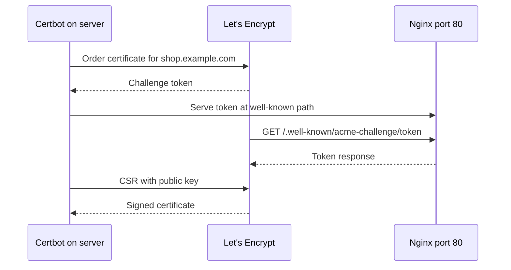

## In one line
You point your domain at the server with a DNS record, then a tool called Certbot proves to Let's Encrypt that you control that domain and installs a free HTTPS certificate that renews itself.

## The problem it solves
Your shop runs on a server at `203.0.113.10` behind [Nginx](#/topic/nginx-reverse-proxy). Customers can't be asked to type an IP address, and without HTTPS:

- Browsers mark the site "Not secure", and many customers leave.
- Passwords and card details on the checkout form travel as readable text across café Wi-Fi.
- Modern browser features, and some APIs, only work on HTTPS pages.

Certificates used to cost money and had to be renewed by hand once a year. People forgot, the certificate expired, and the whole site showed a scary error page until someone noticed. You need a name, a certificate, and renewal that nobody has to remember.

## Everyday analogy
Getting your shop listed and licensed. First you put your address in the phone book (DNS), so people can find you. Then an inspector (Let's Encrypt) checks that you really control the shop at that address, by asking you to put a specific note in the window and coming by to read it. If the note is there, you get a licence (the certificate) to hang on the wall.

Where it breaks down: a real licence lasts years. These certificates last weeks, so a robot (Certbot) repeats the inspection automatically, long before the licence runs out.

## How it works
A few terms first:

- A **domain name** is a human-friendly name like `shop.example.com`. You rent it from a **registrar**, a company that sells domain names.
- **DNS** is the internet's phone book. An **A record** maps a name to an IPv4 address, and an **AAAA record** maps it to an IPv6 address. A **CNAME** says "this name is an alias of that name". See [DNS](#/topic/dns).
- A **certificate** is a file that says "this public key belongs to `shop.example.com`", signed by a **certificate authority** (CA) that browsers trust. See [HTTPS and TLS](#/topic/tls-https).
- **Let's Encrypt** is a free, automated CA. You talk to it with **ACME** (Automatic Certificate Management Environment), a standard protocol for requesting and renewing certificates.
- **Certbot** is an ACME client: a program on your server that talks to Let's Encrypt for you and can edit your Nginx config.

### The HTTP-01 challenge
Let's Encrypt must check that you control the domain before it signs anything. The most common check is **HTTP-01**:

1. Certbot asks Let's Encrypt for a certificate for `shop.example.com`.
2. Let's Encrypt replies with a random **token** and says: "Put this at `http://shop.example.com/.well-known/acme-challenge/<token>`."
3. Certbot sets up Nginx to serve that file on port 80.
4. Let's Encrypt looks up `shop.example.com` in DNS and fetches the file over plain HTTP, from several places on the internet. Only someone who controls both the DNS and the server can make the right answer appear.
5. Certbot creates a **private key** on your server and sends a **CSR** (certificate signing request): your public key plus the domain, signed with the private key.
6. Let's Encrypt signs and returns the certificate. The private key never leaves your server.


*Notice: Let's Encrypt connects to your server from the outside, so DNS must already point at it and port 80 must be open.*

There is a second method, **DNS-01**: you prove control by creating a special TXT record in DNS. It is needed for **wildcard** certificates (`*.example.com`) and for servers that aren't reachable from the internet.

### Renewal
Let's Encrypt certificates are short-lived, 90 days at the time of writing. Let's Encrypt has announced it will shorten them in steps: to 64 days from February 2027, and later to 45 days. Short lives limit the damage if a key leaks, and force everyone to automate. Certbot installs a **systemd timer**, a scheduled job, that runs `certbot renew` twice a day. It only renews certificates that are close to expiry, then reloads Nginx.

## Real example
**Setup:** an Ubuntu server at `203.0.113.10` with Nginx serving `shop.example.com` on port 80 (the config from the Nginx topic), and ports 80 and 443 open in the [firewall](#/topic/firewalls).

**1. Point the domain at the server.** At your DNS provider, create:

```text
shop.example.com.       A      203.0.113.10
www.shop.example.com.   CNAME  shop.example.com.
```

Then check from your laptop before going further:

```bash
dig +short shop.example.com      # must print 203.0.113.10
dig +short AAAA shop.example.com # should print nothing, or the server's own IPv6
```

**2. Get the certificate:**

```bash
sudo apt install -y certbot python3-certbot-nginx   # Certbot plus its Nginx plugin
sudo certbot --nginx -d shop.example.com -d www.shop.example.com
```

Certbot asks for an email address and agreement to the terms, runs the challenge, then edits your server block. The result looks roughly like this:

```nginx
server {
    listen 443 ssl;
    server_name shop.example.com www.shop.example.com;
    ssl_certificate     /etc/letsencrypt/live/shop.example.com/fullchain.pem; # certificate + chain
    ssl_certificate_key /etc/letsencrypt/live/shop.example.com/privkey.pem;   # private key: keep secret
    include /etc/letsencrypt/options-ssl-nginx.conf;                         # secure TLS settings
    # ... your location blocks, unchanged ...
}
server {
    listen 80;
    listen [::]:80;
    server_name shop.example.com www.shop.example.com;
    return 301 https://$host$request_uri;   # send every HTTP visitor to HTTPS
}
```

**3. Make sure renewal works:**

```bash
sudo certbot certificates            # domains and expiry date of each certificate
sudo certbot renew --dry-run         # full rehearsal against Let's Encrypt's test server
systemctl list-timers | grep certbot # the timer that runs renewal automatically
```

**4. Check from the outside:**

```bash
curl -vI https://shop.example.com 2>&1 | grep -E 'expire date|issuer'
```

Add an outside check to your monitoring that warns when a certificate has fewer than about 14 days left. If automatic renewal ever breaks, that warning is your safety net. Don't count on reminder emails: Let's Encrypt stopped sending them on June 4, 2025.

## How to say it in an interview

> [!INTERVIEW]
> **30 seconds:** "I point the domain at the server with an A record, then use Certbot to get a free certificate from Let's Encrypt. Certbot proves I control the domain with the ACME HTTP-01 challenge: Let's Encrypt gives it a token, Certbot serves it on port 80, and Let's Encrypt fetches it. Then Certbot installs the certificate into Nginx, redirects HTTP to HTTPS, and a systemd timer renews it automatically before it expires."

> [!INTERVIEW]
> **2 minutes:** Start with the 30-second answer, then add:
>
> "The private key is generated on my server and never sent anywhere. Let's Encrypt only signs the public key after the challenge succeeds. For a wildcard like `*.example.com`, or a server that isn't public, I'd use the DNS-01 challenge instead, which proves control with a TXT record through the DNS provider's API.
>
> Certificates are short-lived on purpose, so everything hinges on automation. I always run `certbot renew --dry-run` after setup, and I monitor expiry from outside, because a failed renewal is silent until the site breaks.
>
> The tradeoff is that this is per server. With several servers behind a load balancer, I'd terminate TLS at the load balancer or a CDN and let it manage certificates, instead of running Certbot on every machine."

## Follow-up questions interviewers ask

<details>
<summary>The challenge fails with "Timeout during connect". What do you check?</summary>

Let's Encrypt couldn't reach port 80. Check, in order: the DNS record points at this server (`dig +short`), port 80 is open in both ufw and the cloud security group, Nginx is running, and no CDN or proxy in front is blocking `/.well-known/acme-challenge/`. Also check for a stale AAAA record: Let's Encrypt tries IPv6 when one exists.

</details>

<details>
<summary>What is the difference between fullchain.pem and cert.pem?</summary>

`cert.pem` is only your certificate. `fullchain.pem` is your certificate plus the **intermediate** certificate that links it to a root the browser already trusts. Serve `fullchain.pem`. With `cert.pem` alone, some clients fail with "unable to verify" errors, even though your desktop browser might look fine.

</details>

<details>
<summary>Why are certificates so short-lived?</summary>

If a private key leaks, or a domain changes owner, a short-lived certificate stops working soon anyway. Revocation, the system for cancelling certificates early, is unreliable in practice. Short lives also force automation, which removes the "someone forgot to renew" outage.

</details>

<details>
<summary>When do you need DNS-01 instead of HTTP-01?</summary>

For wildcard certificates, which Let's Encrypt only issues through DNS-01. Also when the server isn't reachable on port 80 from the internet, such as an internal admin tool. You need API access to your DNS provider so the client can create the TXT record automatically.

</details>

<details>
<summary>A new domain shows the old site, or nothing, for a while. Why?</summary>

DNS answers are cached for their **TTL** (time to live). Resolvers that looked up the name before you changed it keep the old answer until it expires. Check with `dig` against a public resolver, and lower the TTL ahead of planned moves. See [DNS](#/topic/dns).

</details>

## Common mistakes and misconceptions

> [!MISTAKE]
> Running Certbot before DNS points at the server. The challenge fails, and repeated failures can hit Let's Encrypt's rate limits. Check with `dig` first, and practise with `--dry-run`, which uses the test server.

> [!MISTAKE]
> Closing port 80 once HTTPS works "because everything is on 443 now". HTTP-01 renewals need port 80. Keep it open and let Nginx redirect it to HTTPS.

> [!MISTAKE]
> "Free certificates are less secure." The encryption is the same. Paid certificates may add identity checks on the organisation or support, but the padlock means the same thing.

> [!MISTAKE]
> Copying the certificate files into a Docker image or a Git repository. `privkey.pem` is a secret. Mount it at runtime, or let the proxy manage it.

## Tradeoffs: when NOT to use it
- **Behind a CDN or cloud load balancer**, let that service issue and renew the public certificate. Certbot on each server just adds moving parts.
- **Many servers sharing one domain** shouldn't each run Certbot separately. Terminate TLS in one place, or use DNS-01 with a shared, central process.
- **Internal service-to-service traffic** often uses a private CA or a service mesh instead of public certificates, because internal names can't pass a public challenge.

## Check yourself

<details>
<summary>1. What two things must be true before HTTP-01 can succeed?</summary>

The domain's DNS must point at your server, and port 80 must be reachable from the internet, with Nginx able to serve the challenge path.

</details>

<details>
<summary>2. Does the private key ever leave your server during issuance?</summary>

No. Certbot generates it locally and sends only a CSR containing the public key. Let's Encrypt signs the public key.

</details>

<details>
<summary>3. How do you test that automatic renewal will work, without waiting two months?</summary>

`sudo certbot renew --dry-run`. It goes through the whole renewal against Let's Encrypt's test server without replacing your real certificate.

</details>

## Go deeper
- [Let's Encrypt: How it works](https://letsencrypt.org/how-it-works/)
- [Let's Encrypt: Challenge types](https://letsencrypt.org/docs/challenge-types/)
- [Certbot documentation](https://eff-certbot.readthedocs.io/en/stable/)
