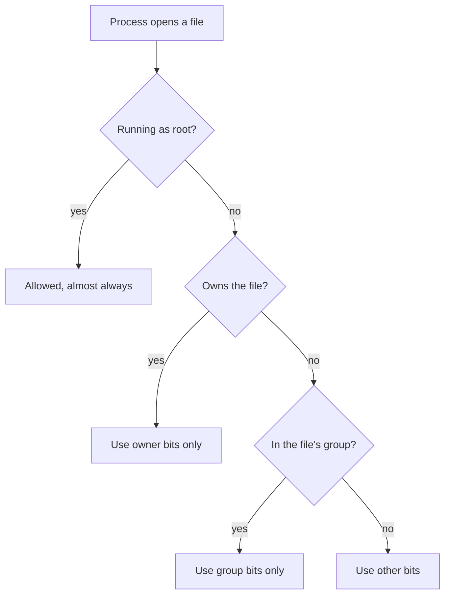

## In one line
Every file on Linux has an owner, a group, and three sets of read, write, and run permissions, which together decide who may do what with it.

## The problem it solves
Your shop's server runs three programs: your Node app, Nginx, and PostgreSQL. Two people log in to it: you and a contractor. The `.env` file holds the database password and the payment API key.

Without permissions, any program or person could read and change every file, so one buggy program or stolen login would expose everything. Permissions let you say: only the app may read `.env`, Nginx may read the public images but not change them, and only administrators may edit system config.

## Everyday analogy
An office with keycards. Each door has a sign with three lines: what the room's **owner** may do, what their **team** may do, and what **everyone else** may do. "Look inside", "change things", and "use the equipment" are separate rights. The building manager (root) has a master key.

Where it breaks down: in an office the most generous line usually wins. On Linux only **one** line applies to you, and it is the first one that matches, even if a later line would allow more.

## How it works

### Users and groups
- A **user** is an account. People have users, and so do programs: Nginx runs as `www-data`, and you might run your app as `deploy`. Each user has a number, its **UID**.
- **root** is the administrator, UID 0. It can read and change any file.
- A **group** is a named set of users, so you can give several users the same access at once.

Run `id deploy` to see a user's UID and groups.

### Reading `ls -l`

```text
-rw-r----- 1 deploy www-data 26 Oct 26 17:52 .env
│└┬┘└┬┘└┬┘   └─┬──┘ └──┬───┘
│ │  │  │      │       └ owning group
│ │  │  │      └ owning user
│ │  │  └ other: everyone else
│ │  └ group: members of www-data
│ └ user: the owner
└ type: - file, d directory, l link
```

Each set has three letters, with `-` when the right is missing:

| Letter | On a file | On a directory |
|---|---|---|
| `r` read | Read its contents | List the names inside |
| `w` write | Change its contents | Create, rename, or delete files inside |
| `x` execute | Run it as a program | Enter it and reach files inside |

Two consequences surprise people. Deleting a file needs `w` on the **directory**, not on the file. And without `x` on a directory, you can't open anything inside it, even files you own.

### The numbers: 755, 644, 600
Each letter has a value: `r` = 4, `w` = 2, `x` = 1. Add them up for each set:

- `7` = 4+2+1 = `rwx`
- `6` = 4+2 = `rw-`
- `5` = 4+1 = `r-x`
- `4` = `r--`, and `0` = `---`

Three digits are user, group, other, in that order. This is called **octal notation**.

| Mode | Letters | Typical use |
|---|---|---|
| `755` | `rwxr-xr-x` | Directories and scripts: owner changes, everyone reads and enters |
| `644` | `rw-r--r--` | Normal files: owner edits, everyone reads |
| `600` | `rw-------` | Secrets: `.env`, SSH private keys |
| `700` | `rwx------` | Private directories, like `~/.ssh` |

New files get their starting mode from the **umask**, a setting that removes rights by default. Ubuntu's usual umask, `022`, removes write for group and other, so new files start at `644` and new directories at `755`.

### How Linux decides
When a **process** (a running program) opens a file, the **kernel**, the core of Linux, checks permissions like this:


*Notice: only one set of bits is ever checked, so an owner with `---` is locked out even if "other" has `rwx`.*

(The "almost always" is because root still needs at least one `x` bit to run a file as a program.)

### Special bits, briefly
- **setuid** on a program makes it run as the file's owner. `/usr/bin/passwd` is owned by root with setuid (`-rwsr-xr-x`, mode `4755`), so normal users can change their own password in a root-only file.
- **setgid** on a directory makes new files inside it take the directory's group. Handy for shared folders.
- The **sticky bit** on a directory means only a file's owner can delete it. `/tmp` is `drwxrwxrwt` (`1777`): everyone can write there, but nobody can delete other people's files.

### sudo
**sudo** lets permitted users run one command as root. On Ubuntu, members of the `sudo` group may use it. The rules live in `/etc/sudoers`, which you edit only with `visudo`, because it checks for mistakes before saving. Each use is logged to `/var/log/auth.log`, so you can see who did what. That is why you log in as a normal user and use `sudo`, instead of logging in as root.

## Real example
**Setup:** the app lives in `/var/www/shop`, runs as user `deploy`, and Nginx runs as `www-data` and serves `/var/www/shop/public`.

```bash
sudo adduser deploy                    # create the user (asks for a password)
sudo usermod -aG sudo deploy           # -a append, -G to group: deploy can use sudo
                                       # (group changes apply at the next login)

# deploy owns everything. The group is www-data, so Nginx gets "group" rights.
sudo chown -R deploy:www-data /var/www/shop          # -R: every file inside too

# Directories 755, files 644: everyone may read, only deploy may change.
sudo find /var/www/shop -type d -exec chmod 755 {} +
sudo find /var/www/shop -type f -exec chmod 644 {} +

sudo chmod 600 /var/www/shop/.env      # secrets: only deploy may read or write
sudo chmod 775 /var/www/shop/uploads   # owner and group may add files here
```

Check the result:

```bash
ls -la /var/www/shop
```

```text
drwxr-xr-x 4 deploy www-data 4096 Oct 26 17:52 .
-rw------- 1 deploy www-data   26 Oct 26 17:52 .env
drwxr-xr-x 2 deploy www-data 4096 Oct 26 17:52 public
-rw-r--r-- 1 deploy www-data    3 Oct 26 17:52 server.js
drwxrwxr-x 2 deploy www-data 4096 Oct 26 17:52 uploads
```

Prove Nginx's user can't read the secrets:

```bash
sudo -u www-data cat /var/www/shop/.env
# cat: /var/www/shop/.env: Permission denied
```

When Nginx says "Permission denied" for an image, check every directory on the way with `namei -l /var/www/shop/public/logo.png`. It lists the permissions of each folder in the path. A missing `x` on any one of them blocks the file.

Letters work too: `chmod u+x deploy.sh` adds execute for the owner, and `chmod o-r notes.txt` removes read from everyone else.

## How to say it in an interview

> [!INTERVIEW]
> **30 seconds:** "Every Linux file has an owning user, an owning group, and three permission sets: owner, group, and others. Each set has read, write, and execute, written as numbers that add up: read 4, write 2, execute 1. So 755 means the owner can do everything and everyone else can read and run, and 644 means the owner can edit and everyone else can only read. I run apps as a dedicated non-root user, keep secrets like .env at 600, and use sudo for admin tasks instead of logging in as root."

> [!INTERVIEW]
> **2 minutes:** Start with the 30-second answer, then add:
>
> "The principle is **least privilege**: every user and program gets only the access it needs. On my video app, the code is owned by a deploy user, Nginx's www-data user is in the group so it can read static files, and only the app user can read the env file. If Nginx were ever compromised, the attacker couldn't read the database password.
>
> The tradeoff is convenience. chmod 777 makes every permission error go away, which is why people reach for it. But it lets any process on the box change the file, including a compromised one. When I hit a permission error, I fix the owner or group instead."

## Follow-up questions interviewers ask

<details>
<summary>Why is chmod 777 a bad idea?</summary>

It gives every user and program on the server full rights. If any service is compromised, the attacker can rewrite your code. It also hides the real problem, which is almost always the wrong owner or group. Fix that with `chown` and keep modes like `755` and `644`.

</details>

<details>
<summary>What does execute permission mean on a directory?</summary>

It means you can enter the directory and reach the files inside it by name. Read alone only lets you list the names. Without `x` on every directory along a path, you can't open the file at the end, whatever its own permissions say.

</details>

<details>
<summary>Why not just run the app as root?</summary>

An attacker who finds a flaw in your app gets whatever rights the app has. As root, that is the whole server. As `deploy`, it is only the app's own files. The same applies in Docker: set a non-root `USER` in the Dockerfile.

</details>

<details>
<summary>I added a user to a group, but they still get "Permission denied". Why?</summary>

Group membership is read at login, so existing sessions keep the old list. Start a new SSH session and check with `id`. Restart any service that runs as that user too.

</details>

<details>
<summary>Is adding a user to the docker group safe?</summary>

Treat it like giving them root. Anyone who can talk to the Docker daemon can start a container that mounts the host's `/` folder and changes any file. Only add trusted administrators.

</details>

## Common mistakes and misconceptions

> [!MISTAKE]
> "The owner always gets at least what 'others' get." No. Linux picks one set and stops. A file at `077` owned by you is unreadable by you.

> [!MISTAKE]
> "To stop someone deleting a file, remove write permission from the file." Deleting is controlled by write permission on the **directory**. Use the sticky bit on shared directories.

> [!MISTAKE]
> Running `chmod -R 755` on a whole project. That makes every file executable, including `.env`, and readable by everyone. Set directories and files separately, as in the real example.

> [!MISTAKE]
> Using `sudo` to "fix" a permission error, then leaving files owned by root. The app, running as `deploy`, can no longer write them. Run `npm install` and `git pull` as the user who owns the project.

## Tradeoffs: when NOT to use it
- **Permissions don't protect against root.** Anyone with root or sudo can read everything. They protect programs and users from each other, not from an administrator.
- **Basic permissions can't name individual extra users.** One owner and one group is all you get. For "these three users and that one service", use **ACLs** (access control lists, managed with `setfacl`), or rethink your groups.
- **They aren't encryption.** Anyone holding the disk or a backup can read a `600` file. See [Environment variables and secrets](#/topic/env-secrets).

## Check yourself

<details>
<summary>1. What does chmod 640 mean?</summary>

Owner: read and write (6). Group: read only (4). Others: nothing (0). Letters: `rw-r-----`.

</details>

<details>
<summary>2. Nginx returns 403 for /var/www/shop/public/logo.png. The image is 644. What else should you check?</summary>

Every directory on the path needs `x` for Nginx's user. Run `namei -l /var/www/shop/public/logo.png` and look for a folder that is missing `x` for the group or others, such as a home directory at `750`.

</details>

<details>
<summary>3. Why can anyone write to /tmp, but not delete other people's files there?</summary>

`/tmp` has the sticky bit (`1777`). Everyone can create files, but only a file's owner, or root, can delete or rename it.

</details>

## Go deeper
- [Ubuntu manpage: chmod](https://manpages.ubuntu.com/manpages/noble/man1/chmod.1.html)
- [Ubuntu Server docs: User management](https://documentation.ubuntu.com/server/how-to/security/user-management/)
