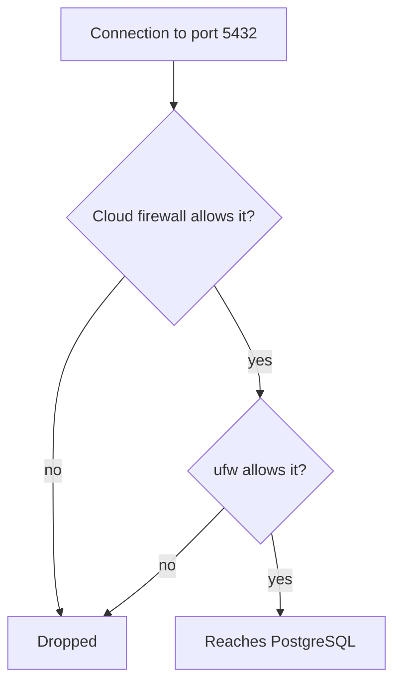

## In one line
A firewall checks every incoming connection against a list of rules and blocks any port you haven't deliberately opened.

## The problem it solves
Your shop's server runs four programs that accept connections: Nginx on ports 80 and 443, `sshd` on 22, your Node API on 3000, and PostgreSQL on 5432.

Customers only need 80 and 443. But if PostgreSQL accidentally listens on every network address, anyone on the internet can connect to it, and bots constantly scan for exactly these ports. One wrong line in one config file exposes your database to the world.

A **firewall** is a filter that decides which network traffic may enter or leave a machine. It gives you a second line of defence: even if a program is listening where it shouldn't, the firewall stops outsiders from reaching it.

## Everyday analogy
A building's security desk with a guest list. Visitors heading to the shop on the ground floor walk straight through. Visitors asking for the server room, the vault, or a floor nobody mentioned are turned away, however politely they ask.

Where it breaks down: a real guard can notice something suspicious about an allowed visitor. A basic firewall only checks the port and the sender's IP address, so it can't tell a customer from an attack sent to an allowed port.

## How it works
Linux has a packet filter built into the kernel, the core of the operating system. A **packet** is a small chunk of network data. On Ubuntu, you usually control the filter with **ufw** (Uncomplicated Firewall), a friendly front end that writes the low-level rules for you.

The rules work like this:

1. **Default policy.** Decide what happens to traffic that matches no rule. The safe setup is "deny incoming, allow outgoing": nothing gets in unless allowed, and the server can still reach the internet for updates.
2. **Allow rules.** Open only what you need, such as port 22 for SSH and 80 and 443 for the website. You can also allow a port only from one IP address.
3. **First match wins.** ufw checks rules from top to bottom and stops at the first match. Order matters when you mix allow and deny rules.
4. **Stateful.** The firewall remembers connections. When your server makes an outgoing request to a payment API, the reply is let back in automatically. You don't need a rule for replies.

Cloud providers add a second layer, usually called a **security group** or cloud firewall. It filters traffic on the provider's network **before** it reaches your server. Like ufw, it is stateful and denies inbound traffic by default. Using both is common: if one is misconfigured, the other still protects you.


*Notice: a connection must pass both layers, so a single closed layer is enough to block it.*

## Real example
**Setup:** an Ubuntu server with `openssh-server` and `nginx` installed. You are logged in over SSH.

> [!WARNING]
> Allow SSH **before** enabling the firewall. Otherwise the default "deny incoming" cuts off your own session and locks you out. Most cloud providers offer a browser console as a way back in.

```bash
sudo ufw default deny incoming       # block everything coming in...
sudo ufw default allow outgoing      # ...but let the server reach out (apt, APIs)

sudo ufw limit OpenSSH               # allow SSH (22), but slow down repeated attempts
sudo ufw allow 'Nginx Full'          # ports 80 and 443
# Allow PostgreSQL only from one office IP, nobody else:
sudo ufw allow from 198.51.100.7 to any port 5432 proto tcp

sudo ufw enable                      # turn it on (also on every boot)
sudo ufw status verbose
```

```text
Status: active
Default: deny (incoming), allow (outgoing), deny (routed)

To                         Action      From
--                         ------      ----
22/tcp (OpenSSH)           LIMIT IN    Anywhere
80,443/tcp (Nginx Full)    ALLOW IN    Anywhere
5432/tcp                   ALLOW IN    198.51.100.7
```

`OpenSSH` and `Nginx Full` are **app profiles**: named port lists installed with those programs. `sudo ufw app list` shows them. `limit` denies an IP address that tries 6 or more connections within 30 seconds, which slows down password-guessing bots.

To remove a rule, list rules with numbers and delete by number:

```bash
sudo ufw status numbered
sudo ufw delete 3
```

**Test from outside**, from your laptop, not from the server itself:

```bash
nc -zv -w 3 203.0.113.10 5432   # -z just check, -v verbose, -w 3 give up after 3 seconds
# Expect a timeout from anywhere except 198.51.100.7.
```

> [!WARNING]
> **Docker bypasses ufw.** When you publish a container port with `-p 5432:5432`, Docker writes its own packet-filter rules that run before ufw's. The port is open to the internet even if ufw says deny. Publish internal services only on localhost, with `-p 127.0.0.1:5432:5432`, or don't publish them at all and let containers talk over a Docker network. See [Docker networking](#/topic/docker-networking).

## How to say it in an interview

> [!INTERVIEW]
> **30 seconds:** "A firewall decides which ports on a server can be reached from outside. I start from deny all incoming, allow outgoing, then open only what's needed: usually 22 for SSH, ideally restricted to known IPs, and 80 and 443 for the web. Databases and app ports stay closed and listen on localhost. On Ubuntu I use ufw, and in the cloud I also set security groups, so there are two layers."

> [!INTERVIEW]
> **2 minutes:** Start with the 30-second answer, then add:
>
> "For my video app, only Nginx is public. The Node API listens on 127.0.0.1:3000, Postgres and Redis are only reachable from the app, and SSH is limited to our office IP or a VPN.
>
> Two gotchas I watch for. First, Docker's published ports bypass ufw, so I bind internal containers to 127.0.0.1 or keep them on a Docker network. Second, I always allow SSH before enabling the firewall, so I don't lock myself out.
>
> The tradeoff is that a port firewall only filters by address and port. It can't stop SQL injection or a login attack on port 443, because that traffic is allowed. So it is one layer. I still need secure code, rate limiting, and maybe a web application firewall, which inspects the HTTP requests themselves."

## Follow-up questions interviewers ask

<details>
<summary>What is the difference between a security group and ufw?</summary>

A **security group** is enforced by the cloud provider's network, before traffic reaches your machine. You manage it in the cloud console or with infrastructure code. **ufw** runs inside your server's own operating system. Both filter by port and source. Using both gives you defence in depth: one layer still protects you if the other is misconfigured.

</details>

<details>
<summary>What does "stateful" mean for a firewall?</summary>

It tracks connections. If your server starts a connection, for example to a payment API, the replies are allowed back in automatically, even though incoming traffic is denied by default. Without that, you would need rules for every reply.

</details>

<details>
<summary>Your app listens on 127.0.0.1. Do you still need a firewall?</summary>

Yes. Binding to localhost protects that one program, but the next program you install, or a container port you publish, may listen on every address. The firewall is a safety net for mistakes you haven't made yet.

</details>

<details>
<summary>Why did a port stay reachable even though ufw denies it?</summary>

The most common reason is Docker. Published container ports skip ufw's rules. Check with `sudo ss -tlnp` and `docker ps`, then rebind the container to `127.0.0.1` or remove the published port. Another reason: an earlier allow rule matches first.

</details>

## Common mistakes and misconceptions

> [!MISTAKE]
> Enabling the firewall before allowing SSH, and locking yourself out. Run `sudo ufw allow OpenSSH` (or `limit`) first.

> [!MISTAKE]
> "The firewall protects my website from hackers." It only controls which ports are reachable. Attacks sent to port 443, like SQL injection or stolen passwords, pass straight through. See [OWASP essentials](#/topic/owasp-essentials).

> [!MISTAKE]
> Opening the database port to every address (`0.0.0.0/0`) "just for a minute" to debug from a laptop. Bots find open database ports quickly. Use an [SSH tunnel](#/topic/ssh-tunnels) instead.

> [!MISTAKE]
> Testing the firewall from the server itself. Traffic from localhost doesn't come through the public interface, so the test proves nothing. Test from another machine.

## Tradeoffs: when NOT to use it
- **Don't rely on it alone.** A firewall reduces exposure. It doesn't make allowed services safe. Keep software patched and services bound to localhost.
- **Don't hand-manage ufw on many servers.** Rules drift apart over time. Define cloud security groups in code, and keep host rules in your setup scripts.
- **Don't over-restrict outgoing traffic by default.** Blocking outgoing traffic is stronger security, but breaks updates, email, and payment APIs in confusing ways. Do it only when you have a clear list of destinations and the time to maintain it.

## Check yourself

<details>
<summary>1. Which ports should a typical web server expose to the whole internet?</summary>

80 and 443 for the website. Port 22 for SSH, ideally limited to known IPs or a VPN. Nothing else: no database, Redis, or app ports.

</details>

<details>
<summary>2. You ran `docker run -p 6379:6379 redis` on a server with ufw denying 6379. Is Redis reachable from the internet?</summary>

Yes. Docker's published ports bypass ufw. Use `-p 127.0.0.1:6379:6379`, or don't publish it and connect from other containers over a Docker network.

</details>

<details>
<summary>3. With a "deny incoming" default, how does the server still receive replies from APIs it calls?</summary>

The firewall is stateful. It remembers connections the server started and lets their replies back in.

</details>

## Go deeper
- [Ubuntu Server docs: Firewall (ufw)](https://documentation.ubuntu.com/server/how-to/security/firewalls/)
- [Docker docs: Packet filtering and firewalls](https://docs.docker.com/engine/network/packet-filtering-firewalls/)
