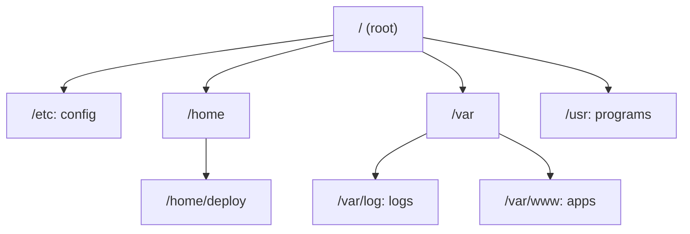

## In one line
Linux essentials are the folder layout and the couple of dozen commands you use to find files, read logs, edit config, and check a server's health from a text-only screen.

## The problem it solves
You log in to your shop's server for the first time. There is no desktop, no mouse, and no file browser. You see only this:

```text
deploy@video-prod:~$
```

Checkout is failing, and you need to answer four questions quickly. Where is the app? Where are its logs? What does the error say? Is the disk full?

Two terms first:

- A **terminal** is the text window you type into.
- A **shell** is the program inside it that reads each command, runs it, and prints the result. On Ubuntu the shell is usually **bash**.

Without a small set of commands and a mental map of where things live, you are guessing. With them, those four questions take under a minute.

## Everyday analogy
A well-run office building. Every department has a fixed floor: contracts on one floor, mail logs on another, staff desks on a third. Once you know the floor plan, you can walk to any document without asking. The commands are what you do on arrival: walk, look, read, copy, shred.

Where it breaks down: a real building has many entrances, but Linux has exactly one starting point, `/`, and every file in the system sits somewhere below it.

## How it works

### 1. One tree of folders
Linux has no `C:` or `D:` drives. Everything hangs from a single **root directory**, written `/`. A **directory** is a folder. Extra disks are attached ("mounted") as folders inside this tree.

The folders you will actually visit:

| Path | What lives there |
|---|---|
| `/etc` | Configuration files: Nginx, SSH, system settings |
| `/var/log` | Log files |
| `/var/www` or `/srv` | Websites and apps (by convention) |
| `/home/deploy` | Personal files of the user `deploy`. Shortcut: `~` |
| `/root` | Home of **root**, the all-powerful administrator account |
| `/usr/bin` | Installed programs, like `ls` and `node` |
| `/tmp` | Temporary files, often cleared on reboot |
| `/proc` | Not real files: live information about running programs, made up by the system when you read it |


*Notice: every path is a route down from `/`, so `/var/log` means "start at root, go into var, then into log".*

A **path** names a place in that tree:

- An **absolute path** starts at `/` and works from anywhere: `/var/log/nginx/error.log`.
- A **relative path** starts from where you are now: `logs/app.log`.
- `.` means "this folder" and `..` means "the folder above".

### 2. Reading the prompt
`deploy@video-prod:~$` tells you three things. You are user `deploy`, on the machine `video-prod`, in folder `~` (your home). The `$` means a normal user. A `#` means you are root, so be careful.

### 3. The shape of a command

```text
ls      -l -a        /var/www
command  options     argument
```

The **command** is the program to run. **Options** (also called flags) change how it behaves, and usually start with `-`. Short ones can be combined, so `-l -a` is the same as `-la`. **Arguments** are what to act on. When you forget a flag, `man ls` opens the manual and `ls --help` gives a summary.

How does the shell find `ls`? It looks through each folder listed in the **PATH** environment variable, in order. An **environment variable** is a named setting that programs can read. "command not found" usually means the program is not installed, or it lives in a folder that is not on your PATH.

### 4. Streams, pipes, and redirection
Every command has three **standard streams**:

- **Standard input** (stdin) is where it reads from, usually your keyboard.
- **Standard output** (stdout) is where normal results go, usually your screen.
- **Standard error** (stderr) is where error messages go, also your screen, but kept separate.

You can rewire them:

| Syntax | Meaning |
|---|---|
| `a \| b` | A **pipe**: send `a`'s output into `b`'s input |
| `> file` | Write output to a file, replacing its contents |
| `>> file` | Append output to the end of a file |
| `2> file` | Write only errors to a file |
| `> file 2>&1` | Write output and errors to the same file |

Pipes are the heart of Linux. Small tools that each do one thing are chained into a quick answer.

### 5. Exit codes
Every command finishes with an **exit code**: `0` means success, anything else means failure. `echo $?` shows the last one. Scripts, Docker, and CI pipelines all decide "did it work?" from this number.

## Real example
**Setup:** an Ubuntu server where your Node app lives in `/var/www/shop` and writes logs to `/var/log/shop/app.log`. Users report that checkout fails.

**Find your way around:**

```bash
pwd                      # print working directory: where am I? -> /home/deploy
cd /var/www/shop         # change directory (absolute path)
ls -la                   # list everything: -l long format, -a include hidden files like .env
cd ..                    # up one level, to /var/www
cd ~                     # back home (plain `cd` does the same)
```

**Read files without opening an editor:**

```bash
cat package.json                 # print a small file in one go
less /var/log/shop/app.log       # scroll a big file: arrows to move, /text to search, q to quit
head -n 20 app.log               # first 20 lines
tail -n 50 app.log               # last 50 lines
tail -f /var/log/shop/app.log    # follow: print new lines as they are written. Ctrl+C stops.
```

**Search and count with pipes:**

```bash
grep ERROR /var/log/shop/app.log                  # lines containing ERROR
# 2026-10-26T10:05:00Z ERROR POST /orders 500 payment timeout
grep -c "POST /orders" /var/log/shop/app.log      # count matching lines -> 51
grep -rn "DATABASE_URL" /var/www/shop             # search every file below a folder, with line numbers
grep " 500 " /var/log/nginx/access.log | tail -n 5   # the last five requests that failed with 500
```

**Create, copy, move, delete:**

```bash
mkdir -p /var/www/shop/backups      # make a folder, including any missing parents
cp .env backups/.env.2026-10-26     # copy (add -r for folders)
mv old.log archive/old.log          # move or rename
rm archive/old.log                  # delete. There is no recycle bin.
nano /var/www/shop/.env             # simple editor: Ctrl+O saves, Ctrl+X exits
```

**Check the machine's health:**

```bash
df -h                    # disk space per mounted disk. 100% full breaks almost everything.
du -sh /var/* | sort -h  # size of each folder in /var, smallest first, so the biggest is last
free -h                  # memory: total, used, available
```

**Install software** with **apt**, Ubuntu's **package manager**, a tool that downloads programs and keeps them updated:

```bash
sudo apt update              # refresh the list of available versions
sudo apt install -y htop     # install a program
```

`sudo` runs one command as root. You need it to change system files. See [Users, groups, and permissions](#/topic/file-permissions).

## How to say it in an interview

> [!INTERVIEW]
> **30 seconds:** "I'm comfortable on a Linux server from the command line. I know where things live: config in /etc, logs in /var/log, apps under /var/www or /srv. Day to day I navigate with cd and ls, read logs with less and tail -f, search with grep, and check disk and memory with df, du, and free. I chain tools with pipes, for example grep for errors and count them with wc, and I check exit codes in scripts."

> [!INTERVIEW]
> **2 minutes:** Start with the 30-second answer, then add a real example:
>
> "Say checkout starts failing. I'd SSH in, run `df -h` first, because a full disk breaks writes and logging in confusing ways. Then I'd `tail -f` the app log while reproducing the error, and `grep` around the timestamp for the stack trace. If I need numbers, I'd pipe grep into `wc -l` to see how many requests failed in the last hour.
>
> I'm careful with destructive commands. There's no undo for `rm`, and `>` silently replaces a file, so I take a copy of a config before editing it.
>
> The tradeoff is that typing commands by hand is fine for investigating, but bad for making changes. Anything I do twice goes into a script or into the deployment pipeline, so the server can be rebuilt from scratch and nobody has to remember what I typed."

## Follow-up questions interviewers ask

<details>
<summary>What is the difference between > and >>?</summary>

`>` replaces the file's contents with the command's output. `>>` adds the output to the end and keeps what was there. Using `>` on the wrong file, like `echo "x" > .env`, wipes it instantly.

</details>

<details>
<summary>The disk is full. How do you find what is using the space?</summary>

`df -h` shows which disk is full. Then `sudo du -sh /var/* | sort -h` shows the size of each folder, biggest last. Repeat inside the biggest folder until you find the culprit. Common culprits are old log files, Docker images and logs, and database backups. See [Reading logs and debugging a server](#/topic/logs-debugging).

</details>

<details>
<summary>Why does `sudo echo "x" > /etc/app.conf` still say "Permission denied"?</summary>

The `>` is handled by **your** shell, which runs as your normal user, before `sudo` even starts. Only `echo` runs as root. Use `echo "x" | sudo tee /etc/app.conf`: `tee` writes its input to a file, and here `tee` itself runs as root.

</details>

<details>
<summary>What is the difference between stdout and stderr, and why keep them separate?</summary>

Both print to the screen by default, but they are separate streams. Programs send normal results to stdout and problems to stderr. That lets you pipe clean output into another tool while errors still reach your screen, or send errors to their own file with `2> errors.log`.

</details>

<details>
<summary>What is /proc?</summary>

A **virtual filesystem**: the files are not stored on disk. The kernel, the core of the operating system, generates them when you read them. `/proc/<number>` holds live details about each running program, and `/proc/meminfo` shows memory. Tools like `ps` and `free` read their information from here.

</details>

<details>
<summary>"command not found", but you just installed it. Why?</summary>

The program is in a folder that is not on your PATH, or your shell remembered an old location. Check with `which node` and `echo $PATH`. Programs installed by version managers like nvm are only on the PATH of the user who installed them, so they often "disappear" under `sudo` or in system services.

</details>

## Common mistakes and misconceptions

> [!MISTAKE]
> Running `rm -rf $DIR/` in a script where `DIR` is empty. That becomes `rm -rf /`. Check variables before deleting, use `set -u` in scripts so empty variables cause an error, and prefer deleting specific paths.

> [!MISTAKE]
> Using `cat` on a 3 GB log file. It floods the terminal and can freeze your session. Use `less`, `tail`, or `grep` instead.

> [!MISTAKE]
> "Linux is case-insensitive like Windows." No. `App.js` and `app.js` are two different files. Code that works on a Mac (usually case-insensitive) can crash on a Linux server because an import has the wrong case.

> [!MISTAKE]
> Editing program files under `/usr` to change settings. Settings belong in `/etc` or in the app's own config. Files under `/usr` are overwritten when the package updates.

## Tradeoffs: when NOT to use it
- **Don't change production by hand.** Typed commands are perfect for investigating, but nobody remembers them later. Put repeatable changes in a script, a Dockerfile, or a CI/CD pipeline.
- **Don't grep logs across ten servers.** Logging in to each machine stops working once you have more than a couple. Send logs to one central place. See [Logging well](#/topic/logging).
- **Don't memorise every flag.** Knowing what a tool does and where to look it up (`man`, `--help`) matters more in an interview than reciting options.

## Check yourself

<details>
<summary>1. Where would you look for Nginx's configuration, and where for its logs?</summary>

Configuration lives in `/etc/nginx`. Logs live in `/var/log/nginx`, usually `access.log` and `error.log`.

</details>

<details>
<summary>2. Write one line that counts how many lines in app.log contain "payment timeout".</summary>

`grep -c "payment timeout" app.log`, or the pipe version, `grep "payment timeout" app.log | wc -l`. `wc -l` counts lines.

</details>

<details>
<summary>3. A deploy script ran `npm test`, the tests failed, but the script kept going. What should it check?</summary>

The exit code. A failing `npm test` exits with a non-zero code. Add `set -e` at the top of a bash script so it stops at the first command that fails, or check `$?` explicitly.

</details>

## Go deeper
- [Ubuntu tutorial: The Linux command line for beginners](https://ubuntu.com/tutorials/command-line-for-beginners)
- [Ubuntu manpage: bash (see the REDIRECTION section)](https://manpages.ubuntu.com/manpages/noble/man1/bash.1.html)
