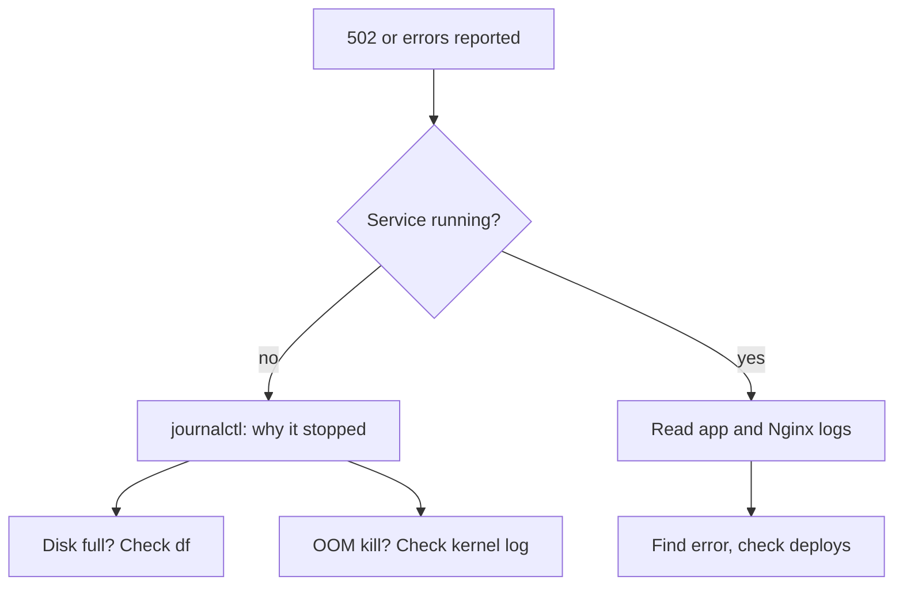

## In one line
Debugging a server means checking, in a fixed order, whether the app is running, what its logs say, and whether the machine has run out of disk, memory, or CPU.

## The problem it solves
Customers report that checkout returns "502 Bad Gateway". You SSH in. Nothing on screen tells you what happened. The app might have crashed on a bug, been killed for using too much memory, or be failing because the disk is full.

Under pressure, people guess. They restart things, redeploy, or reboot the server. Sometimes that hides the problem for an hour, and it wipes out the evidence. A short, repeatable routine finds the real cause in minutes. Interviewers ask about it because it shows whether you have actually run something in production.

## Everyday analogy
A doctor in an emergency room. They don't guess from the first symptom. They check vital signs in a fixed order (breathing, pulse, blood pressure), then read the patient's chart for what happened just before.

On a server, the vital signs are: is the process alive, is the disk full, is memory exhausted, is the CPU maxed out. The chart is the logs.

Where it breaks down: a patient can tell you where it hurts. A server only tells you what was written down, so if logging was poor, the evidence may not exist.

## How it works

### Where logs live
A **log** is a timestamped record of what a program did. On Ubuntu they live in a few places:

| Source | Where | How to read it |
|---|---|---|
| systemd services and the kernel | The **journal**, systemd's log store | `journalctl` |
| Nginx | `/var/log/nginx/access.log` and `error.log` | `tail`, `less`, `grep` |
| Logins and sudo | `/var/log/auth.log` | `grep`, `less` |
| Docker containers | Files under `/var/lib/docker/containers/` | `docker logs` |

The **kernel** is the core of the operating system. Its messages, like "I killed a process to free memory", go to the journal too.

### The three silent killers
**1. Disk full.** When the disk hits 100%, writes fail: logs, uploads, database writes, even temporary files. Apps show odd errors like `ENOSPC: no space left on device`. Two traps:

- A disk can also run out of **inodes**, the slots that each file uses, while still having free space. That happens with millions of tiny files. Check with `df -i`.
- Deleting a big log file that a program still has open doesn't free the space. The program keeps writing to the deleted file until it closes it or restarts. `sudo lsof +L1` lists such files.

**2. Out of memory.** When RAM runs out, the kernel's **OOM killer** ("out of memory") picks a process, usually the biggest, and ends it with SIGKILL. No error appears in your app's own log, because it never got the chance to write one. The evidence is in the kernel log. A process killed this way exits with code 137.

Don't confuse it with Node's own limit. `JavaScript heap out of memory` in your app log means Node reached its heap limit and crashed itself. Both need fixing, but they are found in different places.

**3. CPU maxed out.** Everything is slow, but nothing crashes. `top` shows which process is busy. A high **load average** (the number of processes waiting for CPU, roughly) compared with your number of cores means work is queuing.

### The routine


*Notice: you check whether the process is alive before reading any logs, because the answer tells you which logs matter.*

Always also ask: **what changed?** A deploy, a config edit, a traffic spike, an expired certificate. Most incidents follow a change.

## Real example
**Setup:** the shop API runs as the systemd service `shop-api` behind Nginx, on an Ubuntu VPS. Outputs are trimmed and typical.

**1. Is it running?**

```bash
systemctl status shop-api
# Active: activating (auto-restart) (Result: exit-code)   <- crashing and restarting
```

**2. Why did it stop?** Read its recent logs:

```bash
journalctl -u shop-api -n 30 --no-pager      # last 30 lines of this service
# Error: ENOSPC: no space left on device, write
journalctl -u shop-api --since "30 min ago"   # or by time
journalctl -u shop-api -p err -b              # only errors, since this boot
```

**3. Disk:**

```bash
df -h /
# /dev/vda1   78G   78G     0 100% /
sudo du -xh --max-depth=1 /var | sort -h | tail -n 3   # -x: stay on this disk
# 2.1G  /var/log
# 61G   /var/lib/docker
```

Docker's container logs grew without limit. Free space now, without breaking the running container:

```bash
sudo find /var/lib/docker/containers -name '*-json.log' -size +1G -exec ls -lh {} +
sudo truncate -s 0 /var/lib/docker/containers/<id>/<id>-json.log   # empty it in place
sudo journalctl --vacuum-size=500M                                  # shrink the journal too
```

`truncate` empties the file but keeps it open, so the space comes back immediately. `rm` would not, while Docker still holds the file. Then prevent a repeat: cap Docker's logs in `/etc/docker/daemon.json` with `{"log-opts": {"max-size": "10m", "max-file": "3"}}`, restart Docker, and recreate containers (the limit applies to new ones). Add an alert when the disk passes about 80%.

**4. Memory**, if the logs simply stop with no error:

```bash
free -h            # look at "available", not "free"
journalctl -k --since today | grep -i 'killed process'
# Out of memory: Killed process 2154 (node) total-vm:..., anon-rss:1843200kB ...
docker inspect -f '{{.State.OOMKilled}}' shop-api   # for containers: true means OOM
```

Linux uses spare RAM as a cache for files, so "free" is often low on a healthy server. "Available" is what new programs can actually get.

**5. Nginx's view:**

```bash
sudo tail -n 20 /var/log/nginx/error.log
# connect() failed (111: Connection refused) while connecting to upstream
```

## How to say it in an interview

> [!INTERVIEW]
> **30 seconds:** "I work through it in order. First, is the process running: `systemctl status` or `docker ps`. Then the logs: `journalctl -u` for the service, `docker logs`, and Nginx's error log. Then resources: `df -h` for disk, `free -h` and the kernel log for out-of-memory kills, `top` for CPU. And I always ask what changed recently, because most incidents follow a deploy or config change."

> [!INTERVIEW]
> **2 minutes:** Start with the 30-second answer, then add a real example:
>
> "One time the API kept returning 502. systemctl showed it in a restart loop, and the journal said ENOSPC. `df` showed the disk at 100%, and `du` pointed to Docker's container logs, which had no size limit. I truncated the biggest log to recover, then set max-size and max-file in the Docker daemon config, and added a disk alert at 80%.
>
> Another classic is the OOM killer. The app log just stops with no error, and the only evidence is in the kernel log, plus exit code 137.
>
> The tradeoff with SSH-and-grep debugging is that it doesn't scale and it's reactive. With more than a couple of servers, I'd ship logs to a central system with structured JSON logs, and alert on disk, memory, and error rates, so I hear about problems before customers do."

## Follow-up questions interviewers ask

<details>
<summary>You deleted a 20 GB log file, but df still shows the disk full. Why?</summary>

A process still has the file open. Linux only frees the space when the last program holding the file closes it. Find it with `sudo lsof +L1`, then restart that process. Next time, empty the file with `truncate -s 0` instead of deleting it.

</details>

<details>
<summary>The app was killed but its log shows no error. What happened?</summary>

Most likely the kernel's OOM killer ended it with SIGKILL, which can't be caught, so the app had no chance to log anything. Check `journalctl -k | grep -i 'killed process'`, and for containers, `docker inspect` for `OOMKilled: true` or exit code 137.

</details>

<details>
<summary>How do you stop logs from filling the disk?</summary>

Rotate them. **logrotate** renames, compresses, and deletes old log files on a schedule (configs in `/etc/logrotate.d/`). Limit the journal with `SystemMaxUse=` in `/etc/systemd/journald.conf`. Limit Docker with `max-size` and `max-file`. And alert on disk usage before it reaches 100%.

</details>

<details>
<summary>The server is slow, but nothing is crashing. Where do you look?</summary>

`top` for CPU and memory per process, and the load average against the number of cores. Then the database, often the real bottleneck: slow query logs and open connections. See [Finding performance bottlenecks](#/topic/performance-bottlenecks).

</details>

<details>
<summary>Why not just reboot the server first?</summary>

A reboot can bring the site back quickly, and sometimes that's the right call for users. But it also clears memory state and can hide the cause, and it won't fix a full disk or a bad config. If you reboot, first save what you can: `systemctl status`, recent logs, `df -h`, and `free -h`.

</details>

## Common mistakes and misconceptions

> [!MISTAKE]
> "Free memory is almost zero, so the server is out of memory." Linux deliberately fills spare RAM with file cache and gives it back when programs need it. Read the "available" column.

> [!MISTAKE]
> Restarting or redeploying before reading the logs. The restart can hide the cause until it happens again at a worse time. Look first, then act.

> [!MISTAKE]
> Running `rm` on a log file a process is still writing to. The space isn't freed, and the program loses its log. Use `truncate -s 0` or proper log rotation.

> [!MISTAKE]
> Only reading the app's own log. The cause is often elsewhere: the kernel log (OOM kills), Nginx's error log (502s, timeouts), or the database's log.

## Tradeoffs: when NOT to use it
- **Logging in to each server doesn't scale.** Beyond a couple of machines, send logs to one central place and search there. See [Logging well](#/topic/logging).
- **Reading logs is reactive.** You learn about the problem after customers do. Add [metrics and alerts](#/topic/metrics-alerts) for disk, memory, restarts, and error rates.
- **Don't debug in production when you can reproduce elsewhere.** Collect evidence on the server, then reproduce and fix the bug locally or in staging, rather than editing code on the live machine.

## Check yourself

<details>
<summary>1. A container exited with code 137. Name two likely causes.</summary>

It received SIGKILL (128 + 9). Either the OOM killer ended it for using too much memory, or it ignored SIGTERM during a stop and was force-killed after the timeout.

</details>

<details>
<summary>2. Which command shows the last 50 log lines of the systemd service shop-api?</summary>

`journalctl -u shop-api -n 50`. Add `-f` to keep following new lines.

</details>

<details>
<summary>3. `df -h` shows 40% used, but the app still fails with "No space left on device". What do you check?</summary>

Inodes, with `df -i`. Millions of tiny files, like session files or cache fragments, can use up every inode while plenty of space remains.

</details>

## Go deeper
- [Ubuntu manpage: journalctl](https://manpages.ubuntu.com/manpages/noble/man1/journalctl.1.html)
- [Docker docs: Configure logging drivers](https://docs.docker.com/engine/logging/configure/)
