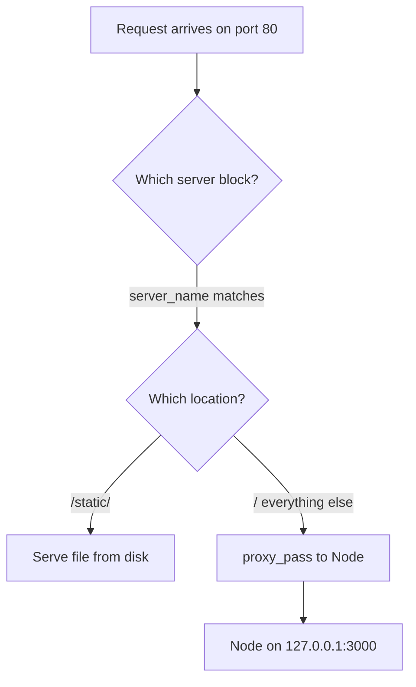

## In one line
Nginx is a fast web server that sits in front of your Node app, receives every request from the internet, handles the generic work itself, and passes the rest to your app.

## The problem it solves
Your shop API runs on port 3000. You could expose Node directly to the internet, but you would hit problems quickly:

- Browsers expect ports 80 (HTTP) and 443 (HTTPS). Ports below 1024 need root, and you don't want your app running as root.
- HTTPS needs certificates loaded, renewed, and configured securely. Doing that inside every app is repetitive and easy to get wrong.
- Serving product images and video thumbnails through Node wastes its time on work that is just "read a file, send it".
- You want `shop.example.com` and `api.example.com` on the same server, but only one program can own port 443.

A **reverse proxy** solves all four. It is a server that accepts requests from clients and forwards them to other servers behind it. "Reverse" because it acts on behalf of the servers, while a normal (forward) proxy acts on behalf of clients. **Nginx** (pronounced "engine-x") is the most common choice.

## Everyday analogy
A hotel reception desk. Guests never wander the corridors looking for staff. They go to reception. Reception answers simple questions itself ("Where's the lift?"), checks IDs at the door, and phones the right department for everything else. The departments never deal with the street directly.

Where it breaks down: reception is a single point of failure. If the desk closes, nobody gets in, even though every department is still working. The same happens when Nginx stops.

## How it works

### Processes
Nginx runs one **master process**, as root, which reads the config and opens ports 80 and 443. It starts several **worker processes**, as the unprivileged user `www-data`, which handle the actual traffic. Each worker is **event-driven**: instead of one thread per visitor, it juggles thousands of open connections and works on whichever one has data ready. That's why Nginx can hold many slow connections cheaply.

### Config structure
Config files are made of nested **blocks**:

- The `http` block holds settings for all web traffic.
- Each **`server` block** is one website. Nginx picks it by the port (`listen`) and the domain the browser asked for (`server_name`, compared with the request's `Host` header).
- Inside a server, **`location` blocks** match the URL path. An exact match (`location = /health`) wins outright. Otherwise the **longest matching prefix** wins, so `/static/` beats `/` for `/static/logo.png`. Regex locations (`location ~ ...`), if you have any, are checked after the prefix search and win when they match.
- Inside a location, either serve files from disk (`root`) or forward the request with **`proxy_pass`**.


*Notice: Nginx makes two choices, the site and then the path, and only the second decides whether Node is involved.*

### What forwarding changes
When Nginx forwards a request, it opens a new connection to Node. From Node's point of view, every request now comes from `127.0.0.1`. So Nginx adds **headers** (extra lines of information on the request) that record the original details:

- `Host`: the domain the visitor asked for.
- `X-Real-IP` and `X-Forwarded-For`: the visitor's real IP address. `X-Forwarded-For` is a chain, with one IP added by each proxy along the way.
- `X-Forwarded-Proto`: whether the visitor used `http` or `https`.

Your app must be told to trust these headers, but only from Nginx. Otherwise anyone could send a fake `X-Forwarded-For` and pretend to be another IP.

### When the app misbehaves
- **502 Bad Gateway**: Nginx couldn't get a valid response from the app. It is down, crashed, or on a different port.
- **504 Gateway Timeout**: the app accepted the request but didn't answer in time (60 seconds by default, `proxy_read_timeout`).

## Real example
**Setup:** Ubuntu with Nginx installed (`sudo apt install nginx`). The Express app listens on `127.0.0.1:3000`. Static files are in `/var/www/shop/public/static/`. DNS for `shop.example.com` points at the server.

**1. Write the site config** in `/etc/nginx/sites-available/shop`:

```nginx
server {
    listen 80;
    listen [::]:80;                        # IPv6 too, or IPv6 visitors get the default site
    server_name shop.example.com;
    client_max_body_size 20m;              # uploads up to 20 MB (default is 1 MB)

    # Static files: Nginx reads them straight from disk. Node is never involved.
    location /static/ {
        root /var/www/shop/public;         # /static/logo.png -> /var/www/shop/public/static/logo.png
        expires 7d;                        # let browsers cache them for a week
    }

    # Everything else goes to the Node app.
    location / {
        proxy_pass http://127.0.0.1:3000;
        proxy_set_header Host              $host;                       # original domain
        proxy_set_header X-Real-IP         $remote_addr;                # real client IP
        proxy_set_header X-Forwarded-For   $proxy_add_x_forwarded_for;  # chain of IPs
        proxy_set_header X-Forwarded-Proto $scheme;                     # http or https
    }
}
```

**2. Enable it, test, and reload:**

```bash
sudo ln -s /etc/nginx/sites-available/shop /etc/nginx/sites-enabled/   # Ubuntu's on/off switch
sudo nginx -t                    # check syntax. Never reload without this.
sudo systemctl reload nginx      # apply with no dropped connections
```

A **reload** starts new workers with the new config, and lets the old workers finish their current requests. A restart drops them.

**3. Tell Express to trust Nginx** (in `server.js`, after `const app = express()`):

```js
// Trust X-Forwarded-* headers only when the request comes from this machine (Nginx).
app.set('trust proxy', 'loopback');
app.get('/whoami', (req, res) => res.json({ ip: req.ip, protocol: req.protocol }));
```

Without that line, `req.ip` is always `127.0.0.1`, which breaks logging and rate limiting. With it, `req.ip` is the visitor's address.

**4. Check it works:**

```bash
curl -I http://shop.example.com/static/logo.png   # 200, served by Nginx, with Cache-Control: max-age=604800
sudo systemctl stop shop-api                       # simulate a crash
curl -s -o /dev/null -w '%{http_code}\n' http://shop.example.com/
# 502
sudo tail -n 1 /var/log/nginx/error.log
# connect() failed (111: Connection refused) while connecting to upstream ... upstream: "http://127.0.0.1:3000/"
```

HTTPS comes next, in [Domains and SSL on a server](#/topic/domains-ssl). Certbot edits this same server block to add port 443.

## How to say it in an interview

> [!INTERVIEW]
> **30 seconds:** "I put Nginx in front of Node as a reverse proxy. Nginx listens on 80 and 443, terminates HTTPS, serves static files directly, and forwards everything else to the Node app on localhost with proxy_pass. It also passes the real client IP and protocol in X-Forwarded headers, and I set trust proxy in Express so the app reads them. That way Node only does application work and is never exposed directly."

> [!INTERVIEW]
> **2 minutes:** Start with the 30-second answer, then add:
>
> "Nginx handles slow clients well. Its workers are event-driven, so a phone on a weak connection uploading a video doesn't tie up my app. Nginx buffers the request and hands it over once it's complete.
>
> The config is server blocks per domain, chosen by server_name, and location blocks per path, chosen by longest prefix. I can put the shop and the API on one server, and add an `upstream` block to balance across several Node processes.
>
> The tradeoff is one more moving part. Nginx is another config to maintain and a single point of failure on that machine. In the cloud, a managed load balancer can take over TLS and routing. And debugging changes: a 502 means 'Nginx couldn't reach the app', so I check that the app is running and on the right port before touching Nginx."

## Follow-up questions interviewers ask

<details>
<summary>What is the difference between a forward proxy and a reverse proxy?</summary>

A **forward proxy** acts for clients: a company routes employees' traffic through it to reach the internet, and websites see the proxy instead of the employee. A **reverse proxy** acts for servers: clients connect to it thinking it is the website, and it passes requests to the real servers hidden behind it.

</details>

<details>
<summary>What does a trailing slash in proxy_pass change?</summary>

With `location /api/ { proxy_pass http://127.0.0.1:3000; }` (no path after the port), the full original path is forwarded: `/api/orders` reaches Node as `/api/orders`. With `proxy_pass http://127.0.0.1:3000/;` (a path, even just `/`), Nginx replaces the matched `/api/` with `/`, so Node receives `/orders`. Mixing these up is a classic cause of mysterious 404s.

</details>

<details>
<summary>How do WebSockets work through Nginx?</summary>

A WebSocket starts as an HTTP request asking to "upgrade" the connection. Nginx doesn't forward those upgrade headers by default, so you add `proxy_http_version 1.1;`, `proxy_set_header Upgrade $http_upgrade;`, and `proxy_set_header Connection "upgrade";` in that location. Raise `proxy_read_timeout` too, because a quiet live-chat connection otherwise closes after 60 seconds.

</details>

<details>
<summary>Users get "413 Request Entity Too Large" when uploading videos. Why?</summary>

Nginx limits request bodies to 1 MB by default. Raise `client_max_body_size` for the upload route. For large videos, a better design is to let the browser upload straight to object storage with a presigned URL. See [File uploads](#/topic/file-uploads).

</details>

<details>
<summary>How does Nginx do load balancing?</summary>

Define an `upstream` block listing several app servers, then `proxy_pass http://shop_api;` using that name. By default Nginx sends requests to each in turn (round robin). It stops using a server for a while after failed attempts. See [Load balancers](#/topic/load-balancers).

</details>

## Common mistakes and misconceptions

> [!MISTAKE]
> Reloading without `sudo nginx -t`. A typo in the config can stop Nginx from starting at the next restart, taking down every site on the server.

> [!MISTAKE]
> Leaving the Node app listening on `0.0.0.0:3000`. Visitors can then skip Nginx, and its HTTPS and limits, by going to port 3000 directly. Bind the app to `127.0.0.1`.

> [!MISTAKE]
> Setting `app.set('trust proxy', true)` everywhere. That trusts every `X-Forwarded-For` value, so a client can fake its IP and slip past rate limits. Trust only the hops you control.

> [!MISTAKE]
> "502 means Nginx is broken." Usually Nginx is fine. It is reporting that the app behind it isn't answering. Check the app first.

## Tradeoffs: when NOT to use it
- **On managed platforms, you often don't need it.** Platforms and cloud load balancers already terminate HTTPS and route traffic. Adding Nginx behind them is one more hop to configure.
- **Not as your only line of defence.** Nginx can rate-limit and block, but it doesn't understand your business logic. Authorization and validation still belong in the app.
- **Not for complex, dynamic routing at scale.** Hand-edited config files suit a few sites. Many services that come and go need an API gateway or a Kubernetes ingress. See [API gateway](#/topic/api-gateway).

## Check yourself

<details>
<summary>1. A request arrives for shop.example.com/static/logo.png. With the config above, who answers it?</summary>

Nginx, directly from disk. The `server_name` picks the shop's server block, and `/static/` is the longest matching prefix, so the request never reaches Node.

</details>

<details>
<summary>2. Your Express logs show every visitor's IP as 127.0.0.1. What's missing?</summary>

`app.set('trust proxy', 'loopback')` (or the right hop count) in Express, plus the `X-Forwarded-For` header in the Nginx config. Without both, the app sees only Nginx's own address.

</details>

<details>
<summary>3. 502 or 504: which one do you expect when the app crashed, and which when it is stuck on a slow database query?</summary>

Crashed: 502, because the connection is refused. Stuck on a slow query: 504, because the app accepted the request but didn't answer before `proxy_read_timeout`.

</details>

## Go deeper
- [Nginx docs: Beginner's guide](https://nginx.org/en/docs/beginners_guide.html)
- [Nginx docs: ngx_http_proxy_module (proxy_pass and friends)](https://nginx.org/en/docs/http/ngx_http_proxy_module.html)
- [Express docs: Behind proxies](https://expressjs.com/en/guide/behind-proxies.html)
