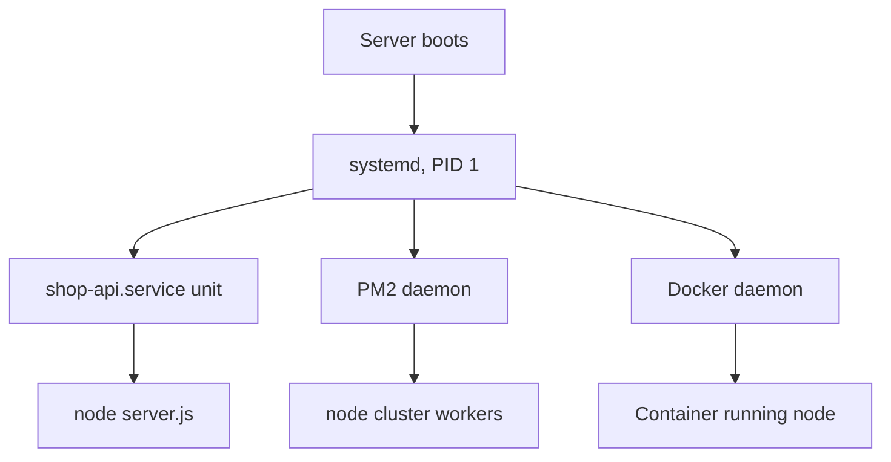

## In one line
A process manager is the program that starts your Node app at boot, restarts it when it crashes, and collects its logs; PM2, systemd, and Docker are three common ways to get that.

## The problem it solves
Your shop API runs as `node server.js`. At 3 a.m. a rare bug throws an unhandled error, and the process exits. Nobody is awake. The site shows 502 errors until someone notices in the morning.

A Node process that exits stays dead unless something brings it back. You need a supervisor that:

1. Starts the app when the server boots.
2. Restarts it within seconds if it crashes.
3. Keeps its logs somewhere you can read them.
4. Stops it gracefully during deploys.

All three tools here do those four jobs. They differ in what else they do, and in how they fit with the rest of your setup.

## Everyday analogy
A night-shift supervisor for a factory machine. If the machine jams, the supervisor restarts it and writes it in the logbook.

- **systemd** is the building's own supervisor: already on site, and looks after every machine in the building.
- **PM2** is a specialist hired just for Node machines. It knows tricks like running several copies side by side.
- **Docker** ships each machine in its own sealed box, and the box supplier's supervisor restarts the box.

Where it breaks down: a real supervisor can tell a jam from a design flaw. A process manager restarts a crashing app forever, whether or not the restart helps.

## How it works
All three sit on top of **systemd**, the program that boots Ubuntu and runs as process number 1. The question is who watches your Node process directly.


*Notice: systemd is always at the bottom. PM2 and Docker are extra supervisors that systemd starts first.*

**systemd directly.** You write a unit file, as in [Processes, ports, and services](#/topic/processes-ports-services). `Restart=on-failure` and `RestartSec=5` restart the app five seconds after a crash. Logs go to the **journal**, systemd's log store, which you read with `journalctl`. Nothing extra to install, and it works for any program. It doesn't run several copies for you or spread traffic between them.

**PM2.** A Node-specific process manager, installed with npm. It runs its own background **daemon** (a long-running background program) that starts and watches your apps. Its extras:

- **Cluster mode** (`-i max`) starts one copy of the app per CPU core. They share one port using Node's built-in `cluster` module. A Node process runs your JavaScript on a single thread, so this lets one app use every core.
- **Zero-downtime reload** (`pm2 reload`) restarts cluster copies one at a time, so some are always serving.
- Log files per app, and a live dashboard (`pm2 monit`).

To survive reboots, `pm2 startup` creates a systemd unit that starts PM2 at boot, and `pm2 save` records which apps PM2 should bring back.

**Docker.** The app runs in a **container**: an isolated process that carries its own files and Node version. The Docker daemon restarts it according to a **restart policy**, such as `--restart unless-stopped`. Since the daemon itself starts at boot, so do your containers. Logs come from the app's standard output, and `docker logs` shows them.

## Real example
**Setup:** the Express app from earlier in `/var/www/shop`, listening on port 3000 and handling SIGTERM.

**Option 1: systemd** (the key lines of `/etc/systemd/system/shop-api.service`):

```ini
[Service]
User=deploy
WorkingDirectory=/var/www/shop
ExecStart=/usr/bin/node server.js
Restart=on-failure        # restart after a crash...
RestartSec=5              # ...after waiting 5 seconds
```

**Option 2: PM2** (run as `deploy`, after `npm install -g pm2`):

```bash
pm2 start server.js --name shop-api -i max   # one copy per CPU core, in cluster mode
pm2 list                                     # status, restarts (↺), memory per copy
pm2 logs shop-api                            # follow logs
pm2 reload shop-api                          # after a deploy: one copy at a time, no downtime
pm2 save                                     # remember this app list
pm2 startup                                  # prints a sudo command: run it to start PM2 at boot
```

**Option 3: Docker** (with an image built from your Dockerfile):

```bash
docker run -d --name shop-api \
  --restart unless-stopped \
  -p 127.0.0.1:3000:3000 \
  shop-api:1.4.0
# unless-stopped: restart after crashes and reboots, unless you stopped it yourself
docker ps                     # is it up? how long since the last restart?
docker logs -f shop-api       # follow logs
```

In Docker Compose the same policy is one line: `restart: unless-stopped`.

## How to say it in an interview

> [!INTERVIEW]
> **30 seconds:** "A Node process that crashes stays dead, so in production something has to supervise it: start it at boot, restart it on crash, and keep its logs. I've used three options. systemd is built into Linux and needs nothing extra. PM2 is Node-specific and adds cluster mode and zero-downtime reloads. Docker restart policies do the job when the app already runs in containers, which is what I use most now."

> [!INTERVIEW]
> **2 minutes:** Start with the 30-second answer, then add:
>
> "How I choose: if the app is containerized, Docker's restart policy plus Compose is the supervisor, and I don't add PM2 inside the container. One supervisor per layer is enough. To use several cores in that setup, I run more containers behind Nginx or a load balancer. On a plain VPS without Docker, PM2 is convenient for Node because cluster mode and reload are one command. systemd is the most minimal choice, with nothing extra to keep updated.
>
> The tradeoff is that automatic restarts hide problems. If the app crashes every ten minutes, users see brief errors but uptime looks fine. So I alert on restart counts, PM2's ↺ column or `docker inspect` RestartCount, and treat repeated restarts as a bug to fix."

## Follow-up questions interviewers ask

<details>
<summary>Should you run PM2 inside a Docker container?</summary>

Usually not. Docker already restarts the container, and an orchestrator can run more copies. Adding PM2 means two supervisors, and a crash inside the container may be hidden from Docker's health and restart data. PM2 offers `pm2-runtime` for containers, but the common advice is one Node process per container.

</details>

<details>
<summary>What is PM2 cluster mode, and how is it different from running several containers?</summary>

Cluster mode starts several Node processes on one machine that share one port, so the app uses every CPU core. Several containers do the same thing at the infrastructure level, with a load balancer in front, and can also spread across machines. Cluster mode is simpler on one server, while containers scale further.

</details>

<details>
<summary>What's the difference between `restart: always` and `unless-stopped` in Docker?</summary>

Both restart the container after a crash and when the Docker daemon starts. The difference is after you stop it yourself: with `always`, a container you stopped by hand starts again when the daemon restarts, for example after a reboot. With `unless-stopped`, it stays stopped.

</details>

<details>
<summary>What happens if the app crashes immediately every time it starts?</summary>

With a short `RestartSec`, systemd gives up after too many starts in a short window (by default, 5 starts within 10 seconds) and marks the service failed. PM2 keeps retrying, and can use `--exp-backoff-restart-delay` to wait longer each time. Docker waits longer between each restart too. Either way, the fix is in the logs, not in the restart settings.

</details>

## Common mistakes and misconceptions

> [!MISTAKE]
> Running `pm2 start` but never `pm2 save` and `pm2 startup`. Everything works until the first reboot, then nothing comes back.

> [!MISTAKE]
> "PM2 makes my app faster." Only cluster mode helps, and only by using more cores for CPU-bound work. One slow database query is just as slow with PM2.

> [!MISTAKE]
> Using cluster mode with in-memory state, like sessions or a rate-limit counter in a JavaScript object. Each copy has its own memory, so a user's next request may reach a copy that has never seen them. Keep shared state in Redis.

## Tradeoffs: when NOT to use it
- **Skip PM2 when you already use Docker or Kubernetes.** Their supervisors, health checks, and scaling replace it.
- **Skip a process manager on managed platforms.** The platform already restarts and scales your app.
- **Don't treat restarts as reliability.** A supervisor turns a crash into a short outage. It doesn't fix the crash. Pair it with [health checks](#/topic/health-checks), alerts, and logs.

## Check yourself

<details>
<summary>1. You rebooted the server and the PM2 apps didn't come back. What was missing?</summary>

`pm2 startup`, which creates the systemd unit that starts PM2 at boot, and `pm2 save`, which records the apps to restore.

</details>

<details>
<summary>2. Your app runs in Docker with Compose. Which setting keeps it running after crashes and reboots?</summary>

`restart: unless-stopped` (or `always`) on the service. The Docker daemon starts at boot and restarts the container.

</details>

<details>
<summary>3. Why does PM2 cluster mode exist at all?</summary>

A Node process runs JavaScript on one thread, so it uses roughly one CPU core. Cluster mode runs one copy per core, all sharing one port, so a 4-core server can do about four times the CPU-bound work.

</details>

## Go deeper
- [PM2 documentation: Quick start](https://pm2.keymetrics.io/docs/usage/quick-start/)
- [Docker docs: Start containers automatically](https://docs.docker.com/engine/containers/start-containers-automatically/)
