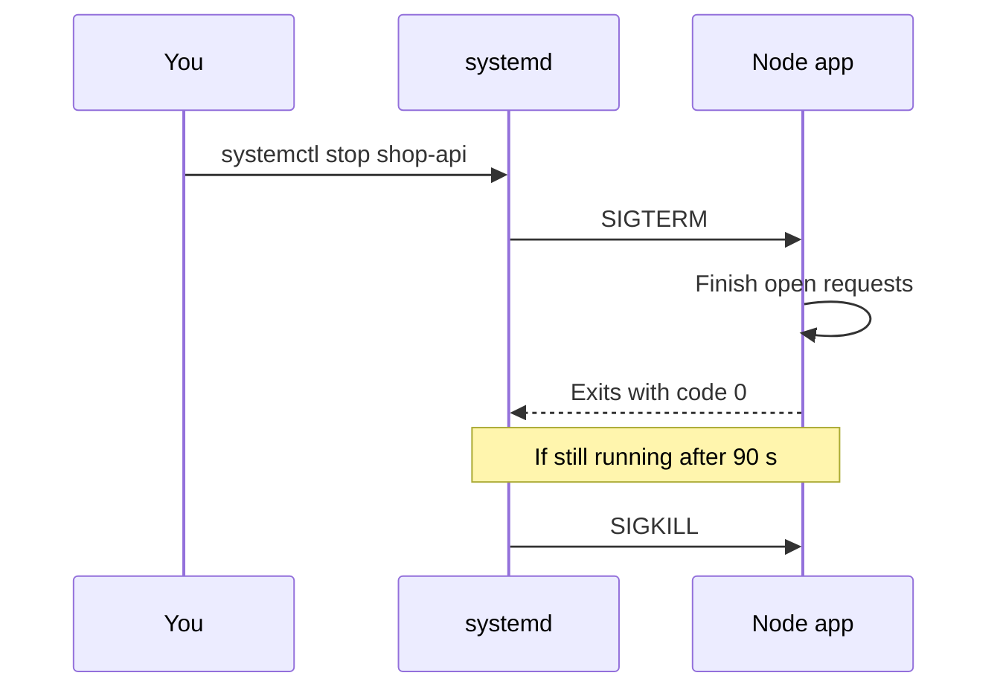

## In one line
A process is a running program, a port is the numbered door it listens on, and a service is a process that the system starts at boot and keeps running for you.

## The problem it solves
You start your shop's API with `node server.js` over SSH. It works. Then you close your laptop, the SSH session ends, and the API dies with it. The next morning the server reboots for an update, and nothing starts again.

Other days, a deploy fails with `listen EADDRINUSE: address already in use :::3000`, and you need to know what holds port 3000. Or you need to restart the app without cutting off customers halfway through checkout. All of these need the same three ideas: processes, ports, and services.

## Everyday analogy
A hotel. Each guest is a **process**: someone actually staying there, with a room number (the process ID). The front desk phone extensions are **ports**: a call to extension 443 rings the guest who claimed it. The **service manager** is the hotel manager, who has a list of permanent staff to bring in every morning and replace if they walk out.

Where it breaks down: one guest can answer several extensions, but two guests can't share one extension on the same line.

## How it works

### Processes
A **process** is a program that is currently running, with its own memory. Running `node server.js` twice gives two processes from one program.

- Each process has a **PID** (process ID), a unique number.
- Each process was started by another, its **parent** (PPID). They form a tree.
- At the top is PID 1. On Ubuntu that is **systemd**, the program that boots the system and manages services.

`ps` shows each process's **state** in the `STAT` column:

| State | Meaning |
|---|---|
| `R` | Running, or ready to run |
| `S` | Sleeping: waiting for something, like a network request. Most processes, most of the time |
| `D` | Waiting on disk, and can't be interrupted. Many of these suggest a slow or failing disk |
| `T` | Stopped (paused), for example with Ctrl+Z |
| `Z` | **Zombie**: finished, but its parent hasn't collected its exit code yet |

### Signals
A **signal** is a short message the system delivers to a process. You send them with `kill`, which is badly named: it sends any signal, not only deadly ones.

| Signal | Number | What it means |
|---|---|---|
| `SIGTERM` | 15 | "Please stop." The process can catch it, clean up, and exit. The default for `kill`. |
| `SIGINT` | 2 | "Interrupt", sent by Ctrl+C. Can be caught. |
| `SIGHUP` | 1 | Originally "the terminal hung up". Many daemons treat it as "reload your config". |
| `SIGKILL` | 9 | The kernel ends the process at once. It can't be caught, so there is no cleanup. |

The rule: send **SIGTERM** first, wait, and use **SIGKILL** only if the process ignores it. SIGTERM lets your app finish open requests and close database connections. SIGKILL can leave a half-written file or a customer whose order request was cut off mid-way.

### Ports
A **port** is a number from 1 to 65535 that says which process on a machine should receive a network connection. A process **listens** on a port by claiming it on an address:

- `127.0.0.1:3000` accepts connections only from the same machine (localhost).
- `0.0.0.0:3000` accepts connections on every network address, including the public one.

Only one process can listen on a given address and port. A second one gets `EADDRINUSE`. Ports below 1024 are **privileged**: normal users can't listen on them. That is one reason Node apps listen on 3000 behind [Nginx](#/topic/nginx-reverse-proxy), which handles 80 and 443.

### Services and systemd
A **service** is a long-running background process, often called a **daemon**, that systemd manages. You describe it in a **unit file** with three sections:

- `[Unit]`: what it is, and what it should start after (for example, the network).
- `[Service]`: how to run it: the command, the user, the folder, the environment, and what to do if it crashes.
- `[Install]`: when to start it at boot. `WantedBy=multi-user.target` means "during a normal boot".

When you stop a service, systemd uses the same signal rule:


*Notice: the app gets a polite request and a grace period before it is forced to stop.*

The 90 seconds is systemd's default `TimeoutStopSec`. Docker does the same with `docker stop`, but waits only 10 seconds by default.

## Real example
**Setup:** Ubuntu, Node.js installed at `/usr/bin/node`, the app in `/var/www/shop`, `npm install express` done, and `"type": "module"` in `package.json`.

**1. Make the app stop gracefully** (`server.js`):

```js
import express from 'express';

const app = express();
app.get('/health', (req, res) => res.send('ok'));

const server = app.listen(3000, '127.0.0.1', () => {
  console.log(`Listening on 127.0.0.1:3000 as PID ${process.pid}`);
});

function shutdown(signal) {
  console.log(`${signal} received: finishing open requests`);
  server.close(() => {            // stop taking new connections, wait for open ones
    console.log('Clean exit');
    process.exit(0);
  });
  setTimeout(() => process.exit(1), 10_000).unref(); // give up after 10 s
}

process.on('SIGTERM', shutdown);  // sent by systemctl stop, docker stop, kill
process.on('SIGINT', shutdown);   // sent by Ctrl+C
```

**2. Describe the service** in `/etc/systemd/system/shop-api.service`:

```ini
[Unit]
Description=Shop API
After=network.target

[Service]
User=deploy
WorkingDirectory=/var/www/shop
ExecStart=/usr/bin/node server.js
Environment=NODE_ENV=production
Restart=on-failure

[Install]
WantedBy=multi-user.target
```

`Restart=on-failure` restarts the app if it crashes. `systemctl` is the command for controlling systemd:

```bash
sudo systemctl daemon-reload            # make systemd re-read unit files
sudo systemctl enable --now shop-api    # start now, and at every boot
systemctl status shop-api               # running? PID? last few log lines
journalctl -u shop-api -f               # follow this service's logs
sudo systemctl restart shop-api         # after a deploy
```

**3. Inspect what's running:**

```bash
ps aux | grep node      # every process, filtered to node
top                     # live view, busiest first. Press q to quit.
sudo ss -tlnp           # listening sockets: -t TCP, -l listening, -n numbers, -p process
```

```text
State  Recv-Q Send-Q Local Address:Port Peer Address:Port Process
LISTEN 0      511        127.0.0.1:3000      0.0.0.0:*    users:(("node",pid=3533,fd=18))
```

That line answers the `EADDRINUSE` puzzle: PID 3533 holds port 3000. `kill 3533` asks it to stop. If it is a systemd service, stop it with `systemctl` instead, or `Restart=` brings it straight back.

If a process dies from SIGKILL, its exit code is 137: 128 plus the signal number, 9. You will see 137 a lot in Docker, often because the system ran out of memory.

## How to say it in an interview

> [!INTERVIEW]
> **30 seconds:** "A process is a running program with its own PID and memory. It can listen on a port, which is how network traffic reaches the right program. To keep an app running, I make it a systemd service with a unit file, so it starts at boot and restarts if it crashes. To stop processes I send SIGTERM first, which my Node app catches to finish in-flight requests, and only use SIGKILL if it hangs."

> [!INTERVIEW]
> **2 minutes:** Start with the 30-second answer, then add:
>
> "For example, my shop API listens on 127.0.0.1 port 3000, so only Nginx on the same machine can reach it. Its unit file sets the user, working directory, and `Restart=on-failure`.
>
> Graceful shutdown matters for deploys. When systemd or Docker stops the app, it sends SIGTERM. My handler calls `server.close()`, so in-flight checkout requests finish, then closes the database pool and exits. If that takes too long, the manager sends SIGKILL.
>
> The tradeoff with automatic restarts is that they can hide a real problem. An app that crashes every minute looks 'up' most of the time. So I alert on restart counts too. When something holds a port, I use `ss -tlnp` to find the PID instead of guessing."

## Follow-up questions interviewers ask

<details>
<summary>What is the difference between SIGTERM and SIGKILL?</summary>

SIGTERM asks the process to stop. It can catch the signal, clean up, and exit in its own time. SIGKILL is carried out by the kernel immediately. The process never sees it, so nothing gets cleaned up. Always try SIGTERM first.

</details>

<details>
<summary>What does "listening on 0.0.0.0" mean, and why might it be dangerous?</summary>

The process accepts connections on every network interface, including the public IP. If your Node app or database listens on `0.0.0.0` and no firewall blocks the port, anyone on the internet can reach it directly. Bind internal services to `127.0.0.1`. See [Firewalls and open ports](#/topic/firewalls).

</details>

<details>
<summary>What is a zombie process? Should you worry?</summary>

A process that has finished, but whose parent hasn't read its exit code yet. It uses no CPU or memory, only a slot in the process table. A few are harmless. Thousands mean the parent has a bug. You can't kill a zombie, because it is already dead. You fix or restart the parent.

</details>

<details>
<summary>How do you find which process uses port 3000?</summary>

`sudo ss -tlnp | grep 3000` shows the listening socket and the PID. `sudo lsof -i :3000` works too. `sudo` is needed to see processes owned by other users.

</details>

<details>
<summary>Why does a Node app in Docker sometimes ignore SIGTERM?</summary>

Inside a container, your app is often PID 1. Linux treats PID 1 specially: signals it has no handler for are ignored, rather than killing it. So unless your code handles SIGTERM, `docker stop` waits 10 seconds and then sends SIGKILL. Fix it by handling SIGTERM in code, or by running with `docker run --init`, which adds a tiny init process as PID 1. Also start Node directly (`CMD ["node", "server.js"]`), not through a shell.

</details>

## Common mistakes and misconceptions

> [!MISTAKE]
> "`kill` kills a process, so `kill -9` is just a stronger version to use first." Plain `kill` sends SIGTERM, a polite request the app can handle. `kill -9` skips all cleanup: open requests are dropped and files can be left half-written. Use it only when SIGTERM fails.

> [!MISTAKE]
> Using `nohup node server.js &` or a `screen` session as "production". The app survives your logout, but not a crash or a reboot. Use systemd, PM2, or Docker. See [PM2 vs systemd vs Docker](#/topic/process-managers).

> [!MISTAKE]
> Editing a unit file and only running `systemctl restart`. systemd keeps its own copy. Run `sudo systemctl daemon-reload` first, or your change is ignored.

## Tradeoffs: when NOT to use it
- **Hand-written unit files don't scale to many servers.** One or two machines are fine. Beyond that, ship the app as a container image and let Docker or an orchestrator handle restarts.
- **Restarting is not fixing.** `Restart=always` turns a crash into a short blip, which is good for users but can hide a memory leak for weeks. Watch restart counts and logs.
- **Don't run several copies of one app with systemd alone** if you want automatic load spreading. systemd keeps processes alive. It doesn't share traffic between them. That needs a [load balancer](#/topic/load-balancers) or Node's cluster mode.

## Check yourself

<details>
<summary>1. Your deploy fails with EADDRINUSE on port 3000. What are your first two commands?</summary>

`sudo ss -tlnp | grep 3000` to find the PID holding the port, then `ps -p <PID> -f` to see what it is. Often it is the old version of the app, still running under systemd, PM2, or a forgotten terminal.

</details>

<details>
<summary>2. A container exits with code 137. What happened?</summary>

It received SIGKILL (128 + 9). Common causes: it ran out of memory and the kernel killed it, or it ignored SIGTERM and was force-stopped after the timeout.

</details>

<details>
<summary>3. In a unit file, which section says "start at boot"?</summary>

`[Install]`, with `WantedBy=multi-user.target`. It takes effect when you run `systemctl enable`.

</details>

## Go deeper
- [systemd manual: systemd.service](https://www.freedesktop.org/software/systemd/man/latest/systemd.service.html)
- [Node.js docs: process signal events](https://nodejs.org/api/process.html#signal-events)
