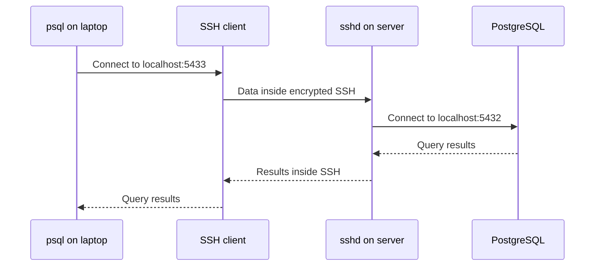

## In one line
An SSH tunnel carries traffic for another program, such as a database client, through your encrypted SSH connection, and `scp` and `rsync` use that same connection to copy files to and from a server.

## The problem it solves
Your shop's PostgreSQL database runs on the server `video-prod`. It listens only on `127.0.0.1:5432`, so nothing on the internet can reach it, and your firewall keeps port 5432 closed. That is exactly right for security.

But today you need to query it from your laptop to investigate a wrong order total, download last night's backup, and upload new product images.

Opening port 5432 would expose the database to every bot on the internet. You already have one safe, encrypted, authenticated door into the server: [SSH](#/topic/ssh) on port 22. Tunnels and file copying reuse that door instead of opening new ones.

## Everyday analogy
A pneumatic tube between two buildings. You already have a secure, locked tube to the server building. Instead of opening a new public door for the database, you put your database requests into the tube. Someone at the other end walks them to the database room down the corridor, and sends the answers back the same way.

Where it breaks down: the tube only exists while your SSH connection is open. Close the laptop, and the tube disappears.

## How it works

### Local port forwarding (`-L`)
This is the tunnel you will use most:

```text
ssh -L 5433:localhost:5432 video-prod
       └┬─┘ └───┬───┘ └┬─┘
        │       │      └ port to reach, as seen from the server
        │       └ host to reach, as seen from the SERVER
        └ port to open on YOUR laptop
```

1. Your SSH client starts listening on port 5433 on your laptop, at `127.0.0.1` only.
2. Your database tool connects to `localhost:5433`, as if the database were local.
3. The SSH client sends that traffic, encrypted, inside the existing SSH connection.
4. On the server, `sshd` (the SSH server program) opens a normal connection to `localhost:5432`. Here, "localhost" means the **server**, not your laptop.
5. Replies travel back the same way.


*Notice: the database never faces the internet. Only port 22 does, and the database sees a connection from the server itself.*

### Other forwards, briefly
- **Remote forwarding (`-R`)** is the reverse: it opens a port on the **server** that leads back to your laptop. For example, `-R 9000:localhost:3000` lets the server reach the app you are running locally.
- **Dynamic forwarding (`-D 1080`)** turns SSH into a **SOCKS proxy**: a general relay that apps like a browser can send any traffic through, so it appears to come from the server.
- **ProxyJump (`-J`)** hops through a **bastion host** (a server whose only job is to be the entry point) to reach private servers: `ssh -J bastion.example.com deploy@10.0.1.25`.

### Copying files
- **scp** copies files over SSH. It is simple, and always copies everything you name. Since OpenSSH 9.0, `scp` uses the SFTP protocol underneath, but the command looks the same.
- **rsync** compares the source and the destination first, then sends only new or changed files. For a changed large file, it can send just the changed parts. Re-running it after a dropped connection only sends what's missing.

## Real example
**Setup:** the `video-prod` alias from the [SSH topic](#/topic/ssh) is in your `~/.ssh/config`. On the server, PostgreSQL listens on `127.0.0.1:5432` and has a read-only user `shop_readonly`. `psql`, PostgreSQL's command-line client, is installed on your laptop.

**1. Query the private database:**

```bash
# -N: don't open a shell, just hold the tunnel open. Ctrl+C closes it.
ssh -N -L 5433:localhost:5432 video-prod

# In a second terminal on your laptop:
psql "postgresql://shop_readonly@localhost:5433/shop" -c "SELECT id, total_cents FROM orders WHERE id = 1042;"
```

Port 5433 avoids clashing with a local PostgreSQL on 5432. Database GUI tools offer an "SSH tunnel" setting that does the same thing.

**2. Copy single files with scp:**

```bash
scp video-prod:/var/backups/shop-2026-10-26.sql.gz .   # server -> current folder on laptop
scp ./banner.jpg video-prod:/var/www/shop/public/      # laptop -> server
```

**3. Sync a folder with rsync.** Rsync must be installed on both machines. The trailing slash matters:

```bash
rsync -a public/  video-prod:/var/www/shop/public/   # copies the CONTENTS of public
rsync -a public   video-prod:/var/www/shop/public/   # copies the folder itself: .../public/public
```

Always preview with `-n` (dry run) before using `--delete`, which removes files on the destination that no longer exist in the source:

```bash
# -a archive: recursive, keeps permissions and timestamps
# -v verbose, -z compress in transit, -n dry run: show what WOULD happen
rsync -avzn --delete public/ video-prod:/var/www/shop/public/
# Happy with the list? Run it again without -n.
```

## How to say it in an interview

> [!INTERVIEW]
> **30 seconds:** "An SSH tunnel forwards a port through an encrypted SSH connection. For example, our production database only listens on localhost, so I run `ssh -L 5433:localhost:5432` to the server and point my database client at localhost 5433. The database never has to be exposed to the internet. For files, I use scp for one-off copies and rsync for folders, because rsync only sends what changed and can resume."

> [!INTERVIEW]
> **2 minutes:** Start with the 30-second answer, then add:
>
> "The key detail in `-L` is that the destination host is resolved from the server's side. So 'localhost' means the server itself, and I can also name a private host the server can reach, like a managed database inside the cloud provider's private network, reached through a bastion host.
>
> For safety, I connect with a read-only database user. The tunnel only listens on my laptop's localhost, so other people on café Wi-Fi can't use it.
>
> The tradeoff: tunnels are great for occasional admin access, but fragile as permanent infrastructure. If one service needs to reach another all the time, I'd put them on a private network or VPN instead of keeping an SSH tunnel alive. And for deploys, I prefer building a Docker image in CI over rsyncing files onto a server by hand."

## Follow-up questions interviewers ask

<details>
<summary>What's the difference between -L and -R?</summary>

`-L` (local) opens a port on **your** machine that leads to something the server can reach. `-R` (remote) opens a port on the **server** that leads back to something your machine can reach. Use `-L` to reach a private database. Use `-R` to let a server reach something running on your laptop.

</details>

<details>
<summary>Why not just open port 5432 to your own IP address instead?</summary>

You can, with a firewall rule. But home IP addresses change, every teammate needs a rule, and a forgotten rule leaves the database exposed. A tunnel needs no new open port and reuses SSH's key-based login.

</details>

<details>
<summary>How do you reach a database in a private subnet that only a bastion host can reach?</summary>

Use the bastion as the tunnel's middle point, and name the private database as the destination: `ssh -N -L 5433:10.0.2.15:5432 bastion.example.com`. The bastion connects onward to `10.0.2.15:5432`. To log in to a private server instead, use `ssh -J bastion.example.com deploy@10.0.1.25`.

</details>

<details>
<summary>When would you choose rsync over scp?</summary>

For folders and repeated copies. Rsync skips files that are already up to date, can send just the changed parts of big files, can resume, and can mirror deletions with `--delete`. scp is fine for copying one file once.

</details>

## Common mistakes and misconceptions

> [!MISTAKE]
> Forgetting the trailing slash in rsync. `rsync -a public dest/` creates `dest/public`, while `rsync -a public/ dest/` copies the contents into `dest`. Combined with `--delete`, the wrong one can wipe a folder. Dry-run with `-n` first.

> [!MISTAKE]
> "localhost in `-L 5433:localhost:5432` means my laptop." It means the **server**. The destination is resolved after the traffic leaves the tunnel.

> [!MISTAKE]
> Binding a tunnel to every address, as in `-L 0.0.0.0:5433:localhost:5432`. Anyone who can reach your laptop, such as people on the same Wi-Fi, can then use your tunnel into production. Keep the default, which listens on localhost only.

## Tradeoffs: when NOT to use it
- **Not for permanent service-to-service links.** Tunnels die with the SSH connection and are easy to forget. Use a private network, a VPN, or the cloud provider's private networking.
- **Not as a deployment method.** Rsyncing files onto a live server leaves it in an unknown state. Build an image in CI and deploy that. See [Deploying Docker over SSH](#/topic/deploy-docker-ssh).
- **Not for large teams without control.** Everyone tunnelling into production with full rights is risky. Bigger teams use bastions with audit logs, cloud session tools, or a database proxy with per-person accounts.

## Check yourself

<details>
<summary>1. Write the command to reach a server's private Redis (port 6379) on your laptop's port 6380.</summary>

`ssh -N -L 6380:localhost:6379 video-prod`, then `redis-cli -p 6380` on your laptop.

</details>

<details>
<summary>2. You rsync a 2 GB folder, the connection drops at 80%, and you run the same command again. What happens?</summary>

Rsync compares both sides and skips files that already match, so it sends roughly the remaining 20%. Add `--partial` (or `-P`) so a big file that was half-sent can continue too.

</details>

<details>
<summary>3. Is data inside an SSH tunnel encrypted all the way to the database?</summary>

It is encrypted from your laptop to the SSH server. From `sshd` to the database it is a normal connection, but here it never leaves the server, because it goes to `localhost`. If the destination is another machine, that last hop is only as safe as that network.

</details>

## Go deeper
- [OpenBSD manual: ssh (see -L, -R, -D, -J)](https://man.openbsd.org/ssh)
- [Ubuntu manpage: rsync](https://manpages.ubuntu.com/manpages/noble/man1/rsync.1.html)
