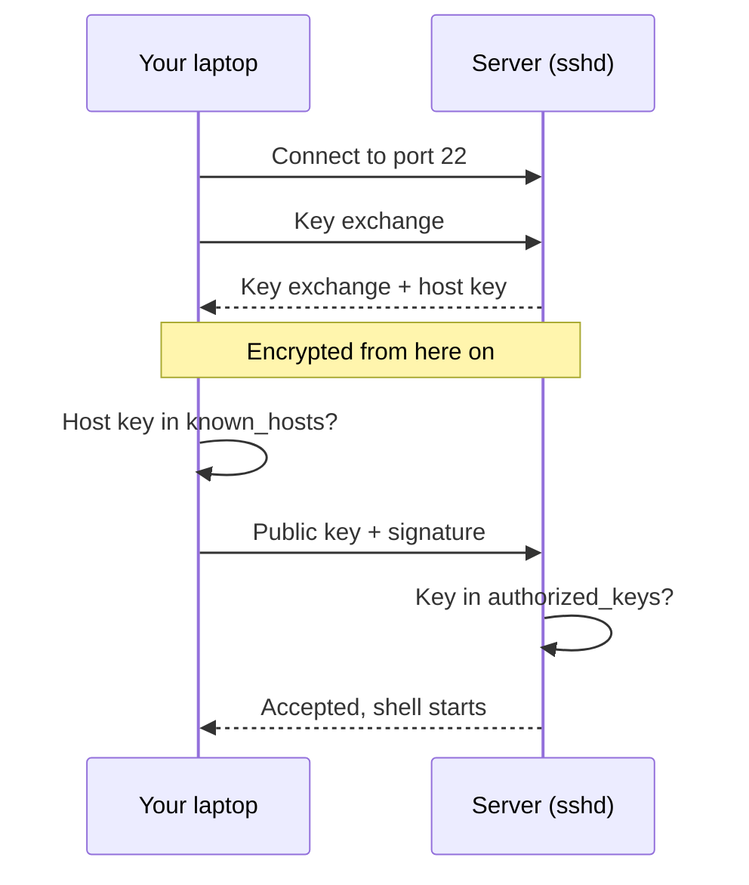

## In one line
SSH lets you log in to a remote computer and run commands over an encrypted connection, usually proving who you are with a key file instead of a password.

## The problem it solves
You rent a server for your video app at `203.0.113.10`. It sits in a data centre far away, with no screen and no keyboard. Every task needs you to type commands on it: installing Docker, reading logs, restarting the app.

A few words first:

- A **shell** is the program that reads the commands you type and runs them. On Ubuntu it is usually `bash`.
- A **terminal** is the window you type those commands into.
- **Encryption** scrambles data so that only someone with the right key can read it.

Two things make remote access dangerous:

1. **Anyone between you and the server could read your traffic.** Older tools like Telnet sent everything as plain text, including your password. On shared café Wi-Fi, others on the network could read it.
2. **Public servers are attacked all the time.** Automated programs (bots) scan the internet and try common usernames and passwords on every server they find. This is called **brute forcing**. A brand-new server commonly sees these attempts within hours of going online.

**SSH** (Secure Shell) solves both problems. It encrypts the whole session, and it lets you log in with a key that bots cannot guess.

## Everyday analogy
A bank signature card. When you open an account, the bank keeps a sample of your signature on file. Later, to prove it is you, you sign a fresh slip in front of the clerk, and they compare it with the sample. The bank never needs your pen.

In SSH, the server keeps your **public key** on file: that's the sample. Your laptop keeps the **private key**: your hand and pen. To log in, your laptop signs something unique to this connection, and the server checks that signature against the public key.

Where it breaks down: a real signature can be forged with practice, but a digital signature cannot be produced without the private key. Also, the bank must prove it is the real bank. In SSH the server proves its identity first, with its own **host key**.

## How it works
Two more terms first:

- A **key pair** is two linked files made together. Anything the private key signs, the public key can verify. You can share the public key freely. The private key never leaves your laptop.
- **sshd** is the SSH server program. It is a **daemon**: a program that runs in the background waiting for work. By default it listens on **port** 22. A port is the number that says which program on a computer should receive the traffic.

You type `ssh deploy@203.0.113.10`, meaning "log in as the user `deploy` on that server". Then:

1. **Connect.** Your SSH client opens a TCP connection to port 22, where `sshd` is listening.
2. **Agree on encryption.** Both sides run a **key exchange**. This is a piece of math that lets them build the same secret session key without ever sending it over the network. From this point on, everything is encrypted.
3. **The server proves who it is.** It signs the key exchange with its **host key**. The first time you connect, your client shows the host key's **fingerprint**, a short summary of the key, and asks whether you trust it. If you say yes, it is saved in `~/.ssh/known_hosts` on your laptop. On later visits, if the key does not match, SSH refuses with a loud warning, because someone may be impersonating the server.
4. **You prove who you are.** Your client sends your public key, plus a signature over this session's unique ID, made with your private key. The server checks two things: that this public key is listed in `/home/deploy/.ssh/authorized_keys`, and that the signature is valid.
5. **You're in.** The server starts a shell for `deploy`. Your keystrokes travel encrypted to the server, and the output travels encrypted back.


*Notice: the server proves its identity before you prove yours, and your private key never crosses the network.*

## Real example
**Setup:**
- An Ubuntu server with a user called `deploy` that has `sudo` rights. `sudo` runs one command as the administrator, called root.
- You can currently log in to `deploy` with a password.
- On your laptop, macOS, Linux, and Windows 10 or later all include the `ssh` command.

**1. Create a key pair and install it (on your laptop):**

```bash
# Create a key pair once per laptop. Set a passphrase when asked.
ssh-keygen -t ed25519 -C "your-name@laptop"
# This creates two files:
#   ~/.ssh/id_ed25519      private key: never share it, never copy it to a server
#   ~/.ssh/id_ed25519.pub  public key: safe to share

# Copy the PUBLIC key into the server's authorized_keys.
# It asks for deploy's password one last time.
ssh-copy-id -i ~/.ssh/id_ed25519.pub deploy@203.0.113.10

# Log in. No password prompt this time.
ssh deploy@203.0.113.10
```

**2. Give the server a short name.** Add this to `~/.ssh/config` on your laptop:

```text
Host video-prod
    HostName 203.0.113.10
    User deploy
    IdentityFile ~/.ssh/id_ed25519
```

Now `ssh video-prod` works. So do `scp`, `rsync`, and `git` when they connect to `video-prod`.

**3. Turn off password login (on the server).**

> [!WARNING]
> Keep your current SSH session open while you do this. Then test the change from a **second** terminal. If something goes wrong, the open session is your way back in. Most cloud providers also offer a browser-based console as a last resort.

```bash
# Ubuntu reads /etc/ssh/sshd_config.d/*.conf first, and the FIRST value set wins.
# Naming the file 00-... means it is read before, for example, a cloud
# provider's 50-cloud-init.conf that might turn passwords back on.
sudo tee /etc/ssh/sshd_config.d/00-hardening.conf > /dev/null <<'EOF'
PasswordAuthentication no
KbdInteractiveAuthentication no
PermitRootLogin no
EOF

sudo sshd -t                     # check the config for errors (no output means OK)
sudo sshd -T | grep -iE '^(passwordauthentication|permitrootlogin)'  # values sshd will actually use
sudo systemctl restart ssh       # apply the change; open sessions stay connected
```

`systemctl` is the command that starts, stops, and restarts background services on Ubuntu.

**4. Prove it worked.** From your second terminal, try to log in with a password only:

```bash
ssh -o PubkeyAuthentication=no deploy@203.0.113.10
# deploy@203.0.113.10: Permission denied (publickey).
```

That error is the success message. The server no longer accepts passwords at all, so bots guessing passwords cannot get in.

## How to say it in an interview

> [!INTERVIEW]
> **30 seconds:** "SSH is how I securely log in to remote servers and run commands. First the client and server do a key exchange to set up an encrypted channel. The server proves its identity with its host key, which my client checks against known_hosts. Then I log in with a key pair: my public key is in the server's authorized_keys, and my client proves it holds the matching private key by signing the session. On my servers I turn off password and root login, so bots can't brute-force their way in."

> [!INTERVIEW]
> **2 minutes:** Start with the 30-second answer, then add:
>
> "Keys are safer than passwords for two reasons. An Ed25519 key is far too large to guess, and the private key never travels to the server, so even a compromised server can't steal it. I protect my private key with a passphrase and use ssh-agent so I only type it once per session. I also keep a `~/.ssh/config` with short names for each server.
>
> For deployments, I'd give GitHub Actions its own key pair, with the private key stored as an encrypted secret. Its public key goes on a limited user on the server, so I can revoke CI access without touching anyone else's.
>
> The tradeoff is key management. Every person's public key sits on every server, so when someone leaves, you must remove their key everywhere. Larger teams solve that with SSH certificates, which are short-lived keys signed by a central authority, or with cloud tools like AWS Session Manager that don't need port 22 open at all. I'd also restrict port 22 with a firewall, so only known IP addresses or a VPN, a private encrypted network, can reach it."

## Follow-up questions interviewers ask

<details>
<summary>What is the difference between the host key and your user key?</summary>

The **host key** belongs to the server and proves the server's identity to you. Your client stores its fingerprint in `known_hosts`. Your **user key** belongs to you and proves your identity to the server. Its public half goes in the server's `authorized_keys`. Both sides prove who they are, using different keys.

</details>

<details>
<summary>SSH shows "WARNING: REMOTE HOST IDENTIFICATION HAS CHANGED!". What do you do?</summary>

Stop, and don't type yes or delete files straight away. The server's host key no longer matches what you saved. That happens for innocent reasons: the server was rebuilt, or the IP address now belongs to a different machine. But it is also exactly what a **man-in-the-middle** attack looks like: someone secretly sitting between you and the server, pretending to be it.

Confirm through another channel, such as your cloud provider's console or the person who rebuilt the server. If the change is legitimate, remove the old entry with `ssh-keygen -R 203.0.113.10` and connect again.

</details>

<details>
<summary>Why are SSH keys safer than passwords?</summary>

Three reasons:

- **They can't be guessed.** A key is a huge random number, while people pick passwords that are easy to remember and so easy to guess.
- **The private key never leaves your laptop.** A fake or compromised server never receives it.
- **One leak stays contained.** You use a different key per laptop, and the server holds only public keys, so a stolen server copy is useless for logging in anywhere.

</details>

<details>
<summary>What is ssh-agent, and why use a passphrase?</summary>

A passphrase encrypts the private key file on your disk, so a stolen laptop or a leaked backup does not expose a usable key. **ssh-agent** is a small background program that holds the unlocked key in memory, so you type the passphrase once per session instead of on every connection.

</details>

<details>
<summary>Does moving SSH from port 22 to another port make the server secure?</summary>

No. It cuts down on noise in the logs, because many bots only try port 22. But a port scan finds the new port quickly. Real security comes from key-only login, no root login, and firewall rules that limit who can reach the port at all.

</details>

<details>
<summary>What is agent forwarding, and why be careful with it?</summary>

`ssh -A` lets a server you are logged in to use your local ssh-agent to log in onward, to another server. The risk: while you are connected, anyone with root on that first server can use your agent to log in as you anywhere your key works. To reach private servers through a **jump host** (a server you hop through), prefer `ssh -J jumphost target` (ProxyJump), which never exposes your agent to the jump host.

</details>

<details>
<summary>A teammate's laptop is stolen. What do you do?</summary>

Remove their public key from `authorized_keys` on every server and in every service that uses it, such as GitHub. Then have them create a new key pair on their new machine. This is easy only if every person has their own key. A shared team key would mean replacing it for everyone.

</details>

## Common mistakes and misconceptions

> [!MISTAKE]
> "My key pair encrypts the whole session." No. The key pair only **proves identity**. The session is encrypted with temporary keys created by the key exchange, and those are thrown away when the connection closes.

> [!MISTAKE]
> Copying the private key (`id_ed25519`) to the server, or sharing one key across the whole team. Only the **public** key (`.pub`) goes on servers, and each person and each machine gets its own key pair.

> [!MISTAKE]
> Turning off password login before testing key login, then getting locked out. Always test the key from a second terminal while your first session stays open.

> [!MISTAKE]
> "The key is in authorized_keys but SSH still asks for a password." This is often a **permissions** problem. `sshd` ignores `authorized_keys` if the file or the `.ssh` folder can be changed by other users. Fix it with `chmod 700 ~/.ssh && chmod 600 ~/.ssh/authorized_keys`. Similarly, the client refuses a private key that other users can read.

> [!MISTAKE]
> Answering "yes" to every host key prompt, or deleting `known_hosts` whenever SSH warns. That switches off the protection against impostor servers.

## Tradeoffs: when NOT to use it
- **Don't make SSH your deployment process.** Changing production by hand creates "snowflake servers": machines nobody can rebuild because nobody remembers every command that was typed. Use SSH to investigate. Put repeatable changes in a script, a Dockerfile, or a CI/CD pipeline (an automated process that tests and deploys code on every push). See [Deploying Docker over SSH](#/topic/deploy-docker-ssh).
- **Hand-managed keys don't scale.** Twenty people across fifty servers means a thousand places to update when someone joins or leaves. Teams at that size use SSH certificates, or cloud session tools that need no open port 22.
- **An open port 22 is a target.** Even with key-only login, limit who can reach it. Use a firewall that allows only your office IP address or a VPN, where practical. See [Firewalls and open ports](#/topic/firewalls).
- **Tunnels are not a network design.** SSH tunnels are great for reaching a private database once. As a permanent link between services, they are fragile and easy to forget. See [SSH tunnels, scp, and rsync](#/topic/ssh-tunnels).

## Check yourself

<details>
<summary>1. Which file goes on the server: id_ed25519 or id_ed25519.pub?</summary>

`id_ed25519.pub`, the public key. It goes in `~/.ssh/authorized_keys` for the user you log in as. The private key `id_ed25519` stays on your laptop.

</details>

<details>
<summary>2. What does known_hosts protect you from?</summary>

Connecting to an impostor server, in a man-in-the-middle attack. Your client remembers each server's host key, and refuses to continue if a server suddenly presents a different one.

</details>

<details>
<summary>3. You set PasswordAuthentication no in sshd_config and restarted, but password login still works on a cloud Ubuntu server. Why?</summary>

A file in `/etc/ssh/sshd_config.d/`, often one created by the cloud provider such as `50-cloud-init.conf`, sets `PasswordAuthentication yes`. That folder is read first, and sshd keeps the first value it sees. Run `sudo sshd -T | grep -i passwordauthentication` to see the value sshd actually uses, then set it in a file that is read earlier, like `00-hardening.conf`.

</details>

## Go deeper
- [Ubuntu Server docs: OpenSSH server](https://documentation.ubuntu.com/server/how-to/security/openssh-server/)
- [OpenBSD manual: sshd_config (every server option explained)](https://man.openbsd.org/sshd_config)
