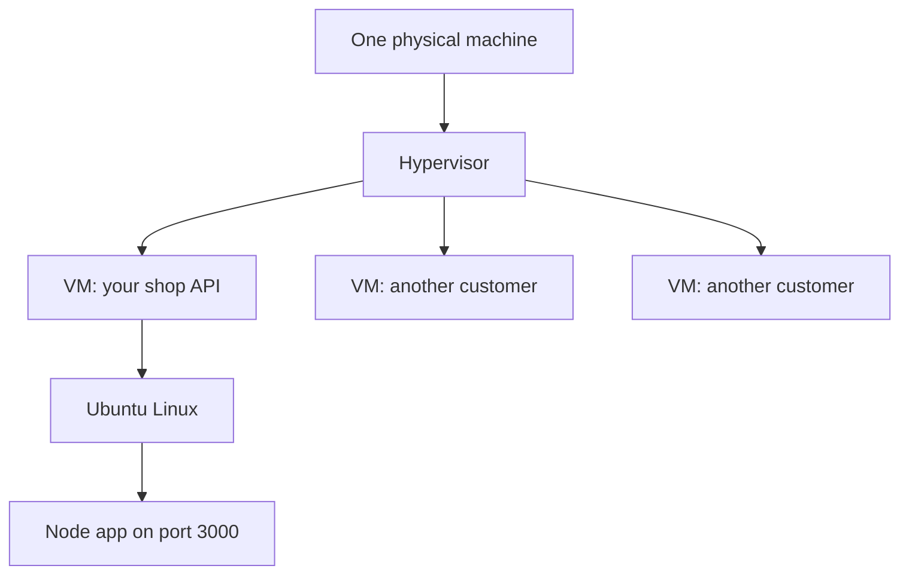

## In one line
A server is an ordinary computer, usually in a data centre, that stays switched on and runs your program so other computers can send it requests at any time.

## The problem it solves
Your video shop runs fine with `node server.js` on your laptop at `localhost:3000`. **localhost** means "this same computer", so only you can open it.

Now you want real customers, and your laptop can't serve them. It sleeps when you close the lid. Your home router blocks incoming connections, and your address can change. Home upload speed is small, so a few people watching videos would fill it.

You need a computer that is always on, with a fixed public address, a fast network, and backup power. That is a **server**: a computer whose job is to wait for requests and send back responses. The role makes it a server, not the hardware.

## Everyday analogy
Finding a place for your shop to live:

- **Dedicated server:** renting a whole building. Every room is yours, and so is every repair.
- **VPS:** renting a flat in a large building. You have your own lock and rooms, but you share the walls, the lift, and the water pipes with neighbours.
- **Managed platform:** a serviced office. Cleaning, security, and repairs are handled for you. You just bring your work, and follow their rules.

Where it breaks down: you can make a VPS twice as big in minutes, and a busy neighbour can slow your "flat" down in ways you can't see.

## How it works
A server has the same parts as your laptop:

- **CPU**: the chip that runs instructions. More cores, more work at once.
- **RAM** (memory): fast, temporary space for running programs, wiped when the power goes off.
- **Disk**: slower, permanent storage for files and databases.
- **Network card**: the connection to the outside world, with a public **IP address**, the number other computers use to reach it, like `203.0.113.10`.

It usually has no screen or keyboard (it is **headless**), so you control it from your laptop over [SSH](#/topic/ssh). Most servers run **Linux**, a free **operating system** (the base software that shares the hardware between programs). It has no licence fee, runs well without a screen, and can be controlled entirely by commands and scripts.

Hosting comes in three common shapes:

1. **Dedicated (bare metal).** You rent a whole physical machine. All its CPU and RAM are yours.
2. **VPS (virtual private server).** The provider runs a **hypervisor** on one big physical machine. A hypervisor is software that splits one computer into several **virtual machines** (VMs). Each VM gets its own slice of CPU, RAM, and disk, and its own operating system, so it behaves like a whole computer. Its CPU is counted in **vCPUs** (virtual CPUs): slices of the real cores, sometimes shared with other customers.
3. **Managed platform.** Often called **PaaS** (Platform as a Service). You hand over your code, or a Docker image (your app packaged with everything it needs), and the provider runs it. They handle the operating system, updates, and restarts.


*Notice: a VPS is a slice of a bigger machine, but inside your slice you get a normal operating system that runs your app like any computer.*

When a customer opens your shop, the request travels across the internet to your server's IP address. It arrives at a **port**, a number that says which program on that computer should get it. Your Node app, listening on that port, answers. That is all "serving" means.

## Real example
**Setup:** you created an Ubuntu VPS with your cloud provider and can log in with `ssh deploy@203.0.113.10`.

The first thing to do on any new server is check what you are paying for:

```bash
nproc                 # how many CPU cores (vCPUs) you can use
free -h               # memory: look at "total" and "available"
df -h /               # disk size and how full it is
grep PRETTY /etc/os-release   # which Linux version
ip -4 addr show       # the machine's network addresses
```

Typical output on a small 2 vCPU, 4 GB VPS (yours will differ):

```text
2
               total        used        free      shared  buff/cache   available
Mem:           3.8Gi       410Mi       2.6Gi       1.0Mi       1.0Gi       3.2Gi
Filesystem      Size  Used Avail Use% Mounted on
/dev/vda1        78G  2.9G   75G   4% /
PRETTY_NAME="Ubuntu 24.04 LTS"
    inet 127.0.0.1/8 scope host lo
    inet 203.0.113.10/24 brd 203.0.113.255 scope global eth0
```

The `-h` flag means "human readable": `3.8Gi` instead of a long number of bytes. Total memory is a bit under the advertised 4 GB because the system reserves some. `127.0.0.1` is localhost, and `203.0.113.10` is the public address customers reach.

> [!NOTE]
> On some clouds, such as AWS, `ip addr` shows only a **private** address like `10.0.1.25`. The public IP lives on the provider's network and is translated on the way in. Check the provider's dashboard for the public one.

## How to say it in an interview

> [!INTERVIEW]
> **30 seconds:** "A server is just a computer that runs a program all the time and answers requests over the network. It has a CPU, memory, disk, and a public IP, usually runs Linux, and sits in a data centre with reliable power and networking. Most teams rent one: a VPS, which is a virtual machine carved out of a bigger physical machine, or a managed platform where the provider runs the machine and you just deploy code."

> [!INTERVIEW]
> **2 minutes:** Start with the 30-second answer, then add:
>
> "The choice is control versus effort. A VPS is cheap and gives me full root access, so I can install Nginx, Docker, and Postgres however I like. But I own security updates, backups, and monitoring. A managed platform removes that work, but costs more as you grow and limits what you can install.
>
> A dedicated server makes sense for heavy, steady work. Video transcoding is a good example: it keeps every core busy for minutes, and you don't want to share cores with neighbours.
>
> For a small video shop, I'd start with one VPS running Docker, or a managed platform, plus a managed database, because lost data is the one failure you can't undo. Video files go to object storage and a CDN early, since serving video from one server eats bandwidth fast."

## Follow-up questions interviewers ask

<details>
<summary>What is the difference between a VPS and a dedicated server?</summary>

A dedicated server is a whole physical machine that only you use. A VPS is a virtual machine: a slice of a physical machine that a hypervisor shares among several customers. A VPS is cheaper and quicker to resize. A dedicated server gives steadier performance, because no neighbour competes for the same hardware.

</details>

<details>
<summary>"Server" can mean hardware or software. What's the difference?</summary>

Both meanings are common. A **server machine** is the computer. A **server program** is software that listens for requests, such as Nginx (a web server), PostgreSQL (a database server), or your Express app. One server machine usually runs several server programs at once, each on its own port.

</details>

<details>
<summary>What is a "noisy neighbour"?</summary>

Another customer's virtual machine on the same physical machine using a lot of CPU, disk, or network. Your VPS can slow down even though your own app did nothing different. Providers offer "dedicated CPU" plans, or dedicated servers, to avoid it.

</details>

<details>
<summary>If I use a managed platform, what am I still responsible for?</summary>

Your code and its dependencies, your configuration and secrets, your data model, and how your app behaves under load. The provider runs the machine. You still own bugs, slow queries, leaked API keys, and bills that grow with traffic.

</details>

## Common mistakes and misconceptions

> [!MISTAKE]
> "A server is special hardware." Usually not. It is a normal computer with server-grade parts and a reliable home. Your laptop can act as a server too. It just isn't reliable or reachable enough for real users.

> [!MISTAKE]
> "The cloud means there are no servers." The cloud is other people's servers, rented by the hour. Even "serverless" code runs on servers. You just don't manage them. See [Cloud basics](#/topic/cloud-basics).

> [!MISTAKE]
> "A 2 vCPU VPS is like a laptop with two cores." Not always. A vCPU is a slice of a real core, and on cheaper plans it may be shared with other customers. Measure real performance instead of trusting the number.

## Tradeoffs: when NOT to use it
- **Don't run your own VPS if nobody has time to look after it.** An unpatched server is a liability. A small team often does better on a managed platform.
- **Don't pick a managed platform without checking the price at scale.** Costs that are tiny at launch can grow fast with traffic, and moving away later takes work.
- **Don't buy a dedicated server for a small or spiky load.** You pay for the whole machine even when it sits idle.
- **Don't serve large video files from one server.** Its bandwidth runs out quickly. Use object storage and a [CDN](#/topic/cdn).

## Check yourself

<details>
<summary>1. What makes a computer a "server"?</summary>

Its role, not its hardware. It runs programs that wait for requests and answer them, and it stays on and reachable at a known address.

</details>

<details>
<summary>2. What does a hypervisor do?</summary>

It splits one physical machine into several virtual machines, each with its own share of CPU, memory, and disk, and its own operating system. That is how one physical machine becomes many VPSes.

</details>

<details>
<summary>3. Your startup has two developers and no operations experience. VPS or managed platform?</summary>

Usually a managed platform. It removes patching, restarts, and machine setup, so the team can focus on the product. Move to VPSes later, if cost or control becomes a real problem.

</details>

## Go deeper
- [Ubuntu Server documentation](https://documentation.ubuntu.com/server/)
- [AWS: What is a hypervisor?](https://aws.amazon.com/what-is/hypervisor/)
