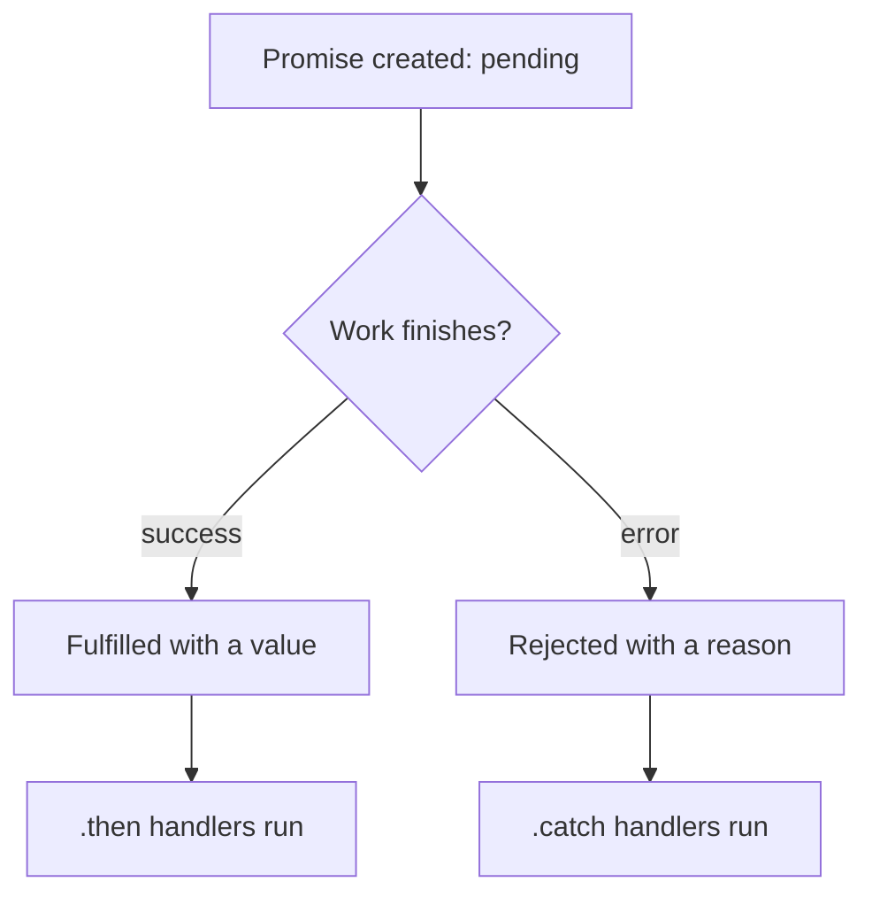

## In one line
Callbacks, promises, and async/await are three ways to say "start this slow task, and here's what to do when it finishes or fails", each easier to read than the one before.

## The problem it solves
Your order page needs the user's profile and their recent orders. Each is a database **query** that takes around 100 ms. JavaScript can't simply stop and wait for them, because Node runs your code on one thread (see [The Node.js event loop](#/topic/event-loop)). If it waited, every other user would wait too.

So slow operations are **asynchronous**: they start now and finish later. Your code needs a way to say "when the result arrives, continue here". It also needs a reliable way to handle failure: the database is down, the file is missing, the card is declined.

JavaScript has grown three ways to do this. You will meet all three in real codebases, and interviewers ask about all three.

## Everyday analogy
Ordering at a busy café.

- **Callback:** you leave your phone number, and they call you when it's ready. Fine for one order. If your next step depends on this one, and the next on that, you end up passing phone numbers inside phone numbers.
- **Promise:** they hand you a buzzer. It's an object you hold. It will either buzz "ready" or flash "sorry, we're out". You can attach plans to it: "when it buzzes, add sugar, then sit down".
- **async/await:** you write your plan as a simple list, "get coffee, add sugar, sit down", and the café handles the buzzer for you.

Where it breaks down: a real buzzer can buzz twice. A promise settles exactly once, and never changes after that.

## How it works

### 1. Callbacks
A **callback** is a function you pass to another function, to be called later. Node's built-in style is **error-first**: the callback's first argument is an error (or `null`), and the second is the result.

The problem is nesting. Three dependent steps means three levels of indentation, each with its own `if (err)`. This is called **callback hell**. Worse, if code inside a callback throws an error, there is no surrounding `try/catch` to catch it, so it can crash the process.

### 2. Promises
A **promise** is an object that stands for a result that isn't ready yet. Every promise is in one of three states:

1. **Pending:** the work is still going.
2. **Fulfilled:** it finished, and has a value.
3. **Rejected:** it failed, and has a reason (usually an `Error`).

Fulfilled and rejected together are called **settled**. A promise settles only once. After that, its state and value never change.

You react with `.then(onSuccess)` and `.catch(onError)`. Each `.then` returns a new promise, so steps chain in a flat line instead of nesting. One `.catch` at the end handles a failure from any step above it.


*Notice: a promise moves out of pending once, to exactly one outcome, and then never changes.*

The handlers don't run instantly. They are queued as **microtasks**, which run as soon as the current code finishes, before timers or new I/O.

### 3. async/await
`async/await` is cleaner syntax built **on top of** promises. It's not a new mechanism.

- An `async` function **always returns a promise**. Returning `5` gives a promise fulfilled with `5`. Throwing an error gives a rejected promise.
- `await somePromise` pauses **only this function** until the promise settles. If it fulfils, `await` gives you the value. If it rejects, `await` throws, so a normal `try/catch` works.
- While the function is paused, the main thread is free to serve other requests. The rest of the function resumes later, as a microtask.

## Real example
**Setup:** Node.js 18 or later, and `"type": "module"` in `package.json`. No packages needed.

**1. The same file read, three ways.** Put `{"appName":"shop"}` in `config.json` next to the script.

```js
import fs from 'node:fs';
import { readFile } from 'node:fs/promises';

// 1. Callback: Node passes the error first, the result second
fs.readFile('config.json', 'utf8', (err, text) => {
  if (err) return console.error('callback failed:', err.code);
  console.log('callback:', JSON.parse(text).appName);
});

// 2. Promise: .then for success, one .catch for any failure above it
readFile('config.json', 'utf8')
  .then((text) => console.log('promise:', JSON.parse(text).appName))
  .catch((err) => console.error('promise failed:', err.code ?? err.message));

// 3. async/await: reads top to bottom, errors caught with try/catch
async function loadConfig() {
  try {
    const text = await readFile('config.json', 'utf8');
    console.log('await:', JSON.parse(text).appName);
  } catch (err) {
    console.error('await failed:', err.code ?? err.message);
  }
}
loadConfig();
```

All three print `shop`. Now break the file: put `{bad` in `config.json`. The callback version **crashes the whole process** with `SyntaxError`, because `JSON.parse` throws inside the callback and nothing catches it. Delete the callback block and run again: the promise and `await` versions both print a clean `failed:` message, because a throw inside `.then` or an `async` function becomes a rejection.

**2. Sequential vs parallel.** This is the async bug interviewers love most.

```js
import { setTimeout as sleep } from 'node:timers/promises';

// Stand-ins for two database queries that each take about 100 ms
async function getUserById(id) { await sleep(100); return { id, name: 'Asha' }; }
async function getOrdersByUser(userId) { await sleep(100); return [{ id: 7, userId }]; }

async function loadDashboardSequential(userId) {
  const user = await getUserById(userId);         // wait 100 ms...
  const orders = await getOrdersByUser(userId);   // ...then another 100 ms
  return { user, orders };
}

async function loadDashboardParallel(userId) {
  // Start both queries first, then wait for both together
  const [user, orders] = await Promise.all([getUserById(userId), getOrdersByUser(userId)]);
  return { user, orders };
}

for (const load of [loadDashboardSequential, loadDashboardParallel]) {
  const start = performance.now();
  await load(981);
  console.log(load.name, Math.round(performance.now() - start), 'ms');
}
```

Output: `loadDashboardSequential 203 ms`, then `loadDashboardParallel 102 ms`. The two queries don't depend on each other, so there's no reason to wait for one before starting the other.

## How to say it in an interview

> [!INTERVIEW]
> **30 seconds:** "All three handle work that finishes later. Callbacks pass a function to call when it's done, with the error as the first argument. They get deeply nested and are hard to handle errors in. Promises are objects that are pending, then fulfilled or rejected exactly once, and you chain .then and .catch. Async/await is syntax on top of promises: await pauses just that function, not the server, and errors become exceptions I can catch with try/catch. I use async/await by default and Promise.all when calls are independent."

> [!INTERVIEW]
> **2 minutes:** Start with the 30-second answer, then add:
>
> "An async function always returns a promise. A throw inside it becomes a rejection. Every rejection needs a handler somewhere. Since Node 15, an unhandled rejection crashes the process by default, which is the right default but surprises people.
>
> For speed, the big thing is not awaiting independent calls one by one. Loading a user and their orders with two awaits takes the sum of both times. With Promise.all it takes the longer of the two. The tradeoff is that Promise.all rejects as soon as one fails, so if I want partial results, like showing a dashboard even when recommendations fail, I use Promise.allSettled.
>
> In Express, version 4 ignores the promise an async route handler returns. If it rejects, nothing handles it, and on modern Node the whole process crashes. Express 5 catches the rejection and passes it to the error middleware. On Express 4, you wrap handlers in try/catch and call next(err) yourself."

## Follow-up questions interviewers ask

<details>
<summary>What's the difference between Promise.all, allSettled, race, and any?</summary>

- **`Promise.all`**: waits for all. Rejects as soon as **any one** rejects.
- **`Promise.allSettled`**: waits for all, never rejects. You get `{ status, value | reason }` for each.
- **`Promise.race`**: settles like the **first** one to settle, success or failure. Useful for timeouts.
- **`Promise.any`**: fulfils with the first **success**. Rejects only if all fail.

</details>

<details>
<summary>Does Promise.all cancel the other promises when one fails?</summary>

No. The other operations keep running. Their results are just ignored. JavaScript promises have no built-in cancellation. To actually stop work like a `fetch` call, pass an `AbortController` signal to it.

</details>

<details>
<summary>How do you turn a callback-style function into a promise?</summary>

Use `util.promisify` from Node's standard library, for any function that follows the error-first convention: `const readFileAsync = util.promisify(fs.readFile)`. Most Node APIs now ship promise versions anyway, like `node:fs/promises` and `node:timers/promises`.

</details>

<details>
<summary>What happens if you forget the await?</summary>

You get a pending promise instead of the value. For example, `const user = getUserById(981)` sets `user` to a promise, so `user.name` is `undefined`. If that promise later rejects and nobody handles it, Node reports an unhandled rejection and, since Node 15, crashes by default. Lint rules such as typescript-eslint's `no-floating-promises` catch this.

</details>

<details>
<summary>Is await inside a for loop always wrong?</summary>

No. It's right when each step depends on the previous one, or when you deliberately want one at a time, for example to avoid sending 10,000 requests at once to a partner API. It's wrong when the items are independent and the volume is small enough to run together. Then use `Promise.all(items.map(...))`, or a concurrency limit for large lists.

</details>

## Common mistakes and misconceptions

> [!MISTAKE]
> "`await` blocks the server." It pauses only the current `async` function. The event loop keeps serving other requests while it waits.

> [!MISTAKE]
> Wrapping a callback that throws in `try/catch`, like `try { fs.readFile(f, (err, t) => JSON.parse(t)) } catch {}`. The callback runs later, after the `try` block has already finished, so the catch never sees the error.

> [!MISTAKE]
> Mixing styles: `return new Promise(...)` around a function that already returns a promise. This "promise constructor anti-pattern" adds code and often loses errors. Just `return` or `await` the existing promise.

> [!MISTAKE]
> Using `.forEach` with an `async` callback and expecting it to wait. `forEach` ignores the returned promises, so the code after it runs before any of them finish. Use `for...of` with `await`, or `Promise.all` with `map`.

## Tradeoffs: when NOT to use it
- **Don't await independent work one by one.** It quietly doubles or triples response time.
- **Don't use Promise.all for thousands of items.** Firing 10,000 queries at once exhausts your database connections. Process in batches, or use a small concurrency limit.
- **Callbacks still have a place.** Event emitters and streams call your function many times (`socket.on('data', ...)`). A promise settles once, so it can't represent "every chunk". See [Streams and buffers](#/topic/streams-buffers).
- **`async` doesn't make CPU work non-blocking.** A heavy loop inside an `async` function still freezes the event loop.

## Check yourself

<details>
<summary>1. What are the three states of a promise, and can a fulfilled promise become rejected later?</summary>

Pending, fulfilled, and rejected. No: once a promise settles (fulfilled or rejected), it never changes state or value again.

</details>

<details>
<summary>2. An async function contains `return 42`. What does calling it return?</summary>

A promise that fulfils with `42`. You need `await` or `.then` to get the number itself.

</details>

<details>
<summary>3. Two awaited calls take 120 ms and 80 ms and don't depend on each other. How long does the function take sequentially, and with Promise.all?</summary>

Sequentially about 200 ms (120 + 80). With `Promise.all` about 120 ms, the time of the slower one, because both run at the same time.

</details>

## Go deeper
- [MDN: Using promises](https://developer.mozilla.org/en-US/docs/Web/JavaScript/Guide/Using_promises)
- [MDN: async function](https://developer.mozilla.org/en-US/docs/Web/JavaScript/Reference/Statements/async_function)
