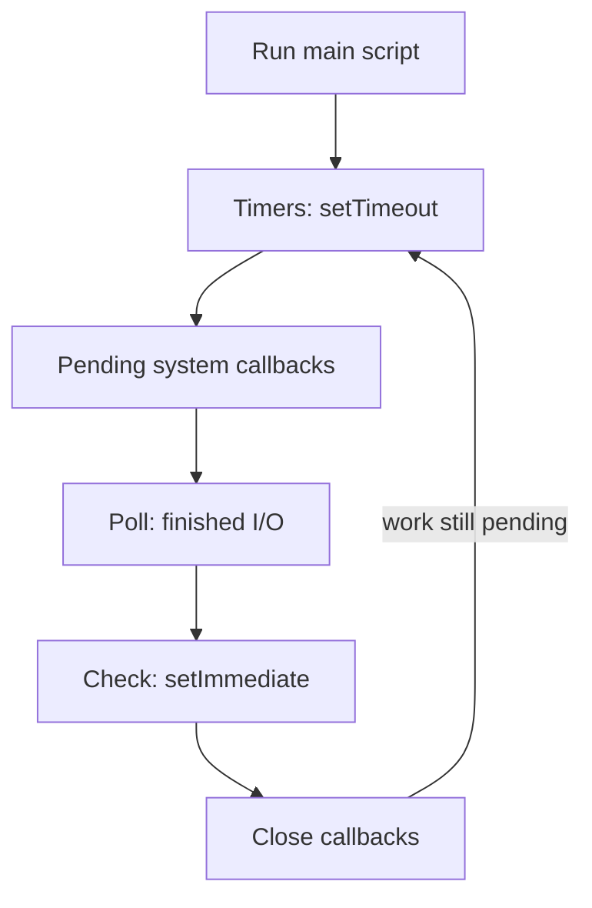

## In one line
The event loop is the part of Node.js that lets a single thread juggle thousands of requests, by starting slow work, moving on, and coming back when the result is ready.

## The problem it solves
Your video app's API gets 2,000 requests a second. Almost every request spends most of its time **waiting**: for PostgreSQL to answer, for Redis, for a file to be read from disk. This waiting is called **I/O** (input/output): any work where your program asks something outside itself and waits for the reply.

Some words first:

- A **process** is one running program, such as one `node server.js`.
- A **thread** is a single line of execution inside a process. It can do exactly one thing at a time.
- **CPU-bound** work keeps the processor busy calculating (hashing a password, resizing an image). **I/O-bound** work mostly waits (a database query, a network call).

The traditional answer was one thread per request. But a thread that waits 50 ms for the database is a thread doing nothing, and each thread costs memory. Ten thousand open connections means ten thousand mostly idle threads.

Node takes a different approach. It runs your JavaScript on **one main thread**. It never sits and waits for I/O. It starts the I/O, registers a **callback** (a function to call when the result arrives), and moves on to the next request. That's why one Node process can handle thousands of connections at once.

The catch, and the one mistake this topic is really about: if your JavaScript itself takes a long time, there is no other thread to serve anyone else. Every user waits.

## Everyday analogy
A single waiter in a busy restaurant. The waiter takes an order, hands it to the kitchen, and goes straight to the next table. They don't stand at the kitchen door waiting. When a dish is ready, the kitchen rings a bell, and the waiter delivers it at the next free moment.

The waiter is the main thread. The kitchen is the operating system and the thread pool. The bell is a callback.

Where it breaks down: if the waiter decides to carve a whole turkey at one table (CPU-heavy work), every other table waits. Real kitchens would hire more waiters; Node needs you to move that work elsewhere.

## How it works
Node is built from two main pieces:

- **V8** runs your JavaScript. It is the same engine Chrome uses.
- **libuv** is a C library that provides the event loop, talks to the operating system for network I/O, and owns a small **thread pool**: by default 4 helper threads (configurable with the `UV_THREADPOOL_SIZE` environment variable).

Who does the waiting depends on the kind of work:

- **Network I/O** (HTTP, database sockets, Redis): the operating system watches thousands of connections at once (using `epoll` on Linux, `kqueue` on macOS). No thread is blocked per connection.
- **Thread pool work**: file system calls (`fs`), `dns.lookup`, and some heavy built-ins such as `crypto.pbkdf2`, `crypto.scrypt`, and `zlib` compression. These run on the 4 helper threads.
- **Your JavaScript**: always on the main thread, one piece at a time.

### The phases of the loop
The event loop is literally a loop. After your main script runs, Node repeats these **phases** in order, for as long as there is work pending:

1. **Timers:** run callbacks whose `setTimeout` or `setInterval` time has passed.
2. **Pending callbacks:** run a few system callbacks deferred from the last loop, such as certain TCP errors.
3. **Poll:** ask the operating system "what I/O has finished?" and run those callbacks (a request arrived, a query returned, a file was read). If nothing else is scheduled, Node waits here for new events.
4. **Check:** run `setImmediate` callbacks.
5. **Close callbacks:** run cleanup callbacks, such as a socket's `'close'` event.

(There is also an internal "idle, prepare" step that you never touch.)


*Notice: it is one loop on one thread, so a slow callback in any phase delays every phase after it.*

### Microtasks: the queues that jump the line
Two more queues run **between every single callback**, before the loop moves on:

- **`process.nextTick` queue:** Node-specific. Runs first.
- **Microtask queue:** promise reactions (`.then`, and the code after an `await`) and `queueMicrotask`.

Both are drained completely each time. So a promise that resolves inside a timer callback continues right after that callback, not on the next loop.

```js
// order.cjs (a CommonJS file, so the output is predictable)
setTimeout(() => console.log('timeout'), 0);
setImmediate(() => console.log('immediate'));
Promise.resolve().then(() => console.log('promise'));
process.nextTick(() => console.log('nextTick'));
console.log('sync');
```

`node order.cjs` prints `sync`, `nextTick`, `promise`, then `timeout` and `immediate`. Synchronous code first, then nextTick, then promises, then the loop phases.

> [!NOTE]
> The order of `timeout` and `immediate` here is **not guaranteed**. It depends on how fast the process starts. Inside an I/O callback, `setImmediate` always runs first, because check comes right after poll. Also, in an ES module (`.mjs`, or `"type": "module"`), `promise` can print before `nextTick`, because Node runs ES module code itself from the microtask queue.

## Real example
**Setup:** Node.js 18 or later, `"type": "module"` in `package.json`, and `npm install express` (tested with Express 5.3).

This server hashes a password two ways. `pbkdf2Sync` runs on the main thread. `pbkdf2` sends the same work to the thread pool.

```js
import express from 'express';
import { pbkdf2, pbkdf2Sync } from 'node:crypto';

const app = express();
const ROUNDS = 5_000_000; // deliberately slow: about a second of CPU work

app.get('/health', (req, res) => res.json({ ok: true }));

// BAD: runs on the main thread. Nothing else can run until it finishes.
app.get('/hash-sync', (req, res) => {
  const hash = pbkdf2Sync('user-password', 'salt-981', ROUNDS, 32, 'sha256');
  res.json({ hash: hash.toString('hex').slice(0, 12) });
});

// GOOD: same work, handed to libuv's thread pool. The main thread stays free.
app.get('/hash-async', (req, res, next) => {
  pbkdf2('user-password', 'salt-981', ROUNDS, 32, 'sha256', (err, hash) => {
    if (err) return next(err);
    res.json({ hash: hash.toString('hex').slice(0, 12) });
  });
});

app.listen(45001, () => console.log('Listening on 45001'));
```

Start a slow request, then immediately ask for `/health`:

```bash
curl -s localhost:45001/hash-sync > /dev/null &
curl -s -o /dev/null -w 'health: %{time_total}s\n' localhost:45001/health
# health: 0.869523s   <- a trivial route waited for someone else's hash

curl -s localhost:45001/hash-async > /dev/null &
curl -s -o /dev/null -w 'health: %{time_total}s\n' localhost:45001/health
# health: 0.000796s   <- answered instantly while the hash ran on the pool
```

The numbers come from one laptop run; yours will differ, but the gap won't. With the sync version, the health check waited almost a full second for **someone else's** request. A load balancer that checks `/health` might even decide the server is dead.

## How to say it in an interview

> [!INTERVIEW]
> **30 seconds:** "Node runs my JavaScript on a single thread, but it doesn't wait on I/O. When I query the database or read a file, Node hands that off to the operating system or libuv's thread pool and keeps serving other requests. When the result is ready, its callback goes into a queue and the event loop runs it. That makes Node great for I/O-heavy APIs. The flip side is that CPU-heavy code blocks the loop and freezes every request, so I keep that work off the main thread."

> [!INTERVIEW]
> **2 minutes:** Start with the 30-second answer, then add:
>
> "The loop runs in phases: timers for setTimeout, then pending callbacks, then poll, where finished I/O callbacks run, then check for setImmediate, then close callbacks. Between every callback, Node drains the process.nextTick queue and then the promise microtask queue, which is why a resolved promise runs before a zero-delay timer.
>
> Network I/O doesn't use the thread pool. libuv uses the operating system's epoll or kqueue for that. The pool, 4 threads by default, handles file system calls, DNS lookups, and heavy crypto like pbkdf2 and scrypt.
>
> A classic real-world example is an export endpoint that builds a big CSV in a synchronous loop. While it runs, every other request stalls and health checks can time out. The fix is to move it into a background job. For CPU work that has to stay in the request, I'd use worker_threads or a separate service. The tradeoff: Node is excellent for many concurrent, mostly waiting requests, and a poor fit for heavy computation on the main thread."

## Follow-up questions interviewers ask

<details>
<summary>If Node is single-threaded, how can it read files in parallel?</summary>

Your JavaScript is single-threaded. Node itself is not. File system calls run on libuv's thread pool, 4 threads by default, so up to 4 file operations run truly in parallel. Network I/O doesn't use threads at all: the operating system reports when sockets are ready. Only the callbacks come back to the one main thread.

</details>

<details>
<summary>What's the difference between process.nextTick, setImmediate, and setTimeout(fn, 0)?</summary>

- `process.nextTick(fn)` runs right after the current operation, before promises and before the loop continues.
- `setImmediate(fn)` runs in the **check** phase, after poll on the current loop.
- `setTimeout(fn, 0)` runs in the **timers** phase of a later loop (Node treats 0 as 1 ms).

The names are confusing: `nextTick` is actually the most immediate. Calling `nextTick` recursively can starve I/O, because the loop can't move on until that queue is empty.

</details>

<details>
<summary>What blocks the event loop in a real app?</summary>

Anything synchronous and slow:

- `*Sync` functions like `fs.readFileSync` or `pbkdf2Sync` inside request handlers.
- `JSON.parse` or `JSON.stringify` on very large payloads (many megabytes).
- Big loops: sorting or filtering hundreds of thousands of items in memory.
- A regular expression that backtracks badly on certain input. Attackers can trigger this deliberately (called ReDoS).

`readFileSync` at startup is fine. Inside a request handler, it isn't.

</details>

<details>
<summary>How do you run CPU-heavy work in Node, then?</summary>

Three options, from smallest to largest:

1. Use the async version of a built-in, like `crypto.pbkdf2` instead of `pbkdf2Sync`, which uses the thread pool.
2. Use **worker threads** (`node:worker_threads`): extra JavaScript threads with their own event loop. You send them data as messages.
3. Move it out of the request entirely: a background job queue, or a separate service. See [Why background jobs exist](#/topic/background-jobs).

</details>

<details>
<summary>How would you detect that the event loop is blocked in production?</summary>

Measure **event loop delay**: how late timers fire compared to when they were scheduled. Node has `perf_hooks.monitorEventLoopDelay()` built in, and most monitoring tools chart it. Symptoms include every endpoint slowing down at the same moment, and health checks timing out while CPU sits near 100% on one core.

</details>

<details>
<summary>Can raising UV_THREADPOOL_SIZE fix a slow app?</summary>

Only if the bottleneck is thread pool work, such as many concurrent `fs` or `pbkdf2` calls queuing behind 4 threads. It does nothing for network I/O, and nothing for CPU work on the main thread. It must be set before the pool is first used, ideally as an environment variable when starting the process.

</details>

## Common mistakes and misconceptions

> [!MISTAKE]
> "Node is single-threaded, so it can't do two things at once." Your JavaScript runs on one thread, but I/O happens concurrently in the operating system and the thread pool. Thousands of database queries can be in flight at once.

> [!MISTAKE]
> "Making a function `async` stops it blocking." No. `async` only changes how the result is returned. A CPU-heavy loop inside an `async` function still runs on the main thread and still blocks everything.

> [!MISTAKE]
> "`setTimeout(fn, 0)` runs immediately." It runs no sooner than the next timers phase, after all synchronous code, nextTicks, and promise callbacks. It can be delayed much longer if the loop is busy.

> [!MISTAKE]
> "All async work goes through the thread pool." Network I/O doesn't. Saying "Node has 4 threads for HTTP requests" is a common wrong answer.

## Tradeoffs: when NOT to use it
The event loop model is a choice with clear limits:

- **CPU-heavy services.** Video transcoding, image processing, and big data crunching keep the main thread busy. Run them in worker threads, in a separate job service, or in a language built for parallel computation.
- **One process uses one core for JavaScript.** A server with 8 cores runs one Node process at about one core of JS work. To use the rest, run several processes (Node's `cluster` module, PM2, or several containers behind a load balancer). See [PM2 vs systemd vs Docker](#/topic/process-managers).
- **Latency-sensitive apps with mixed workloads.** If one endpoint occasionally does heavy work, it hurts every other endpoint's response time. Separate them.

## Check yourself

<details>
<summary>1. A route calls fs.readFileSync on a 50 MB file for every request. Why is that bad, even though it "works"?</summary>

While the file is read, the main thread is stuck, so every other request waits. Use the async `fs.promises.readFile`, or better, stream the file. See [Streams and buffers](#/topic/streams-buffers).

</details>

<details>
<summary>2. In which phase does the callback for a finished database query run?</summary>

The **poll** phase. That's where Node asks the operating system which I/O has completed and runs those callbacks. Any promise continuations they trigger run right after, as microtasks.

</details>

<details>
<summary>3. A promise resolves and a setTimeout(fn, 0) is scheduled at the same moment. Which callback runs first, and why?</summary>

The promise callback. Microtasks are drained after the current piece of code finishes, before the event loop moves to the next phase. The timer has to wait for the timers phase.

</details>

## Go deeper
- [Node.js docs: The event loop, timers, and process.nextTick()](https://nodejs.org/en/learn/asynchronous-work/event-loop-timers-and-nexttick)
- [Node.js docs: Don't block the event loop (or the worker pool)](https://nodejs.org/en/learn/asynchronous-work/dont-block-the-event-loop)
