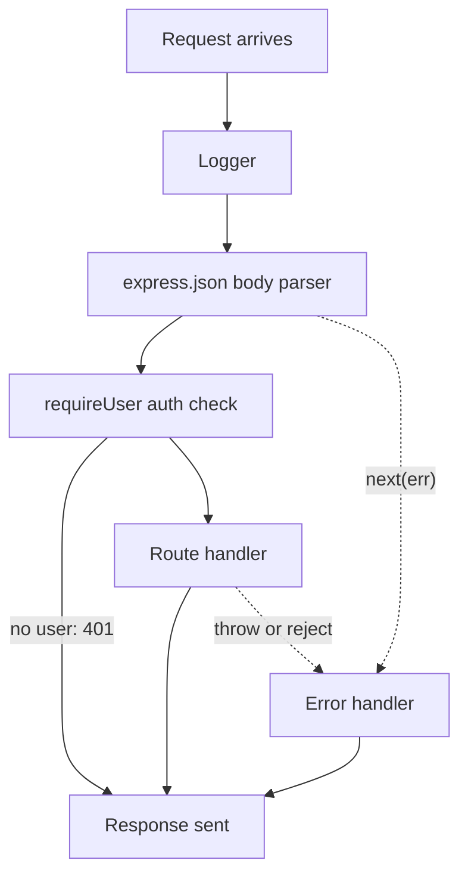

## In one line
Express handles each request by passing it through a line of small functions called middleware, in the order you registered them, until one of them sends a response.

## The problem it solves
Your shop's API has 40 **endpoints**: specific URL-and-method pairs like `GET /orders/7`. Almost all of them need the same chores done first:

- Log the request.
- Turn the JSON body into a JavaScript object.
- Check the user is logged in.
- Turn any crash into a clean error response.

Without a shared mechanism, you copy those lines into all 40 handlers. Someone forgets the login check on one, and that's a security hole.

**Express** is the most widely used web framework for Node.js. A **framework** is a library that gives your app its structure: you fill in the parts, it calls them at the right time. Express's core idea is **middleware**: write each chore once, as a function, and plug it into the request's path.

## Everyday analogy
Airport security. Every passenger goes through the same stations in a fixed order: check-in, ID check, bag scan, gate. Each station either waves you on to the next one or stops you ("no boarding pass, go back"). A separate desk handles problems.

Where it breaks down: at the airport, someone at a station physically walks you on. In Express, each function must explicitly say "next", or the passenger stands there forever.

## How it works
A few terms:

- **Routing** means choosing which code runs based on the request's method and path. `app.get('/orders/:id', handler)` runs `handler` for `GET /orders/7`. `:id` is a **route parameter**: Express puts `7` in `req.params.id`.
- `req` is the request object (method, path, headers, body). `res` is the response object you use to reply.

### The middleware signature
A middleware is a function with three parameters:

```js
function middleware(req, res, next) { /* ... */ }
```

Inside it, you do exactly one of three things:

1. **Call `next()`** to pass control to the next matching function.
2. **Send a response** (`res.json(...)`, `res.status(401).end()`) to end the chain. Later functions don't run.
3. **Call `next(err)`** to skip straight to the error handlers.

If you do none of these, the request hangs until the client gives up.

### The chain
Express keeps one ordered list of everything you registered with `app.use`, `app.get`, `app.post`, and so on. For each request it walks the list from the top. It skips entries whose path or method doesn't match, and runs the ones that do.

- `app.use(fn)` matches every method, and any path that **starts with** the given prefix (or every path, if none is given).
- `app.get('/orders/:id', fn)` matches only `GET` and only that exact path pattern.
- A **router** (`express.Router()`) is a mini-app with its own list. Mounting it with `app.use('/orders', ordersRouter)` sends every `/orders/...` request into it.

**Order matters.** A middleware only affects routes registered after it. That's how `/health` below stays public: it is registered before the router that checks login.

### Error-handling middleware
An error handler has **four** parameters:

```js
function errorHandler(err, req, res, next) { /* ... */ }
```

Express recognises it by the count of parameters. Write all four, even if you don't use `next`. When anything calls `next(err)` or throws, Express skips every normal middleware and jumps to the next error handler. Register error handlers **last**.

In **Express 5**, if an `async` handler's promise rejects, Express catches it and calls `next(err)` for you. In **Express 4**, it didn't: the rejection went unhandled, and on modern Node that crashes the process. On Express 4, wrap async handlers in `try/catch` and call `next(err)`.


*Notice: any function can end the chain by responding, and every error skips ahead to the one error handler.*

## Real example
**Setup:** Node.js 18 or later, `"type": "module"` in `package.json`, `npm install express` (tested with Express 5.3; the async error behaviour needs Express 5).

**`server.js`: the app-wide chain**

```js
import express from 'express';
import { ordersRouter } from './orders.js';

const app = express();

// 1. Runs for every request: log method, path, status, and time taken
app.use((req, res, next) => {
  const start = Date.now();
  res.on('finish', () => console.log(req.method, req.originalUrl, res.statusCode, `${Date.now() - start}ms`));
  next(); // pass control to the next middleware
});

app.use(express.json({ limit: '100kb' })); // 2. parse JSON bodies into req.body

app.get('/health', (req, res) => res.json({ ok: true })); // public: no auth needed

app.use('/orders', ordersRouter); // 3. everything under /orders goes to the router

app.use((req, res) => res.status(404).json({ error: 'Not found' })); // 4. nothing matched

// 5. Error handler: FOUR arguments, registered last
app.use((err, req, res, next) => {
  const status = err.status ?? 500;
  if (status >= 500) console.error(err); // log the details for yourself...
  res.status(status).json({ error: status < 500 ? err.message : 'Internal error' }); // ...not the client
});

app.listen(45005);
```

**`orders.js`: a router with its own middleware**

```js
import express from 'express';

export const ordersRouter = express.Router();

// Runs only for /orders routes. Ending the response here stops the chain.
function requireUser(req, res, next) {
  const userId = Number(req.get('X-User-Id')); // demo only: real apps verify a session or token
  if (!userId) return res.status(401).json({ error: 'Log in first' });
  req.user = { id: userId }; // later functions can read this
  next();
}
ordersRouter.use(requireUser);

ordersRouter.get('/:id', async (req, res) => {
  const order = await findOrder(Number(req.params.id)); // Express 5: a rejection goes to the error handler
  if (!order || order.userId !== req.user.id) return res.status(404).json({ error: 'Order not found' });
  res.json(order);
});

async function findOrder(id) { // stand-in for a database query
  if (id === 500) throw new Error('connection refused to db:5432');
  return id === 7 ? { id: 7, userId: 981, totalCents: 4999 } : null;
}
```

**Try it:**

```bash
curl localhost:45005/orders/7                          # {"error":"Log in first"}  401
curl -H 'X-User-Id: 981' localhost:45005/orders/7      # {"id":7,"userId":981,...}  200
curl -H 'X-User-Id: 981' localhost:45005/orders/500    # {"error":"Internal error"} 500
curl -H 'X-User-Id: 981' -H 'Content-Type: application/json' \
     -d '{bad' localhost:45005/orders                  # {"error":"Expected property name..."} 400
curl localhost:45005/nope                              # {"error":"Not found"}  404
```

Each case left the chain at a different point. The broken JSON never reached the router: `express.json` called `next(err)` with a 400 status. The database error was logged in full on the server, but the client only saw "Internal error".

## How to say it in an interview

> [!INTERVIEW]
> **30 seconds:** "Express runs each request through a chain of middleware functions in the order they were registered. Each one gets req, res, and next. It can modify the request, end it by sending a response, or call next to pass it on. I use middleware for cross-cutting things like logging, parsing JSON, and authentication, and routers to group related routes. Errors go to a special middleware with four arguments, registered last, so every error gets one consistent response."

> [!INTERVIEW]
> **2 minutes:** Start with the 30-second answer, then add:
>
> "Order is the main thing to get right. A middleware only applies to routes registered after it, which is how I keep a health check public but put everything under /orders behind an auth check, by mounting a router with its own middleware.
>
> For errors, calling next with an error skips all normal middleware and goes to the error handler. In Express 5, a rejected promise from an async handler is forwarded there automatically. In Express 4 it wasn't, so people used try/catch or a wrapper, otherwise an unhandled rejection could crash the process.
>
> The tradeoff is that middleware is implicit. A route's behaviour depends on what was registered above it, maybe in another file, so a missing next or a wrongly ordered auth check is easy to miss in review. I keep the chain short and visible in one place, and I test that protected routes actually return 401."

## Follow-up questions interviewers ask

<details>
<summary>What's the difference between app.use and app.get?</summary>

`app.use(path, fn)` matches **any method** and any path that **starts with** `path` (on segment boundaries, so `/orders` matches `/orders/7` but not `/ordersXYZ`). Inside it, `req.url` has the prefix removed. `app.get(path, fn)` matches only GET requests whose path matches the full pattern. Use `use` for middleware and routers, and the method functions for endpoints.

</details>

<details>
<summary>What happens if a middleware neither calls next() nor sends a response?</summary>

The request hangs. The connection stays open until the client, a proxy like Nginx, or a server timeout gives up. It's a common bug in hand-written auth middleware: an `if` branch that forgets to `return` a response or call `next()`.

</details>

<details>
<summary>Why does the error handler need exactly four parameters?</summary>

Express tells error handlers apart from normal middleware by the function's declared parameter count (`fn.length`). With three parameters, Express treats it as normal middleware and skips it when there's an error. So you write `(err, req, res, next)`, even if `next` is unused.

</details>

<details>
<summary>What changed from Express 4 to Express 5 that affects your code?</summary>

The biggest one: rejected promises from async handlers and middleware are passed to `next(err)` automatically. Path matching also became stricter. For example, a wildcard needs a name, like `/files/*filepath` instead of `/files/*`. Some long-deprecated signatures were removed, such as `res.send(body, status)`. Use `res.status(status).send(body)`.

</details>

## Common mistakes and misconceptions

> [!MISTAKE]
> Registering the error handler or 404 handler **before** the routes. Express walks the list in order, so the 404 handler catches every request first. Put the 404 handler, then the error handler, at the very end.

> [!MISTAKE]
> Calling `next()` after sending a response, or forgetting `return` before `res.status(401).json(...)`. The next function then tries to respond as well, and Express throws "Cannot set headers after they are sent".

> [!MISTAKE]
> Writing the error handler with three parameters, like `(err, req, res) => ...`. Express treats it as normal middleware, so it never runs for errors.

> [!MISTAKE]
> Sending `err.message` or the stack trace to the client for every error. A database message can reveal hostnames, table names, or queries. Log details on the server, and send a generic message for 500 errors.

## Tradeoffs: when NOT to use it
- **Don't put business logic in middleware.** "Calculate the order total" belongs in a function the route calls. Middleware is for cross-cutting concerns that apply to many routes. Hidden logic in middleware makes routes hard to understand.
- **Avoid long global chains.** Every global middleware runs on every request, including health checks and static files. Mount heavy work, like loading the full user from the database, only on routes that need it.
- **Express isn't the only choice.** It is minimal, with no built-in validation. Fastify (schema-based) or NestJS (structured, opinionated) suit some teams better.

## Check yourself

<details>
<summary>1. Name the three things a middleware can do with a request.</summary>

Pass it on with `next()`, end it by sending a response, or send it to the error handlers with `next(err)`.

</details>

<details>
<summary>2. An auth middleware is registered with app.use after app.get('/admin/stats', ...). Is /admin/stats protected?</summary>

No. Express matched and answered `/admin/stats` before reaching the auth middleware. Middleware only applies to routes registered after it.

</details>

<details>
<summary>3. An async route handler throws in Express 5. Where does the error go? What about Express 4?</summary>

Express 5 catches the rejected promise and passes the error to your error-handling middleware. Express 4 ignores it, so it becomes an unhandled rejection, and on Node 15 or later the process crashes by default.

</details>

## Go deeper
- [Express docs: Using middleware](https://expressjs.com/en/guide/using-middleware.html)
- [Express docs: Error handling](https://expressjs.com/en/guide/error-handling.html)
