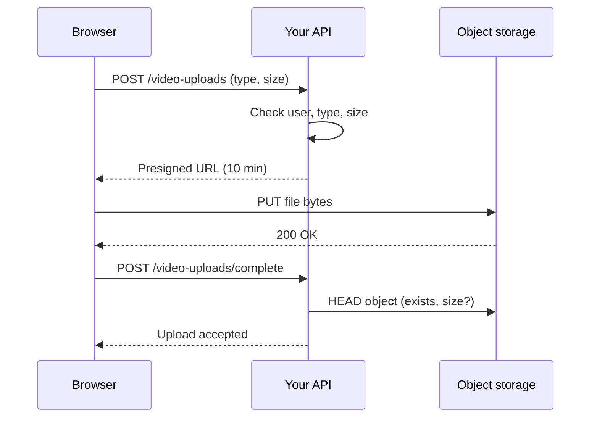

## In one line
Small files can travel through your server as a multipart form, but large files like videos should go straight from the browser to object storage using a short-lived presigned URL your server hands out.

## The problem it solves
Creators upload videos to your platform. A typical upload is 1–2 GB. If every byte flows through your Node API:

- **Your server becomes a pipe.** A 2 GB upload over a home connection can take many minutes. During that time it holds a connection and uses network **bandwidth** (how much data can move per second) that your API needs for normal requests.
- **Memory can explode.** Code that buffers the whole file needs 2 GB of RAM per upload.
- **Timeouts.** Nginx, load balancers, and Node all have request time limits and body size limits. Nginx rejects bodies over 1 MB by default.
- **You pay twice.** Data travels from the user to your server, then from your server to storage.

Most apps store files in **object storage**: a service like Amazon S3 (or Cloudflare R2, Google Cloud Storage) that stores files, called **objects**, by name in containers called **buckets**. It's cheap, durable, and built to accept huge uploads.

So the question is: how do you let a user upload directly to your bucket, without giving them your storage password?

## Everyday analogy
A valet parking ticket. You don't give the driver your house keys. You give them a ticket that works for one car, one parking spot, for the next ten minutes. The car goes straight to the garage, and you never handle it yourself.

A presigned URL is that ticket. Your server writes it, the browser uses it, and the file goes straight to storage.

Where it breaks down: a valet can still dent the car. Once a file lands in storage, you still have to check what it actually is before trusting it.

## How it works
### Way 1: through your server (multipart form)
HTML forms and `FormData` send files as **multipart/form-data**. The body is split into **parts**, separated by a **boundary**: a random string declared in the `Content-Type` header. Each part has its own small headers, then its content:

```text
POST /users/981/avatar HTTP/1.1
Content-Type: multipart/form-data; boundary=----X7a9

------X7a9
Content-Disposition: form-data; name="caption"

hello
------X7a9
Content-Disposition: form-data; name="avatar"; filename="face.png"
Content-Type: image/png

<raw PNG bytes>
------X7a9--
```

The server reads the stream, finds each boundary, and gets text fields and file bytes. Libraries like **multer** or **busboy** do this parsing. The final boundary ends with `--`.

Multipart sends raw bytes. Base64 inside JSON would make the file about 33% bigger, plus extra work to encode and decode.

This route is fine for **small files**, such as a 2 MB profile picture.

### Way 2: direct to storage (presigned URL)
A **presigned URL** is a normal storage URL with extra query parameters, including a cryptographic **signature**. The server creates the signature using its secret storage credentials, without contacting the storage service. Storage checks the signature on each request. The URL allows only:

- one **operation** (here, `PUT` to upload),
- one **object key** (the file's name in the bucket),
- until an **expiry time**,
- and optionally only a specific `Content-Type` and size, if those were signed.

Change anything, such as the key, the size, or the type, and the signature no longer matches. Storage replies `403 Forbidden`.

The full flow:

1. **Ask.** The browser tells your API: "I want to upload an MP4 of 1.2 GB."
2. **Check and sign.** The API checks the user, file type, and size. It picks the object key itself, saves a `video_uploads` row with status `pending`, and returns a presigned URL.
3. **Upload.** The browser `PUT`s the file straight to storage. Your server sees none of those bytes.
4. **Confirm.** The browser tells the API it's done (or storage sends an event notification). The API checks the object really exists and has the expected size.
5. **Process.** The API marks the upload `uploaded` and queues a job, for example transcoding the video into streaming formats. See [Why background jobs exist](#/topic/background-jobs).


*Notice: the gigabytes go from browser to storage. Your API only handles small JSON requests.*

For very large files, S3 also supports **multipart upload** (a different thing from multipart forms). The file is split into parts, uploaded separately and in parallel, then joined. A failed part can be retried alone. AWS recommends it for objects of 100 MB or more, and a single PUT is capped at 5 GB.

## Real example
**Setup:** Node.js 18 or later, `"type": "module"`, `npm install express @aws-sdk/client-s3 @aws-sdk/s3-request-presigner` (tested with Express 5.3 and AWS SDK v3, against an S3 emulator with signature checks on). Environment: `AWS_REGION`, AWS credentials, and `UPLOAD_BUCKET`. The bucket needs a **CORS** rule allowing `PUT` from your site's origin, because the browser is uploading to a different domain. See [CORS](#/topic/cors).

**Client setup:**

```js
import express from 'express';
import { S3Client, PutObjectCommand, HeadObjectCommand } from '@aws-sdk/client-s3';
import { getSignedUrl } from '@aws-sdk/s3-request-presigner';
import { randomUUID } from 'node:crypto';

// Region and credentials come from the standard AWS environment variables.
// WHEN_REQUIRED stops the SDK adding an empty-body checksum to the URL,
// which would make the real upload fail.
const s3 = new S3Client({ requestChecksumCalculation: 'WHEN_REQUIRED' });
const BUCKET = process.env.UPLOAD_BUCKET;
const MAX_BYTES = 2 * 1024 ** 3; // 2 GB
const app = express();
app.use(express.json());
```

**Steps 1, 2, and 4:**

```js
// Steps 1 and 2: the browser asks for permission to upload one file.
app.post('/video-uploads', async (req, res) => {
  const { contentType, sizeBytes } = req.body;
  if (contentType !== 'video/mp4') return res.status(400).json({ error: 'Only MP4 videos are allowed' });
  if (!Number.isInteger(sizeBytes) || sizeBytes < 1 || sizeBytes > MAX_BYTES) {
    return res.status(400).json({ error: 'Size must be between 1 byte and 2 GB' });
  }
  const key = `raw/${randomUUID()}.mp4`; // the server picks the name, never the user
  // In a real app: INSERT INTO video_uploads (key, user_id, status) VALUES ($1, $2, 'pending')
  const command = new PutObjectCommand({ Bucket: BUCKET, Key: key, ContentType: contentType, ContentLength: sizeBytes });
  const uploadUrl = await getSignedUrl(s3, command, {
    expiresIn: 600,                             // valid for 10 minutes
    signableHeaders: new Set(['content-type']), // the upload must use this exact type (size is signed too)
  });
  res.status(201).json({ key, uploadUrl });
});

// Step 4: the browser says "done". Check the file really exists before trusting it.
app.post('/video-uploads/complete', async (req, res) => {
  const head = await s3.send(new HeadObjectCommand({ Bucket: BUCKET, Key: req.body.key }));
  // In a real app: check the key belongs to this user, mark the row 'uploaded', queue transcoding.
  res.json({ key: req.body.key, sizeBytes: head.ContentLength, status: 'uploaded' });
});

app.listen(45010);
```

**What happened when tested** with a 1 MB file:

```text
PUT with the right file and type     -> 200, then /complete reports sizeBytes 1048576
PUT a 2 MB file to the same URL      -> 403 (signed size doesn't match)
PUT with Content-Type: text/html     -> 403 (signed type doesn't match)
PUT after editing the key in the URL -> 403 (signature doesn't match)
```

In the browser, step 3 is one call: `await fetch(uploadUrl, { method: 'PUT', headers: { 'Content-Type': 'video/mp4' }, body: file })`.

## How to say it in an interview

> [!INTERVIEW]
> **30 seconds:** "For small files like avatars, I accept a multipart form upload and stream it with a library like multer, with strict size and type limits. For large files like videos, I don't route the bytes through my API. The client asks my API for a presigned URL. The API checks the user, file type, and size, picks the object key, and signs a URL that's valid for one upload for a few minutes. The browser uploads straight to S3, then tells the API it's done, and the API verifies the object and queues processing."

> [!INTERVIEW]
> **2 minutes:** Start with the 30-second answer, then add:
>
> "Presigned URLs keep my servers out of the data path. No gigabyte requests tying up Node, no proxy body limits, and S3 handles the scale. The signature covers the method, the key, and the expiry, and I can also sign the content type and length, so a client can't swap in a 20 GB file or an HTML page.
>
> I never trust the upload blindly. I generate the key on the server so users can't overwrite each other's files, track each upload in a video_uploads table with a status, and verify the object with a HEAD request or an S3 event before processing. The real file type gets checked during processing, because the Content-Type is just whatever the client claims.
>
> For multi-gigabyte files I'd use S3 multipart upload, so parts upload in parallel and failed parts retry alone. The tradeoff is complexity. There are more moving parts: bucket CORS, a confirm step, cleanup of abandoned uploads with a lifecycle rule. For a 200 KB profile picture, going through the server is simpler."

## Follow-up questions interviewers ask

<details>
<summary>How is a presigned URL secure if anyone with the link can use it?</summary>

It is a **bearer** credential: whoever holds it can use it, so you keep it short-lived (minutes) and narrow (one key, one method, a signed type and size). It can't be changed into something else, because the signature covers those details. It also can't outlive the credentials that signed it. For downloads of private files, the same idea lets a user fetch one object for a few minutes.

</details>

<details>
<summary>How do you stop a user uploading a 50 GB file to a presigned URL?</summary>

Sign the `Content-Length` into a presigned PUT, as in the example, so any other size gets a 403. Or use a **presigned POST** with a policy containing `content-length-range`, which allows a range of sizes. Also check the size in your API before signing, and verify it again with a HEAD request after upload.

</details>

<details>
<summary>Can you trust the file's Content-Type or extension?</summary>

No. Both are claims made by the client. A file named `cat.png` can contain anything. Check the actual bytes. Most formats start with a recognisable signature, the "magic bytes". Or let the processing step, such as the video transcoder, reject files it can't read. Never serve user uploads from your main domain in a way that lets the browser run them as HTML.

</details>

<details>
<summary>What happens to uploads that start but never finish?</summary>

You get `pending` rows with no object, and with S3 multipart, incomplete parts that still cost storage. Clean them up with a scheduled job that expires old pending rows, plus a bucket **lifecycle rule** that aborts incomplete multipart uploads after a few days.

</details>

## Common mistakes and misconceptions

> [!MISTAKE]
> Using the user's filename as the storage key, like `uploads/${req.body.filename}`. Users can overwrite each other's files, or use `../` tricks. Generate the key on the server, and store the original name separately if you need it.

> [!MISTAKE]
> Putting storage credentials in the frontend so it can upload directly. Anyone can read them from the browser and get full access to your bucket. Only the server holds credentials. The browser gets presigned URLs.

> [!MISTAKE]
> Buffering uploads in memory, for example multer's `memoryStorage()` for videos. Large or many simultaneous uploads exhaust RAM. Stream to disk or storage, or use presigned URLs.

> [!MISTAKE]
> Treating "the browser said it finished" as proof. Verify the object exists and has the expected size, and that the key belongs to this user.

## Tradeoffs: when NOT to use it
- **Small files with immediate processing.** For a 200 KB avatar you resize right away, a multipart upload to your server is simpler: one request, no bucket CORS, no confirm step.
- **When you must inspect every byte first**, for example regulated documents that must be virus-scanned before being stored anywhere. Even then, a common pattern is uploading to a quarantine bucket, then scanning.
- **No object storage.** A small app saving to local disk doesn't need presigned URLs, though local disk doesn't scale across servers.
- **Presigned URLs are bearer tokens.** If one leaks in logs or analytics, anyone can use it until it expires. Keep expiry short, and don't log full URLs.

## Check yourself

<details>
<summary>1. What does the boundary in a multipart/form-data body do?</summary>

It separates the parts of the body. The server splits the body at each boundary line to get each field and file. The boundary is declared in the `Content-Type` header, and the last one ends with `--`.

</details>

<details>
<summary>2. Name three things a presigned PUT URL can restrict.</summary>

Any three of: the HTTP method, the bucket and object key, the expiry time, the `Content-Type`, and the `Content-Length`. Changing any signed part makes storage return 403.

</details>

<details>
<summary>3. Why should the server, not the browser, choose the object key?</summary>

So users can't overwrite other users' files, guess other paths, or use special characters and `../` tricks. A server-generated random key, like a UUID, is also hard to guess.

</details>

## Go deeper
- [AWS docs: Uploading objects with presigned URLs](https://docs.aws.amazon.com/AmazonS3/latest/userguide/PresignedUrlUploadObject.html)
- [AWS docs: Uploading and copying objects using multipart upload](https://docs.aws.amazon.com/AmazonS3/latest/userguide/mpuoverview.html)
- [MDN: Using FormData objects](https://developer.mozilla.org/en-US/docs/Web/API/FormData/Using_FormData_Objects)
