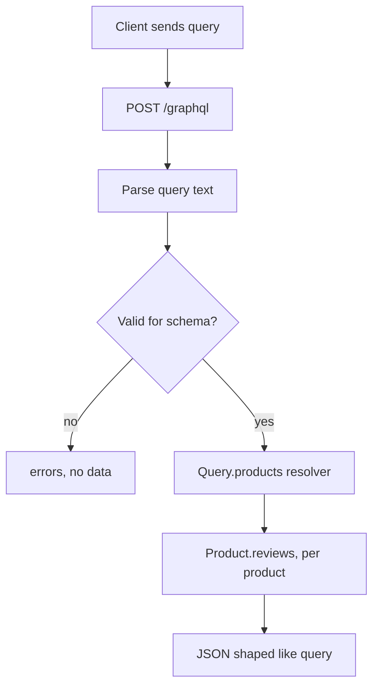

## In one line
REST gives you many fixed endpoints that each return a set shape, while GraphQL gives you one endpoint where the client describes exactly the data it wants, and the honest choice depends on who your clients are.

## The problem it solves
Your shop's mobile home screen shows 10 products, each with its name, price, and average rating. With a typical REST API, the app might call:

1. `GET /products?limit=10`, which returns 25 fields per product when it needs 3. That's **over-fetching**: downloading data you throw away.
2. Then `GET /products/42/reviews` for each of the 10 products to get ratings. That's **under-fetching**: one endpoint doesn't have enough, so you make many requests.

On a slow mobile connection, 11 sequential **round trips** (a request travelling to the server and the reply coming back) is painful. Meanwhile, the web app wants a different shape, and the TV app another. The backend team ends up adding endpoints like `/home-screen-v3`.

**GraphQL** is a query language for APIs, released by Facebook in 2015. The client sends one request that names exactly the fields it needs, across related data, and gets back exactly that shape.

## Everyday analogy
REST is a set menu at a restaurant: dish number 4 always comes with the same sides. Need something extra? Order another dish.

GraphQL is a build-your-own order form: tick exactly the items you want, from any section, and it all arrives on one tray.

Where it breaks down: with an order form, the kitchen can't prepare popular trays in advance, and one customer can tick every box and keep the kitchen busy for an hour. Those are GraphQL's real costs: harder caching, and protecting the server from expensive queries.

## How it works
### The pieces
- **Schema:** a typed description of everything the API offers. It's the contract between frontend and backend. Types like `Product` list their fields and types. Three special root types are the entry points: **Query** (read), **Mutation** (write), and **Subscription** (live updates, usually over WebSockets).
- **Query:** the client's request, written in GraphQL's language. Its shape mirrors the response.
- **Resolver:** a function on the server that produces the value of **one field**. `Query.products` fetches products. `Product.reviews` fetches one product's reviews.
- **One endpoint:** usually `POST /graphql`, carrying the query in a JSON body.

### What happens to one request
1. **Parse:** the server turns the query text into a tree.
2. **Validate:** it checks the tree against the schema. Unknown fields or wrong argument types are rejected before any code runs.
3. **Execute:** starting at the root, it calls the resolver for each requested field. For a list, it calls child resolvers once **per item**.
4. **Respond:** a JSON object with `data` (shaped like the query) and, if something failed, an `errors` array. Partial success is possible: some fields have data, others have errors.


*Notice: the work done depends on which fields the client asked for, and child resolvers run once per item in a list.*

### The N+1 problem
That "once per item" is GraphQL's classic performance trap. A query for 50 products with their reviews runs **1** query for the products, then **50** separate review queries, one per product. That's **N+1** queries, where N is the number of items. See [The N+1 query problem](#/topic/n-plus-one).

The standard fix is **batching**: collect all the product ids requested during one tick of the event loop, then run one query, `WHERE product_id IN (...)`. In Node, the **DataLoader** library does this, and also caches within a single request.

## Real example
**Setup:** Node.js 18 or later, `"type": "module"`, `npm install express graphql graphql-http` (tested with Express 5.3, graphql 16, graphql-http 1.x).

```js
import express from 'express';
import { buildSchema } from 'graphql';
import { createHandler } from 'graphql-http/lib/use/express';

// The schema: every type, field, and entry point the API offers.
const schema = buildSchema(`
  type Review { rating: Int!, comment: String }
  type Product { id: ID!, name: String!, priceCents: Int!, reviews: [Review!]! }
  type Query { products(limit: Int = 10): [Product!]! }
`);

// Stand-in data. In a real app these would be database queries.
const products = [{ id: 42, name: 'Trail camera', priceCents: 12999 }, { id: 43, name: 'Tripod', priceCents: 2999 }];
const reviews = { 42: [{ rating: 5, comment: 'Great' }], 43: [{ rating: 4, comment: null }] };
let reviewQueries = 0;

const rootValue = {
  products: ({ limit }) => products.slice(0, limit).map((p) => ({
    ...p,
    // A resolver: runs only if the client asked for "reviews", once per product.
    reviews: () => { reviewQueries++; return reviews[p.id] ?? []; },
  })),
};

const app = express();
app.all('/graphql', createHandler({ schema, rootValue }));
app.get('/stats', (req, res) => res.json({ reviewQueries }));
app.listen(45012);
```

Ask for only names and prices:

```bash
curl localhost:45012/graphql -H 'Content-Type: application/json' \
  -d '{"query":"{ products { name priceCents } }"}'
# {"data":{"products":[{"name":"Trail camera","priceCents":12999},{"name":"Tripod","priceCents":2999}]}}
# /stats -> {"reviewQueries":0}   the reviews resolver never ran
```

Now ask for reviews too:

```bash
curl localhost:45012/graphql -H 'Content-Type: application/json' \
  -d '{"query":"{ products(limit: 2) { name reviews { rating } } }"}'
# {"data":{"products":[{"name":"Trail camera","reviews":[{"rating":5}]},{"name":"Tripod","reviews":[{"rating":4}]}]}}
# /stats -> {"reviewQueries":2}   one lookup per product: N+1 in miniature
```

Ask for a field that doesn't exist (`stock`), and validation rejects it before any resolver runs: `Cannot query field "stock" on type "Product"`. Note the status code. With a plain `Accept: application/json`, this server returned **200** with an `errors` array. With `Accept: application/graphql-response+json`, it returned **400**. Many GraphQL clients and tools check the `errors` field, not just the status code.

## How to say it in an interview

> [!INTERVIEW]
> **30 seconds:** "REST exposes many endpoints, each returning a fixed shape, and uses HTTP methods, status codes, and caching naturally. GraphQL exposes one endpoint with a typed schema. The client asks for exactly the fields it needs, across related data, in one request, and resolvers on the server fill in each field. GraphQL shines when many different clients need different shapes of data. REST is simpler to build, cache, secure, and monitor, so it's my default for most APIs."

> [!INTERVIEW]
> **2 minutes:** Start with the 30-second answer, then add:
>
> "GraphQL fixes over-fetching and under-fetching. A mobile home screen that needs products with ratings is one query instead of eleven calls. The schema is also a strong contract with good tooling: typed clients, auto-complete, and validation before code runs.
>
> But it moves complexity to the server. Resolvers run per field, so a list of 50 products with reviews causes the N+1 problem unless I batch with DataLoader. Because a client can write any query, I need depth and complexity limits, or persisted queries, so nobody can send a query that makes the server do huge amounts of work. Caching is harder too. Everything is a POST to one URL, so CDNs and browser caches can't help by default. Errors often come back as 200 with an errors array, which makes monitoring trickier.
>
> So I'd pick GraphQL for a product with several frontends evolving quickly, often as a layer over existing services. For a public API, simple CRUD, file downloads, or anything that benefits from HTTP caching, I'd pick REST."

## Follow-up questions interviewers ask

<details>
<summary>How do you solve N+1 in GraphQL?</summary>

Batch with **DataLoader** (or your framework's equivalent). Each resolver asks the loader for one item, like `reviewsLoader.load(productId)`. The loader waits until the current tick of the event loop ends, then runs one batched query for all requested ids, and hands each resolver its result. Create a new loader per request so cached data never leaks between users.

</details>

<details>
<summary>How do you cache GraphQL responses?</summary>

HTTP caching is hard because requests are POSTs with different bodies to one URL. Options: **persisted queries** (the client sends a hash of a pre-registered query, which can then be sent as a cacheable GET), caching inside resolvers or data loaders (for example in Redis), and **normalized client caches** like Apollo Client's, which store objects by type and id in the browser.

</details>

<details>
<summary>How do you stop someone sending a huge, expensive query?</summary>

Layer several defences:

- Limit query **depth**, such as at most 7 levels.
- Compute a query **cost** and reject anything above a budget.
- Cap list sizes, like `limit` at most 100.
- Apply rate limiting and timeouts.
- For first-party apps, allow only **persisted queries**, so arbitrary queries are refused.

Also consider disabling **introspection** (the feature that lets clients download the whole schema) in production for private APIs.

</details>

<details>
<summary>How do errors work in GraphQL?</summary>

The response can contain both `data` and `errors`. If one field's resolver fails, that field becomes `null` (when nullable) and an entry appears in `errors` with a message and path, while the rest of the data still returns. HTTP status codes are often 200 even with errors, depending on the server and the `Accept` header. Monitoring has to look inside the response.

</details>

## Common mistakes and misconceptions

> [!MISTAKE]
> "GraphQL is faster than REST." Not inherently. It can cut round trips for the client, but a naive server can be slower because of N+1 resolvers and the lack of HTTP caching. Speed depends on implementation.

> [!MISTAKE]
> "GraphQL is a database." It's a query language for **APIs**. The data still lives in PostgreSQL, MongoDB, or other services.

> [!MISTAKE]
> Putting authorization only at the top-level query. Clients can reach the same object through different paths, such as `order.user.email` or `review.author.email`. Check permissions in the business logic every resolver uses, not just at the entry point.

> [!MISTAKE]
> Treating HTTP 200 as success. A GraphQL response with status 200 can still contain errors. Clients and monitoring must check the `errors` field.

## Tradeoffs: when NOT to use it
- **Simple CRUD or a single client.** If one web app talks to one backend, REST is less code, easier to debug, and works with every tool.
- **Public APIs for unknown third parties.** Arbitrary queries from strangers are hard to rate-limit and price fairly. Many public APIs stay REST.
- **Heavily cached, read-mostly content.** Product pages served through a CDN benefit enormously from plain GET URLs and cache headers.
- **Files and streams.** Uploads, downloads, and video don't fit GraphQL well. Use REST endpoints or presigned URLs alongside it.
- **Small teams without the time.** Schema design, DataLoaders, query cost limits, and monitoring add real work. Pay that cost only when the flexibility is worth it.

## Check yourself

<details>
<summary>1. What are over-fetching and under-fetching? Which one makes a client call many endpoints?</summary>

Over-fetching is getting more fields than you need. Under-fetching is one endpoint not giving you enough, so you call more endpoints. Under-fetching causes the many calls.

</details>

<details>
<summary>2. A query asks for 20 orders, each with its user. Without batching, how many database queries run?</summary>

21: one for the orders, then one per order for its user. That's the N+1 problem. With DataLoader batching, it becomes 2 queries.

</details>

<details>
<summary>3. Give two reasons GraphQL is harder to cache than REST.</summary>

All requests usually go to one URL as POST, and CDNs and browsers don't cache POST by default. And every client can ask for a different combination of fields, so even the same data comes in many shapes. Persisted queries and resolver-level caching help.

</details>

## Go deeper
- [GraphQL.org: Learn GraphQL](https://graphql.org/learn/)
- [GraphQL.org: Execution](https://graphql.org/learn/execution/)
- [GraphQL.org: Performance (N+1 and DataLoader)](https://graphql.org/learn/performance/)
