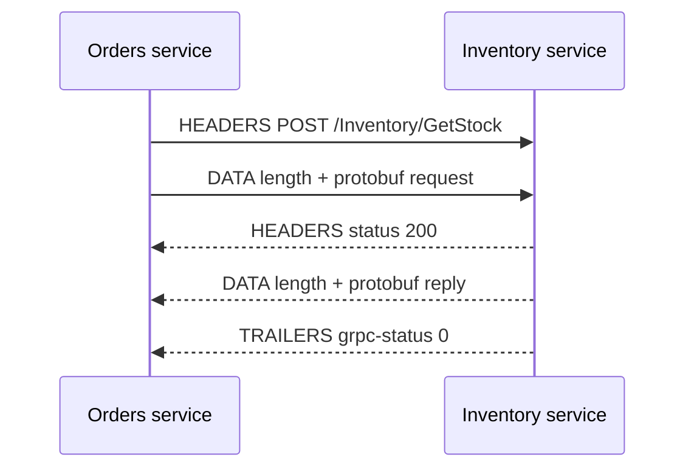

## In one line
gRPC lets one backend service call a function on another service as if it were local, using a shared typed contract (a `.proto` file), compact binary messages, and HTTP/2 underneath.

## The problem it solves
Your app has grown into several services. The orders service asks the inventory service "how many of product 42 are in stock?" thousands of times a second. With JSON over REST, a few things hurt:

- **No enforced contract.** The inventory team renames `available` to `qty`, and the orders service breaks at runtime, in production.
- **Hand-written clients.** Every service hand-writes HTTP calls and JSON parsing for every other service.
- **Overhead.** JSON repeats every field name as text in every message, and parsing text costs CPU. At high volume, that adds up.

**gRPC** is an open-source **RPC** framework created at Google. RPC means **remote procedure call**: calling a function that runs on another machine, as if it were a normal function call. You describe the service once, generate client and server code in any supported language, and the types are checked for you.

## Everyday analogy
Ordering parts from a supplier with a printed catalogue. Each part has a fixed number. You don't write "the small blue 3 mm bolt, please" in a letter. You fill in an order form: "part 17, quantity 200". Both sides use the same catalogue, so the form is short and can't be misread.

The `.proto` file is the catalogue. The field numbers are the part numbers.

Where it breaks down: a `.proto` file changes far more often than a catalogue, so there are rules for changing it safely (see follow-ups).

## How it works
### 1. The contract: Protocol Buffers
**Protocol Buffers** (protobuf) is a language for describing data, plus a compact binary format for sending it. A `.proto` file defines:

- **Messages:** data structures. Each field has a type, a name, and a **field number**.
- **Services:** groups of **methods** (the RPCs), each with a request and a response message.

```proto
syntax = "proto3";
package shop.inventory.v1;

service Inventory {
  rpc GetStock (GetStockRequest) returns (StockReply);          // unary: one in, one out
  rpc WatchStock (GetStockRequest) returns (stream StockReply); // server streaming
}

message GetStockRequest {
  int32 product_id = 1;   // the number, not the name, is what goes on the wire
}

message StockReply {
  int32 product_id = 1;
  int32 available = 2;
  string warehouse = 3;
}
```

On the wire, a field is sent as its **number and type**, then its value. Names never travel. `{ product_id: 42, available: 17, warehouse: "BLR-1" }` encodes to **11 bytes** in protobuf (`08 2a 10 11 1a 05 ...`), compared with 52 bytes as JSON. A **code generator** (`protoc`, or a library that loads the file at runtime) turns the `.proto` into typed client and server code.

### 2. The transport: HTTP/2
gRPC runs over **HTTP/2**, which can carry many requests and responses at once over **one TCP connection**, as separate **streams**. See [HTTP/1.1 vs HTTP/2 vs HTTP/3](#/topic/http-versions). A call looks like this:

1. The client opens a stream and sends headers: `POST /shop.inventory.v1.Inventory/GetStock`, `content-type: application/grpc`, and optionally `grpc-timeout`, the time left before the **deadline**.
2. It sends the request message, **length-prefixed**: 1 byte saying whether it's compressed, 4 bytes giving the length, then the protobuf bytes.
3. The server replies with headers (HTTP status `200`), then zero or more length-prefixed messages.
4. It ends with **trailers**, headers sent after the body: `grpc-status: 0` means OK. Errors use gRPC's own codes, such as `NOT_FOUND` (5), `DEADLINE_EXCEEDED` (4), or `UNAVAILABLE` (14).


*Notice: the real result of the call arrives in the trailers at the end, not in the HTTP status code.*

Because HTTP/2 streams stay open, gRPC supports four call types: **unary** (one request, one response), **server streaming**, **client streaming**, and **bidirectional streaming**.

## Real example
**Setup:** Node.js 18 or later, `"type": "module"`, `npm install @grpc/grpc-js @grpc/proto-loader` (tested with grpc-js 1.14). Save the `.proto` above as `inventory.proto`. `proto-loader` reads it at runtime, so no separate code generation step is needed, and it turns `product_id` into `productId`.

**Server:**

```js
import grpc from '@grpc/grpc-js';
import protoLoader from '@grpc/proto-loader';

const { Inventory } = grpc.loadPackageDefinition(protoLoader.loadSync('inventory.proto')).shop.inventory.v1;
const stock = { 42: { available: 17, warehouse: 'BLR-1' } }; // stand-in for a database

const server = new grpc.Server();
server.addService(Inventory.service, {
  getStock(call, callback) {
    const item = stock[call.request.productId];
    if (!item) return callback({ code: grpc.status.NOT_FOUND, details: 'No such product' });
    callback(null, { productId: call.request.productId, ...item });
  },
  watchStock(call) { // send three updates, one per second, then finish
    let left = 3;
    const timer = setInterval(() => {
      call.write({ productId: call.request.productId, available: 17 - (3 - left), warehouse: 'BLR-1' });
      if (--left === 0) { clearInterval(timer); call.end(); }
    }, 1000);
    call.on('cancelled', () => clearInterval(timer)); // the client hung up
  },
});
// Plaintext is for local testing only. Use TLS between real servers.
server.bindAsync('127.0.0.1:45014', grpc.ServerCredentials.createInsecure(), () => console.log('gRPC on 45014'));
```

**Client** (in another service):

```js
import grpc from '@grpc/grpc-js';
import protoLoader from '@grpc/proto-loader';

const { Inventory } = grpc.loadPackageDefinition(protoLoader.loadSync('inventory.proto')).shop.inventory.v1;
const inventory = new Inventory('127.0.0.1:45014', grpc.credentials.createInsecure());

for (const productId of [42, 7]) {
  const deadline = new Date(Date.now() + 500); // give up after 500 ms
  inventory.getStock({ productId }, { deadline }, (err, reply) => {
    if (err) return console.log(`product ${productId}:`, grpc.status[err.code], err.details);
    console.log(`product ${productId}:`, reply);
  });
}

const stream = inventory.watchStock({ productId: 42 });
stream.on('data', (update) => console.log('update:', update.available));
stream.on('end', () => console.log('stream finished'));
```

**Output:**

```text
product 7: NOT_FOUND No such product
product 42: { productId: 42, available: 17, warehouse: 'BLR-1' }
update: 17
update: 16
update: 15
stream finished
```

The calls look like local functions, and both unary calls shared one connection.

## How to say it in an interview

> [!INTERVIEW]
> **30 seconds:** "gRPC is an RPC framework for service-to-service calls. You define services and messages in a .proto file, and generate typed clients and servers in each language. Messages are encoded with Protocol Buffers, a compact binary format that sends field numbers instead of names, and calls run over HTTP/2, so they share connections and support streaming. I'd use it for high-volume internal calls between backend services, and keep REST or GraphQL for browsers and public APIs."

> [!INTERVIEW]
> **2 minutes:** Start with the 30-second answer, then add:
>
> "On the wire, each call is an HTTP/2 POST to /package.Service/Method with content-type application/grpc. Each message is length-prefixed protobuf, and the result comes back in trailers as a grpc-status code. Deadlines are built in, and they propagate: if the orders service has 300 ms left, the inventory call knows it too and can stop early.
>
> The contract is the big benefit. Breaking changes show up at compile time, not in production. You evolve it safely by adding new field numbers and never reusing old ones.
>
> The tradeoffs: browsers can't call gRPC directly because they don't expose HTTP/2 trailers, so you need gRPC-Web with a proxy, or a REST gateway. Binary payloads are harder to debug than JSON with curl, though tools like grpcurl help. And HTTP/2's long-lived connections need load balancing per request, not per connection. For a small team with a monolith, it's overhead you don't need."

## Follow-up questions interviewers ask

<details>
<summary>How do you change a .proto without breaking existing clients?</summary>

Field **numbers** are the identity of a field, so:

- **Add** new fields with new numbers. Old clients ignore fields they don't know.
- **Never reuse or change** a field's number or type. Mark deleted fields as `reserved` so nobody reuses them.
- Renaming a field is safe on the wire, because names aren't sent, but it breaks generated code that uses the old name.

For bigger breaking changes, create a new package version, like `shop.inventory.v2`.

</details>

<details>
<summary>Why can't a browser call a gRPC service directly?</summary>

Browsers don't give JavaScript the low-level HTTP/2 control gRPC needs, such as reading trailers. **gRPC-Web** is a modified protocol that browsers can use, translated by a proxy such as Envoy. Alternatives are a REST/JSON gateway in front of gRPC services, or the Connect protocol, which supports both.

</details>

<details>
<summary>Why does load balancing gRPC need special care?</summary>

gRPC keeps one long-lived HTTP/2 connection and sends many calls over it. A classic **layer 4** load balancer, which balances TCP connections, sends all those calls to whichever server got the connection. You need **layer 7** (request-aware) balancing, for example Envoy or a service mesh, or client-side load balancing across several server addresses.

</details>

<details>
<summary>What are deadlines, and why do they matter?</summary>

A **deadline** is the point in time after which the caller no longer wants the answer. The client sets it, it travels with the call, and the server can check it and stop work once the deadline has passed. Without deadlines, a slow downstream service makes callers pile up waiting, and the slowdown spreads through the system. See [Designing for failure](#/topic/designing-for-failure).

</details>

## Common mistakes and misconceptions

> [!MISTAKE]
> "gRPC is always faster than REST." It is usually more compact and efficient, but for a small number of calls, network latency and database time dominate. Measure before switching for speed alone.

> [!MISTAKE]
> Reusing a deleted field's number for a new field. Old clients still send the old meaning under that number, and the data gets silently misread. Use `reserved`.

> [!MISTAKE]
> Checking the HTTP status to see if a call succeeded. A failed gRPC call usually has HTTP status 200. The real result is `grpc-status` in the trailers, which client libraries surface as an error code.

## Tradeoffs: when NOT to use it
- **Browser and public APIs.** REST with JSON is universally understood, easy to try with curl, and works with HTTP caches and CDNs.
- **A small system or a monolith.** Code generation, `.proto` management, and HTTP/2-aware infrastructure are overhead with no payoff when there's only one service. See [Monolith vs microservices](#/topic/monolith-microservices).
- **Infrastructure without HTTP/2 support end to end.** Some proxies and load balancers don't pass gRPC through correctly.

## Check yourself

<details>
<summary>1. What goes on the wire for a protobuf field: its name or its number?</summary>

Its number (with a type tag), followed by the value. That's why messages are small, and why field numbers must never be reused.

</details>

<details>
<summary>2. Name the four gRPC call types.</summary>

Unary (one request, one response), server streaming, client streaming, and bidirectional streaming.

</details>

<details>
<summary>3. A gRPC call failed, but the proxy logs show HTTP 200. Where is the real status?</summary>

In the HTTP/2 trailers, as `grpc-status` (and `grpc-message`). gRPC reports the call's result there, after any response messages.

</details>

## Go deeper
- [gRPC docs: Core concepts](https://grpc.io/docs/what-is-grpc/core-concepts/)
- [Protocol Buffers: proto3 language guide](https://protobuf.dev/programming-guides/proto3/)
- [gRPC over HTTP/2 protocol specification](https://github.com/grpc/grpc/blob/master/doc/PROTOCOL-HTTP2.md)
