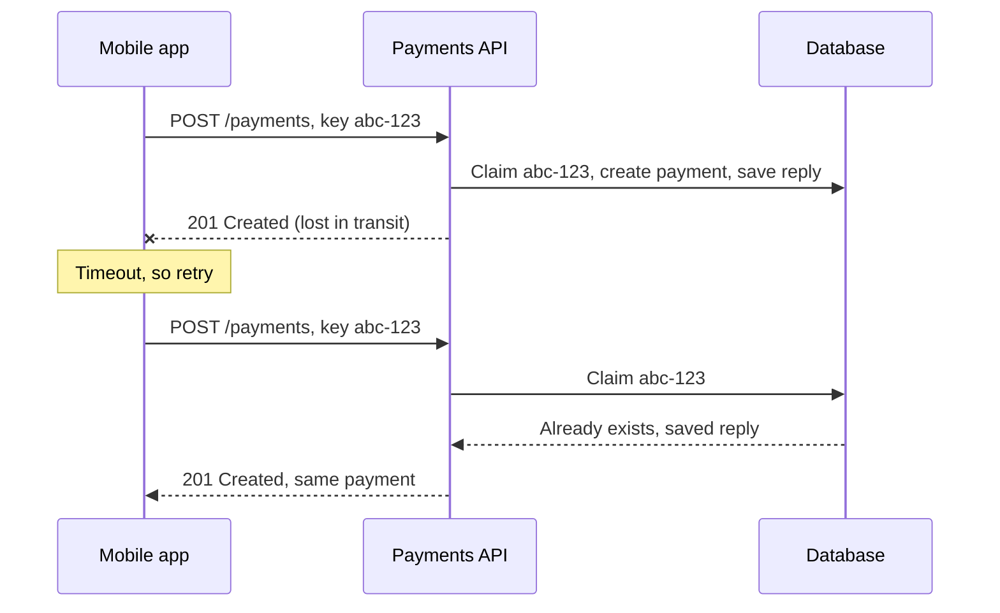

## In one line
An operation is idempotent if doing it twice has the same effect as doing it once, which is what makes it safe to retry a request, like a payment, after a timeout.

## The problem it solves
A customer clicks "Pay $59.98" in your shop. Your server charges the card, but the response is lost: the phone switched from Wi-Fi to mobile data. The app sees a timeout. Did the payment go through?

The app can't know. It has two bad choices:

- **Don't retry.** Maybe the order never got paid, and the customer is stuck.
- **Retry.** Maybe the first one worked, and the customer is charged twice.

This isn't rare. **Timeouts** (giving up after waiting too long) happen everywhere, and load balancers, queue consumers, and impatient users all retry.

Idempotency makes "retry" always the safe choice: the second attempt returns the first attempt's result instead of doing the work again.

## Everyday analogy
A lift button. Pressing "5" once calls the lift to floor 5. Pressing it ten more times while you wait changes nothing. Compare that with a vending machine: each press of "buy" drops another can and takes more money.

An idempotency key turns a vending machine into a lift button. Each purchase gets a receipt number. Press "buy" again with the same receipt number, and the machine says "already done, here's your can" instead of charging you twice.

Where it breaks down: the machine must remember receipt numbers, and that memory has a cost and an expiry date.

## How it works
### Which HTTP methods are idempotent
HTTP defines some methods as idempotent by meaning (RFC 9110):

- **GET**, **HEAD**: only read. Repeating changes nothing.
- **PUT** `/orders/1001/address`: "set the address to X". Setting it to X twice leaves it as X.
- **DELETE** `/cart/items/42`: after the first call it's gone. The second may return 404, but the server's **state** (its stored data) is the same.
- **POST** `/payments`: **not** idempotent. Each call creates a new payment.
- **PATCH**: depends on the change. "Set status to cancelled" is idempotent. "Add 1 to the view count" isn't.

Idempotent describes the **effect on the server**, not the response. A repeated DELETE can return 404 and still be idempotent.

### Idempotency keys: making POST safe to retry
An **idempotency key** is a unique id the **client** creates for one logical operation, and sends with every attempt of it, usually in an `Idempotency-Key` header. Stripe's API popularised this pattern, and an IETF Internet-Draft (a proposed standard, not yet final) describes the header.

The flow:

1. The client creates a random **UUID** (a 128-bit random id, like `9f1c...`) when the user clicks Pay. It saves it, and sends it with the request.
2. The server tries to **claim** the key: insert it into an `idempotency_keys` table with a **unique constraint**, a database rule that rejects a second row with the same value.
3. **New key:** do the work. Save the response (status code and body) under the key. Ideally, save it in the same database **transaction** as the work, so both are stored or neither is. (A transaction groups changes so they all succeed or all fail together. See [Transactions and ACID](#/topic/transactions-acid).)
4. **Key already finished:** don't do the work. Return the saved response.
5. **Key still in progress** (two attempts at the same moment): make the second one wait, or return **409 Conflict** so it retries later.
6. **Same key, different body:** a client bug. Reject it, typically with **422**.
7. Keys **expire** after a while, such as 24 hours. Stripe, for example, may delete keys once they are at least 24 hours old.


*Notice: the retry gets the original answer, and the card is charged only once.*

## Real example
**Setup:** Node.js 18 or later, `"type": "module"`, `npm install express pg` (tested with Express 5.3), and PostgreSQL with these tables. `DATABASE_URL` is set.

```sql
CREATE TABLE payments (id serial PRIMARY KEY, order_id int NOT NULL, amount_cents int NOT NULL);
CREATE TABLE idempotency_keys (
  key          text PRIMARY KEY,          -- the unique constraint does the deduplication
  request_hash text NOT NULL,             -- detects the same key sent with a different body
  status_code  int,
  response     jsonb,
  created_at   timestamptz NOT NULL DEFAULT now()  -- for deleting old keys later
);
```

The route (imports: `express`, `pg`, and `createHash` from `node:crypto`; `db` is a `pg.Pool`, and `express.json()` is in use):

```js
app.post('/payments', async (req, res) => {
  const key = req.get('Idempotency-Key');
  if (!key) return res.status(400).json({ error: 'Idempotency-Key header is required' });
  const hash = createHash('sha256').update(JSON.stringify(req.body)).digest('hex');

  const client = await db.connect();
  try {
    await client.query('BEGIN');
    // Claim the key. If it exists, insert nothing (waiting first if that request is mid-flight).
    const claim = await client.query('INSERT INTO idempotency_keys (key, request_hash) VALUES ($1, $2) ON CONFLICT (key) DO NOTHING', [key, hash]);
    if (claim.rowCount === 0) {                 // seen before: replay, don't charge again
      await client.query('ROLLBACK');
      const { rows: [saved] } = await db.query('SELECT * FROM idempotency_keys WHERE key = $1', [key]);
      if (saved.request_hash !== hash) return res.status(422).json({ error: 'Key reused with a different body' });
      return res.status(saved.status_code).json(saved.response);
    }
    const { rows: [payment] } = await client.query('INSERT INTO payments (order_id, amount_cents) VALUES ($1, $2) RETURNING *', [req.body.orderId, req.body.amountCents]);
    await client.query('UPDATE idempotency_keys SET status_code = 201, response = $2 WHERE key = $1', [key, payment]);
    await client.query('COMMIT');               // payment + saved response commit together
    res.status(201).json(payment);
  } catch (err) {
    await client.query('ROLLBACK');
    throw err;                                  // Express 5 passes it to the error handler
  } finally {
    client.release();
  }
});
```

**What happened when tested:** two identical requests sent at the same instant both returned `201` with the **same** payment id. The second one's insert waited on the first one's uncommitted key row, then found the key and replayed the saved answer. A third retry also got the same payment. The same key with a different amount got `422`. The `payments` table had exactly one row.

If the first attempt crashes before `COMMIT`, the key rolls back too, so a retry runs fresh.

> [!NOTE]
> This version works because the "work" is a database insert inside the same transaction. A real card charge calls an outside provider, and you shouldn't hold a transaction open during a slow network call. Then you store the key with a `processing` status first, return 409 to duplicates while it's processing, and pass your key on to the provider, since providers like Stripe accept idempotency keys too.

## How to say it in an interview

> [!INTERVIEW]
> **30 seconds:** "An operation is idempotent if repeating it has the same effect as doing it once. GET, PUT, and DELETE are idempotent by design. POST isn't, so retrying a payment after a timeout could charge twice. The fix is an idempotency key: the client generates a unique id per operation and sends it with every retry. The server stores the key with a unique constraint and the response. If the key comes again, it returns the saved response instead of doing the work again."

> [!INTERVIEW]
> **2 minutes:** Start with the 30-second answer, then add:
>
> "The key has to come from the client, created once per user action, like when they press Pay. If the server generated it, a retry would get a new key and defeat the purpose.
>
> On the server, I let the database decide, not a 'check then insert' in code, because two retries can arrive at the same instant on different servers. A unique constraint with INSERT ON CONFLICT closes that race. I store the key and the result in the same transaction as the work, and reject a reused key with a different body.
>
> The same idea applies to queue consumers, because most queues deliver at least once. A consumer that sends a receipt email should record the event id and skip duplicates. The tradeoff is storage and complexity. You keep keys for a window, like 24 hours, and need a cleanup job. So I use it where duplicates cost money or trust: payments, orders, transfers. Not for every endpoint."

## Follow-up questions interviewers ask

<details>
<summary>Who generates the idempotency key, and when?</summary>

The **client**, once per logical action: when the user taps "Pay", not on each attempt. Every retry of that action reuses the same key. If the user deliberately starts a new purchase, that gets a new key. A UUID v4 is the usual choice.

</details>

<details>
<summary>Why not just check "has this order already been paid?"</summary>

Sometimes that's enough. A **natural key**, such as "one payment per order id", enforced by a unique constraint, is a simple form of idempotency. But many operations have no natural key: two identical $5 top-ups might both be intended. And a "check then write" in application code has a race condition when two requests arrive together. A database constraint doesn't.

</details>

<details>
<summary>How is idempotency related to "exactly-once delivery"?</summary>

Real networks and queues can't guarantee a message is delivered exactly once. They offer **at-most-once** (may lose messages) or **at-least-once** (may duplicate them). The practical answer is at-least-once delivery plus idempotent processing. That gives exactly-once **effects**, which is what users care about. See [Retries, backoff, and dead-letter queues](#/topic/retries-backoff-dlq).

</details>

<details>
<summary>Where do you store idempotency keys: Redis or the database?</summary>

The database, when the work itself writes to the database, because the key and the result can then commit in one transaction. Redis is fast and has built-in expiry, but a key saved in Redis and an order saved in Postgres can get out of sync if one write fails. Redis is reasonable for lighter cases, such as deduplicating notifications.

</details>

<details>
<summary>Is DELETE really idempotent if the second call returns 404?</summary>

Yes. Idempotency is about the **effect on the server's state**, not the response. After one DELETE or five, the item is gone. Many APIs return 204 for the first call and 404 for later ones, and that's fine.

</details>

## Common mistakes and misconceptions

> [!MISTAKE]
> "Idempotent means the response is always the same." It means the **server state** ends the same. A repeated DELETE can return 404, and that's still idempotent.

> [!MISTAKE]
> Generating a new key on every retry, for example inside the HTTP client's retry loop. Then every attempt looks new, and the protection disappears. Create the key once per user action.

> [!MISTAKE]
> Checking for the key with a `SELECT`, then inserting. Two simultaneous requests can both see "not found" and both do the work. Let a unique constraint decide.

> [!MISTAKE]
> Disabling the Pay button and calling it done. That stops double-clicks, but not network retries, proxy retries, or the app retrying after a timeout.

## Tradeoffs: when NOT to use it
- **Naturally idempotent operations don't need keys.** `PUT`, `DELETE`, and "set status to shipped" are already safe to repeat.
- **Low-stakes writes.** A duplicate "like" or analytics event is often cheaper to tolerate, or to deduplicate later, than to protect with a key table.
- **It costs storage and a cleanup job.** Every key and response is stored for the retention window. High-volume endpoints add up.
- **It isn't a lock for different operations.** It only deduplicates retries of the **same** request. Two different requests racing to buy the last item in stock need a transaction or a row lock instead. See [Isolation levels and race conditions](#/topic/isolation-levels).

## Check yourself

<details>
<summary>1. Is "UPDATE products SET stock = stock - 1 WHERE id = 42" idempotent?</summary>

No. Each run lowers stock by one more. "SET stock = 17" would be idempotent. To make a decrement safe to retry, tie it to something unique, like an order id or idempotency key.

</details>

<details>
<summary>2. The first request with key K crashed halfway, before COMMIT. What happens when the client retries with K?</summary>

The transaction rolled back, including the key row, so K is unknown to the database. The retry claims K and does the work normally. That's the right outcome, since the first attempt left no trace.

</details>

<details>
<summary>3. A client sends key K with amount 5998, then key K again with amount 1. What should the server do?</summary>

Reject the second request, typically with 422, because the body doesn't match what was stored for K. It's a client bug, and replaying the first response would hide it.

</details>

## Go deeper
- [Stripe API docs: Idempotent requests](https://docs.stripe.com/api/idempotent_requests)
- [IETF draft: The Idempotency-Key HTTP header field](https://datatracker.ietf.org/doc/draft-ietf-httpapi-idempotency-key-header/)
- [RFC 9110: Idempotent methods](https://www.rfc-editor.org/rfc/rfc9110.html#name-idempotent-methods)
