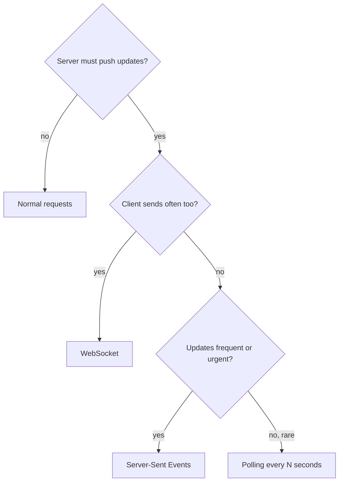

## In one line
Polling asks the server "anything new?" over and over, Server-Sent Events keep one HTTP response open so the server can push updates, and WebSockets turn the connection into a two-way channel where both sides can send at any time.

## The problem it solves
Plain HTTP works one way: the client asks, the server answers, and it's done. The server can't speak first.

But your app needs the server to tell the browser things as they happen:

- **Order tracking:** "Your order has shipped" should appear without a refresh.
- **Live stream chat:** thousands of viewers send messages, and everyone sees them within a second.
- **AI answers** that appear word by word as they're generated.

Making the user press refresh isn't acceptable. So how does the server push data to a browser that only knows how to ask?

## Everyday analogy
Waiting for a parcel.

- **Polling:** you walk to the door every five minutes to check. Mostly there's nothing.
- **Long polling:** you stand at the door until the courier arrives, take the parcel, then go back and stand there again.
- **Server-Sent Events:** you subscribe to delivery text messages. The courier sends updates as they happen. You can't reply by text.
- **WebSocket:** you're on an open phone call with the courier. Either of you can speak at any moment.

Where it breaks down: on a server, every open "call" uses memory, even when nobody is talking.

## How it works
### 1. Short polling
The client sends a normal request on a timer: `GET /orders/1001` every 5 seconds.

- **Good:** works everywhere, simple, stateless.
- **Bad:** wasteful. 10,000 users polling every 5 seconds is 2,000 requests a second, mostly returning "no change". Updates also arrive late, up to one full interval.

### 2. Long polling
The client sends a request, and the server **holds it open** until there's news or a timeout (say 30 seconds). Then it replies, and the client immediately asks again. Updates arrive almost instantly, but each message costs a full request. It was the standard trick before SSE and WebSockets.

### 3. Server-Sent Events (SSE)
The browser opens one ordinary HTTP request with the built-in **`EventSource`** API. The server replies with `Content-Type: text/event-stream` and **never ends the response**. It writes events as plain text whenever something happens:

```text
id: 17
event: status
data: {"orderId":"1001","status":"shipped"}

```

- Each line is a `field: value` pair: `data` is the content, `event` is an optional name, and `id` labels the event.
- A **blank line** ends one event.
- If the connection drops, the browser **reconnects automatically** and sends a `Last-Event-ID` header, so the server can resend what was missed.
- It's **one-way**: server to client. The client still uses normal requests to send things.

Over HTTP/1.1, browsers allow only about 6 connections per domain, and each SSE stream uses one. HTTP/2 removes this limit in practice, because many streams share one connection.

### 4. WebSockets
A **WebSocket** is a persistent, **full-duplex** connection: both sides can send messages at any time, independently. It starts life as an HTTP request, then **upgrades** to a different protocol on the same TCP connection.

**The upgrade handshake:**

```text
GET /live/7/chat HTTP/1.1
Host: api.example.com
Connection: Upgrade
Upgrade: websocket
Sec-WebSocket-Version: 13
Sec-WebSocket-Key: dGhlIHNhbXBsZSBub25jZQ==

HTTP/1.1 101 Switching Protocols
Upgrade: websocket
Connection: Upgrade
Sec-WebSocket-Accept: s3pPLMBiTxaQ9kYGzzhZRbK+xOo=
```

1. The client asks to upgrade, with a random `Sec-WebSocket-Key`.
2. The server proves it understands WebSockets by computing `Sec-WebSocket-Accept`: the key plus a fixed string defined in the standard, hashed with SHA-1 and base64-encoded. It replies **101 Switching Protocols**.
3. From then on, the connection carries WebSocket **frames**, small binary-framed messages, not HTTP. Either side can send text or binary frames. **Ping/pong** frames check that the other side is still there.

The URL scheme is `ws://`, or `wss://` when encrypted with TLS. Always use `wss://` in production.

### Choosing


*Notice: WebSocket is only necessary when both sides talk often. One-way push is simpler with SSE, and rare updates are fine with polling.*

## Real example
**Setup:** Node.js 18 or later, `"type": "module"`, `npm install express ws` (tested with Express 5.3 and ws 8). One process, port 45013.

**SSE: live order status**

```js
import express from 'express';
import { EventEmitter } from 'node:events';
import { WebSocketServer, WebSocket } from 'ws';

const app = express();
const orderEvents = new EventEmitter(); // in-process only; see "scaling" below

// SSE: the browser opens this once and keeps listening.
app.get('/orders/:id/events', (req, res) => {
  res.set({ 'Content-Type': 'text/event-stream', 'Cache-Control': 'no-cache' });
  res.flushHeaders(); // send headers now, keep the response open
  const send = (update) => {
    if (update.orderId !== req.params.id) return;
    res.write(`event: status\ndata: ${JSON.stringify(update)}\n\n`); // blank line ends the event
  };
  orderEvents.on('update', send);
  res.on('close', () => orderEvents.off('update', send)); // browser left: stop sending
});

// Something else in the app (an admin, a job) changes the order status.
app.post('/orders/:id/status', express.json(), (req, res) => {
  orderEvents.emit('update', { orderId: req.params.id, status: req.body.status });
  res.status(204).end();
});
```

**WebSocket: live-stream chat** (same file, continued)

```js
const server = app.listen(45013);
const chat = new WebSocketServer({ server, path: '/live/7/chat' });

chat.on('connection', (socket) => {
  socket.on('message', (data) => {
    for (const client of chat.clients) { // broadcast to everyone watching stream 7
      if (client.readyState === WebSocket.OPEN) client.send(data.toString());
    }
  });
});
```

**What happened when tested:**

- `curl -N localhost:45013/orders/1001/events` stayed open. Two `POST /orders/1001/status` calls appeared in it instantly as `event: status` blocks. An update for order 9999 did not. After curl disconnected, the listener count dropped to 0, so nothing leaked.
- A manual upgrade request with the sample key above got `101 Switching Protocols` and the matching `Sec-WebSocket-Accept`.
- Two `ws` clients connected. One sent `{"user":981,"text":"Great goal!"}`, and the other received it.

In the browser, both are built in:

```js
const events = new EventSource('/orders/1001/events');            // SSE
events.addEventListener('status', (e) => showStatus(JSON.parse(e.data)));

const chatSocket = new WebSocket('wss://api.example.com/live/7/chat'); // WebSocket
chatSocket.onmessage = (e) => addChatLine(JSON.parse(e.data));
```

> [!WARNING]
> Behind Nginx, WebSockets need `proxy_http_version 1.1` plus `Upgrade` and `Connection` headers passed through. Both SSE and WebSockets also need a longer `proxy_read_timeout`, since Nginx closes connections idle for 60 seconds by default. For SSE, also turn off proxy buffering (`proxy_buffering off`), or events arrive in delayed batches.

## How to say it in an interview

> [!INTERVIEW]
> **30 seconds:** "Polling has the client ask on a timer: simple but wasteful and delayed. Server-Sent Events keep one HTTP response open and let the server push text events, with automatic reconnection built into the browser. It's one-way, which suits notifications, order status, and streaming AI responses. WebSockets upgrade an HTTP connection into a full-duplex channel, so both sides can send at any time. That's what chat, multiplayer, and collaborative editing need. I pick the simplest one that fits the direction and frequency of messages."

> [!INTERVIEW]
> **2 minutes:** Start with the 30-second answer, then add:
>
> "A WebSocket starts as an HTTP GET with Upgrade: websocket and a random key. The server answers 101 Switching Protocols with an accept hash derived from the key, and from then on it's WebSocket frames over the same TCP connection, not HTTP.
>
> The hard part is scaling, not the protocol. Connections are long-lived and stateful, so each server holds thousands of open sockets. With several servers behind a load balancer, a chat message arriving on server A has to reach viewers connected to server B. I'd use a publish/subscribe, or pub/sub, layer like Redis: each server publishes incoming messages and subscribes to the channels its clients care about. Deployments also drop every connection, so clients need reconnect with backoff, and the server has to resend or let them fetch what they missed.
>
> The tradeoff is complexity. For a one-way stream like order updates or an LLM response, SSE is plain HTTP. It works with normal auth cookies, proxies, and HTTP/2, and reconnection is built in. I'd only reach for WebSockets when the client also needs to send frequent messages."

## Follow-up questions interviewers ask

<details>
<summary>How do you scale WebSockets across multiple servers?</summary>

Each connection lives on one server, so you need two things:

1. A way to **route messages between servers**. Typically pub/sub: Redis Pub/Sub, NATS, or Kafka. Server A publishes "message for stream 7", and every server with stream 7 viewers delivers it.
2. A load balancer that supports **long-lived connections** and upgrades. Sticky sessions are needed with some libraries' fallback modes (like Socket.IO's long-polling), not for plain WebSockets.

See [Redis beyond caching](#/topic/redis-beyond-caching) and [Design: chat application](#/topic/design-chat).

</details>

<details>
<summary>How do you authenticate a WebSocket connection?</summary>

Authenticate during the **handshake**, which is a normal HTTP request. Cookies are sent automatically for same-site connections. The browser `WebSocket` API can't set custom headers like `Authorization`, so token-based apps often send a short-lived token in the first message, or in the URL (which risks it appearing in logs). Also check the `Origin` header to block other sites from opening sockets with your users' cookies.

</details>

<details>
<summary>Why do ChatGPT-style APIs stream with SSE rather than WebSockets?</summary>

The data flows one way, server to client, for a single request. SSE is just an HTTP response that stays open, so it works with ordinary POST/GET semantics, auth headers, proxies, and load balancers, with no protocol upgrade. Many LLM APIs use the `text/event-stream` format for this. See [Calling LLM APIs from a backend](#/topic/llm-apis).

</details>

<details>
<summary>What happens when a WebSocket connection drops silently?</summary>

TCP may not notice for a long time, for example when a phone loses signal. Use **heartbeats**: the server sends ping frames every 30 seconds or so, and closes connections that don't answer with pong. Clients reconnect with **exponential backoff** (waiting longer after each failure), so a server restart doesn't trigger a stampede of instant reconnects.

</details>

<details>
<summary>WebSocket vs Socket.IO?</summary>

WebSocket is the protocol and browser API. **Socket.IO** is a library built on top of it, adding rooms, automatic reconnection, acknowledgements, and a long-polling fallback. A Socket.IO client can't talk to a plain WebSocket server, or the reverse, because it adds its own protocol on top.

</details>

## Common mistakes and misconceptions

> [!MISTAKE]
> "WebSockets are always better than polling." For a dashboard that changes every few minutes, polling is simpler, cacheable, and stateless. WebSockets add connection state, reconnection logic, and scaling work.

> [!MISTAKE]
> "SSE is outdated." It's a current web standard, supported in all modern browsers, and widely used for streaming AI responses and notifications.

> [!MISTAKE]
> Not cleaning up when the client leaves. Forgetting `off()` on close, as in the example, leaks listeners and memory with every disconnected user.

> [!MISTAKE]
> Broadcasting with an in-memory list on one server, then adding a second server. Users on different servers stop seeing each other's messages. Add pub/sub before scaling out.

## Tradeoffs: when NOT to use it
- **Don't use WebSockets for one-way updates.** SSE is simpler and plain HTTP.
- **Don't use any push for rare updates.** If something changes a few times a day, poll occasionally or refresh on page load.
- **Open connections have a cost.** Each one holds memory and a file descriptor, and some hosting platforms (certain serverless functions) can't hold connections open for long.
- **Real-time doesn't mean reliable.** If a message is sent while a user is disconnected, it's gone unless you store it. Chat apps save messages to a database and let clients fetch what they missed after reconnecting.

## Check yourself

<details>
<summary>1. Which status code completes a WebSocket handshake, and what does the server send to prove it understood the request?</summary>

`101 Switching Protocols`, with a `Sec-WebSocket-Accept` header computed from the client's `Sec-WebSocket-Key`.

</details>

<details>
<summary>2. Order status updates flow only from server to browser. Which technique fits best, and why?</summary>

Server-Sent Events. The data flows one way, SSE is plain HTTP with automatic reconnection, and it avoids WebSockets' extra complexity.

</details>

<details>
<summary>3. Chat works with one server. After adding a second server behind the load balancer, some users stop seeing messages. Why?</summary>

Each server broadcasts only to its own connected clients. Messages arriving at server A never reach users connected to server B. Add a pub/sub layer, such as Redis, so every server receives every message for the rooms its clients are in.

</details>

## Go deeper
- [MDN: Using server-sent events](https://developer.mozilla.org/en-US/docs/Web/API/Server-sent_events/Using_server-sent_events)
- [MDN: The WebSocket API](https://developer.mozilla.org/en-US/docs/Web/API/WebSockets_API)
- [RFC 6455: The WebSocket Protocol](https://www.rfc-editor.org/rfc/rfc6455.html)
