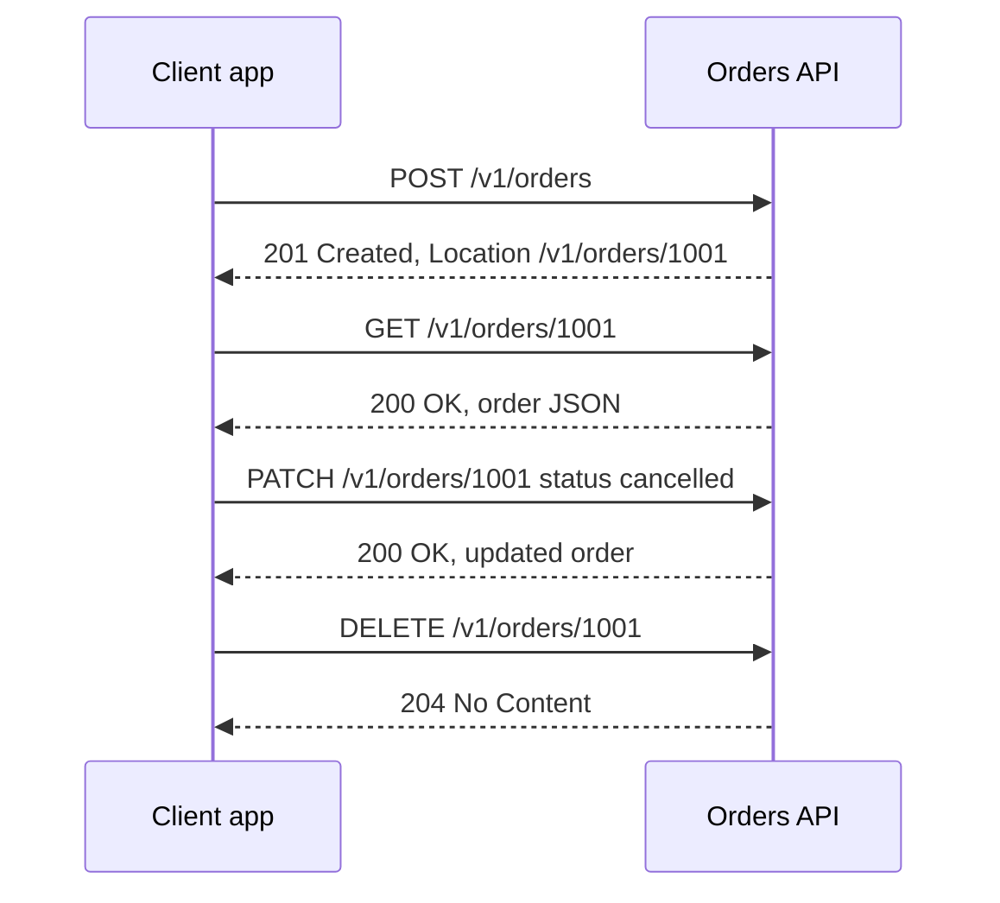

## In one line
REST API design means modelling your data as resources with predictable URLs, and using HTTP's own methods and status codes to act on them, so other developers can guess how your API works.

## The problem it solves
Your mobile team needs the shop's API. Here's what they find:

```text
POST /getOrders
POST /createNewOrder
GET  /deleteOrder?id=7
POST /order/update        -> 200 OK  { "success": false, "msg": "not found" }
```

Every endpoint is a surprise. Is it `order` or `orders`? Does a failure come back as an error code, or as `200 OK` with `success: false`? Worse, `GET /deleteOrder` deletes data. Browsers, crawlers, and **caches** (saved copies kept to avoid repeating work) all assume a GET only reads. A link-preview bot could delete orders just by visiting URLs.

An **API** (Application Programming Interface) is the set of requests a program accepts. A well-designed one is boring in the best way: a developer who has used one REST API can mostly guess yours.

## Everyday analogy
A library. Every item has a shelf address (`/books/978-0`), and every visitor uses the same few actions at the desk: look at, add, replace, update, remove. You don't need a different procedure for each book.

Resources are the books. URLs are the shelf addresses. HTTP methods are the desk actions. Status codes are the librarian's standard replies: "here it is", "we don't have that", "you're not allowed".

Where it breaks down: some real actions don't fit "a thing with an address", like "cancel this order" or "transcode this video". REST handles those with a bit of judgment (see follow-up questions).

## How it works
**REST** (Representational State Transfer) is an architectural style described by Roy Fielding in 2000. Its key constraints, in plain words:

- **Client-server:** the frontend and backend are separate and talk only through the API.
- **Stateless:** each request carries everything needed to handle it (including who you are, for example a token). The server doesn't remember "where you were".
- **Cacheable:** responses say whether they can be cached.
- **Uniform interface:** every resource is handled the same way: URLs name things, methods say what to do.

### 1. Resources and URLs
A **resource** is a thing your API exposes: a product, an order, a video. A URL names it.

- Use **plural nouns**: `/products`, `/orders`, `/videos`.
- A collection is `/orders`. One item is `/orders/1001`.
- Show ownership by nesting one level: `/users/981/orders`. Avoid deeper nesting; `/orders/1001` is enough once you have the id.
- No verbs in paths. The method is the verb.

### 2. Methods
Two properties matter. A method is **safe** if it doesn't change anything. It is **idempotent** if sending it once or five times has the same effect on the server.

| Method | Use | Safe | Idempotent |
|---|---|---|---|
| `GET /orders/1001` | Read | Yes | Yes |
| `POST /orders` | Create (server picks the id) | No | No |
| `PUT /orders/1001` | Replace the whole resource | No | Yes |
| `PATCH /orders/1001` | Change some fields | No | Not guaranteed |
| `DELETE /orders/1001` | Remove | No | Yes |

Idempotency matters because networks fail and clients retry. Retrying a `PUT` is harmless. Retrying a `POST /orders` might create two orders. See [Idempotency](#/topic/idempotency).

### 3. Status codes
Use the code that matches what happened. Clients, monitoring tools, and proxies all read it.

- **200 OK:** success, with a body.
- **201 Created:** a POST created something. Include a `Location: /orders/1001` header.
- **204 No Content:** success, nothing to return (common for DELETE).
- **400 Bad Request:** the input is malformed or invalid. (Some APIs use **422** for "well-formed but fails validation".)
- **401 Unauthorized:** you're not logged in, or your token is invalid. Despite the name, it means *unauthenticated*.
- **403 Forbidden:** we know who you are; you're not allowed.
- **404 Not Found:** no such resource.
- **409 Conflict:** clashes with current state, like cancelling an order that already shipped.
- **429 Too Many Requests:** slow down (rate limited).
- **500** for bugs on your side. **503** when temporarily unavailable.


*Notice: the URL stays the same while the method changes the action, and each reply has a status code that says exactly what happened.*

### 4. Pagination, filtering, sorting
Never return an unbounded list. `GET /products` on a catalogue of 2 million rows would be slow and huge.

- **Filtering and sorting** go in the **query string** (the part after `?`): `/products?category=audio&sort=-price` (a leading minus commonly means descending).
- **Offset pagination**: `?limit=20&offset=40`. Easy, and lets users jump to page 50. But the database still has to step over all skipped rows, so deep pages get slow. And if new rows arrive while someone pages, items shift and get shown twice or skipped.
- **Cursor pagination**: `?limit=20&after=<cursor>`, where the cursor marks the last item seen. The query becomes "the next 20 after this one", which an **index** (a lookup structure the database keeps, like a book's index) answers quickly at any depth. It's stable when new rows arrive. You can't jump to page 50, which suits infinite scroll and feeds.

### 5. Errors and versioning
- **One error format** for every endpoint. A common standard is **Problem Details** (RFC 9457): `{ "type", "title", "status", "detail" }`. Even a simple `{ "error": { "code": "ORDER_NOT_FOUND", "message": "..." } }` works, as long as it's consistent.
- **Versioning**: put a major version in the path (`/v1/orders`) or a header. Add fields freely, since clients should ignore what they don't know. Removing or renaming fields is a breaking change that needs a new version.

## Real example
**Setup:** Node.js 18 or later, `"type": "module"`, `npm install express pg` (tested with Express 5.3), and PostgreSQL with a `products (id, name, category, price_cents)` table. `DATABASE_URL` is set.

Cursor pagination with an optional filter:

```js
import express from 'express';
import pg from 'pg';

const db = new pg.Pool({ connectionString: process.env.DATABASE_URL });
const app = express();

// GET /v1/products?category=audio&limit=20&after=40
app.get('/v1/products', async (req, res) => {
  const limit = Math.min(Math.max(Number(req.query.limit) || 20, 1), 100); // 1 to 100, default 20
  const after = Number(req.query.after) || 0;                 // cursor: last id the client saw
  const category = req.query.category ?? null;                // optional filter

  const { rows } = await db.query(
    `SELECT id, name, category, price_cents FROM products
     WHERE id > $1 AND ($2::text IS NULL OR category = $2)
     ORDER BY id LIMIT $3`,
    [after, category, limit + 1], // ask for one extra row to learn if another page exists
  );
  const hasMore = rows.length > limit;
  const items = rows.slice(0, limit);
  res.json({ items, nextCursor: hasMore ? items.at(-1).id : null });
});

app.listen(45007);
```

```bash
curl 'localhost:45007/v1/products?category=cameras&limit=2'
# {"items":[{"id":3,...},{"id":6,...}],"nextCursor":6}
curl 'localhost:45007/v1/products?category=cameras&limit=2&after=6'
# {"items":[{"id":9,...},{"id":12,...}],"nextCursor":12}
```

The client just passes back `nextCursor`. When it's `null`, there are no more pages. The `$1`, `$2` placeholders keep user input out of the SQL text, which prevents SQL injection. Real APIs often encode the cursor as an opaque string (for example base64), so clients don't build their own.

## How to say it in an interview

> [!INTERVIEW]
> **30 seconds:** "I design REST APIs around resources with plural noun URLs, like /orders and /orders/1001, and let the HTTP method be the verb: GET reads, POST creates, PUT replaces, PATCH updates part, DELETE removes. I return status codes that match what happened, like 201 with a Location header on create, 404, 409 for conflicts, and one consistent error format. Lists are always paginated, with filters in the query string, and I version the API, for example /v1, so I can make breaking changes safely."

> [!INTERVIEW]
> **2 minutes:** Start with the 30-second answer, then add:
>
> "I pay attention to which methods are idempotent. GET, PUT, and DELETE are, so clients can retry them safely. POST isn't, so for things like creating orders or payments I accept an idempotency key.
>
> For pagination, offset is simple and supports page numbers, but it gets slow on deep pages and items shift when new rows arrive. For a feed or a big catalogue I use cursor pagination: the client sends back the last id it saw, and the query uses an index to fetch the next page, which stays fast at any depth.
>
> For actions that don't map to CRUD, like cancelling an order, I either model it as a state change, PATCH the status, or as a sub-resource like POST /orders/1001/cancellation. I keep the same error shape everywhere so the frontend has one error handler. The tradeoff with REST is that clients sometimes need several calls to build one screen, or get more fields than they need. That's where GraphQL or a purpose-built endpoint can help."

## Follow-up questions interviewers ask

<details>
<summary>PUT vs PATCH: what's the difference?</summary>

`PUT` replaces the whole resource with what you send. Fields you leave out are removed or reset. Sending the same PUT twice gives the same result, so it's idempotent. `PATCH` changes only the fields you send. It is often idempotent in practice (`{"status":"cancelled"}`), but not by definition: `{"op":"increment","field":"views"}` would not be.

</details>

<details>
<summary>401 vs 403?</summary>

**401**: "I don't know who you are." No credentials, or invalid or expired ones. Logging in might help. **403**: "I know who you are, and you're not allowed." Logging in again won't help. For resources a user shouldn't even know exist, such as someone else's order, many APIs return **404** instead of 403, to avoid confirming that it exists.

</details>

<details>
<summary>How do you model an action like "cancel order" in REST?</summary>

Three common options:

1. Update state: `PATCH /orders/1001` with `{"status":"cancelled"}`.
2. A sub-resource noun: `POST /orders/1001/cancellation`.
3. A pragmatic action endpoint: `POST /orders/1001/cancel`.

Return **409** if the order already shipped. Purists prefer 1 or 2. Many large public APIs use 3. Being consistent matters more than being pure.

</details>

<details>
<summary>URL versioning or header versioning?</summary>

**URL** (`/v1/orders`): visible, easy to test in a browser, easy to route in Nginx. It's the most common. **Header** (`Accept: application/vnd.shop.v2+json` or a custom version header): keeps URLs clean, but is harder to see and test. Either way, avoid breaking changes inside a version. Adding optional fields is fine. Removing or renaming them isn't.

</details>

<details>
<summary>Is it RESTful to return 200 with an error in the body?</summary>

No. Status codes exist so that clients, proxies, retries, and monitoring can tell success from failure without parsing the body. A failed request returning 200 hides errors from your dashboards and breaks retry logic. Return the right 4xx or 5xx code, plus an error body.

</details>

<details>
<summary>What is HATEOAS? Do you use it?</summary>

"Hypermedia as the engine of application state": responses include links to related actions, like `"links": {"cancel": "/orders/1001/cancellation"}`, so clients follow links instead of hard-coding URLs. It's part of Fielding's original definition of REST, but most real-world "REST" APIs don't use it fully. An honest answer: "I know the idea; in practice, I design resource-based JSON APIs with documented URLs."

</details>

## Common mistakes and misconceptions

> [!MISTAKE]
> Verbs in URLs, like `/getUser` or `/createOrder`. The method already says the action. Use `GET /users/981` and `POST /orders`.

> [!MISTAKE]
> Using GET for anything that changes data. Crawlers, browser prefetching, and caches assume GET is safe, and may call it without a user asking.

> [!MISTAKE]
> Returning a whole table with no limit. It works with 50 test rows, then times out in production. Always paginate, and cap `limit` on the server.

> [!MISTAKE]
> Leaking database structure into the API: column names like `usr_fk_id`, or exposing every column. The API is a contract. Shape responses for clients, so you can change the database without breaking them.

## Tradeoffs: when NOT to use it
- **Many different screens with very different data needs**, especially mobile apps on slow networks. REST may need several round trips per screen. GraphQL or a screen-specific endpoint (a "backend for frontend") can be better. See [GraphQL vs REST](#/topic/graphql-vs-rest).
- **Internal service-to-service calls with high volume.** gRPC gives typed contracts and compact binary messages. See [gRPC](#/topic/grpc).
- **Real-time updates.** REST is request-response. For live order status or chat, use WebSockets or Server-Sent Events. See [Real-time](#/topic/realtime).
- **Purity has costs.** Bending a natural action into awkward nouns just to be "RESTful" makes the API harder to use. Pragmatic and consistent beats pure.

## Check yourself

<details>
<summary>1. Design URLs and methods to list a user's orders, create an order, and get one order.</summary>

`GET /users/981/orders` (or `GET /orders?userId=981`, or `GET /orders` scoped to the logged-in user), `POST /orders` (returns 201 with a `Location` header), and `GET /orders/1001`.

</details>

<details>
<summary>2. Which of GET, POST, PUT, DELETE are idempotent, and why does it matter?</summary>

GET, PUT, and DELETE are idempotent. POST isn't. It matters for retries: after a timeout, a client can safely resend an idempotent request, but resending a POST could create a duplicate order or payment.

</details>

<details>
<summary>3. A feed paginates with ?offset=. Users report seeing the same video twice while scrolling. Why, and what's the fix?</summary>

New videos were added at the top while the user scrolled, so every item shifted down, and the next offset page repeated items. Cursor pagination ("the next 20 after id X") isn't affected by new rows, and it stays fast on deep pages.

</details>

## Go deeper
- [MDN: HTTP request methods](https://developer.mozilla.org/en-US/docs/Web/HTTP/Reference/Methods)
- [RFC 9110: HTTP Semantics (methods, safe and idempotent, status codes)](https://www.rfc-editor.org/rfc/rfc9110.html)
- [RFC 9457: Problem Details for HTTP APIs](https://www.rfc-editor.org/rfc/rfc9457.html)
