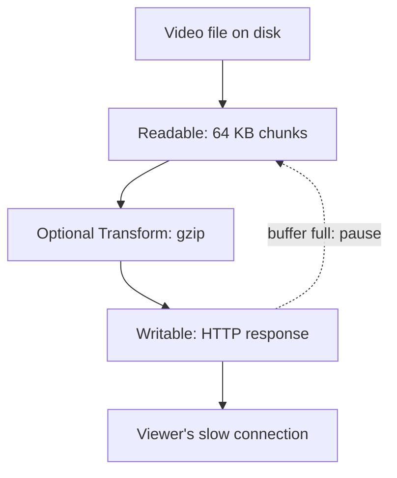

## In one line
A stream moves data in small pieces as it arrives, so your server can handle a 2 GB video using a few megabytes of memory instead of 2 GB.

## The problem it solves
Your video app lets viewers download their purchased videos. The simple code reads the whole file, then sends it:

```js
const data = await readFile('videos/42.mp4'); // the entire file, in memory
res.send(data);
```

For a 10 MB file, fine. For a 500 MB file, your process suddenly needs 500 MB more **memory** (RAM, the computer's fast short-term storage). Ten viewers at once need 5 GB. The server runs out of memory, and the operating system kills the process. Files over 2 GB don't even load: Node's `readFile` refuses them with `ERR_FS_FILE_TOO_LARGE`.

There's a speed problem too. The viewer gets nothing until the whole file has been read from disk.

Uploads have the same shape. A user uploads a 2 GB video. Holding all of it in memory before saving it is wasteful and dangerous.

## Everyday analogy
Moving water from a lake to a field. You could fill one giant tank first, drive it over, and empty it. You need a tank as big as the job. Or you could run a hose. Water flows through continuously, and the hose only ever holds a little.

A stream is the hose. Backpressure is the tap: if the field is flooding, you turn the tap down.

Where it breaks down: a hose can't go backwards or skip ahead. Some jobs genuinely need the whole thing at once, like parsing a JSON document or resizing an image.

## How it works
**A buffer** is a fixed-size block of raw bytes in memory. In Node, `Buffer` is the built-in type for binary data: file contents, network packets, image bytes. `Buffer.from('hi')` holds the two bytes `68 69`. A **chunk** is one buffer-sized piece of a larger stream.

**A stream** is an object that hands you data chunk by chunk, over time, instead of all at once. Node has four types:

1. **Readable:** a source you read from. Examples: `fs.createReadStream()`, an incoming HTTP request (`req`).
2. **Writable:** a destination you write to. Examples: `fs.createWriteStream()`, an HTTP response (`res`).
3. **Duplex:** both readable and writable, independently. Example: a TCP socket.
4. **Transform:** a duplex that changes data as it passes through. Examples: `zlib.createGzip()` for compression, or a step that encrypts.

Streams are **event emitters**: objects that call your functions when something happens. A readable emits `'data'` for each chunk, `'end'` when finished, and `'error'` if it fails.

### Backpressure
**Backpressure** is how a slow destination tells a fast source to slow down.

Reading from a local disk can be very fast. Sending to a viewer on a weak phone connection can be far slower. Without backpressure, chunks pile up in memory waiting to be sent, and you're back to loading the whole file.

Each stream has a buffer limit, the **highWaterMark**. File read streams use 64 KB chunks by default. Here is the mechanism:

1. The source reads a chunk and calls `destination.write(chunk)`.
2. `write()` returns `true` while the destination's buffer is below its limit. Keep going.
3. When the buffer is full, `write()` returns `false`. The source **pauses**.
4. When the destination has flushed its buffer, it emits `'drain'`. The source **resumes**.


*Notice: data flows down in small chunks, and a full buffer at the bottom pauses the source at the top.*

You rarely write that pause-and-resume logic yourself. **`pipeline()`** from `node:stream/promises` connects streams, handles backpressure, and, crucially, destroys every stream in the chain if any one fails. That prevents leaked file handles when a viewer closes the tab halfway.

## Real example
**Setup:** Node.js 18 or later, `"type": "module"` in `package.json`, `npm install express` (tested with Express 5.3). Put a large file at `videos/42.mp4`; the test used a 500 MB file.

```js
import express from 'express';
import { createReadStream } from 'node:fs';
import { readFile, stat } from 'node:fs/promises';
import { pipeline } from 'node:stream/promises';
import path from 'node:path';

const app = express();
const videoPath = (id) => path.resolve('videos', `${Number(id)}.mp4`); // Number() blocks "../" tricks

// BAD: loads the whole file into memory before sending a single byte
app.get('/videos/:id/buffered', async (req, res) => {
  const data = await readFile(videoPath(req.params.id)); // one 500 MB Buffer
  res.type('video/mp4').send(data);
});

// GOOD: sends the file in 64 KB chunks, pausing when the viewer falls behind
app.get('/videos/:id/streamed', async (req, res) => {
  const file = videoPath(req.params.id);
  const info = await stat(file).catch(() => null);
  if (!info) return res.status(404).json({ error: 'Video not found' });

  res.type('video/mp4').set('Content-Length', String(info.size));
  try {
    await pipeline(createReadStream(file), res); // handles backpressure, errors, cleanup
  } catch (err) {
    console.warn('Stream stopped:', err.code); // e.g. the viewer closed the tab
  }
});

app.get('/memory', (req, res) => res.json({ rssMB: Math.round(process.memoryUsage().rss / 1e6) }));
app.listen(45004);
```

The 404 check happens **before** streaming starts. Once `pipeline` begins, a failure destroys the response, so you can no longer send a clean error.

Download the file with each route, restarting the server in between, and check memory:

```bash
curl -s -o /dev/null localhost:45004/videos/42/streamed && curl -s localhost:45004/memory
# {"rssMB":93}    started at 54 MB

curl -s -o /dev/null localhost:45004/videos/42/buffered && curl -s localhost:45004/memory
# {"rssMB":581}   started at 54 MB
```

**RSS** (resident set size) is the memory the process actually holds. Streaming the 500 MB file added about 40 MB. Buffering added over 500 MB, for a **single** viewer.

> [!TIP]
> In production, Express's `res.sendFile()` streams files for you and also supports **Range requests**, which let a video player jump to minute 30 without downloading the first 29. Large static files are usually served by Nginx or a CDN instead of Node.

## How to say it in an interview

> [!INTERVIEW]
> **30 seconds:** "A buffer is a chunk of raw bytes in memory. A stream processes data chunk by chunk as it arrives, instead of loading everything first. For a large video download, I pipe a file read stream into the HTTP response, so memory stays small no matter how big the file is. Streams also handle backpressure: if the client is slow, the source pauses until the buffer drains. I use stream.pipeline so errors and cleanup are handled properly."

> [!INTERVIEW]
> **2 minutes:** Start with the 30-second answer, then add:
>
> "There are four stream types: readable, writable, duplex like a TCP socket, and transform like gzip. HTTP requests are readable streams and responses are writable, so uploads and downloads are streams by nature.
>
> Backpressure works through write() returning false when the destination's buffer passes its highWaterMark. The source pauses until a 'drain' event. Ignoring that return value is how streaming code quietly fills memory anyway.
>
> As an example: when testing a 500 MB download, the buffered version grew the process by over 500 MB per request. The streamed version grew it by about 40 MB. The tradeoff is complexity. Streams are harder to debug, errors can arrive midway after headers are sent, and some work needs the whole input at once. For small JSON API responses, buffering is simpler and fine."

## Follow-up questions interviewers ask

<details>
<summary>Why use pipeline() instead of .pipe()?</summary>

`readable.pipe(writable)` handles backpressure but **not errors**. If the source fails, the destination is left open, and **file descriptors** (the operating system's handles for open files and connections) can leak. `pipeline()` forwards errors, destroys every stream in the chain, and tells you once, through a rejected promise or a callback, that something failed.

</details>

<details>
<summary>What's the difference between a Buffer and a string?</summary>

A string is text: a sequence of characters. A `Buffer` is raw bytes with no meaning attached. To turn bytes into text you need an **encoding** such as UTF-8, a rule for which bytes mean which characters. One emoji is 4 bytes in UTF-8. If a chunk boundary splits it, decoding each chunk separately produces garbage, which is why `setEncoding('utf8')` or `StringDecoder` exist.

</details>

<details>
<summary>How do you handle a 2 GB file upload in Node?</summary>

Never buffer it. Either stream the request body straight to disk or to object storage (`pipeline(req, createWriteStream(path))`), or skip your server entirely by letting the browser upload directly to storage with a presigned URL. See [File uploads and presigned URLs](#/topic/file-uploads).

</details>

<details>
<summary>What is objectMode?</summary>

By default streams carry bytes (buffers or strings). In **object mode**, each chunk is a JavaScript object instead. That's useful for processing database rows one at a time, for example streaming 1 million `orders` rows into a CSV export without loading them all.

</details>

<details>
<summary>Can you use async iteration with streams?</summary>

Yes. Readable streams work with `for await (const chunk of stream) { ... }`. It respects backpressure automatically, because the loop doesn't pull the next chunk until your body finishes. It's often the clearest way to consume a stream.

</details>

## Common mistakes and misconceptions

> [!MISTAKE]
> "Streaming means the request is faster." Not necessarily faster to finish. It's lighter on memory and gets the first byte to the user sooner. Total transfer time is usually limited by the network either way.

> [!MISTAKE]
> Calling `write()` in a loop and ignoring its return value. Each call still succeeds, but data piles up in memory. Use `pipeline()`, or wait for `'drain'` when `write()` returns `false`.

> [!MISTAKE]
> Using `.pipe()` with no error handling. A missing file or a closed connection then leaks resources, or crashes the process with an unhandled `'error'` event.

> [!MISTAKE]
> Trying to send a 404 after streaming has started. Headers go out with the first chunk. Check that the file exists **before** you begin.

## Tradeoffs: when NOT to use it
- **Small payloads.** A 2 KB JSON response doesn't need a stream. Buffering is simpler to write, test, and debug.
- **Work that needs the whole input.** Parsing one JSON document, or computing a total before writing a header, needs all the data. (Streaming parsers exist, but add complexity.)
- **When something else should do it.** Nginx or a CDN serves static video far more efficiently than Node. Let browsers upload to object storage directly instead of streaming through your API.
- **Error handling gets harder.** A failure can happen after the status code and half the body are already sent. The client sees a cut-off download, not a clean error.

## Check yourself

<details>
<summary>1. Name the four stream types and give one example of each.</summary>

Readable (`fs.createReadStream`, an incoming `req`), Writable (`fs.createWriteStream`, `res`), Duplex (a TCP socket), Transform (`zlib.createGzip`).

</details>

<details>
<summary>2. What does it mean when write() returns false?</summary>

The destination's internal buffer has reached its highWaterMark. The source should stop writing until the destination emits `'drain'`. That's backpressure.

</details>

<details>
<summary>3. Ten viewers download a 1 GB video at once. Roughly how much extra memory does each approach need?</summary>

Buffering: about 10 GB, a full copy per viewer (and `readFile` would reject files over 2 GB anyway). Streaming: a few chunks per viewer, typically well under a megabyte each, so the total stays small.

</details>

## Go deeper
- [Node.js docs: Backpressuring in streams](https://nodejs.org/en/learn/modules/backpressuring-in-streams)
- [Node.js API docs: Stream](https://nodejs.org/api/stream.html)
