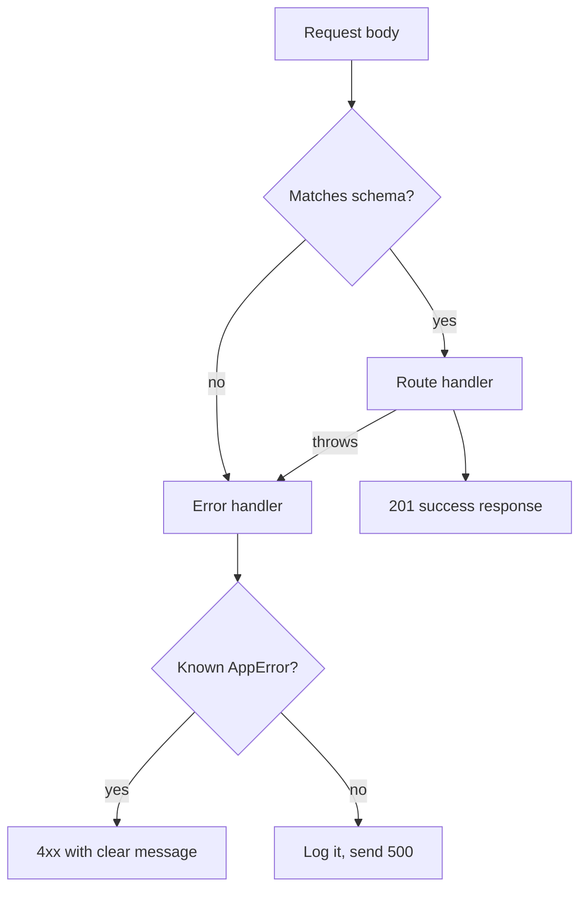

## In one line
Check every piece of incoming data against clear rules before using it, and send every error through one central handler that turns it into a safe, consistent response.

## The problem it solves
An order request should look like `{ "productId": 42, "quantity": 2 }`. Here's what actually arrives over a week:

- `{ "productId": "42", "quantity": -3 }`: a string, and a negative quantity. Your code multiplies the price by -3 and issues a refund.
- `{ "productId": 42, "quantity": 2, "priceCents": 1 }`: someone added a field. If your code copies the body into the database row, they just set their own price.
- `{bad`: broken JSON.
- A database bug throws, and the response shows the stack trace, table names, and the database hostname to the world.

**Input validation** means checking that data has the shape and values you expect before you act on it. **Error handling** means deciding what happens when something goes wrong, and making sure the client gets a clear answer while the details stay in your logs.

The rule behind both: **never trust the client**. Your frontend's form checks are for user convenience. Anyone can send any request with `curl`, bypassing your frontend entirely.

## Everyday analogy
A bank teller and a branch manager. The teller checks every form at the window: is the account number the right length, is the amount positive, is it signed? Bad forms go back immediately, with a note saying what to fix. Nothing questionable reaches the vault.

If something goes wrong behind the counter, the manager handles it. Customers get a calm, standard message, never the internal memo.

Where it breaks down: a teller can phone someone to double-check. Your validation has to decide instantly from the rules you wrote.

## How it works
Some terms:

- A **schema** is a written description of what valid data looks like: field names, types, and limits. Libraries like **zod**, Joi, or AJV (for JSON Schema) check data against one.
- A **trust boundary** is where data enters your system from somewhere you don't control: request bodies, query strings, headers, uploaded files, webhooks, even responses from third-party APIs.

### Validation at the boundary
1. **Parse.** `express.json()` turns the raw body into an object. Broken JSON fails here, with a 400.
2. **Validate against a schema.** Check types, required fields, ranges, lengths, and formats.
3. **Keep only known fields.** Drop anything the schema doesn't list. This stops **mass assignment**, where an attacker sets fields you never meant to expose, like `priceCents` or `isAdmin`.
4. **Convert.** Trim strings, turn `"42"` into `42` if you allow it. From here on, handlers can trust `req.body`.
5. **Reject early** with a **400** and a list of every problem, so the client can fix them all at once.

Validation checks **shape**. Business rules, such as "is product 42 in stock?" or "does this order belong to this user?", still happen in the handler, because they need the database.

### Two kinds of errors
- **Operational errors** are expected situations: invalid input, a missing product, a payment declined, a timeout to a partner API. You know what to tell the client.
- **Programmer errors** are bugs: reading a property of `undefined`, a typo in SQL. You can't explain these to the client. Log them, return a generic 500, and fix the code.

### One central error handler
Handlers don't build error responses themselves. They **throw** (or call `next(err)`). Express routes every error to the error-handling middleware, the one with four parameters, registered last. See [Express: routing and middleware](#/topic/express-middleware).

That handler:

1. Recognises known errors (a custom `AppError` class with a status and code) and sends their message.
2. For anything unknown, logs the full details on the server and sends a generic 500.
3. Uses the same response shape for every error, so the frontend needs one piece of code to show errors.

In **Express 5**, a rejected promise from an `async` handler reaches this handler automatically. In Express 4, you had to call `next(err)` yourself.


*Notice: every failure, from bad input or from a bug, ends at one error handler that decides what the client may see.*

## Real example
**Setup:** Node.js 18 or later, `"type": "module"`, `npm install express zod` (tested with Express 5.3 and zod 4.x).

**`errors.js`: the error class, a validation middleware, and the central handler**

```js
// Errors we expect and can explain to the client carry a status and a code.
export class AppError extends Error {
  constructor(status, code, message, details) {
    super(message);
    Object.assign(this, { status, code, details });
  }
}

// Middleware factory: check req.body against a zod schema before the handler runs.
export const validateBody = (schema) => (req, res, next) => {
  const result = schema.safeParse(req.body);
  if (!result.success) {
    const details = result.error.issues.map((i) => ({ field: i.path.join('.'), message: i.message }));
    return next(new AppError(400, 'VALIDATION_FAILED', 'Some fields are invalid', details));
  }
  req.body = result.data; // only the fields the schema allows, already converted
  next();
};

// The one place that turns any error into a response. Register it last.
export function errorHandler(err, req, res, next) {
  if (err.type === 'entity.parse.failed') err = new AppError(400, 'BAD_JSON', 'Body is not valid JSON');
  if (err instanceof AppError) {
    return res.status(err.status).json({ error: { code: err.code, message: err.message, details: err.details } });
  }
  console.error({ msg: err.message, stack: err.stack, method: req.method, path: req.originalUrl });
  res.status(500).json({ error: { code: 'INTERNAL', message: 'Something went wrong' } }); // no internals
}
```

**`server.js`: a route that uses them**

```js
import express from 'express';
import { z } from 'zod';
import { AppError, validateBody, errorHandler } from './errors.js';

const app = express();
app.use(express.json({ limit: '10kb' })); // also rejects oversized bodies

const createOrderSchema = z.object({
  productId: z.number().int().positive(),
  quantity: z.number().int().min(1).max(10),
  couponCode: z.string().trim().max(20).optional(),
}); // unknown fields, like "priceCents", are stripped

app.post('/orders', validateBody(createOrderSchema), async (req, res) => {
  const product = await findProduct(req.body.productId);
  if (!product) throw new AppError(404, 'PRODUCT_NOT_FOUND', 'Product not found'); // Express 5 forwards it
  res.status(201).json({ id: 1001, ...req.body, totalCents: product.priceCents * req.body.quantity });
});

async function findProduct(id) { // stand-in for a database query
  if (id === 13) throw new Error('relation "products" does not exist'); // simulates a bug
  return id === 42 ? { id: 42, priceCents: 2999 } : null;
}

app.use(errorHandler);
app.listen(45008);
```

**What each request gets back:**

```text
{"productId":42,"quantity":2,"priceCents":1}  -> 201  totalCents 5998 (priceCents ignored)
{"productId":"42","quantity":0}               -> 400  VALIDATION_FAILED
     details: productId "expected number, received string"; quantity "expected number to be >=1"
{"productId":7,"quantity":1}                  -> 404  PRODUCT_NOT_FOUND
{"productId":13,"quantity":1}                 -> 500  INTERNAL "Something went wrong"
{bad                                          -> 400  BAD_JSON
```

The 500 case logged the full stack trace on the server. The client saw only a generic message.

## How to say it in an interview

> [!INTERVIEW]
> **30 seconds:** "I validate every request at the edge with a schema library like zod: types, required fields, ranges, and lengths. I strip unknown fields so nobody can set things like price or role. Invalid input gets a 400 with a list of what's wrong. For errors, handlers just throw, and one central error middleware turns known errors into the right status code and a consistent JSON shape. Unknown errors get logged in full and return a generic 500, so I never leak stack traces or database details."

> [!INTERVIEW]
> **2 minutes:** Start with the 30-second answer, then add:
>
> "I separate operational errors, like a missing product or a declined card, from programmer errors, which are bugs. Operational errors get a status, a code, and a useful message. Bugs get a 500 and an alert.
>
> Validation only checks shape. Business rules like stock levels or ownership still live in the handler, because they need the database. And frontend validation is only for user experience. Anyone can call the API directly.
>
> In Express 5, rejected promises from async handlers reach the error middleware automatically. In Express 4, I'd wrap handlers so they don't become unhandled rejections.
>
> The tradeoff is strictness. Very strict schemas reject harmless extra fields from older clients. I usually strip unknown fields rather than reject them, and reserve hard rejection for security-sensitive endpoints."

## Follow-up questions interviewers ask

<details>
<summary>400 or 422 for validation errors?</summary>

Both are used. **400 Bad Request** is the general "your input is wrong" code. **422 Unprocessable Content** more precisely means "the syntax is fine, but the values fail validation". Some APIs return 400 for broken JSON and 422 for failed rules. Pick one convention and use it everywhere. Being consistent matters more than which you choose.

</details>

<details>
<summary>Why validate on the server if the frontend already validates?</summary>

The frontend is under the user's control. Anyone can open dev tools, edit the JavaScript, or call your API with `curl` or a script. Frontend validation gives fast feedback. Server validation is the actual protection.

</details>

<details>
<summary>Does validation prevent SQL injection and XSS?</summary>

It helps, but it isn't the defence. A field can be a perfectly valid string and still contain `'; DROP TABLE orders; --` or `<script>`. The real defences are **parameterized queries**, which keep data separate from the SQL text, and **output encoding** when showing data in HTML. See [OWASP essentials](#/topic/owasp-essentials).

</details>

<details>
<summary>What should happen on an uncaught exception?</summary>

Log it with as much context as possible, then **exit** and let a process manager or Docker restart the app. After an uncaught exception, the process may be in a broken state: half-finished work, leaked connections. Trying to "keep going" risks wrong behaviour that's harder to debug than a clean restart.

</details>

<details>
<summary>What do you put in an error response, and what do you leave out?</summary>

Put in: a stable `code` (`PRODUCT_NOT_FOUND`), a human-readable `message`, field-level `details` for validation, and often a request id the user can quote to support. Leave out: stack traces, SQL, file paths, hostnames, and library versions.

</details>

## Common mistakes and misconceptions

> [!MISTAKE]
> Spreading the request body straight into a database insert, like `INSERT ... VALUES (${...req.body})` or `Order.create(req.body)`. That invites mass assignment. Validate first, and pass only the fields you allow.

> [!MISTAKE]
> Returning `err.message` for every error. Database and library messages reveal internals. Only send messages from errors you created on purpose.

> [!MISTAKE]
> Validation in every handler by hand (`if (typeof req.body.quantity !== 'number') ...`). It gets inconsistent fast and is easy to forget. Use a schema and one middleware.

> [!MISTAKE]
> Catching errors and doing nothing: `catch (err) {}`. The request may hang, or carry on with bad data, and nobody ever learns about the bug. Handle the error, or let it reach the central handler.

## Tradeoffs: when NOT to use it
- **Don't validate deep inside internal code.** Validate once at the boundary, then trust typed, validated data internally. Re-checking every function call adds noise and slows development.
- **Don't reject unknown fields everywhere.** Strict rejection breaks older or newer clients that send an extra field. Stripping is often enough. Reserve strict mode for sensitive endpoints.
- **Validation isn't authorization.** A perfectly valid request for someone else's order must still be refused. See [Authentication vs authorization](#/topic/authn-vs-authz).

## Check yourself

<details>
<summary>1. A request includes "isAdmin": true in a sign-up body. How should a schema-based validator treat it?</summary>

Strip it (or reject the request), because it isn't in the schema. It must never reach the database insert. Allowing it is a mass-assignment vulnerability.

</details>

<details>
<summary>2. What's the difference between an operational error and a programmer error? Give an example of each.</summary>

Operational: an expected situation you can explain, like "product not found" (404) or "quantity must be at least 1" (400). Programmer: a bug, like reading `.price` of `undefined`. That becomes a 500 with a generic message, and gets logged and fixed.

</details>

<details>
<summary>3. Why does the error handler send "Something went wrong" instead of the real message for a 500?</summary>

The real message can contain internal details: table names, hostnames, file paths, or SQL. Those help attackers and mean nothing to users. The full message goes to the server logs, where developers can see it.

</details>

## Go deeper
- [Express docs: Error handling](https://expressjs.com/en/guide/error-handling.html)
- [OWASP Cheat Sheet: Input validation](https://cheatsheetseries.owasp.org/cheatsheets/Input_Validation_Cheat_Sheet.html)
- [zod documentation](https://zod.dev/)
