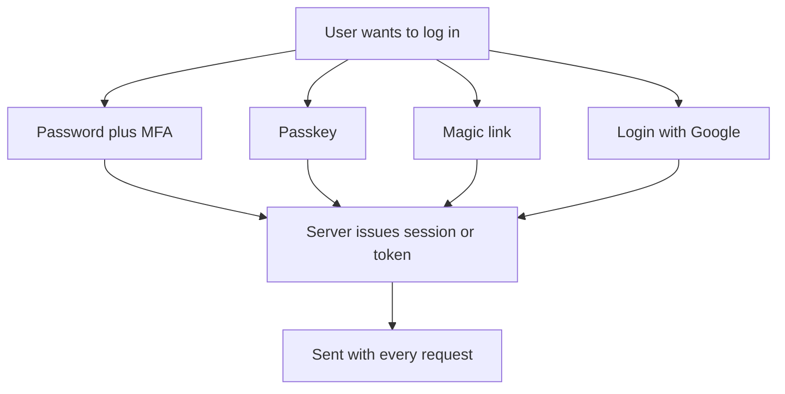

## In one line
There are several ways for a person or a program to prove who it is, and each one trades convenience against how easy it is to steal, guess, or fake.

## The problem it solves
Your video and shopping app has very different visitors:

- Customers logging in on their phones, often in a hurry.
- Sellers and admins who can change prices and issue refunds.
- A partner warehouse system that calls your API every minute, with no human involved.

One login method does not fit all of them. A password alone is too weak for an admin who can refund thousands of orders. A passkey makes no sense for a warehouse server. Interviewers ask "how would you handle login for this app?" to see whether you know the options and their weak spots.

This topic is a map. Each method links to a deeper topic where one exists.

## Everyday analogy
Ways into an office building:

- A door code that everyone types (a password). Anyone who overhears it can walk in.
- A door code plus your badge (multi-factor). Overhearing the code is no longer enough.
- A badge that only works on this building's real doors, and refuses to work on a fake door set up by a con artist (a passkey).
- A receptionist who posts a one-day pass to your home address (a magic link).
- A trusted company that vouches for you at the door (Login with Google).

Where it breaks down: in a building, the guard checks you once. On the web, after the login check, every later request must still carry proof, which is a separate job (see step 2 below).

## How it works
A few terms first:

- **Credentials** are the evidence you present to prove identity.
- An **authentication factor** is a kind of evidence: **something you know** (a password), **something you have** (your phone, a security key), or **something you are** (a fingerprint).
- **Multi-factor authentication (MFA)** means requiring two **different** factors. A password plus a security question is still one factor: both are things you know.
- **Phishing** is tricking someone into entering their credentials on a fake site that looks real, such as `shop-example-login.com`.

Authentication is really two jobs, and most confusion comes from mixing them up:

1. **Prove identity once, at login.** Passwords, MFA codes, magic links, passkeys, and Login with Google all live here.
2. **Remember the identity on every later request.** **HTTP** has no memory between requests, so after login the server hands out proof: a **session** ID in a **cookie**, or a signed token such as a **JWT**. The browser sends it with every request.
3. **Programs are different.** A server calling your API has no human to type anything, so it uses an **API key** or a machine token instead.


*Notice: the login methods differ, but they all end the same way: the server hands out a session or token that proves the login on later requests.*

### The methods, one by one
**Passwords.** The user picks a secret. The server stores only a slow, salted **hash** of it (a one-way fingerprint), never the password itself. At login it hashes the typed password and compares. Weakness: people reuse passwords, so a leak from another site lets attackers try the same email and password on yours. This is called **credential stuffing**. See [Password hashing](#/topic/password-hashing).

**Server sessions.** After login, the server creates a random session ID, stores the user's details against it (for example in Redis), and puts the ID in a cookie. Each request is looked up. Easy to revoke: delete the session. Weakness: needs a shared store every server can reach. See [Sessions vs JWT](#/topic/sessions-vs-jwt).

**Tokens (JWT).** After login, the server signs a token saying "user 981, expires in 15 minutes". Any server with the key can check the signature without a lookup. Weakness: a stolen token works until it expires, and revoking it early needs extra machinery. See [JWT in depth](#/topic/jwt-deep-dive).

**API keys.** A long random string given to a program, such as the warehouse system, sent in a header like `Authorization: Bearer sk_live_...`. It identifies an application, not a person. Weakness: keys are long-lived and leak through Git repositories, logs, and screenshots. Store only a hash of each key, limit what each key can do, and make rotation easy.

**MFA with an authenticator app (TOTP).** At setup, your server and the user's app (Google Authenticator, 1Password, and similar) share a secret through a QR code. Both sides then compute the same 6-digit code from the secret and the current time, and it changes every 30 seconds. TOTP stands for **Time-based One-Time Password**. Weakness: a phishing page can ask for the code and use it within those seconds.

**MFA by SMS.** The server texts a code. Better than nothing, but the weakest MFA option. In a **SIM swap**, an attacker convinces a mobile carrier to move your number to their SIM card, and then receives your codes. SMS codes can also be phished. NIST's US digital identity guidelines classify SMS as a "restricted" authenticator for these reasons.

**Magic links.** The user types their email. The server emails a link containing a long random, single-use token that expires in a few minutes. Clicking it logs them in. Weakness: security is exactly as strong as the user's email account, and emails can be slow or land in spam.

**Passkeys (WebAuthn).** The user's device creates a **key pair** for your site: a private key that never leaves the device, and a public key your server stores. To log in, the server sends a random **challenge**, the device asks for a fingerprint, face, or PIN, and then signs the challenge. **WebAuthn** is the browser standard behind this. Key strength: the browser only uses the passkey on the real domain, so a fake site gets nothing. This is called being **phishing-resistant**. Weakness: recovery when someone loses all their devices, and more work to implement.

**Login with Google (OpenID Connect).** Google checks the user's identity and sends your app a signed statement of who they are. You never see their Google password. See [OAuth 2.0 and "Login with Google"](#/topic/oauth-oidc).

| Method | Job | Best for | Main weakness |
|---|---|---|---|
| Password | Login | Universal fallback | Reused, phished, guessed |
| Session cookie | Later requests | Web apps | Needs shared session store |
| JWT | Later requests | APIs, many services | Hard to revoke early |
| API key | Machine calls | Server-to-server | Long-lived, leaks easily |
| TOTP app | Second factor | Admins, sellers | Code can be phished |
| SMS code | Second factor | Low-risk accounts | SIM swap, phishing |
| Magic link | Login | Occasional users | Only as safe as email |
| Passkey | Login | Most users, admins | Account recovery |
| Login with Google | Login | Consumer sign-up | Depends on provider |

## Real example
TOTP looks magic until you see that it is about 15 lines of code. This follows RFC 6238, the TOTP standard. It uses only Node's built-in `crypto` module (Node.js 18+, `"type": "module"`). `secret` is a `Buffer` of random bytes, for example from `crypto.randomBytes(20)`, saved per user at setup.

```js
import { createHmac, timingSafeEqual } from 'node:crypto';

// TOTP (RFC 6238): HMAC the current 30-second "step" with the shared secret.
export function totp(secret, timeMs = Date.now()) {
  const step = Math.floor(timeMs / 1000 / 30);         // changes every 30 seconds
  const counter = Buffer.alloc(8);
  counter.writeBigUInt64BE(BigInt(step));
  const mac = createHmac('sha1', secret).update(counter).digest();

  const offset = mac[mac.length - 1] & 0x0f;          // "dynamic truncation"
  const number = mac.readUInt32BE(offset) & 0x7fffffff;
  return String(number % 1_000_000).padStart(6, '0'); // 6 digits
}

// Accept the current step and one step either side, for clock drift.
export function checkTotp(secret, code, timeMs = Date.now()) {
  return [-1, 0, 1].some((drift) => {
    const expected = Buffer.from(totp(secret, timeMs + drift * 30_000));
    const given = Buffer.from(String(code));
    return given.length === expected.length && timingSafeEqual(given, expected);
  });
}
```

What is happening:

- **HMAC** is a keyed hash: mixing a secret into a hash so only someone with the secret can produce the same output.
- Both sides know the secret and roughly the same time, so both compute the same 6 digits. Nothing is sent between the server and the app after setup. That is why authenticator apps work offline.
- `timingSafeEqual` compares in constant time, so an attacker cannot learn digits by measuring how fast a wrong guess is rejected.

At setup, the QR code just encodes a URL like this, with the secret in **base32** (a letters-and-digits text encoding):

```text
otpauth://totp/VideoShop:asha@example.com?secret=GEZDGNBVGY3TQOJQ&issuer=VideoShop
```

In production, also remember the last step each user logged in with, so the same code cannot be used twice. Prefer a maintained TOTP library over hand-written code. This version is here to show the mechanism.

## How to say it in an interview

> [!INTERVIEW]
> **30 seconds:** "I separate two things: how a user proves who they are at login, and how later requests stay authenticated. For login the options are passwords, ideally with MFA, magic links, passkeys, or a provider like Google via OpenID Connect. After login, the server issues a session cookie or a token. Programs calling an API use API keys or machine tokens instead. Passkeys are the strongest option for people, because they are phishing-resistant."

> [!INTERVIEW]
> **2 minutes:** Start with the 30-second answer, then add:
>
> "For a shop with video, I'd offer Login with Google and passkeys for customers, because they're fast on phones, and keep email and password as a fallback, stored with Argon2id. After login I'd use an HttpOnly session cookie backed by Redis, so I can log someone out instantly. Sellers and admins must use MFA, preferably passkeys or an authenticator app rather than SMS, because SMS is vulnerable to SIM swapping. The warehouse integration gets its own API key, stored hashed, limited to the inventory endpoints, and easy to rotate.
>
> The tradeoff is security versus friction and recovery. Every factor you add makes login slower and gives users one more thing to lose. So I'd require the strongest methods where the damage is highest, like admin actions and payouts, and keep customer login simple."

## Follow-up questions interviewers ask

<details>
<summary>Why are SMS codes considered weak?</summary>

Three reasons. **SIM swapping**: an attacker talks a mobile carrier into moving the victim's number, then receives every code. **Phishing**: a fake login page simply asks for the code and uses it immediately. **Interception**: phone networks were not designed to protect message contents. SMS is still much better than a password alone, but prefer an authenticator app or passkey for valuable accounts.

</details>

<details>
<summary>What makes passkeys phishing-resistant when TOTP is not?</summary>

With TOTP, the user reads a code and types it. They can type it into a fake site just as easily as the real one. With a passkey, the browser itself checks the domain. A passkey made for `shop.example.com` will only sign challenges for that site. On `shop-example-login.com` there is no matching passkey, so there is nothing to steal. Also, the server stores only a public key, so a database leak reveals no secrets.

</details>

<details>
<summary>How should you store and check API keys?</summary>

Treat them like passwords. Generate a long random value, show it to the customer once, and store only a hash. Because keys are long and random, a fast hash like SHA-256 is fine here, unlike passwords. Give each key a visible prefix (such as `sk_live_`) so leaked keys are easy to spot in code scans, limit each key's permissions, log its use, and let customers rotate keys without downtime by allowing two active keys at once.

</details>

<details>
<summary>Is a password plus a security question multi-factor authentication?</summary>

No. Both are "something you know", so it is one factor used twice. A phishing page can ask for both at once. Real MFA combines different kinds of evidence, such as a password and a code from a phone.

</details>

<details>
<summary>Should you build authentication yourself or use a service?</summary>

It depends on the team and the requirements. Managed identity providers, such as Auth0, Amazon Cognito, or Firebase Authentication, give you MFA, passkeys, social login, and breach protections quickly. The costs are money per user, some lock-in, and less control. Building it yourself is reasonable for simple email and password plus sessions, if you follow the OWASP cheat sheets. Very few teams should invent their own cryptography or token formats.

</details>

## Common mistakes and misconceptions

> [!MISTAKE]
> "JWT is a way to log in." A JWT does not check a password or a passkey. It only **carries** the result of a login on later requests. The login itself is still a password, passkey, magic link, or provider.

> [!MISTAKE]
> "Any MFA stops phishing." Codes from SMS or an authenticator app can be typed into a fake page and relayed in real time. Only phishing-resistant methods, such as passkeys and hardware security keys, stop that.

> [!MISTAKE]
> Putting an API key in frontend JavaScript or a mobile app. Anyone can read it from the bundle or the network traffic. API keys belong on servers. Browsers and apps should authenticate the user instead.

> [!MISTAKE]
> Shipping passkeys or MFA without a recovery plan. Users lose phones. Without backup codes, a second factor, or a careful recovery flow, you create support tickets and locked-out customers. A weak recovery flow, like "answer a security question", also becomes the attacker's easiest way in.

## Tradeoffs: when NOT to use it
- **Magic links** are a poor fit for people who log in many times a day, or who read email on a different device from the one they log in on.
- **SMS codes** should not protect high-value actions like payouts or admin access. Offer an authenticator app or passkeys instead.
- **API keys** are wrong for anything a person does in a browser, and wrong when you need to know which person acted. Use user authentication for that.
- **Mandatory MFA for every customer** can hurt sign-ups for a low-risk shopping account. Many apps require it for sellers and admins, offer it to customers, and ask for it again only for risky actions like changing the email address.
- **Passkeys alone** are risky until you have tested account recovery. Keep a second way in, and make that second way just as strong.

## Check yourself

<details>
<summary>1. Which job does a session cookie do: proving identity at login, or remembering it afterwards?</summary>

Remembering it afterwards. The password, passkey, or Google login proves identity once. The session cookie carries proof of that login on each later request, because HTTP itself has no memory.

</details>

<details>
<summary>2. A partner's inventory system needs to call your API every minute. Which method fits, and how do you store it?</summary>

An API key (or a machine token from an OAuth client-credentials flow). Store only a hash of the key, limit it to the inventory endpoints, log its use, and support rotation.

</details>

<details>
<summary>3. Why do authenticator apps work with no internet connection?</summary>

At setup, the server and the app share a secret. After that, each computes the code on its own from the secret and the current 30-second time step. Nothing needs to be sent between them.

</details>

## Go deeper
- [OWASP Multifactor Authentication Cheat Sheet](https://cheatsheetseries.owasp.org/cheatsheets/Multifactor_Authentication_Cheat_Sheet.html)
- [MDN: Web Authentication API (passkeys)](https://developer.mozilla.org/en-US/docs/Web/API/Web_Authentication_API)
- [RFC 6238: TOTP](https://datatracker.ietf.org/doc/html/rfc6238)
