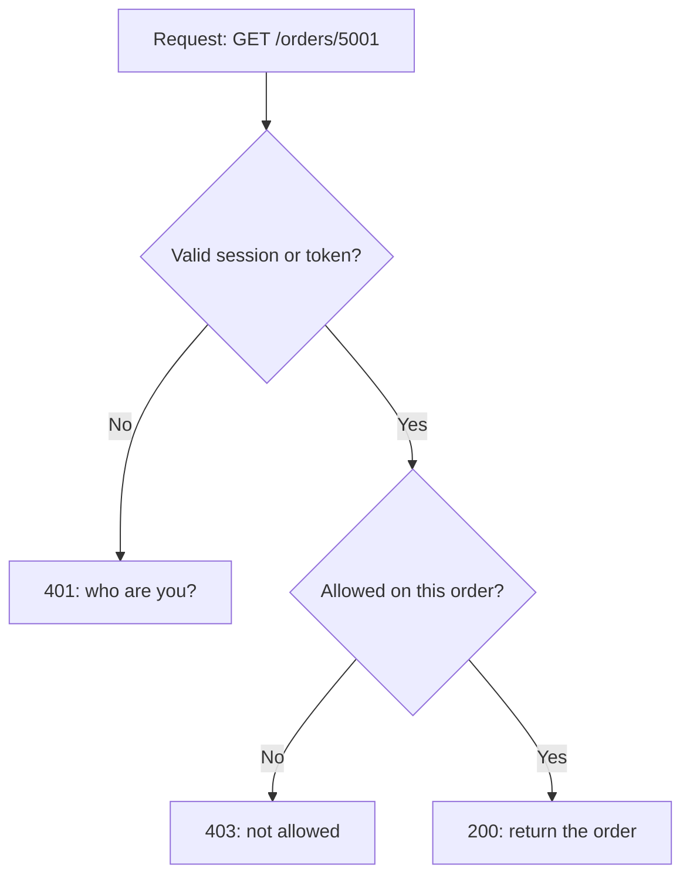

## In one line
Authentication checks **who you are**; authorization checks **what you are allowed to do**.

## The problem it solves
Your shop has an endpoint `GET /orders/5001` that returns an order: what was bought, the delivery address, the total. Two separate questions must be answered before the server sends anything back:

1. **Who is asking?** An anonymous visitor? Asha (user 981)? Ben (user 982)?
2. **Is that person allowed to see order 5001?** It belongs to Asha. Ben is a real, logged-in customer, but it is not his order.

Many real data leaks happen because a team answered the first question and forgot the second. The app checks "is someone logged in?" and then returns whatever order ID is in the URL. Ben changes `5001` to `5002`, `5003`, and so on, and reads other people's addresses.

Keeping the two questions separate, in your head and in your code, is how you avoid that bug.

## Everyday analogy
A hotel. At check-in, the front desk looks at your passport. That is **authentication**: proving you are who you say you are. They hand you a key card. The card opens your room and the gym, but not other guests' rooms or the staff office. That is **authorization**: what your proven identity is allowed to open.

Where it breaks down: the hotel checks your passport once, and the doors trust the card. A web server must check permissions on **every request**, because anyone can type any URL or send any request directly, skipping your user interface.

## How it works
A few terms first:

- **Authentication** (often shortened to **authn**) is proving identity. You present **credentials**, the evidence of who you are: a password, a passkey, a one-time code, or a "Login with Google" result.
- **Authorization** (often shortened to **authz**) is deciding whether an identity may perform an action on a specific thing, for example "read order 5001".
- **HTTP** has no memory between requests. So after login, the server gives the browser proof that it already logged in: a **session** ID in a **cookie** (a small value the browser sends back automatically), or a signed **token**. Every later request carries that proof. See [Sessions vs JWT](#/topic/sessions-vs-jwt).

On every request to a protected endpoint, the server does this:

1. **Read the proof.** Find the session cookie or token on the request.
2. **Authenticate.** Check that the proof is valid and not expired, and find out which user it belongs to. If there is no valid proof, stop with **`401 Unauthorized`**. The name is misleading: 401 really means "unauthenticated, I don't know who you are".
3. **Authorize.** Ask: may this user do this action on this resource? Check their **role** (a named group of permissions, like `admin`) and their **ownership** of the data (is `order.user_id` equal to their ID?). If not, stop with **`403 Forbidden`**: "I know who you are, and the answer is no".
4. **Do the work.** Only now run the query or the update, and return `200 OK`.


*Notice: authentication always runs first, because you cannot decide what someone may do until you know who they are.*

Authorization comes in different shapes, from simple to rich:

- **Ownership:** "users can read their own orders".
- **Roles:** "sellers can edit products, admins can refund orders". See [Role-based access control](#/topic/rbac).
- **Attributes:** "support staff can view orders from their own region, during work hours". This is **attribute-based access control (ABAC)**: rules about properties of the user, the data, and the situation.

## Real example
**Setup:** Node.js 18+ with `"type": "module"`, `npm install express express-session pg`, a PostgreSQL `orders` table with an integer `user_id` column, and `express-session` already set up so a successful login stores `req.session.userId` and `req.session.role`. `db` is a `pg.Pool`.

```js
// Authentication: do we know who is calling? If not, 401.
export function requireAuth(req, res, next) {
  if (!req.session.userId) {
    return res.status(401).json({ error: 'Please log in' });
  }
  next();
}

// Authorization: may THIS user read THIS order?
export function registerOrderRoutes(app, db) {
  app.get('/orders/:id', requireAuth, async (req, res, next) => {
    try {
      const { rows } = await db.query(
        'SELECT id, user_id, total_cents, status FROM orders WHERE id = $1',
        [req.params.id]
      );
      const order = rows[0];
      if (!order) return res.status(404).json({ error: 'Order not found' });
      const isOwner = order.user_id === req.session.userId;
      const isAdmin = req.session.role === 'admin';
      if (!isOwner && !isAdmin) {
        return res.status(403).json({ error: 'Not allowed' }); // known user, wrong order
      }
      res.json(order);
    } catch (err) {
      next(err);
    }
  });
}
```

`requireAuth` is **middleware**: a function that runs before the route handler and can stop the request early. Authentication fits naturally in middleware, because the question is the same for every protected route. The ownership check lives inside the route, because only the route knows which order is being asked for.

What each caller gets for order 5001, which belongs to user 981:

| Caller | Result |
|---|---|
| No cookie | `401 {"error":"Please log in"}` |
| Asha (user 981) | `200` with the order |
| Ben (user 982) | `403 {"error":"Not allowed"}` |
| An admin | `200` with the order |

## How to say it in an interview

> [!INTERVIEW]
> **30 seconds:** "Authentication is proving who you are, for example logging in with a password or a passkey. Authorization is deciding what that identity is allowed to do, like whether this user may read this specific order. Authentication happens first. If it fails, the API returns 401. If the user is known but not allowed, it returns 403. And authorization has to be checked on every request, on the server, not just by hiding buttons in the UI."

> [!INTERVIEW]
> **2 minutes:** Start with the 30-second answer, then add:
>
> "In an Express app I put authentication in middleware: it reads the session or token, verifies it, and attaches the user to the request. Authorization is split. Coarse checks, like 'only admins can reach `/admin`', can also be middleware. But resource checks, like 'does this order belong to you', need the actual record, so they live in the handler or in the query itself, for example `WHERE id = $1 AND user_id = $2`.
>
> The classic bug is checking only authentication. Any logged-in user can then change an ID in the URL and read someone else's data. OWASP calls this an insecure direct object reference, and broken access control is the number one category in its Top 10.
>
> One tradeoff: whether to return 403 or 404 when someone asks for a record they can't access. 403 is more honest, but it confirms the record exists. For private data like orders, many APIs return 404, so attackers can't probe which IDs exist."

## Follow-up questions interviewers ask

<details>
<summary>What is the difference between 401 and 403?</summary>

`401 Unauthorized` means the server does not know who you are: no credentials, or invalid or expired ones. Logging in might fix it. `403 Forbidden` means the server knows who you are, and you are still not allowed. Logging in again will not help. The HTTP standard also says a 401 response should include a `WWW-Authenticate` header naming how to authenticate. Cookie-based apps often skip it in practice.

</details>

<details>
<summary>Is hiding the "Delete" button for non-admins enough?</summary>

No. Hiding it is good user experience, but it is not security. Anyone can send `DELETE /products/42` with `curl` or the browser's developer tools. The server must check permission on every request. Treat the frontend as a convenience and the server as the only real gatekeeper.

</details>

<details>
<summary>Where does "Login with Google" fit: authentication or authorization?</summary>

Both protocols are involved. **OAuth 2.0** was designed for authorization: letting your app access something on the user's behalf, like their Google Calendar. **OpenID Connect** is a layer on top of OAuth that adds authentication: it tells your app who the user is. "Login with Google" uses OpenID Connect. See [OAuth 2.0 and "Login with Google"](#/topic/oauth-oidc).

</details>

<details>
<summary>What does "deny by default" mean?</summary>

Every endpoint is closed unless a rule explicitly allows access. For example, apply `requireAuth` to the whole `/api` router, and open only the few public routes, like login and the product catalogue. Forgetting a check then fails safe (blocked) instead of failing open (leaked). This pairs with **least privilege**: give each user and each service only the permissions it actually needs.

</details>

<details>
<summary>Should authorization checks be in middleware, the handler, or the database query?</summary>

Use all three for different jobs. Middleware handles "is anyone logged in?" and role checks like "admins only". The handler or a service function handles rules that need the record, like ownership. Putting the user into the query, as in `WHERE id = $1 AND user_id = $2`, makes it hard to forget the check, because the wrong row is never even loaded.

</details>

## Common mistakes and misconceptions

> [!MISTAKE]
> "Authentication and authorization are the same thing." They are separate steps. A perfectly authenticated user can still be unauthorized for a specific action. Most access-control bugs live in that gap.

> [!MISTAKE]
> Checking only that a user is logged in, then trusting the ID in the URL. Always check that the logged-in user may access **that specific record**.

> [!MISTAKE]
> Trusting a role sent by the client, such as `{"role": "admin"}` in the request body or a plain cookie. The server must look up the role itself, from the session or a signed token it issued.

> [!MISTAKE]
> Returning 403 when the user simply isn't logged in, or 401 when they are logged in but not allowed. The frontend relies on the difference: 401 means "show the login page", 403 means "show a 'no access' message".

## Tradeoffs: when NOT to use it
The split itself is always right. The cost is in how heavy you make the authorization model:

- **Don't build a permissions framework on day one.** For a small app, "logged in", "owns this record", and one `admin` flag may cover everything. A full roles-and-permissions system adds tables, admin screens, and bugs.
- **Every check costs something.** Ownership checks often need a database read. On hot paths, fold the check into the main query instead of doing a separate lookup.
- **Cached permissions go stale.** If you copy roles into a long-lived token or cache, a removed admin may keep access until it expires. For sensitive actions, re-check against the database.
- **Some data is genuinely public.** The product catalogue and video thumbnails need no authentication. Requiring login there just adds load and friction.

## Check yourself

<details>
<summary>1. A logged-in customer opens /admin/refunds and gets an error. Should it be 401 or 403?</summary>

403 Forbidden. The server knows who they are (authentication succeeded), but customers are not allowed to use the refunds page (authorization failed).

</details>

<details>
<summary>2. Which step runs first, and why?</summary>

Authentication. Authorization rules are about a specific identity, such as "user 981 owns order 5001". You can't apply them until you know who is asking.

</details>

<details>
<summary>3. GET /orders/:id checks that a session exists, then returns the order by ID. What is wrong?</summary>

It authenticates but never authorizes. Any logged-in user can read any order by changing the ID. Add an ownership check, or query with `WHERE id = $1 AND user_id = $2` so other users' orders are never loaded.

</details>

## Go deeper
- [OWASP Authorization Cheat Sheet](https://cheatsheetseries.owasp.org/cheatsheets/Authorization_Cheat_Sheet.html)
- [MDN: HTTP authentication (401, 403, and the WWW-Authenticate header)](https://developer.mozilla.org/en-US/docs/Web/HTTP/Guides/Authentication)
