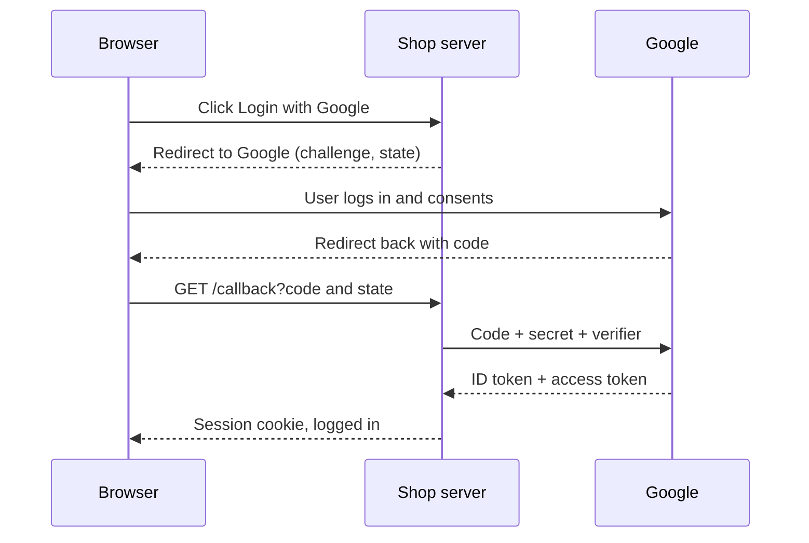

## In one line
OAuth 2.0 lets an app get limited access to a user's account on another service without ever seeing their password, and OpenID Connect adds a signed **ID token** on top, so the app also learns **who** the user is. That combination is "Login with Google".

## The problem it solves
Years ago, apps that wanted your contacts from webmail asked for your email **password**. That was terrible: the app could read all your mail, change your password, and keep access forever. The only way to cancel its access was to change your password everywhere.

Your video shop faces two versions of this problem today:

1. **Login.** You want "Login with Google". Users don't want to give your shop their Google password, and you don't want to store one more password.
2. **Access on the user's behalf.** A creator wants your app to publish their stream recordings to their YouTube channel. You need permission to do exactly that, and nothing else.

OAuth solves the second problem: limited, revocable access without the password. OpenID Connect builds on it to solve the first.

## Everyday analogy
A **valet key** for a car. You give the valet a special key that starts the engine and opens the door, but won't open the boot or the glovebox. You keep your master key. If something goes wrong, the valet key can be cancelled without changing the locks.

OAuth access tokens are valet keys: limited (scopes), temporary (expiry), and revocable.

Where it breaks down: a valet key says nothing about **who** is holding it. That's why login needs the extra ID token from OpenID Connect, which is more like a signed ID card.

## How it works
The cast of characters:

- **Resource owner:** the user, Asha.
- **Client:** your app, the shop. It is registered with Google and has a **client ID** (public) and a **client secret** (known only to your server).
- **Authorization server:** Google's login and consent service. It checks the user and issues tokens.
- **Resource server:** the API holding the data, for example the YouTube API.

The tokens and terms:

- An **access token** lets the client call the resource server. Treat it as opaque: it's meant for the API, not for your app to read.
- A **scope** names one permission, like `openid`, `email`, or `youtube.upload`. The user sees the scopes on the consent screen.
- The **redirect URI** is the exact URL on your site where Google sends the user back. It must be registered in advance.
- An **authorization code** is a short-lived, one-time code that your server exchanges for tokens.
- **OpenID Connect (OIDC)** is a standard layer on top of OAuth 2.0 for login. Adding the `openid` scope makes Google also return an **ID token**: a **JWT** (a signed token, see [JWT in depth](#/topic/jwt-deep-dive)) stating who the user is.

**The authorization code flow with PKCE**, the recommended flow for web and mobile apps:

1. Asha clicks "Login with Google". Your server creates three random values and saves them in her session: `state`, `nonce`, and a **PKCE code verifier**. **PKCE** (Proof Key for Code Exchange, said "pixy") makes a stolen authorization code useless to anyone else.
2. Your server redirects her browser to Google with your client ID, redirect URI, scopes, `state`, `nonce`, and the SHA-256 hash of the verifier (the **code challenge**).
3. Google shows its own login page. Asha logs in **on google.com** and approves the scopes. Your app never sees her password.
4. Google redirects her browser back to your redirect URI with `?code=...&state=...`.
5. Your server checks that `state` matches the one in her session. This blocks forged callbacks.
6. Your server sends the code, the client secret, and the original **verifier** to Google's token endpoint, directly, server to server. This is the **back channel**: the browser never sees this exchange.
7. Google checks that the verifier hashes to the challenge from step 2, then returns an ID token (and an access token).
8. Your server verifies the ID token: Google's signature, issuer, audience equal to your client ID, expiry, and the `nonce`. Then it finds or creates the user by `sub` and starts a normal session.


*Notice: the password only ever goes to Google, and the tokens travel over the back channel between your server and Google, not through the browser.*

**OAuth vs OIDC at a glance:**

| | OAuth 2.0 | OpenID Connect |
|---|---|---|
| Question it answers | What may this app do? | Who is this user? |
| Main output | Access token | ID token (always a JWT) |
| Meant to be read by | The API | Your app |
| Example | Upload to my YouTube | Login with Google |

**Other OAuth flows, briefly:**

- **Client credentials:** a server authenticates as itself, with no user. Used for service-to-service calls.
- **Device authorization:** for TVs and consoles. The TV shows a short code, and the user approves on their phone. Very common for video apps.
- **Implicit** and **password** flows: older flows that current security guidance (RFC 9700) says not to use.

## Real example
**Setup:** an Express 5 app with `express-session` configured, Node.js 18+, `npm install jose`. You created an OAuth client in Google Cloud Console and registered your callback URL (`REDIRECT_URI` below) as an authorized redirect URI. `GOOGLE_CLIENT_ID` and `GOOGLE_CLIENT_SECRET` are environment variables. `findOrCreateUserByGoogleSub` is your own database function.

**1. Start the login** (steps 1–2):

```js
import crypto from 'node:crypto';

const GOOGLE_AUTH = 'https://accounts.google.com/o/oauth2/v2/auth';
const REDIRECT_URI = 'https://shop.example.com/auth/google/callback';
const random = () => crypto.randomBytes(32).toString('base64url');

app.get('/auth/google', (req, res) => {
  const state = random();      // checked on return: blocks forged callbacks (CSRF)
  const nonce = random();      // must come back inside the ID token
  const verifier = random();   // PKCE secret: only its hash is sent now
  req.session.oauth = { state, nonce, verifier };

  const url = new URL(GOOGLE_AUTH);
  url.search = new URLSearchParams({
    client_id: process.env.GOOGLE_CLIENT_ID,
    redirect_uri: REDIRECT_URI,
    response_type: 'code',              // "send me an authorization code"
    scope: 'openid email profile',      // openid = "this is a login (OIDC)"
    state,
    nonce,
    code_challenge: crypto.createHash('sha256').update(verifier).digest('base64url'),
    code_challenge_method: 'S256',
  });
  res.redirect(url.toString());         // the browser goes to Google
});
```

**2. Handle the callback** (steps 5–8; `createRemoteJWKSet` and `jwtVerify` come from `jose`):

```js
const GOOGLE_JWKS = createRemoteJWKSet(new URL('https://www.googleapis.com/oauth2/v3/certs'));

app.get('/auth/google/callback', async (req, res, next) => {
  const saved = req.session.oauth;
  delete req.session.oauth;                                  // single use
  if (!saved || req.query.state !== saved.state) return res.status(400).send('Bad state');
  const tokenRes = await fetch('https://oauth2.googleapis.com/token', {
    method: 'POST',                                          // back channel
    body: new URLSearchParams({
      grant_type: 'authorization_code', code: req.query.code, redirect_uri: REDIRECT_URI,
      client_id: process.env.GOOGLE_CLIENT_ID, client_secret: process.env.GOOGLE_CLIENT_SECRET,
      code_verifier: saved.verifier,                         // PKCE: proves we started this
    }),
  });
  if (!tokenRes.ok) return res.status(401).send('Login failed');
  const { id_token } = await tokenRes.json();
  const { payload } = await jwtVerify(id_token, GOOGLE_JWKS, {
    algorithms: ['RS256'],
    issuer: ['https://accounts.google.com', 'accounts.google.com'],
    audience: process.env.GOOGLE_CLIENT_ID,                  // issued for OUR app
  });
  if (payload.nonce !== saved.nonce) return res.status(401).send('Bad nonce');

  const user = await findOrCreateUserByGoogleSub(payload.sub, payload.email);
  req.session.regenerate((err) => {          // new session ID at login
    if (err) return next(err);
    req.session.userId = user.id; res.redirect('/');
  });
});
```

A decoded ID token payload looks like this (values shortened):

```json
{ "iss": "https://accounts.google.com", "aud": "1234-abc.apps.googleusercontent.com",
  "sub": "110248495921238986420", "email": "asha@example.com", "email_verified": true,
  "nonce": "Xq3...", "iat": 1793037422, "exp": 1793041022 }
```

`sub` is Google's permanent ID for this user. Store it and match on it.

> [!TIP]
> This code is written out by hand to show every step. In production, prefer a maintained, certified OpenID Connect library such as `openid-client`, which handles discovery, PKCE, and token checks for you.

## How to say it in an interview

> [!INTERVIEW]
> **30 seconds:** "OAuth 2.0 is a delegation protocol. It lets my app get a limited, revocable access token to a user's data on another service, like their Google account, without ever seeing their password. OpenID Connect sits on top for login: it adds an ID token, a signed JWT that tells my app who the user is. For 'Login with Google' I use the authorization code flow with PKCE, verify the ID token, then start my own session."

> [!INTERVIEW]
> **2 minutes:** Start with the 30-second answer, then add:
>
> "The flow: my server redirects the user to Google with my client ID, the scopes, a random `state`, and a PKCE challenge. The user logs in on Google and consents. Google redirects back with a one-time code. My server checks the `state`, then exchanges the code plus the PKCE verifier and client secret for tokens, server to server. I verify the ID token's signature, issuer, audience, expiry, and nonce, and look the user up by `sub`, not by email.
>
> For example, in a video app, customers log in with Google, and creators who want to publish to YouTube grant an extra upload scope later, only when they need it.
>
> The tradeoff is dependency and complexity. I'm relying on Google being up, and there are many subtle checks to get right, so I'd use a certified library. I'd also keep a fallback login method so users who lose their Google account can still get in."

## Follow-up questions interviewers ask

<details>
<summary>What is the difference between OAuth and OpenID Connect?</summary>

OAuth 2.0 is about **authorization**: it gives an app an access token to call an API on the user's behalf. It doesn't define how to tell the app who the user is. OpenID Connect adds **authentication**: the `openid` scope, a standard ID token (a JWT with `iss`, `sub`, `aud`, `exp`, and `nonce`), a userinfo endpoint, and a discovery document. Using a plain access token as proof of login is a known mistake: a token issued to some other app could be replayed against yours.

</details>

<details>
<summary>What do state, nonce, and PKCE each protect against?</summary>

- **`state`** protects the callback from CSRF (cross-site request forgery): an attacker can't make your browser complete a login that the attacker started, which could log you in to the attacker's account.
- **`nonce`** ties the ID token to this specific login attempt, so an old or stolen ID token can't be replayed.
- **PKCE** protects the authorization code: if the code is intercepted (from logs, browser history, or a malicious app on a phone), it is useless without the verifier, which never left your server.

</details>

<details>
<summary>Why match users by sub and not by email?</summary>

`sub` is the provider's permanent, unique ID for that account. Email addresses can change, and with some providers or account types they may not be verified. If you link accounts by email, check `email_verified` is true, and be careful with providers that let users set any email address.

</details>

<details>
<summary>Why does the code go through the browser but the tokens don't?</summary>

The browser is the **front channel**: URLs end up in history, logs, and `Referer` headers, so anything sent there could leak. A short-lived, one-time code is safe enough to pass that way, especially with PKCE. The tokens are fetched over the **back channel**, a direct HTTPS call from your server to Google, authenticated with your client secret.

</details>

<details>
<summary>How does a single-page app or mobile app do this without a client secret?</summary>

Apps whose code runs on the user's device can't keep a secret, so they're called **public clients**. They use the same authorization code flow with PKCE but no client secret. PKCE is what makes this safe. Many teams instead use a **backend for frontend**: a small server that does the OAuth flow and gives the browser a normal `HttpOnly` session cookie, so tokens never reach JavaScript.

</details>

## Common mistakes and misconceptions

> [!MISTAKE]
> "OAuth is a login protocol." Plain OAuth is for delegated access. Login needs OpenID Connect's ID token, verified properly.

> [!MISTAKE]
> Skipping the `state` check, or the ID token's `aud` check. Without `aud`, an ID token Google issued to a different app could log someone in to yours.

> [!MISTAKE]
> Using the implicit flow (tokens returned in the URL) for single-page apps. That was common years ago. Current guidance is the authorization code flow with PKCE.

> [!MISTAKE]
> Requesting every scope up front "just in case". Users abandon scary consent screens, and leaked tokens can do more damage. Ask for the minimum, and request more later, when a feature actually needs it.

## Tradeoffs: when NOT to use it
- **Your own first-party login.** If users only log in to your own app with your own accounts, you don't need to run an OAuth server. A session cookie after a password or passkey login is simpler.
- **Service-to-service calls inside your own system.** A full OAuth server may be overkill for two internal services. Simpler options exist, like mutual TLS or signed tokens. OAuth client credentials make sense when there are many services or third parties.
- **Audiences without the provider.** Not everyone has or wants a Google account. Offer at least one other way in.
- **Hand-rolling it.** The code above is for learning. Real deployments should use a certified library or a managed identity provider, because each missed check is a security hole.

## Check yourself

<details>
<summary>1. In "Login with Google", who sees the user's Google password?</summary>

Only Google. The user types it on google.com. Your app receives an authorization code, then an ID token, and never sees the password.

</details>

<details>
<summary>2. Which token tells your app who the user is, and how do you trust it?</summary>

The ID token from OpenID Connect. Verify its signature with Google's published keys (JWKS), and check that `iss` is Google, `aud` is your client ID, `exp` is in the future, and `nonce` matches the one you sent.

</details>

<details>
<summary>3. An attacker steals an authorization code from a log file. Why can't they use it if you use PKCE?</summary>

Exchanging the code requires the original code verifier, whose hash was sent at the start. The verifier stayed in your server's session, so the attacker can't produce it. Codes are also short-lived and single-use.

</details>

## Go deeper
- [OAuth 2.0 Security Best Current Practice (RFC 9700)](https://datatracker.ietf.org/doc/html/rfc9700)
- [OpenID Connect Core 1.0](https://openid.net/specs/openid-connect-core-1_0.html)
- [Google Identity: OpenID Connect](https://developers.google.com/identity/openid-connect/openid-connect)
