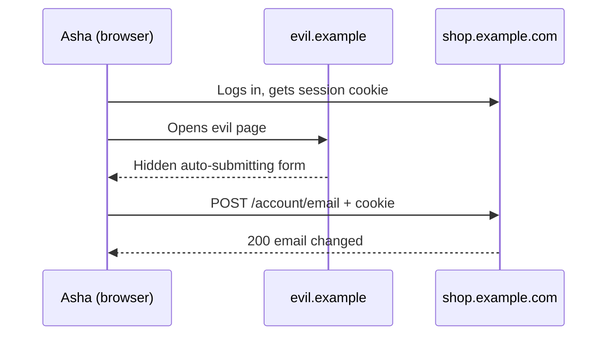

## In one line
Most real web app breaches come from a few well-known mistakes: SQL injection, cross-site scripting (XSS), cross-site request forgery (CSRF), and broken access control, and each has a standard, boring defence you should apply every time.

## The problem it solves
**OWASP** (the Open Worldwide Application Security Project) is a non-profit community that publishes free security guidance. Its best-known document, the **OWASP Top 10**, ranks the most common categories of web app weaknesses, based on data from real applications. In the 2025 edition, broken access control is number 1, and injection (which includes SQL injection and XSS) is number 5.

These bugs are not exotic. A single line that glues user input into a SQL string, or prints a product review as raw HTML, is enough to leak your whole `users` table or let an attacker act as your customers.

Interviewers ask about them because each one is easy to explain, easy to get wrong, and has a clear fix. If you can describe the attack and the defence for all four, you cover a large share of real-world web security.

## Everyday analogy
A bank teller who takes written instructions:

- **SQL injection:** a customer writes "Withdraw 10 euros **and also give me everyone's balances**" on the slip, and the teller follows the whole slip as instructions.
- **XSS:** someone pins a note on the bank's own notice board, and other customers trust and follow it because it's on the bank's wall.
- **CSRF:** a stranger hands you a pre-filled, signed-looking slip and tricks you into handing it to the teller yourself. The teller sees your face and approves it.
- **Broken access control:** the teller checks your ID, then hands you whichever account file you ask for.

Where it breaks down: a human teller might get suspicious. Code follows instructions exactly, every time, at machine speed.

## How it works
A few terms first:

- **Untrusted input** is anything that comes from outside your server: URL parameters, form fields, JSON bodies, headers, cookies, uploaded files. Attackers control all of it.
- **Injection** happens when untrusted input is mixed into something that gets **interpreted as code**, such as SQL, HTML, or a shell command.
- **Escaping** means converting special characters so they are shown as text instead of being interpreted, for example turning `<` into `&lt;` in HTML.

### 1. SQL injection
The app builds a **query** (a database request) by gluing strings together:

```text
SELECT id, name FROM products WHERE name = '<user input>'
```

If the input is `x' OR '1'='1`, the query becomes `... WHERE name = 'x' OR '1'='1'`, which is true for every row. With a `UNION SELECT`, the attacker reads other tables entirely.

**Defence:** **parameterized queries** (also called prepared statements). The SQL text and the values travel to the database separately, so a value can never become SQL. Add least privilege too: the app's database user shouldn't be able to drop tables.

### 2. Cross-site scripting (XSS)
The app shows untrusted text inside a page as HTML. An attacker posts a product review containing:

```html

```

Every visitor who opens that product page runs the attacker's JavaScript **on your site**, with access to everything the page can see: their account details, any token in `localStorage`, and the ability to make requests as them. Three variants:

- **Stored:** saved in your database and shown to others, like the review above.
- **Reflected:** bounced straight back from the URL, like a search page that prints `?q=...` unescaped.
- **DOM-based:** front-end JavaScript writes untrusted data into the page, for example with `innerHTML`.

**Defence:** escape output for the context it goes into. Template engines (EJS's `<%= %>`, Handlebars' `{{ }}`) and React's `{value}` escape by default. Avoid `innerHTML` and `dangerouslySetInnerHTML` with untrusted data. If you must allow user HTML, clean it with a sanitizer like DOMPurify. Then add a **Content Security Policy** as a safety net, and `HttpOnly` cookies so scripts can't read session cookies. See [Security headers and cookie flags](#/topic/security-headers).

### 3. Cross-site request forgery (CSRF)
Browsers attach your site's cookies to requests going to your site, even when **another** site started the request. So:

1. Asha is logged in to `shop.example.com`. Her browser holds the session cookie.
2. She opens `evil.example`, maybe from a link in an email.
3. That page contains a hidden form that auto-submits `POST https://shop.example.com/account/email` with the attacker's email address.
4. Her browser sends the request **with her cookie**. Your server sees a valid session and changes her email. The attacker then resets her password.


*Notice: the attacker never sees the cookie; they only make Asha's own browser send it.*

**Defences**, usually combined:

- **`SameSite=Lax` or `Strict` cookies.** The browser then doesn't attach the cookie to cross-site POSTs.
- **Check where the request came from.** Modern browsers send `Sec-Fetch-Site` (`same-origin`, `same-site`, `cross-site`, or `none`), and page JavaScript cannot change it. Older browsers send `Origin`. Reject state-changing requests from other sites.
- **CSRF tokens.** A random secret tied to the session, included in each form or as a custom header, which another site can't read or guess. This is the classic pattern the OWASP CSRF cheat sheet recommends when your framework has nothing built in.
- **Never change data on GET.** Links and images trigger GETs freely.

APIs that authenticate only with an `Authorization` header, not cookies, aren't exposed to CSRF, because browsers never attach that header automatically.

### 4. Broken access control
The user is logged in, but the server doesn't check that they may access **this** record. Asha requests `/orders/5002` and gets Ben's order, because the code only checked "is anyone logged in?". This specific form is called an **IDOR** (insecure direct object reference).

**Defence:** check authorization on the server for every request, deny by default, and scope queries to the user: `WHERE id = $1 AND user_id = $2`. See [Authentication vs authorization](#/topic/authn-vs-authz) and [Role-based access control](#/topic/rbac).

## Real example
**Setup:** Node.js 18+, `"type": "module"`, `npm install express pg` (Express 5, which handles errors thrown in `async` routes), PostgreSQL with `products` and `users` tables, `DATABASE_URL` set.

**1. SQL injection, the wrong way and the right way:**

```js
// WRONG: never do this. User input is pasted into the SQL text.
app.get('/unsafe/products', async (req, res) => {
  const sql = `SELECT id, name FROM products WHERE name = '${req.query.name}'`;
  const { rows } = await db.query(sql);
  res.json(rows);
});

// RIGHT: a parameterized query. $1 is always a value, never SQL.
app.get('/products', async (req, res) => {
  const { rows } = await db.query(
    'SELECT id, name FROM products WHERE name = $1', [req.query.name]);
  res.json(rows);
});
```

Real results from both routes:

| `name=` | Unsafe route | Parameterized route |
|---|---|---|
| `Ceramic mug` | product 42 | product 42 |
| `x' OR '1'='1` | **every product** | `[]` |
| `x' UNION SELECT id, email \|\| ':' \|\| role FROM users --` | **every user's email and role** | `[]` |

The `--` starts a SQL comment, which hides the trailing quote.

**2. XSS: escape before inserting into HTML.** In practice your template engine or React does this. Written out, escaping is just:

```js
const escapeHtml = (s) => String(s)
  .replaceAll('&', '&amp;').replaceAll('<', '&lt;').replaceAll('>', '&gt;')
  .replaceAll('"', '&quot;').replaceAll("'", '&#39;');

// WRONG: res.send(`<p>${review.body}</p>`);   the review's HTML runs as code
res.send(`<p>${escapeHtml(review.body)}</p>`); // shown as text, harmless
```

The attack payload above comes out as `&lt;img src=x onerror=&quot;...&quot;&gt;`, which the browser displays as text.

**3. CSRF: reject cross-site writes** (no extra packages):

```js
const SAFE_METHODS = new Set(['GET', 'HEAD', 'OPTIONS']);
const OUR_ORIGIN = 'https://shop.example.com';

export function blockCrossSiteRequests(req, res, next) {
  if (SAFE_METHODS.has(req.method)) return next();       // GETs must not change data

  const site = req.get('Sec-Fetch-Site');                 // set by the browser, not by page JS
  if (site) {
    return site === 'same-origin' ? next()
      : res.status(403).json({ error: 'Cross-site request blocked' });
  }
  const origin = req.get('Origin');                       // fallback for older browsers
  if (origin && origin !== OUR_ORIGIN) {
    return res.status(403).json({ error: 'Cross-site request blocked' });
  }
  next();                                                 // no browser headers: not a browser
}
```

Use it with `app.use(blockCrossSiteRequests)`, together with `SameSite=Lax` session cookies. If your frontend and API are on different subdomains, `Sec-Fetch-Site` will say `same-site`, so you'd allow that value too, after checking `Origin` against a list of your own domains.

## How to say it in an interview

> [!INTERVIEW]
> **30 seconds:** "SQL injection is when user input ends up as part of a SQL command; the fix is parameterized queries. XSS is when an attacker's script runs on my page because I rendered their input as HTML; the fix is escaping output, which React and template engines do by default, plus a Content Security Policy. CSRF is when another site makes the user's browser send a request with their cookies; the fixes are SameSite cookies, checking the request's origin, and CSRF tokens. Broken access control is not checking whether this user may access this record; the fix is server-side checks on every request."

> [!INTERVIEW]
> **2 minutes:** Start with the 30-second answer, then add:
>
> "The common thread is never trusting input and never mixing data with code. For example, in a shop app, a product search that builds SQL with template strings can dump the users table with a UNION query. With `$1` placeholders, the same input is just a weird product name that matches nothing.
>
> XSS and CSRF are often confused. XSS runs the attacker's code inside my site, so it's more powerful: it can defeat CSRF protections entirely. CSRF only rides on the user's cookies, without reading anything.
>
> The tradeoff is that some defences cost flexibility. A strict Content Security Policy can break third-party widgets and inline scripts, and `SameSite=Strict` logs users out when they arrive from an external link. So I use `SameSite=Lax` for the session cookie and roll CSP out in report-only mode first.
>
> And broken access control is number one in the OWASP Top 10 because frameworks can't fix it for you: only your code knows who owns order 5001."

## Follow-up questions interviewers ask

<details>
<summary>Does using an ORM make me safe from SQL injection?</summary>

Mostly, for the normal query methods, because ORMs (libraries that map database rows to objects) parameterize values for you. But most ORMs also offer raw-query escape hatches, like `sequelize.query()` or Prisma's `$queryRawUnsafe`, and string-building there is just as dangerous. Column names and sort directions can't be parameterized either. Check them against an allow-list, such as `['price', 'name']`.

</details>

<details>
<summary>What is the difference between XSS and CSRF?</summary>

**XSS:** the attacker's script runs **inside** your site, in the victim's browser. It can read the page, call your API as the user, and change anything the user can change. **CSRF:** the attacker's page, on **another** site, makes the browser send one request to your site with the user's cookies. It can't read the response. XSS is the more serious bug, and it defeats CSRF defences, because the script runs as same-origin.

</details>

<details>
<summary>Is input validation enough to stop injection?</summary>

No, but it helps. Validation means rejecting input that doesn't match what you expect, like a product ID that isn't a positive integer. It shrinks the attack surface. But free text, like reviews and names, legitimately contains quotes and angle brackets. The real defence is how you **use** the input: parameterized queries for SQL, and escaping for HTML. See [Input validation and error handling](#/topic/validation-errors).

</details>

<details>
<summary>Do APIs that use JWTs in the Authorization header need CSRF protection?</summary>

Not for CSRF itself, because browsers never add an `Authorization` header to cross-site requests automatically. But if the JWT is stored in a cookie, CSRF applies again. And a token in `localStorage` is exposed to XSS instead, so you've swapped one risk for another.

</details>

<details>
<summary>What is SSRF?</summary>

**Server-side request forgery**: your server fetches a URL the user supplied, such as "import a product image from this URL", and the attacker points it at internal addresses, like `http://localhost:6379` or a cloud provider's metadata service, which can hand out credentials. Defences: allow-list the domains you fetch from, block private and internal IP ranges, and don't return raw responses to the user. OWASP's 2025 Top 10 includes SSRF under broken access control.

</details>

## Common mistakes and misconceptions

> [!MISTAKE]
> "Escaping quotes by hand stops SQL injection." Hand-written escaping misses edge cases, such as numeric fields with no quotes, or different character encodings. Use parameterized queries.

> [!MISTAKE]
> "React prevents XSS, so I'm safe." React escapes `{value}`, but not `dangerouslySetInnerHTML`, `href="javascript:..."` links built from user input, or HTML you build on the server. Each needs care.

> [!MISTAKE]
> "CORS protects me from CSRF." CORS controls whether another site's JavaScript can **read** your responses. A plain form POST from another site is still sent, cookies and all, and the action still happens. See [CORS](#/topic/cors).

> [!MISTAKE]
> Hiding admin links in the UI instead of checking on the server. Attackers call your API directly with `curl`. Every endpoint must check permissions itself.

## Tradeoffs: when NOT to use it
The defences themselves are never optional. The tradeoffs are about **how strict** to be:

- **`SameSite=Strict`** blocks more, but users who click a link to your site from an email arrive logged out. `Lax` is the usual default for session cookies.
- **Strict Content Security Policy** can break analytics, payment widgets, and inline scripts. Start in report-only mode and tighten over time.
- **HTML sanitizers** let users write rich text, but they're a constant target. If plain text or Markdown will do, prefer that to accepting user HTML.
- **Web application firewalls** (filters in front of your app that block known attack patterns) can catch obvious attacks, but they are a backup. They are easy to bypass, and they never replace fixing the code.

## Check yourself

<details>
<summary>1. A search endpoint returns every product when given x' OR '1'='1. What is the bug, and the fix?</summary>

SQL injection: the input is pasted into the SQL text, so it changes the query's logic. Fix: use a parameterized query, `WHERE name = $1` with the value passed separately.

</details>

<details>
<summary>2. A review containing a script tag runs for every visitor to a product page. Which kind of XSS is this, and what is the main fix?</summary>

Stored XSS. Escape the review when it's inserted into HTML, which template engines and React do by default. Add a Content Security Policy as a second layer.

</details>

<details>
<summary>3. Why can a form on evil.example change a logged-in user's email on your site, and what stops it?</summary>

The browser attaches your session cookie to the cross-site POST, so the request looks authenticated. That's CSRF. `SameSite=Lax` cookies, rejecting requests whose `Sec-Fetch-Site` or `Origin` shows another site, and CSRF tokens all stop it.

</details>

## Go deeper
- [OWASP Top 10:2025](https://owasp.org/Top10/2025/)
- [OWASP Cross-Site Request Forgery Prevention Cheat Sheet](https://cheatsheetseries.owasp.org/cheatsheets/Cross-Site_Request_Forgery_Prevention_Cheat_Sheet.html)
- [OWASP Cross Site Scripting Prevention Cheat Sheet](https://cheatsheetseries.owasp.org/cheatsheets/Cross_Site_Scripting_Prevention_Cheat_Sheet.html)
