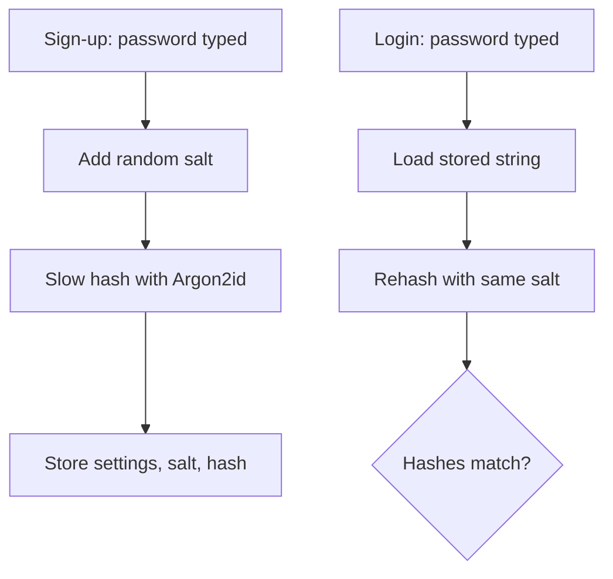

## In one line
Instead of storing passwords, you store a slow, salted, one-way **hash** of each one, so a stolen database does not reveal what anyone typed.

## The problem it solves
Assume your `users` table will leak one day. It happens through a backup left in a public storage bucket, a SQL injection bug (user input being run as part of a database command), or a laptop with a database dump on it.

- If passwords are stored as plain text, the attacker logs in as every user immediately. Worse, people reuse passwords, so the attacker tries the same email and password on their email and bank accounts too.
- If passwords are stored with a fast hash like SHA-256, attackers guess instead. A single modern graphics card can try billions of SHA-256 guesses per second, so common and short passwords fall within minutes.

Password hashing makes a leaked table as useless as possible: no password can be read back, and every guess costs the attacker real time and memory.

## Everyday analogy
Baking a cake from a recipe. Given the ingredients, anyone can bake the same cake again. Given only the cake, you can't get the exact ingredients back out. To check a password, you bake again with what the user typed and compare the cakes.

A **salt** is a unique pinch of spice added to each user's cake, so two users with the same password still get different cakes. A **slow** hash is a recipe that deliberately takes a long time to bake, so an attacker can't bake billions of test cakes.

Where it breaks down: real cakes vary a little each time. A hash function gives exactly the same output for the same input, every time.

## How it works
A few terms first:

- A **hash function** turns any input into a fixed-length fingerprint. It is **one-way** (you can't reverse it) and **deterministic** (same input, same output).
- **Encryption** is two-way: with the key, you get the original back. That is the wrong tool for passwords, because anyone who steals the key can read every password.
- A **salt** is a random value, different for each user, mixed in before hashing and stored next to the hash. It is not secret.
- A **rainbow table** is a giant precomputed list of hash-to-password pairs. Salts make it useless, because the attacker would need a separate table for every salt.
- The **work factor** (or **cost**) controls how slow the hash is. **Memory-hard** algorithms also require lots of memory per guess, which limits how many guesses a graphics card can run in parallel.

**At sign-up:**

1. Generate a random salt, typically 16 bytes.
2. Run a password hashing algorithm such as **Argon2id** over the password and salt, with your chosen cost settings.
3. Store one string containing the algorithm, settings, salt, and hash.

**At login:**

4. Load the stored string for that email.
5. Read the algorithm, settings, and salt out of it, and hash the typed password the same way.
6. Compare the result with the stored hash in **constant time**, meaning the comparison takes the same time no matter where the first difference is. Match means log in.


*Notice: the server never stores or needs the original password; it only ever compares hashes.*

### Anatomy of a stored hash
This is a real Argon2id hash from the example below:

```text
$argon2id$v=19$m=65536,p=4,t=3$2Muym+s1UWIXl+W1jGaNOw$tNgI0C03AuLUkZPK/zuJJRqgx2dAIvoiEHdP2DEc5xs
```

| Part | Meaning |
|---|---|
| `argon2id` | Algorithm |
| `v=19` | Algorithm version |
| `m=65536` | Memory per hash, in KiB (64 MiB) |
| `p=4` | Parallelism: threads used |
| `t=3` | Time cost: passes over memory |
| `2Muym+s1...` | The salt, base64-encoded |
| `tNgI0C03...` | The hash itself |

Because the settings travel with each hash, you can raise them later. Old hashes still verify, and you upgrade each one the next time that user logs in.

**Which algorithm?** The OWASP Password Storage Cheat Sheet recommends, in order:

1. **Argon2id**, with at least 19 MiB of memory, 2 passes, and parallelism 1.
2. **scrypt**, if Argon2id isn't available.
3. **bcrypt**, for older systems, with a cost of at least 10. bcrypt only uses the first 72 bytes of a password.
4. **PBKDF2**, when a standard called FIPS-140 requires it, with 600,000 iterations for PBKDF2-HMAC-SHA256.

## Real example
**Setup:** Node.js 18+, `"type": "module"`, `npm install argon2 pg`. A `users` table with `email`, `password_hash`, and `role` columns. `db.js` exports a `pg.Pool` as `db`.

```js
import argon2 from 'argon2';
import { randomUUID } from 'node:crypto';
import { db } from './db.js';

export async function registerUser(email, password) {
  const hash = await argon2.hash(password);   // Argon2id, random salt, safe defaults
  const { rows } = await db.query(
    'INSERT INTO users (email, password_hash) VALUES ($1, $2) RETURNING id',
    [email, hash]
  );
  return rows[0].id;
}

// Used when the email doesn't exist, so both failures take the same time.
const DUMMY_HASH = await argon2.hash(randomUUID());

export async function checkPassword(email, password) {
  const { rows } = await db.query(
    'SELECT id, role, password_hash FROM users WHERE email = $1', [email]);
  const user = rows[0];
  const ok = await argon2.verify(user?.password_hash ?? DUMMY_HASH, password);
  if (!user || !ok) return null;              // same result for both failures

  if (argon2.needsRehash(user.password_hash)) { // defaults raised since signup?
    const newHash = await argon2.hash(password);
    await db.query('UPDATE users SET password_hash = $1 WHERE id = $2', [newHash, user.id]);
  }
  return { id: user.id, role: user.role };
}
```

What to notice:

- `argon2.hash` picks the salt and settings for you. With the library version tested here, the defaults were 64 MiB, 3 passes, and 4 threads, which is above the OWASP minimum.
- On a laptop, each hash or verify took roughly 20–50 ms. That is unnoticeable for one login, but brutal for someone trying billions of guesses.
- Unknown emails still run a full verify against `DUMMY_HASH`. Without it, "no such user" would answer much faster than "wrong password", which tells an attacker which emails are registered.
- `needsRehash` quietly upgrades old hashes after a successful login, which is the only moment you have the plain password.

## How to say it in an interview

> [!INTERVIEW]
> **30 seconds:** "I never store passwords, only a hash from a slow, salted password hashing algorithm, ideally Argon2id, or bcrypt in older systems. Each user gets a random salt, so identical passwords produce different hashes and precomputed tables don't work. The algorithm is deliberately slow and memory-hungry, so even if the database leaks, guessing passwords is very expensive. At login I hash the typed password with the same salt and settings and compare."

> [!INTERVIEW]
> **2 minutes:** Start with the 30-second answer, then add:
>
> "Fast hashes like SHA-256 are the wrong tool, because a GPU can try billions of guesses per second. Encryption is also wrong: whoever steals the key gets every password back.
>
> In Node I use the `argon2` package. It stores the algorithm, settings, salt, and hash in one string, so I can raise the cost later and rehash each user on their next successful login.
>
> The tradeoff is CPU and memory on my own servers. Each login costs tens of milliseconds and a chunk of memory, which also makes the login endpoint a target for denial-of-service. So I put rate limiting on login and cap the password length at something generous like 64 to 128 characters.
>
> Hashing protects leaked data, not live accounts. I'd still add MFA, check new passwords against lists of known breached passwords, and return the same error for 'no such user' and 'wrong password'."

## Follow-up questions interviewers ask

<details>
<summary>What is the difference between a salt and a pepper?</summary>

A **salt** is random per user and stored next to the hash. It forces attackers to crack each user separately. A **pepper** is one secret value for the whole app, kept outside the database, for example in a secrets manager. If only the database leaks, the attacker can't even start guessing without the pepper. OWASP treats a pepper as optional extra defence. The catch: if the pepper leaks, you can't simply change it, because changing it breaks every existing hash. Users would need to reset their passwords.

</details>

<details>
<summary>What is bcrypt's 72-byte limit, and why does it matter?</summary>

bcrypt only uses the first 72 **bytes** of input and ignores the rest. Emoji and many non-English characters take several bytes each, so the limit can be reached in fewer than 72 characters. Two long passwords that share their first 72 bytes are treated as the same. Either enforce a 72-byte maximum, or use Argon2id, which has no such limit. Avoid pre-hashing with plain SHA-256 to get around it. OWASP warns that pre-hashing has its own pitfalls.

</details>

<details>
<summary>How do you move a legacy app from MD5 or SHA-1 hashes to Argon2id?</summary>

Don't wait for users to log in, because inactive accounts would stay weak forever. Wrap the old hashes now: store `argon2id(old_md5_hash)` and mark those rows as "wrapped". At login, compute the MD5 of the typed password, then verify that with Argon2id. After a successful login, replace the entry with a normal `argon2id(password)` hash.

</details>

<details>
<summary>How slow should the hash be?</summary>

Start from the OWASP minimums and raise the cost as far as your servers comfortably allow at peak login traffic. Many teams aim for tens to a few hundred milliseconds per hash. Measure on your production hardware. Remember memory too: 64 MiB per hash, with 50 simultaneous logins, is roughly 3 GB.

</details>

<details>
<summary>Why return the same error for "unknown email" and "wrong password"?</summary>

Different messages, status codes, or response times let an attacker discover which emails have accounts. That is called **user enumeration**. It helps them target phishing and credential stuffing, which means trying leaked email-password pairs from other sites. Return one generic message, such as "Invalid email or password", and keep timing similar, as the dummy hash does.

</details>

## Common mistakes and misconceptions

> [!MISTAKE]
> "I encrypt passwords with AES." Encryption is reversible. Anyone with the key, including an attacker who steals it from your server, can read every password. Passwords need one-way hashing.

> [!MISTAKE]
> "SHA-256 with a salt is enough." The salt stops precomputed tables, but SHA-256 is still built to be fast, so attackers can make billions of guesses per second per GPU. Use a password hashing algorithm built to be slow: Argon2id, scrypt, or bcrypt.

> [!MISTAKE]
> One salt shared by every user, or a salt derived from the email. Then identical passwords still match each other, and attackers can attack many users at once. Use a fresh random salt per hash. Libraries do this for you.

> [!MISTAKE]
> Silently truncating passwords, or capping them at something small like 16 characters. Allow long passphrases: OWASP suggests allowing at least 64 characters. A cap of, say, 128 characters keeps the hashing cost predictable.

> [!MISTAKE]
> Logging request bodies on the login route. The password ends up in plain text in your log files, and in every log tool they're shipped to. Redact `password` fields before logging.

## Tradeoffs: when NOT to use it
- **Data you need to read back.** A partner's API secret that your server must send to the partner can't be hashed, because you need the original. Encrypt it instead, with the key in a secrets manager.
- **High-randomness tokens.** API keys, session IDs, and password-reset tokens are long and random, so guessing is hopeless anyway. A fast hash like SHA-256 is fine and much cheaper.
- **Unprotected login endpoints.** Slow hashing makes each login attempt expensive for you too. Without [rate limiting](#/topic/rate-limiting), an attacker can tie up your CPU and memory with junk logins.
- **When you don't need passwords at all.** Passkeys or "Login with Google" mean there is no password to store or leak. See [Ways to authenticate](#/topic/auth-methods).

## Check yourself

<details>
<summary>1. Two users both choose the password "sunflower2026". Do their stored hashes match? Why?</summary>

No. Each user gets a different random salt, so the inputs to the hash differ, and the outputs differ completely.

</details>

<details>
<summary>2. Where is the salt stored, and is it a secret?</summary>

It is stored next to the hash, usually inside the same string, for example the `2Muym+s1...` part of an Argon2id hash. It is not secret. Its job is to make every hash unique, not to be hidden.

</details>

<details>
<summary>3. Why is a fast hash a problem for password storage?</summary>

Attackers with a leaked database guess passwords by hashing candidates and comparing. A fast hash lets them try billions per second. A slow, memory-hard hash makes each guess expensive, so cracking even weak passwords takes far longer.

</details>

## Go deeper
- [OWASP Password Storage Cheat Sheet](https://cheatsheetseries.owasp.org/cheatsheets/Password_Storage_Cheat_Sheet.html)
- [RFC 9106: Argon2](https://datatracker.ietf.org/doc/html/rfc9106)
