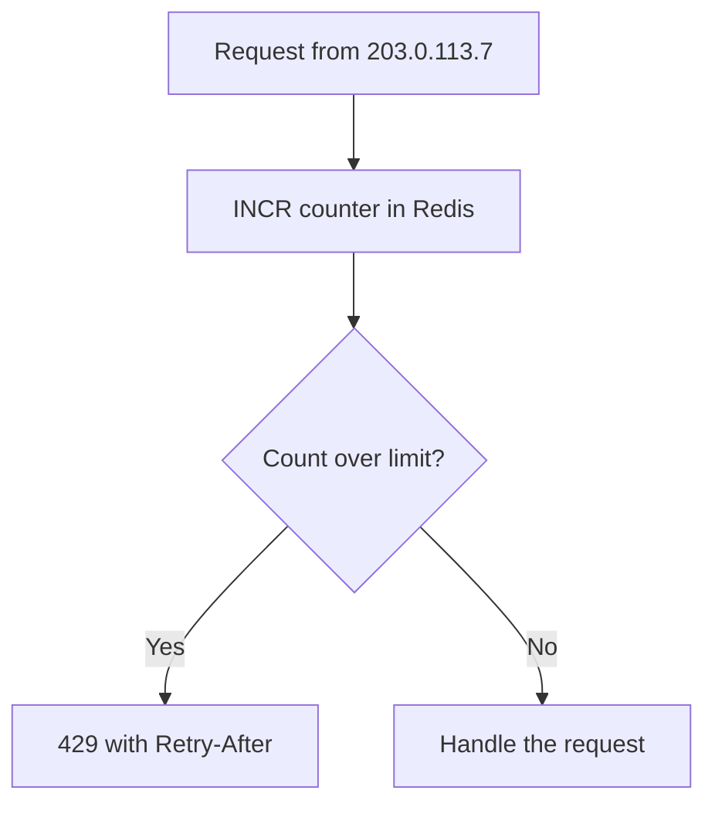

## In one line
Rate limiting caps how many requests a client can make in a period of time, so one client can't overwhelm your API or make thousands of password guesses.

## The problem it solves
Three things happen to your shop's API in the same week:

1. A bot sends 10,000 login attempts an hour to `/login`, using email and password pairs leaked from other websites. This is **credential stuffing**. Some of your customers reused passwords, so some attempts succeed.
2. Each of those logins runs a slow password hash on purpose, costing tens of milliseconds of CPU and memory. The bot is also slowing down login for everyone else.
3. A buggy mobile app release retries failed requests in a tight loop, and 2,000 phones hammer `/videos/feed` nonstop.

All three are "too many requests from someone". Without a limit, your servers do whatever they're asked until they fall over, and guessing passwords is free.

## Everyday analogy
An arcade gives you a cup of 10 tokens, and refills it with one token every 6 seconds. Each game costs one token. You can play a quick burst of 10 games, but over time you can't average more than 10 a minute. When the cup is empty, you wait.

Where it breaks down: the arcade knows exactly who you are. A server has to decide who "you" is: an IP address (shared by an entire office, and easy for attackers to rotate), a user ID, an API key, or an email being guessed.

## How it works
A few terms first:

- A **rate limit** is a rule like "at most 100 requests per minute".
- The **window** is the period being counted, such as one minute.
- The **key** is **who** gets counted: an IP address, a user ID, an API key, or a login email.
- **`429 Too Many Requests`** is the HTTP **status code** for "slow down". It often comes with a **`Retry-After`** header saying how many seconds to wait.
- Counters must live in a shared store such as **Redis** (a fast in-memory database), so that all your app servers see the same count.

The simplest algorithm, a **fixed-window counter**:

1. A request arrives from IP `203.0.113.7`.
2. Work out the current window number, for example "minute 29,883,996 since 1970".
3. Increment a Redis counter named after the key and the window: `rl:api:203.0.113.7:29883996`. Redis's `INCR` is **atomic**: two servers incrementing at once can't lose a count.
4. On the first request in the window, give the counter an expiry, so old counters delete themselves.
5. If the count is over the limit, reply `429` with `Retry-After`. Otherwise, handle the request.


*Notice: the check is one fast Redis call before any real work happens, so rejected requests cost almost nothing.*

**Other algorithms**, and why you'd pick them:

| Algorithm | How it counts | Good | Weak |
|---|---|---|---|
| Fixed window | Counter per clock minute | Simplest, cheap | Up to 2× burst across a window boundary |
| Sliding window log | Timestamp of every request | Exact | Memory per request |
| Sliding window counter | Weighted mix of this and last window | Smooth, cheap | Approximate |
| Token bucket | Tokens refill at a steady rate | Allows short bursts | Slightly more logic |
| Leaky bucket | Queue drained at a fixed rate | Smooth output | Adds waiting |

The 2× burst: with "100 per minute", a client can send 100 requests at 12:00:59 and 100 more at 12:01:00, which is 200 in two seconds.

**Brute-force protection is a special case.** Limiting `/login` by IP alone fails against botnets: networks of thousands of hijacked machines, each making only a few attempts. So also count **failed attempts per account** (per email), whatever IP they come from. OWASP's authentication guidance makes the same point.

## Real example
**Setup:** Node.js 18+, `"type": "module"`, `npm install express redis express-rate-limit rate-limit-redis`. Redis 7 or later. `redis` is a connected node-redis client. The app runs behind Nginx, so add `app.set('trust proxy', 1)`. Without it, `req.ip` is Nginx's own address and every user shares one counter.

**1. A fixed-window limiter by hand**, to see the mechanism:

```js
// Fixed-window limiter: at most `limit` requests per `windowSec` per client.
export function fixedWindowLimit(redis, { name, limit, windowSec }) {
  return async (req, res, next) => {
    const windowNo = Math.floor(Date.now() / 1000 / windowSec);
    const key = `rl:${name}:${req.ip}:${windowNo}`;   // e.g. rl:api:203.0.113.7:29883996

    try {
      const [count] = await redis.multi()             // MULTI: both commands run together
        .incr(key)                                    // atomic +1, safe across many servers
        .expire(key, windowSec, 'NX')                 // set a TTL only if none exists yet
        .exec();
      res.set('RateLimit-Limit', String(limit));
      res.set('RateLimit-Remaining', String(Math.max(0, limit - count)));
      if (count > limit) {
        const secondsLeft = windowSec - (Math.floor(Date.now() / 1000) % windowSec);
        res.set('Retry-After', String(secondsLeft));  // tell clients when to try again
        return res.status(429).json({ error: 'Too many requests' });
      }
    } catch (err) {
      console.warn('Rate limiter unavailable:', err.message); // fail open: keep serving
    }
    next();
  };
}
```

With `app.use('/api', fixedWindowLimit(redis, { name: 'api', limit: 5, windowSec: 60 }))`, seven quick requests give `200, 200, 200, 200, 200, 429, 429`, and the 429s carry `Retry-After: 58` or similar.

**2. Login protection with a maintained library.** Two limits: one per IP, and one per account that counts only failures:

```js
import { rateLimit, ipKeyGenerator } from 'express-rate-limit';
import { RedisStore } from 'rate-limit-redis';

export function loginLimiters(redis) {
  const store = (prefix) => new RedisStore({
    prefix,
    sendCommand: (...args) => redis.sendCommand(args),  // share counts across all servers
  });
  return [
    // Per IP: slows one machine hammering many accounts.
    rateLimit({ windowMs: 15 * 60_000, limit: 50, store: store('rl:login-ip:'),
      standardHeaders: 'draft-8', legacyHeaders: false }),
    // Per account: stops slow, distributed guessing on one email. Counts failures only.
    rateLimit({ windowMs: 15 * 60_000, limit: 5, store: store('rl:login-acct:'),
      skipSuccessfulRequests: true,                  // a 2xx login doesn't count
      keyGenerator: (req) => String(req.body?.email ?? '').toLowerCase()
        || ipKeyGenerator(req.ip),
      message: { error: 'Too many failed attempts. Try again in 15 minutes.' } }),
  ];
}

// app.post('/login', express.json(), ...loginLimiters(redis), loginHandler);
```

In a test, six wrong passwords for `asha@example.com`, each from a **different** IP address, gave `401` five times and then `429`. A login attempt for a different email was unaffected. `ipKeyGenerator` groups IPv6 addresses by network block, because one user can easily get many IPv6 addresses.

## How to say it in an interview

> [!INTERVIEW]
> **30 seconds:** "Rate limiting caps how many requests a client can make per time window, and returns 429 Too Many Requests with a Retry-After header when they go over. I keep the counters in Redis so every app server shares them. The simplest algorithm is a fixed-window counter with INCR and a TTL. A token bucket is better if you want to allow short bursts. For login, I limit both per IP and per account, because attackers spread guesses across many IPs."

> [!INTERVIEW]
> **2 minutes:** Start with the 30-second answer, then add:
>
> "The key decision is what to count by. For public endpoints, it's the IP address. For logged-in users, it's the user ID. For partners, it's the API key, often with different limits per pricing tier. For login, I add a per-email counter of failed attempts, so a botnet using thousands of IPs still gets only a few guesses per account.
>
> For example, on a shop's `/login` I'd allow about 50 attempts per IP and 5 failures per account per 15 minutes, then show a CAPTCHA or require a wait.
>
> The tradeoffs: IP limits can block innocent users who share an IP, like an office or a mobile network, so I keep IP limits generous. Per-account limits can be abused to lock someone out, so I block attempts for a while rather than locking the account permanently, and keep password reset working. I also decide what happens if Redis is down: usually fail open for general APIs, but stay strict on login."

## Follow-up questions interviewers ask

<details>
<summary>Why store counters in Redis instead of in the app's memory?</summary>

With three app servers behind a **load balancer** (which spreads requests across servers), each in-memory counter only sees about a third of the traffic, so the real limit becomes roughly three times what you set. Counters also reset on every deploy or restart. Redis gives one shared, fast counter, and `INCR` is atomic, so concurrent requests are counted correctly.

</details>

<details>
<summary>How do you get the client's real IP behind Nginx or a load balancer?</summary>

The proxy adds an `X-Forwarded-For` header with the client's IP. In Express, `app.set('trust proxy', 1)` tells Express to trust exactly one proxy hop and set `req.ip` from that header. Don't trust it blindly with more hops than you have: clients can send a fake `X-Forwarded-For`, and if you trust too many entries, they can pick their own IP and dodge your limits.

</details>

<details>
<summary>Where should rate limiting live: in the app, Nginx, or the CDN?</summary>

Often in layers. A **CDN** or edge firewall (servers in front of yours, run by a provider like Cloudflare or AWS) absorbs floods before they reach you. Nginx's `limit_req` module can cap requests per IP cheaply. The app does the smart limits that need context: per user, per API key, per login email. The app layer can't stop a large flood on its own, because the traffic has already reached your servers.

</details>

<details>
<summary>What should happen if Redis is down?</summary>

You choose between **fail open** (allow requests, losing protection briefly) and **fail closed** (reject requests, causing an outage). Most APIs fail open, so a Redis problem doesn't take the whole site down. For login or expensive endpoints, failing closed, or falling back to a strict in-memory limit, may be safer. `express-rate-limit` blocks by default when its store errors, and its `passOnStoreError: true` option fails open. Decide on purpose and log it.

</details>

<details>
<summary>What is the difference between rate limiting and throttling?</summary>

People use the words loosely. Usually **rate limiting** means rejecting excess requests with 429. **Throttling** means slowing them down, by delaying or queueing them instead of rejecting. Some APIs combine both: delay a little after 20 requests, and reject after 100.

</details>

## Common mistakes and misconceptions

> [!MISTAKE]
> Forgetting `trust proxy` behind Nginx. Every request then appears to come from `127.0.0.1`, so all users share one counter, and one busy user gets everyone blocked.

> [!MISTAKE]
> Limiting login by IP only. Credential-stuffing botnets rotate through thousands of IPs. Also count failed attempts per account.

> [!MISTAKE]
> Permanent account lockout after a few failures. An attacker can then lock out any customer just by typing their email wrong five times. Use temporary blocks or increasing delays, keep password reset working, and add a CAPTCHA or MFA for suspicious logins.

> [!MISTAKE]
> "Rate limiting stops DDoS attacks." A **DDoS** (distributed denial of service) is a flood from many machines, often large enough to saturate your network before your app sees anything. App-level rate limiting helps against small abuse. Large floods need a CDN or a DDoS protection service upstream.

## Tradeoffs: when NOT to use it
- **Strict IP limits on shared networks.** Offices, universities, and mobile carriers put many users behind one IP. Tight limits there block real customers. Prefer user or API-key limits once someone is logged in.
- **Internal service-to-service calls.** Limits between your own services can cause confusing cascading failures. Use timeouts, queues, and capacity planning instead, or set limits very high and alert on them.
- **As your only defence.** Rate limiting slows guessing. It does not replace strong password hashing, MFA, or input validation.
- **Every request paying a Redis round trip.** On very hot, cheap endpoints, the limiter's network call can cost more than the endpoint itself. Limit at the edge, or use a local token bucket, for those.

For designing a rate limiter as a full system design question, see [Design: rate limiter](#/topic/design-rate-limiter).

## Check yourself

<details>
<summary>1. What status code and header should a rate-limited response use?</summary>

`429 Too Many Requests`, with a `Retry-After` header saying how many seconds to wait. Many APIs also send `RateLimit` headers showing the limit and how many requests remain.

</details>

<details>
<summary>2. An attacker tries one password per account, across 50,000 accounts, from 5,000 IPs. Which limit catches this?</summary>

Neither simple limit, really: each IP makes only 10 attempts, and each account sees only one. This "password spraying" needs other defences. Watch the overall failed-login rate and alert on spikes, add CAPTCHAs when failures rise, check passwords against known-breached lists, and encourage MFA.

</details>

<details>
<summary>3. Why might a fixed window let through twice the limit?</summary>

The count resets at each window boundary. A client can use its full limit at the very end of one window and again at the very start of the next, so twice the limit arrives within a few seconds.

</details>

## Go deeper
- [MDN: 429 Too Many Requests](https://developer.mozilla.org/en-US/docs/Web/HTTP/Reference/Status/429)
- [OWASP Authentication Cheat Sheet: login throttling and account lockout](https://cheatsheetseries.owasp.org/cheatsheets/Authentication_Cheat_Sheet.html)
- [express-rate-limit documentation](https://express-rate-limit.mintlify.app/overview)
