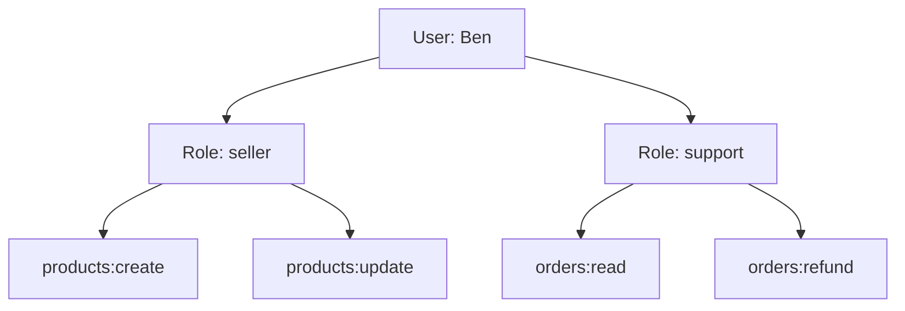

## In one line
Role-based access control (RBAC) gives permissions to **roles**, like `seller` or `support`, and gives roles to users, so you manage access by changing someone's role instead of editing their permissions one by one.

## The problem it solves
Your shop has customers, sellers who manage their own products, support agents who look up orders and issue refunds, and a few admins. At first the code checks people directly:

```js
// The messy way: people hard-coded into the rules
if (user.email === 'ben@example.com' || user.isAdmin || user.id === 77) { /* allow refund */ }
```

With 40 staff this falls apart. When Ben moves from support to marketing, someone has to find every place he was granted something. Nobody can answer "who is able to issue refunds?" without reading the whole codebase. And people quietly collect permissions they no longer need.

RBAC answers that with one indirection: permissions belong to roles, and people belong to roles.

## Everyday analogy
Job titles in a shop. "Cashier" means you can open the till and process returns. When you hire a cashier, you give them the title, not a list of twenty separate rights. When someone is promoted to manager, you change the title, and their access changes with it.

Where it breaks down: a job title doesn't say **which** till. RBAC alone can say "sellers can edit products", but not "only their own products". That needs an extra ownership check, shown below.

## How it works
A few terms first:

- **Authorization** is deciding what a known user may do. (Knowing who they are is authentication, which happens first. See [Authentication vs authorization](#/topic/authn-vs-authz).)
- A **permission** is one action on one kind of thing, often written `resource:action`, like `orders:refund` or `products:update`.
- A **role** is a named bundle of permissions, like `support = orders:read + orders:refund`.
- A **role assignment** links a user to a role. A user can have several roles.
- **Least privilege** means giving each person only the permissions they need for their job, and nothing more.

On each request:

1. Authenticate the user and load their roles, for example from the session.
2. Turn the roles into a set of permissions.
3. Ask the one question the code cares about: does this user have the permission this endpoint needs?
4. If the action is about a specific record, also check **scope**: does this record belong to them, or their team, or their shop?
5. Allow, or return `403 Forbidden`.


*Notice: Ben never holds a permission directly; he gets every permission through a role, so removing the role removes all of them at once.*

The key design rule: **code checks permissions, not role names.** The route says "needs `orders:refund`", not "needs admin or support". Then adding a `senior-support` role later means editing the role list, not hunting through every route.

## Real example
**Setup:** an Express 5 app (which passes errors from `async` handlers to the error handler) where earlier authentication middleware sets `req.user = { id, roles: ['seller'] }`. `db` is a `pg.Pool`, and the `products` table has a `seller_id` column.

**1. Roles, permissions, and a middleware** (`permissions.js`):

```js
// Which permissions each role grants. Changes go through code review.
const ROLE_PERMISSIONS = {
  customer: [],
  seller:   ['products:create', 'products:update'],
  support:  ['orders:read', 'orders:refund'],
  admin:    ['products:create', 'products:update', 'products:update:any',
             'orders:read', 'orders:refund', 'users:manage'],
};

export function can(user, permission) {
  return user.roles.some((role) => ROLE_PERMISSIONS[role]?.includes(permission));
}

export function requirePermission(permission) {
  return (req, res, next) => {
    if (!req.user) return res.status(401).json({ error: 'Please log in' });
    if (!can(req.user, permission)) return res.status(403).json({ error: 'Not allowed' });
    next();
  };
}
```

**2. Use it on a route, plus the ownership check:**

```js
import { can, requirePermission } from './permissions.js';

app.patch('/products/:id', requirePermission('products:update'), async (req, res) => {
  const { rows } = await db.query('SELECT seller_id FROM products WHERE id = $1', [req.params.id]);
  if (!rows[0]) return res.status(404).json({ error: 'Product not found' });

  // RBAC said "sellers may update products". Ownership says "only your own".
  const ownsIt = rows[0].seller_id === req.user.id;
  if (!ownsIt && !can(req.user, 'products:update:any')) {
    return res.status(403).json({ error: 'Not your product' });
  }
  await db.query('UPDATE products SET price_cents = $1 WHERE id = $2',
    [req.body.priceCents, req.params.id]);
  res.json({ ok: true });
});
```

Results for `PATCH /products/42`, which belongs to seller 50:

| Caller | Roles | Result |
|---|---|---|
| Not logged in | none | `401` |
| Asha, user 981 | `customer` | `403 Not allowed` |
| Seller 50 | `seller` | `200` |
| Seller 51 | `seller` | `403 Not your product` |
| Admin | `admin` | `200`, via `products:update:any` |

## How to say it in an interview

> [!INTERVIEW]
> **30 seconds:** "RBAC means permissions are attached to roles, and users are given roles. A seller role might have 'create product' and 'update product', and a support role might have 'read orders' and 'refund'. The code checks permissions, not people, so changing someone's job is one role change. RBAC covers what kind of action someone can do, and I add ownership checks for which records they can do it on."

> [!INTERVIEW]
> **2 minutes:** Start with the 30-second answer, then add:
>
> "In Express I'd write a `requirePermission('orders:refund')` middleware that returns 401 if there's no user and 403 if none of their roles grant the permission. Routes name permissions, never role names, so adding a new role doesn't touch route code.
>
> For example, sellers can update products, but only their own. RBAC can't express that on its own, so the handler also checks `seller_id`, and admins get a separate `products:update:any` permission.
>
> The tradeoff is flexibility versus simplicity. As rules get more specific, like 'support agents in the EU can refund up to 100 euros', you get 'role explosion', with dozens of near-duplicate roles. At that point attribute-based rules, or a policy engine, fit better. I'd also be careful about caching roles in a long-lived JWT, because removed roles would keep working until it expires."

## Follow-up questions interviewers ask

<details>
<summary>What is the difference between RBAC and ABAC?</summary>

**RBAC** decides by role: "support can refund". **ABAC** (attribute-based access control) decides by attributes of the user, the resource, and the context: "support can refund orders under 100 euros, in their own region, during work hours". RBAC is easier to understand and audit. ABAC is more expressive but harder to reason about. Many real systems use RBAC for the broad strokes and add a few attribute rules, like ownership, on top.

</details>

<details>
<summary>How would you store roles and permissions in the database?</summary>

Four tables: `roles`, `permissions`, and two many-to-many link tables, `role_permissions` and `user_roles`. Then one query gets everything a user may do:

```sql
SELECT DISTINCT p.name
FROM user_roles ur
JOIN role_permissions rp ON rp.role_id = ur.role_id
JOIN permissions p       ON p.id = rp.permission_id
WHERE ur.user_id = 50;
```

Load this once at login and keep it in the session. Many teams keep the role-to-permission map in code instead (as above), because it changes with the code, and only store user-to-role assignments in the database.

</details>

<details>
<summary>What is role explosion, and how do you avoid it?</summary>

Role explosion is when every special case gets its own role: `support-eu`, `support-eu-senior`, `support-us-readonly`. Soon there are more roles than people and nobody understands them. Avoid it by keeping roles tied to real job functions, and expressing context like region or amount limits as attributes or scoped checks rather than new roles.

</details>

<details>
<summary>How does RBAC work in a multi-tenant app, where one user belongs to several shops?</summary>

Make the role assignment **scoped**: `user_roles(user_id, shop_id, role_id)`. Ben can be `admin` in shop 12 and `viewer` in shop 30. Every check then asks "does this user have this permission **in this shop**?", and every query filters by the shop. Forgetting the scope is a classic way to leak data between customers.

</details>

## Common mistakes and misconceptions

> [!MISTAKE]
> Checking role names in routes, like `if (user.role === 'admin' || user.role === 'support')`. Every new role means editing many routes. Check permissions instead, and keep the role-to-permission map in one place.

> [!MISTAKE]
> "RBAC is enough." It says what kind of action is allowed, not on which records. Without ownership or tenant checks, every seller can edit every seller's products. This kind of gap is broken access control, the top category in the OWASP Top 10.

> [!MISTAKE]
> Giving new users a broad default role, or keeping old roles forever. Default to the smallest role, and review role assignments regularly, especially when people change teams or leave.

> [!MISTAKE]
> Putting roles in a long-lived token and never re-checking. A demoted admin keeps admin powers until the token expires. Keep tokens short, or re-check sensitive permissions against the database.

## Tradeoffs: when NOT to use it
- **Very small apps.** If there are only "users" and "one admin", an `is_admin` column plus ownership checks is clearer than four tables and a permissions map.
- **Per-record sharing.** "Asha shared this playlist with Ben and Chen" is about relationships between specific users and specific records, like Google Docs sharing. That fits **relationship-based access control** (ReBAC) better than roles.
- **Context-heavy rules.** Limits on amounts, time, location, or device are attributes. Encoding them as roles creates role explosion. Use ABAC rules or a policy engine.
- **Instead of auditing.** RBAC limits who can act. You still need logs of who actually did what, especially for refunds and admin actions.

## Check yourself

<details>
<summary>1. A new "refund manager" job is created. With permission-based checks, what code changes?</summary>

Only the role definition: add a `refund-manager` role with `orders:read` and `orders:refund`, and assign it. Routes that check `requirePermission('orders:refund')` don't change.

</details>

<details>
<summary>2. Every seller can edit every seller's products. Is the RBAC wrong?</summary>

Not necessarily. The `seller` role correctly grants `products:update`. What's missing is the ownership check: compare the product's `seller_id` with the user's ID, unless they have a broader permission like `products:update:any`.

</details>

<details>
<summary>3. Why give permissions to roles instead of directly to users?</summary>

Because people change jobs far more often than jobs change. Assigning or removing one role updates many permissions at once, makes "who can do X?" easy to answer, and avoids forgotten leftover permissions.

</details>

## Go deeper
- [OWASP Authorization Cheat Sheet](https://cheatsheetseries.owasp.org/cheatsheets/Authorization_Cheat_Sheet.html)
- [NIST: Role-based access control project](https://csrc.nist.gov/projects/role-based-access-control)
