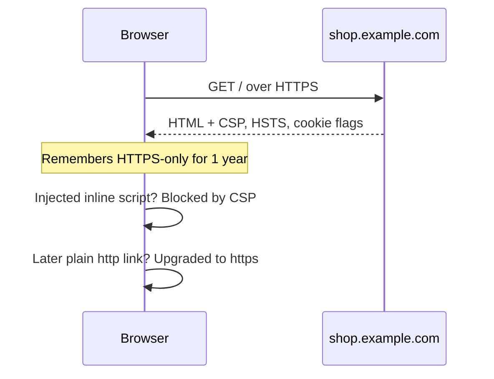

## In one line
A few HTTP response headers and cookie settings switch on protections that are built into the browser: forcing HTTPS, blocking injected scripts, refusing to be framed by other sites, and keeping cookies away from scripts and other websites.

## The problem it solves
Browsers already know how to defend your users against many attacks. But most of those defences are **off by default**, because turning them on everywhere would break older websites. Your server has to ask for them.

Without them, on your shop:

- A user types `shop.example.com` on café Wi-Fi. The first request goes over plain HTTP, and someone on the network intercepts it and keeps them on a fake, unencrypted copy of your site. This is called **SSL stripping**.
- One **XSS** bug (an attacker's script getting into your page) lets that script send data anywhere and load more code from anywhere.
- An attacker's page loads your "Delete account" page in an invisible frame and tricks the user into clicking it. This is **clickjacking**.
- Your session cookie gets sent over plain HTTP, or read by a script.

A handful of headers turns each of these from "possible" into "the browser refuses".

## Everyday analogy
House rules posted at a building's entrance: "Visitors must use the front door", "No deliveries from unknown companies", "Keys never leave the building". The security guard, the browser, reads the rules and enforces them for every visitor.

Where it breaks down: only browsers follow the rules. An attacker using `curl` or their own script ignores them completely. Security headers protect **your users in their browsers**. They don't protect your server or your API from direct attacks.

## How it works
A few terms first:

- A **response header** is a `Name: value` line the server sends with a response, before the body.
- An **origin** is the scheme, host, and port of a URL together, like `https://shop.example.com`.
- **MIME sniffing** is a browser guessing a file's type from its content instead of trusting the `Content-Type` header. A file uploaded as "image" could then be treated as a script or a page.

The flow:

1. The browser requests a page over HTTPS.
2. Your server, often through Nginx or the Helmet middleware for Express, adds the security headers to the response.
3. The browser **remembers** some rules (HSTS: "only HTTPS for this site, for a year") and **enforces** others on this page (CSP: "only run scripts from these places").
4. When something breaks a rule, such as an injected script or a framing attempt, the browser blocks it, and can report it.


*Notice: after one response, the browser enforces your rules by itself, even for attacks that happen later on other pages.*

### The headers that matter

| Header | Example value | What it stops |
|---|---|---|
| `Strict-Transport-Security` (HSTS) | `max-age=31536000; includeSubDomains` | SSL stripping. The browser uses only HTTPS for this site, for a year. |
| `Content-Security-Policy` (CSP) | `default-src 'self'; script-src 'self'; object-src 'none'` | Most damage from XSS. Scripts only load from allowed places, and inline scripts are blocked. |
| `Content-Security-Policy` | `frame-ancestors 'none'` | Clickjacking. No site may put your pages in a frame. |
| `X-Frame-Options` | `DENY` | Clickjacking, in older browsers. |
| `X-Content-Type-Options` | `nosniff` | MIME sniffing. The browser trusts your `Content-Type`. |
| `Referrer-Policy` | `strict-origin-when-cross-origin` | Leaking full URLs (with IDs or tokens) to other sites. |
| `Permissions-Policy` | `camera=(self), geolocation=()` | Pages or embedded frames using the camera, microphone, or location when they shouldn't. |

Some details interviewers probe:

- **HSTS** only takes effect when received over HTTPS. The very first visit is still exposed, so sites can join the browsers' **HSTS preload list**, which is built into browsers. Preloading requires `includeSubDomains` and the `preload` keyword, and is slow to undo.
- **CSP** is a list of **directives**, one per resource type: `script-src` for scripts, `img-src` for images, `media-src` for video and audio, `connect-src` for `fetch` calls, and `default-src` as the fallback. `'self'` means "my own origin". Adding `'unsafe-inline'` to `script-src` throws away most of the XSS protection. If you need inline scripts, use a **nonce**: a random value per response, in both the header (`'nonce-r4nd0m'`) and the script tag.
- **`X-XSS-Protection`** is a retired header from old browsers. Its filter caused problems of its own, so current advice is to set it to `0` or leave it out.

### Cookie flags
Cookie basics are in [Cookies, sessions, and local storage](#/topic/cookies-sessions-storage). For a session cookie, these attributes matter:

| Attribute | Effect |
|---|---|
| `HttpOnly` | JavaScript can't read it, so XSS can't steal it directly. |
| `Secure` | Only sent over HTTPS. |
| `SameSite=Lax` | Not sent on cross-site POSTs, fetches, or frames. Blocks most CSRF (other sites triggering requests that carry your cookie). |
| `SameSite=Strict` | Never sent on cross-site requests, even when following a link. |
| `SameSite=None` | Always sent. Requires `Secure`. Only for genuine cross-site use. |
| No `Domain` | Sent only to the exact host that set it, not to subdomains. |
| `__Host-` name prefix | The browser rejects the cookie unless it has `Secure`, `Path=/`, and no `Domain`. |

The `__Host-` prefix stops a compromised or careless subdomain, like `blog.example.com`, from overwriting your session cookie.

## Real example
**Setup:** Node.js 18+, `"type": "module"`, `npm install express helmet express-session`. HTTPS is handled by Nginx in front, so `trust proxy` is set. Videos and images are served from `https://cdn.example.com`.

**1. Security headers with Helmet:**

```js
import express from 'express';
import helmet from 'helmet';

const app = express();
app.set('trust proxy', 1);
app.use(helmet({
  contentSecurityPolicy: {
    directives: {                                   // merged with Helmet's safe defaults
      'script-src': ["'self'"],                     // no inline or third-party scripts
      'img-src': ["'self'", 'https://cdn.example.com'],
      'media-src': ["'self'", 'https://cdn.example.com'], // videos come from our CDN
      'frame-ancestors': ["'none'"],                // nobody may put us in an iframe
    },
  },
  strictTransportSecurity: { maxAge: 31536000, includeSubDomains: true }, // 1 year
  xFrameOptions: { action: 'deny' },                // same rule for older browsers
}));
app.use((req, res, next) => {                       // live streams need camera and mic
  res.set('Permissions-Policy', 'camera=(self), microphone=(self), geolocation=()');
  next();
});
```

Check the result with `curl -sI https://shop.example.com/`. This is the output from a local run, trimmed:

```text
Content-Security-Policy: default-src 'self';base-uri 'self';font-src 'self' https: data:;form-action 'self';frame-ancestors 'none';img-src 'self' https://cdn.example.com;object-src 'none';script-src 'self';script-src-attr 'none';style-src 'self' https: 'unsafe-inline';upgrade-insecure-requests;media-src 'self' https://cdn.example.com
Cross-Origin-Opener-Policy: same-origin
Referrer-Policy: no-referrer
Strict-Transport-Security: max-age=31536000; includeSubDomains
X-Content-Type-Options: nosniff
X-Frame-Options: DENY
X-XSS-Protection: 0
Permissions-Policy: camera=(self), microphone=(self), geolocation=()
```

Helmet also removes `X-Powered-By: Express`, which would otherwise advertise your framework.

**2. A hardened session cookie:**

```js
app.use(session({
  name: '__Host-sid',             // prefix: browser enforces Secure, Path=/, no Domain
  secret: process.env.SESSION_SECRET,
  resave: false,
  saveUninitialized: false,
  cookie: {
    httpOnly: true,               // page JavaScript can't read it
    secure: true,                 // only sent over HTTPS
    sameSite: 'lax',              // not sent on cross-site POSTs
    maxAge: 7 * 24 * 3600 * 1000, // 7 days
  },
}));
```

The browser receives:

```text
Set-Cookie: __Host-sid=s%3AR-qms8...; Path=/; Expires=Mon, 02 Nov 2026 18:37:53 GMT; HttpOnly; Secure; SameSite=Lax
```

> [!TIP]
> Free scanners such as Mozilla's HTTP Observatory grade your headers and explain what's missing. Run one after every change.

## How to say it in an interview

> [!INTERVIEW]
> **30 seconds:** "Security headers tell the browser to turn on protections it already has. HSTS forces HTTPS. Content Security Policy limits where scripts and other resources can load from, which contains XSS. `frame-ancestors` or X-Frame-Options stops clickjacking, and `nosniff` stops MIME sniffing. For cookies, I set HttpOnly, Secure, and SameSite=Lax on the session cookie. In Express I use Helmet, then tune the CSP for the app."

> [!INTERVIEW]
> **2 minutes:** Start with the 30-second answer, then add:
>
> "CSP is the one that needs real work. For example, a video shop loads images and video from a CDN, so I'd allow that CDN in `img-src` and `media-src`, keep `script-src` to `'self'`, and avoid `'unsafe-inline'`. If the app needs inline scripts, I'd use per-request nonces. I'd roll it out with `Content-Security-Policy-Report-Only` first, collect violation reports, fix them, and then enforce.
>
> The tradeoff is breakage versus protection. A strict CSP can break analytics or payment widgets. HSTS with a long `max-age` and `includeSubDomains` will break any subdomain that doesn't have HTTPS, and you can't easily take it back. So I start with a short max-age and increase it.
>
> These headers are defence in depth. They reduce the damage from bugs like XSS, but escaping output and validating input still come first."

## Follow-up questions interviewers ask

<details>
<summary>Why roll out CSP in report-only mode first?</summary>

`Content-Security-Policy-Report-Only` makes the browser report violations without blocking anything. You see which legitimate scripts, styles, or images your policy would break, such as an analytics tag or an inline handler. You fix or allow them, then switch to the enforcing header. Turning on a strict policy blind usually breaks something in production.

</details>

<details>
<summary>Does HttpOnly protect me from XSS?</summary>

Only partly. It stops a script from **reading** the cookie, so the attacker can't steal the session and use it elsewhere. But the injected script runs inside your page, so it can still send requests as the user, and the browser attaches the cookie automatically. You still need to prevent XSS: escape output and use a CSP.

</details>

<details>
<summary>What is the risk of HSTS preload?</summary>

Once your domain is in the browsers' built-in preload list, every subdomain must support HTTPS, including old internal tools. Getting removed from the list takes a long time, because it ships with browser releases. Only preload when you're sure every subdomain has HTTPS, now and in the future.

</details>

<details>
<summary>Are CORS headers security headers too?</summary>

They are related but do the opposite job. Security headers **restrict** what the browser does with your pages. CORS headers **relax** the browser's same-origin rule, allowing another origin's JavaScript to read your API responses. Misconfigured CORS, such as reflecting any `Origin` with credentials allowed, weakens security. See [CORS](#/topic/cors).

</details>

<details>
<summary>Should APIs that return JSON send these headers too?</summary>

Yes, the cheap ones. `nosniff` stops a browser from treating JSON as HTML. A restrictive CSP like `default-src 'none'; frame-ancestors 'none'` costs nothing on an API. HSTS should be on every HTTPS response from the domain. Helmet applies them to every route by default.

</details>

## Common mistakes and misconceptions

> [!MISTAKE]
> "Security headers make my server secure." They instruct **browsers**. Attackers calling your API with scripts ignore them entirely. Server-side checks are still required.

> [!MISTAKE]
> A CSP containing `'unsafe-inline'` and `'unsafe-eval'` in `script-src`, or a wildcard like `https:`. It looks protective but blocks almost no real XSS. Keep `script-src` tight and use nonces.

> [!MISTAKE]
> Turning on `includeSubDomains` or preload before every subdomain supports HTTPS. Browsers then refuse to load the HTTP-only subdomains at all, and you can't quickly undo it.

> [!MISTAKE]
> `SameSite=None` without `Secure`. Modern browsers reject the cookie. And `SameSite=None` also removes your CSRF protection, so only use it when cross-site cookies are genuinely needed.

## Tradeoffs: when NOT to use it
- **`frame-ancestors 'none'` on pages meant to be embedded.** A video player page that partners embed in their sites needs `frame-ancestors` listing those partner origins. Set it per route instead of globally.
- **A strict CSP on pages full of third-party scripts.** Marketing pages with many tags may need a looser policy. Keep the strict one on account, checkout, and admin pages.
- **Long HSTS max-age on a brand-new setup.** Start with minutes or a day, check everything works over HTTPS, then raise it to a year.
- **Copy-pasted header lists.** Headers you don't understand can break features, like a strict `Cross-Origin-Embedder-Policy` blocking third-party images. Add them one at a time and test.

## Check yourself

<details>
<summary>1. Which header stops a user's browser from ever loading your site over plain HTTP again, and what is its weak spot?</summary>

`Strict-Transport-Security` (HSTS). Its weak spot is the very first visit, before the browser has seen the header. The HSTS preload list closes that gap.

</details>

<details>
<summary>2. An attacker finds an XSS bug, but their inline script doesn't run. Which header likely stopped it?</summary>

`Content-Security-Policy`, with a `script-src` that doesn't allow `'unsafe-inline'`. The browser refuses inline scripts that lack the right nonce or hash.

</details>

<details>
<summary>3. What does the __Host- cookie prefix guarantee?</summary>

The browser accepts the cookie only if it has `Secure`, `Path=/`, and no `Domain` attribute, and was set over HTTPS. So it can only be set by, and sent to, that exact host, and a subdomain can't overwrite it.

</details>

## Go deeper
- [MDN: Content Security Policy (CSP)](https://developer.mozilla.org/en-US/docs/Web/HTTP/Guides/CSP)
- [OWASP HTTP Security Response Headers Cheat Sheet](https://cheatsheetseries.owasp.org/cheatsheets/HTTP_Headers_Cheat_Sheet.html)
- [Helmet documentation](https://helmetjs.github.io/)
