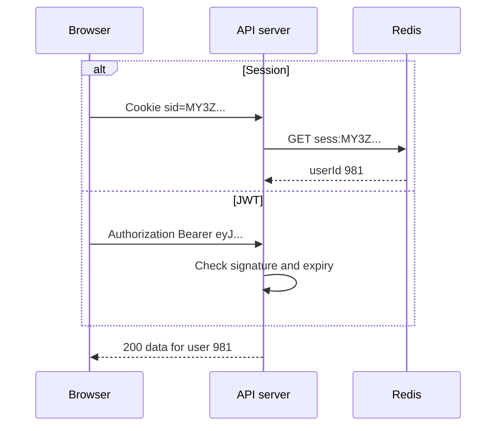

## In one line
After login, a **session** keeps the user's details on the server and gives the browser only a random ID, while a **JWT** puts the details into a signed token that the client carries and any server can check.

## The problem it solves
Asha (user 981) logs in to your shop once. In the next ten minutes her browser makes forty more requests: her video library, her cart, her order history. **HTTP** has no memory between requests, so each request must carry proof that she already logged in. Nobody wants to type a password forty times.

There are two classic designs for that proof:

- **Remember it on the server.** Store "this visitor is user 981" in a shared store, and give the browser a meaningless ticket number that points to it.
- **Hand it to the client, sealed.** Give the browser a tamper-proof note that says "user 981, valid for 15 minutes", which any server can check by itself.

The choice affects how you log people out, how you scale to many servers, and which attacks you have to defend against. That is why "sessions or JWT?" is one of the most common backend interview questions.

## Everyday analogy
A **coat check** versus a **festival wristband**.

- At the coat check you get ticket #4471. The ticket says nothing by itself. The staff look up #4471 to find your coat. If the ticket is reported stolen, they simply cancel #4471. That is a **session**.
- At a festival you get a wristband printed "VIP, Saturday only", with a tamper-proof seal. Any guard at any gate can check it on sight, without phoning the office. But if you are thrown out, they can't easily take back a wristband that is still on someone's wrist. That is a **JWT**.

Where it breaks down: anyone can read what is printed on the wristband. A JWT's contents are only signed, not hidden.

## How it works
A few terms first:

- A **session** is data the server keeps about a logged-in user, found through a **session ID**: a long random string that is impossible to guess.
- A **cookie** is a small value the server asks the browser to store and send back automatically on every request to that site. See [Cookies, sessions, and local storage](#/topic/cookies-sessions-storage).
- A **JWT** (JSON Web Token, said "jot") is a piece of text with three parts: who the user is, when it expires, and a **signature**. A signature is a value only the holder of a secret key can produce, so any change to the token is detected. The parts are explained in [JWT in depth](#/topic/jwt-deep-dive).
- A **bearer token** is any token that works for whoever holds it, like cash. A JWT sent in the `Authorization: Bearer <token>` header is one.

**Session flow:**

1. Asha logs in. The server checks her password.
2. It creates a random session ID, such as `MY3ZoBv62j...`, and stores `{ userId: 981, role: "customer" }` under it in **Redis** (a fast in-memory store), with an expiry.
3. It sends the ID in a cookie marked `HttpOnly; Secure; SameSite=Lax`. These flags hide it from page scripts, send it only over HTTPS, and keep it off most requests started by other sites.
4. On every request, the browser sends the cookie. The server looks up the ID in Redis to find the user.
5. Logout deletes the Redis entry. The ID is now worthless, immediately.

**JWT flow:**

1. Asha logs in. The server checks her password.
2. It builds a token containing `sub: "981"`, `role: "customer"`, and an expiry 15 minutes away, then signs it with a secret key.
3. The client keeps the token and sends it on every request, usually in the `Authorization` header.
4. The server checks the signature and the expiry. That is pure math on the server's own CPU: no database or Redis call.
5. "Logout" deletes the token on the client. But if someone copied the token, it keeps working until it expires.


*Notice: the session path makes a lookup on every request, while the JWT path checks the token locally, which is exactly why one is easy to revoke and the other is not.*

**The honest comparison:**

| | Session (ID in cookie) | JWT (self-contained) |
|---|---|---|
| Where user data lives | Server store, e.g. Redis | Inside the token |
| Cost per request | One lookup, typically under 1 ms in the same network | Signature check, no network call |
| Instant logout or ban | Yes: delete the session | No: valid until it expires |
| Changing a role | Takes effect on the next request | Old role stays until the token expires |
| Size on each request | Roughly 100 bytes | Typically a few hundred bytes, growing with each claim |
| Many separate services | All need the session store | Each verifies on its own |
| Typical client | Browser web app | Mobile apps, service-to-service, third-party APIs |

**The common hybrid.** Many real systems combine both: a short-lived JWT **access token** (5–15 minutes) for fast checks, plus a long-lived **refresh token** that the server does track and can revoke. When the access token expires, the client uses the refresh token to get a new one. Revoking the refresh token logs the user out within one access-token lifetime. Details in [JWT in depth](#/topic/jwt-deep-dive).

## Real example
**Setup:** Node.js 18+, `"type": "module"`, `npm install express express-session connect-redis redis jose`. Redis is running and `REDIS_URL` and `SESSION_SECRET` (a long random string) are set. The app runs behind Nginx with HTTPS.

**1. Server-side sessions stored in Redis:**

```js
import express from 'express';
import session from 'express-session';
import { RedisStore } from 'connect-redis';
import { createClient } from 'redis';

const redis = createClient({ url: process.env.REDIS_URL });
redis.on('error', (err) => console.error('Redis error:', err.message));
await redis.connect();

export const app = express();
app.use(express.json());
app.set('trust proxy', 1); // behind Nginx: trust X-Forwarded-Proto for secure cookies
app.use(session({
  store: new RedisStore({ client: redis }),  // stored in Redis as sess:<id>
  secret: process.env.SESSION_SECRET,        // signs the cookie so it can't be forged
  resave: false,
  saveUninitialized: false,                  // no session (or cookie) until login
  cookie: { httpOnly: true, secure: true, sameSite: 'lax', maxAge: 7 * 24 * 3600 * 1000 },
}));
```

**2. Log in and log out** (`checkPassword` is your own function that returns the user or `null`; see [Password hashing](#/topic/password-hashing)):

```js
app.post('/login', async (req, res, next) => {
  const user = await checkPassword(req.body.email, req.body.password);
  if (!user) return res.status(401).json({ error: 'Invalid email or password' });

  req.session.regenerate((err) => {      // fresh ID at login: blocks session fixation
    if (err) return next(err);
    req.session.userId = user.id;        // stored in Redis, not in the cookie
    req.session.role = user.role;
    res.json({ ok: true });
  });
});

app.post('/logout', (req, res, next) => {
  req.session.destroy((err) => {         // deletes sess:<id> in Redis: logged out now
    if (err) return next(err);
    res.clearCookie('connect.sid').json({ ok: true });
  });
});
```

After Asha logs in, Redis holds this, and the cookie holds only the signed ID:

```bash
redis-cli GET sess:MY3ZoBv62jyQN-tfXka0q2QI2_NarUxl
# {"cookie":{"originalMaxAge":604800000,...,"httpOnly":true,"sameSite":"lax"},"userId":981,"role":"customer"}
redis-cli TTL sess:MY3ZoBv62jyQN-tfXka0q2QI2_NarUxl
# (integer) 604800   <- 7 days, then Redis deletes it
```

To force-logout a stolen session, delete that key. It stops working on the very next request.

**3. The JWT version of the same check** (`JWT_SECRET` is at least 32 random bytes):

```js
import { SignJWT, jwtVerify } from 'jose';

const key = new TextEncoder().encode(process.env.JWT_SECRET);

export function issueAccessToken(user) {
  return new SignJWT({ role: user.role })
    .setProtectedHeader({ alg: 'HS256' })
    .setSubject(String(user.id))
    .setIssuedAt()
    .setExpirationTime('15m')            // short-lived: limits damage if stolen
    .sign(key);
}

export async function requireJwt(req, res, next) {
  const token = req.get('Authorization')?.replace(/^Bearer /, '');
  if (!token) return res.status(401).json({ error: 'Missing token' });
  try {
    const { payload } = await jwtVerify(token, key, { algorithms: ['HS256'] });
    req.user = { id: Number(payload.sub), role: payload.role }; // no Redis lookup
    next();
  } catch {
    res.status(401).json({ error: 'Invalid or expired token' });
  }
}
```

Notice what is missing: there is no logout route that can make an issued token stop working. That is the core tradeoff in code form.

## How to say it in an interview

> [!INTERVIEW]
> **30 seconds:** "With sessions, the server stores the user's login state, for example in Redis, and the browser only holds a random session ID in an HttpOnly cookie. With JWTs, the user's identity and expiry are inside a signed token, so any server can verify it without a lookup. Sessions are easy to revoke and simple for web apps. JWTs avoid the shared store and suit APIs and multiple services, but you can't easily revoke one before it expires, so you keep them short-lived."

> [!INTERVIEW]
> **2 minutes:** Start with the 30-second answer, then add:
>
> "For a typical web app with one backend, I'd pick sessions in Redis. The lookup is well under a millisecond, I get instant logout and bans, and an HttpOnly cookie keeps the ID away from JavaScript. I regenerate the session ID at login to prevent session fixation.
>
> I'd reach for JWTs when many services need to check identity independently, or for mobile and third-party API clients. Then I keep the access token short, around 15 minutes, and pair it with a refresh token stored server-side so I can still revoke access.
>
> The tradeoff is revocation versus lookups. A common mistake is choosing JWTs 'because they're stateless', then adding a Redis denylist to handle logout. At that point you've rebuilt sessions with extra complexity. I'd also never put sensitive data in a JWT, because the payload is only encoded, not encrypted."

## Follow-up questions interviewers ask

<details>
<summary>Aren't JWTs more scalable, because they are stateless?</summary>

A little, but less than people claim. A Redis session lookup typically takes well under a millisecond on the same network, and one Redis instance can serve a very large number of such lookups. **Stateless** means the server keeps no per-user memory between requests. It matters most when many separate services, or different companies, must verify identity without sharing a store. For one backend behind a load balancer, a shared Redis session store scales fine.

</details>

<details>
<summary>How do you log out a user who has a JWT?</summary>

Options, from simplest:
- Keep access tokens short (5–15 minutes) and revoke the server-tracked **refresh token**. The user is fully out within one token lifetime.
- Keep a **denylist** of revoked token IDs (the `jti` claim) in Redis until they expire. This works instantly, but now every request needs a lookup again.
- Store a per-user "tokens valid after" timestamp and reject tokens issued earlier. This also needs a lookup.

Deleting the token from the browser only logs out that browser. A copy elsewhere keeps working.

</details>

<details>
<summary>What is session fixation, and how do you prevent it?</summary>

The attacker gets a session ID first, then tricks the victim into using it, for example on a shared computer or through a vulnerable subdomain that can set cookies. When the victim logs in, the attacker's known ID becomes a logged-in session. The fix is to create a **new** session ID at login, which `req.session.regenerate()` does. Also regenerate when privileges change, such as becoming an admin.

</details>

<details>
<summary>Where should a browser app keep a JWT?</summary>

Preferably in an `HttpOnly`, `Secure` cookie, where page JavaScript cannot read it. `localStorage` is readable by any script on the page, so one **XSS** bug (an attacker's script running on your site) can steal the token and use it from anywhere. Cookies bring **CSRF** risk instead (other sites triggering requests that carry the cookie), which `SameSite` and CSRF tokens handle. Mobile apps store tokens in the platform's secure storage, such as the iOS Keychain or Android Keystore.

</details>

<details>
<summary>Why not use express-session's default store in production?</summary>

The default `MemoryStore` keeps sessions inside one Node.js process. The express-session docs warn that it leaks memory and is not designed for production. Every restart logs everyone out, and with two or more servers, a user logged in on server A looks logged out on server B. Use a shared store such as Redis or PostgreSQL.

</details>

## Common mistakes and misconceptions

> [!MISTAKE]
> "A JWT is encrypted, so it's safe to put data in it." A normal JWT is only **signed**. Anyone with the token can decode and read the payload in one line of code. Never put passwords, addresses, or other private data in it.

> [!MISTAKE]
> "Sessions don't scale." In-memory sessions in a single process don't. Sessions in a shared store like Redis work fine across many servers, and that is how most large web apps run.

> [!MISTAKE]
> Long-lived JWTs, such as 30 days with no refresh flow. A stolen token then works for a month, and you cannot cancel it. Keep access tokens short and put the long-lived part in a revocable refresh token.

> [!MISTAKE]
> Keeping the same session ID before and after login. That enables session fixation. Regenerate the ID at login.

## Tradeoffs: when NOT to use it
**Don't choose JWTs when:**
- You have one web app and one backend. Sessions are simpler and safer, and you get real logout.
- You need instant revocation, for example banning a fraudster mid-purchase or removing an admin.
- You plan to put lots of data in the token. It is sent on every request and goes stale the moment the data changes.

**Don't choose server sessions when:**
- Many independent services, or services in different regions, must verify identity without all reaching one session store.
- Third parties call your API. They expect tokens, not your cookies.
- Your API is consumed by clients that don't handle cookies well, such as some command-line tools or IoT devices.

## Check yourself

<details>
<summary>1. An admin bans a user. With sessions, when does the ban take effect? With 15-minute JWTs and no denylist?</summary>

With sessions, on the next request, once you delete their sessions. With 15-minute JWTs, up to 15 minutes later, when the current access token expires, assuming the refresh token was revoked so no new one is issued.

</details>

<details>
<summary>2. What does the session cookie actually contain?</summary>

Only the session ID, signed so it can't be forged (express-session prefixes it with `s:` and appends a signature). The user's data, such as `userId: 981`, lives on the server, in Redis.

</details>

<details>
<summary>3. Your team picked JWTs, then added a Redis lookup on every request to check for revoked tokens. What have they built?</summary>

Effectively server-side sessions, plus the complexity of tokens. That can be a reasonable choice, but they've lost the main benefit of JWTs, verification without a lookup. A plain session store might be simpler.

</details>

## Go deeper
- [OWASP Session Management Cheat Sheet](https://cheatsheetseries.owasp.org/cheatsheets/Session_Management_Cheat_Sheet.html)
- [Express docs: express-session middleware](https://expressjs.com/en/resources/middleware/session.html)
