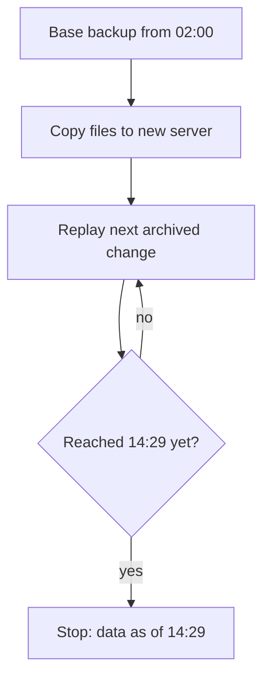

## In one line
A backup is a copy of your data stored somewhere safe, and it only counts if you have actually restored it and checked the result.

## The problem it solves
At 14:30 a developer runs a cleanup script against the wrong database:

```sql
DELETE FROM orders;   -- meant for staging, ran on production
```

Every order is gone. Things that do **not** help:

- **Replicas.** They copy the `DELETE` within milliseconds (see [Replication](#/topic/replication-sharding)).
- **RAID or a cloud disk.** They protect against a disk dying, not against a command doing exactly what it was told.
- **A backup file nobody has tested.** It may be empty, corrupt, or missing the one table you need. You find out at the worst moment.

Backups also cover disk failures, ransomware, a bad migration, and a cloud account being deleted. The questions that matter are: how much data can you afford to lose, how fast can you get it back, and have you proven it works?

## Everyday analogy
Photocopies of your important documents kept at a relative's house. If your home floods, you still have them.

Where it breaks down: you would notice a blank photocopy. A backup file can look fine, with a normal size and name, and still fail to restore. You only know by trying.

## How it works
Two numbers set the requirements:

- **RPO** (recovery point objective): how much recent data you can afford to lose, measured in time. A nightly backup means an RPO of up to 24 hours.
- **RTO** (recovery time objective): how long you can afford to be down while restoring.

PostgreSQL offers two kinds of backup:

- **Logical backup** with `pg_dump`: exports one database as SQL statements or a compressed archive. It reads a consistent snapshot while the app keeps running. It can be restored into newer PostgreSQL versions, and it lets you restore a single table. But restoring means re-inserting every row and rebuilding every index, which gets slow on large databases.
- **Physical backup** with `pg_basebackup` (or tools like pgBackRest): copies the database's raw data files. It covers the whole server and restores fast, because files are just copied back. It only works on the same PostgreSQL major version.

**Point-in-time recovery** (PITR) is what saves you at 14:30. It combines a physical **base backup** with **WAL archiving**. Every change PostgreSQL makes is first written to its WAL (write-ahead log). With archiving on, each finished WAL file is copied to safe storage. To recover:

1. Restore the most recent base backup (say, from 02:00) onto a new server.
2. Tell PostgreSQL where the archived WAL files are and the target time, 14:29.
3. PostgreSQL replays every change from 02:00 onward, in order.
4. It stops just before the target time, so the `DELETE` at 14:30 never happens.
5. You check the data, then point the app at it, or copy the lost rows back.


*Notice: recovery replays history up to just before the mistake, then stops.*

With WAL archiving, the RPO drops from a day to a few minutes or less. Managed databases such as AWS RDS do all of this for you as "automated backups" with point-in-time restore, within a retention period you choose.

**Where to keep backups.** A common rule of thumb is **3-2-1**: 3 copies of the data, on 2 different kinds of storage, with 1 copy off-site, such as object storage in another region or account. A backup on the same server as the database disappears with that server.

## Real example
**Setup:** an Ubuntu server with the PostgreSQL client tools (`sudo apt install postgresql-client`) and the AWS CLI configured. The env file holds `DATABASE_URL` for the `shop` database.

**A nightly logical backup** (`/usr/local/bin/backup-shop.sh`):

```bash
#!/usr/bin/env bash
set -euo pipefail                      # stop on any error, so failures are noticed
source /etc/shop-backup.env            # sets DATABASE_URL (cron has no shell profile)

STAMP=$(date +%F)                      # e.g. 2026-10-26
FILE="/var/backups/shop-$STAMP.dump"

pg_dump --format=custom --file="$FILE" "$DATABASE_URL"  # compressed, restorable per table
aws s3 cp "$FILE" s3://shop-backups/postgres/           # copy off the server
find /var/backups -name 'shop-*.dump' -mtime +7 -delete  # keep a week locally
```

Schedule it with cron (`crontab -e`), every day at 02:00:

```bash
0 2 * * * /usr/local/bin/backup-shop.sh >> /var/log/backup-shop.log 2>&1
```

**Prove it restores**, ideally automatically every week, on a separate machine:

```bash
createdb shop_restore_test
pg_restore --dbname=shop_restore_test --no-owner shop-2026-10-26.dump
psql -d shop_restore_test -c "SELECT count(*) FROM orders;"  # compare with production
dropdb shop_restore_test
```

`--no-owner` skips the original table owners, which may not exist on the test machine. Check that row counts and the newest `created_at` look right, and time the restore. That time is your real RTO.

**Point-in-time recovery, in short.** On the primary, in `postgresql.conf`:

```ini
archive_mode = on
archive_command = 'test ! -f /mnt/wal_archive/%f && cp %p /mnt/wal_archive/%f'
```

To recover, restore a base backup onto a new server, create an empty `recovery.signal` file in its data directory, and set:

```ini
restore_command = 'cp /mnt/wal_archive/%f %p'
recovery_target_time = '2026-10-26 14:29:00+00'
recovery_target_action = 'promote'
```

In a local test, this brought back rows inserted after the base backup and stopped right before a `DELETE`. Production setups usually use pgBackRest or WAL-G instead of `cp`, which add compression, encryption, and uploads to object storage.

## How to say it in an interview

> [!INTERVIEW]
> **30 seconds:** "I start from two numbers: how much data we can lose, the RPO, and how long we can be down, the RTO. For PostgreSQL I'd use nightly or managed snapshots plus WAL archiving, which gives point-in-time recovery, so I can restore to the minute before someone ran a bad delete. Backups go off-site, and most importantly, we restore them regularly, because an untested backup isn't a backup."

> [!INTERVIEW]
> **2 minutes:** Start with the 30-second answer, then add:
>
> "There are two kinds. `pg_dump` is a logical backup: portable, and I can restore one table, but restoring a big database is slow because every index is rebuilt. Physical backups copy the data files: fast to restore and the basis for point-in-time recovery, but tied to the same major version.
>
> Replicas are not backups. They copy a `DELETE` instantly. They help availability; backups help you go back in time.
>
> On a managed service like RDS, I'd enable automated backups with a retention of, say, two weeks, and copy snapshots to another region or account so a compromised account can't delete everything. Then a scheduled job restores the latest backup into a scratch database, runs sanity checks like row counts, and alerts if anything fails. The tradeoff is cost and effort: more frequent backups and longer retention cost storage, and restore drills take engineering time."

## Follow-up questions interviewers ask

<details>
<summary>pg_dump vs physical backups: when do you use each?</summary>

- **pg_dump:** smaller databases, moving data to a new PostgreSQL version, copying one table or schema, or giving a developer a copy.
- **Physical plus WAL archiving:** large production databases, fast full restores, and point-in-time recovery.

Many teams use both: physical backups for disaster recovery, plus occasional `pg_dump` exports for portability.

</details>

<details>
<summary>How do you restore just one deleted table without rolling back everything else?</summary>

Restore the backup (or a point-in-time recovery to just before the mistake) into a **separate** database. Then copy only the missing rows back into production, for example with `pg_dump --table=orders` from the restored copy, or `INSERT ... SELECT` across the two. Rolling back the whole production database would throw away every good order placed since.

</details>

<details>
<summary>How do you know your backups work?</summary>

Restore them automatically on a schedule into a scratch database, run checks (row counts, latest timestamps, a few known records), and alert on failure. Also alert if a backup job didn't run or produced a suspiciously small file. Time the restore to know your real RTO.

</details>

<details>
<summary>How do you protect backups from ransomware or an attacker?</summary>

Keep at least one copy where the production credentials can't delete it: a separate cloud account, or object storage with versioning and object lock (write-once storage that can't be deleted until a set date). Encrypt backups, because they contain all your users' data.

</details>

## Common mistakes and misconceptions

> [!MISTAKE]
> "We have replicas, so we're backed up." Replicas copy mistakes immediately. They protect against a server dying, not against a bad command.

> [!MISTAKE]
> Never testing a restore. Backups fail silently: wrong database, a full disk, an expired credential, a missing extension. Only a real restore proves anything.

> [!MISTAKE]
> Keeping backups on the same server or in the same account. One disk failure, one deleted account, or one attacker takes out both the data and its backups.

> [!MISTAKE]
> Copying the raw data directory of a running database with `cp` or `rsync`. The files change while you copy, so the result can be unusable. Use `pg_basebackup` or a proper backup tool.

## Tradeoffs: what backups cost
- **Storage and transfer.** Daily full backups with long retention add up. Keep fewer old copies, or use incremental backups.
- **Load on the database.** A big `pg_dump` reads every row and can slow production. Run it at quiet hours, or take it from a replica.
- **Logical backups at scale.** For very large databases, restoring from `pg_dump` can take hours. Use physical backups when RTO matters.
- **Data you don't need to back up.** Caches in Redis and anything you can regenerate from the source of truth, such as video thumbnails or search indexes, usually don't need their own backups.

## Check yourself

<details>
<summary>1. Backups run nightly at 02:00. The database is destroyed at 23:00. How much data is lost, and what would reduce it?</summary>

Up to 21 hours: everything since 02:00. WAL archiving with point-in-time recovery cuts that to minutes. That is a better RPO.

</details>

<details>
<summary>2. Why can't a read replica undo an accidental DELETE?</summary>

Replication sends every change to the replica within moments, including the `DELETE`. The replica ends up with the same missing data.

</details>

<details>
<summary>3. What makes a backup "real"?</summary>

It is stored away from the database it protects, and you have restored it, checked the data, and timed how long the restore took.

</details>

## Go deeper
- [PostgreSQL docs: backup and restore](https://www.postgresql.org/docs/current/backup.html)
- [PostgreSQL docs: continuous archiving and point-in-time recovery](https://www.postgresql.org/docs/current/continuous-archiving.html)
- [AWS docs: restoring an RDS instance to a specific time](https://docs.aws.amazon.com/AmazonRDS/latest/UserGuide/USER_PIT.html)
