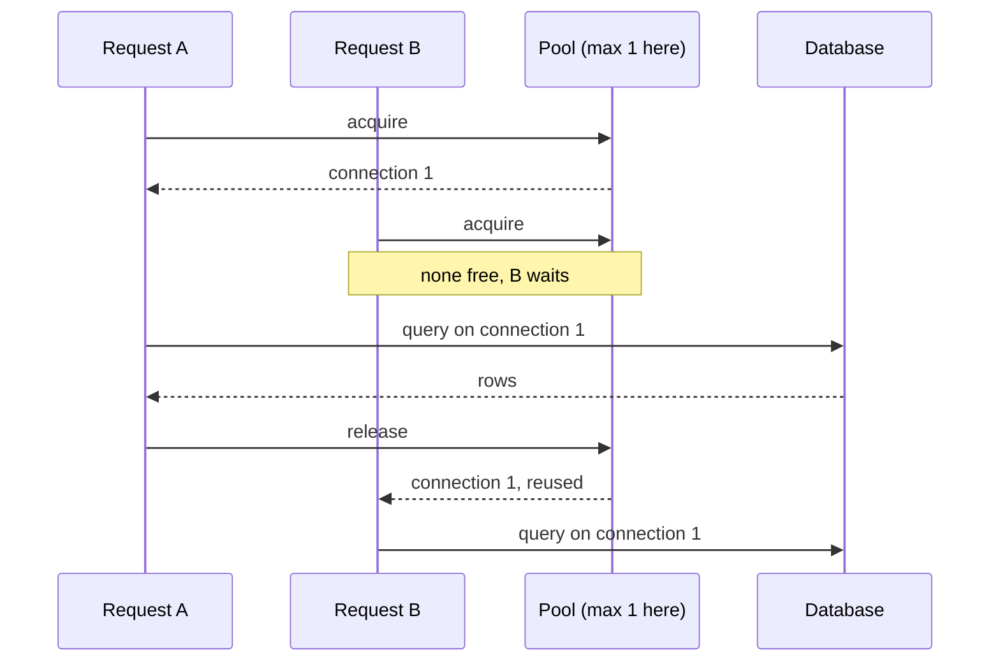

## In one line
Connection pooling means keeping a small set of database connections open and lending them to requests, instead of opening a brand-new connection for every query.

## The problem it solves
Before your server can ask PostgreSQL anything, it needs a **database connection**: an open, logged-in channel between your app and the database. Opening one is not free:

1. A TCP connection is set up (a network round trip).
2. Often a TLS handshake follows, to encrypt it (more round trips).
3. The database checks your username and password.
4. PostgreSQL starts a separate server **process** just for this connection, which costs memory.

In one test against PostgreSQL in Docker on the same laptop, opening a fresh connection for each `SELECT 1` took about 6 ms per query. Reusing an open connection took about 0.25 ms. Across a real network with TLS, the gap gets bigger.

Now imagine your shop's API opens a new connection for each of 500 requests per second. Most of the time goes into connecting, and the database also has a hard cap: PostgreSQL's `max_connections` setting defaults to 100. Past it, new connections are refused with `sorry, too many clients already`, and your site starts returning errors.

## Everyday analogy
A car-sharing lot. Instead of buying a car for every trip and scrapping it afterwards, people borrow one of 10 cars, drive, and bring it back. If all 10 are out, you wait in line for the next one to return.

Where it breaks down: a borrower who never brings the car back (a "leaked" connection) slowly empties the lot, and nobody notices until everyone is stuck waiting.

## How it works
A **connection pool** is an object inside your app that owns a few open connections. The pool's life cycle:

1. **Start empty.** Connections are opened lazily, the first time they are needed.
2. **Acquire.** A request asks the pool for a connection (also called "checking out"). If an idle one exists, it gets it immediately.
3. **Grow, up to max.** If none is idle and the pool is below its **max size**, it opens a new connection.
4. **Wait.** If the pool is at max and all connections are busy, the request waits in a queue.
5. **Release.** When the request finishes its queries, it gives the connection back. The pool hands it to the next waiting request, still open and logged in.
6. **Idle timeout.** A connection unused for a while (for example 30 seconds) is closed, so a quiet app doesn't hold connections it doesn't need.
7. **Connection timeout.** A request that waits too long for a free connection gets an error instead of hanging forever.


*Notice: B never opens its own connection. It waits, then reuses the one A gave back.*

In Node.js, the `pg` library's `Pool` defaults to a max of 10 connections, a 10-second idle timeout, and **no** connection timeout, meaning a request waits forever when the pool is exhausted. Set that timeout yourself.

**Sizing the pool.** The total that matters is pool max × number of app instances. Four servers with `max: 10` can open 40 connections, so they fit under PostgreSQL's default of 100. Ten servers with `max: 20` (200) do not. Bigger is not faster, either: the database has a fixed number of CPU cores, and too many queries at once just compete with each other. Start small, and grow only if requests wait while the database still has spare capacity.

**External poolers.** When there are many app instances or serverless functions, each with its own pool, put **PgBouncer** in front of PostgreSQL. It is a lightweight proxy that accepts thousands of client connections and funnels them into a few real database connections. In its "transaction" mode, a real connection is lent out only for the length of one transaction. Session-level features such as `SET` or `LISTEN` then don't behave as expected, so check your library's PgBouncer guidance.

## Real example
**Setup:** Node.js 18+, `"type": "module"`, `npm install pg`, PostgreSQL with the shop tables, and `DATABASE_URL` set.

**One pool per process** (`db.js`):

```js
import pg from 'pg';

export const pool = new pg.Pool({
  connectionString: process.env.DATABASE_URL,
  max: 10,                         // at most 10 open connections from this process
  idleTimeoutMillis: 30_000,       // close a connection unused for 30 s
  connectionTimeoutMillis: 2_000,  // fail after 2 s instead of waiting forever
});

// An idle connection can die (DB restart, network blip). Log it; the pool replaces it.
pool.on('error', (err) => console.error('Idle client error:', err.message));
```

For single queries, `pool.query(...)` acquires and releases for you. A transaction must run every statement on the **same** connection, so you check one out yourself (`checkout.js`):

```js
import { pool } from './db.js';

export async function placeOrder(userId, productId, quantity) {
  const client = await pool.connect();             // acquire one connection
  try {
    await client.query('BEGIN');
    const { rows } = await client.query(
      'INSERT INTO orders (user_id) VALUES ($1) RETURNING id', [userId]);
    const item = await client.query(
      `INSERT INTO order_items (order_id, product_id, quantity, unit_price_cents)
       SELECT $1, id, $3, price_cents FROM products WHERE id = $2`,
      [rows[0].id, productId, quantity]);
    if (item.rowCount === 0) throw new Error('Product not found'); // rolls back
    await client.query('COMMIT');
    return rows[0].id;
  } catch (err) {
    await client.query('ROLLBACK');
    throw err;
  } finally {
    client.release();                               // ALWAYS give it back
  }
}
```

**What exhaustion looks like.** If code forgets `release()` ten times, all ten connections are stuck. The next query waits 2 seconds, then fails with:

```text
Error: timeout exceeded when trying to connect
```

The pool exposes `pool.totalCount`, `pool.idleCount`, and `pool.waitingCount`. Logging them, or exporting them as metrics, shows exhaustion before users report it: `waitingCount` above zero for long periods means requests are queuing.

## How to say it in an interview

> [!INTERVIEW]
> **30 seconds:** "Opening a database connection is expensive: a network handshake, often TLS, authentication, and in PostgreSQL a new server process. A connection pool opens a few connections once and lends them to requests. A request acquires a connection, runs its queries, and releases it. If all are busy, it waits in a queue, with a timeout. That cuts latency and keeps the database under its connection limit."

> [!INTERVIEW]
> **2 minutes:** Start with the 30-second answer, then add:
>
> "The settings I care about are max size, idle timeout, and connection timeout. In node-postgres a request waits forever for a free connection by default, so I always set a connection timeout to fail fast.
>
> Sizing is about the total: pool size times the number of app instances must stay under the database's `max_connections`, which is 100 by default in PostgreSQL. When we scale out to many instances or use serverless functions, I add PgBouncer in transaction mode, so thousands of clients share a few real connections.
>
> The most common bug is a leak: checking out a client for a transaction and not releasing it on an error path. The pool slowly drains, and requests start timing out under load. I always release in a `finally` block and watch the pool's waiting count."

## Follow-up questions interviewers ask

<details>
<summary>Node.js is single-threaded. Why does it need more than one connection?</summary>

Because one PostgreSQL connection runs one query at a time. Node's [event loop](#/topic/event-loop) can have many requests in flight, each waiting on the database. With a pool of 10, up to 10 queries run in parallel on the database side while Node handles other work.

</details>

<details>
<summary>What happens when the pool is exhausted?</summary>

New requests queue inside the pool and fail when the connection timeout passes. Common causes, each with its fix: leaked connections (release in `finally`), slow queries (index them), long transactions (keep them short), or a real traffic spike (add capacity, carefully).

</details>

<details>
<summary>Why do serverless functions struggle with connection pools?</summary>

**Serverless functions** (code the cloud starts on demand for each burst of requests, such as AWS Lambda) run as many separate instances. Each instance is a separate process with its own pool, and a traffic spike can start hundreds of instances at once. Together they open hundreds of connections and exhaust the database. The usual fixes are an external pooler (PgBouncer, or a managed one such as AWS RDS Proxy), and a pool max of 1 or 2 per function instance.

</details>

<details>
<summary>Session pooling vs transaction pooling in PgBouncer?</summary>

- **Session mode:** a client keeps the same real connection until it disconnects. Everything works, but it saves fewer connections.
- **Transaction mode:** a real connection is lent for one transaction, then returned. Far more clients share far fewer connections, but session state (`SET`, `LISTEN`, session-level advisory locks, which are locks your app defines by name) doesn't carry across transactions.

</details>

## Common mistakes and misconceptions

> [!MISTAKE]
> Creating a new `Pool` inside a request handler. That opens fresh connections on every request, which is exactly what pooling is meant to avoid, and can leak pools. Create one pool per process at startup and import it.

> [!MISTAKE]
> Forgetting `client.release()` when an error is thrown. Always release in a `finally` block. A single leak per hour can take down a server after a few hours.

> [!MISTAKE]
> Running a transaction with `pool.query('BEGIN')`, then `pool.query(...)`. Each `pool.query` may use a **different** connection, so the statements aren't in the same transaction. Check out one client with `pool.connect()`.

> [!MISTAKE]
> Doing slow non-database work (calling a payment API, resizing an image) while holding a connection inside a transaction. The connection is blocked the whole time. Do that work before or after.

## Tradeoffs: when NOT to use it
- **Short scripts and one-off jobs.** A migration script or nightly report that runs a few queries can use a single `pg.Client` and close it.
- **When an external pooler already does the job.** Behind PgBouncer in transaction mode, a large in-app pool adds little. Keep the app pool small.
- **Long sessions that need state.** Features like `LISTEN/NOTIFY` (PostgreSQL's built-in messaging) need a dedicated, long-lived connection outside the normal pool.

## Check yourself

<details>
<summary>1. You run 6 app servers, each with a pool max of 25, against PostgreSQL with max_connections = 100. What goes wrong?</summary>

Under load the servers can try to open 150 connections. PostgreSQL refuses connections past its limit (minus a few reserved for superusers), so some requests fail with "too many clients". Lower each pool's max, raise the limit carefully, or add PgBouncer.

</details>

<details>
<summary>2. Requests fail with "timeout exceeded when trying to connect", but the database CPU is nearly idle. What is the likely cause?</summary>

Connections are being held without doing database work: most likely leaked (never released) or held during slow external calls inside a transaction. Check `pool.waitingCount` and `totalCount`, and look for code paths that skip `release()`.

</details>

<details>
<summary>3. Why must a transaction use pool.connect() instead of pool.query()?</summary>

A transaction lives on one connection. `pool.query` may pick a different connection for each statement, so `BEGIN`, the inserts, and `COMMIT` could land on different connections and not form one transaction.

</details>

## Go deeper
- [node-postgres docs: pooling](https://node-postgres.com/features/pooling)
- [PostgreSQL docs: connection settings (max_connections)](https://www.postgresql.org/docs/current/runtime-config-connection.html)
- [PgBouncer docs: pool modes and feature support](https://www.pgbouncer.org/features.html)
