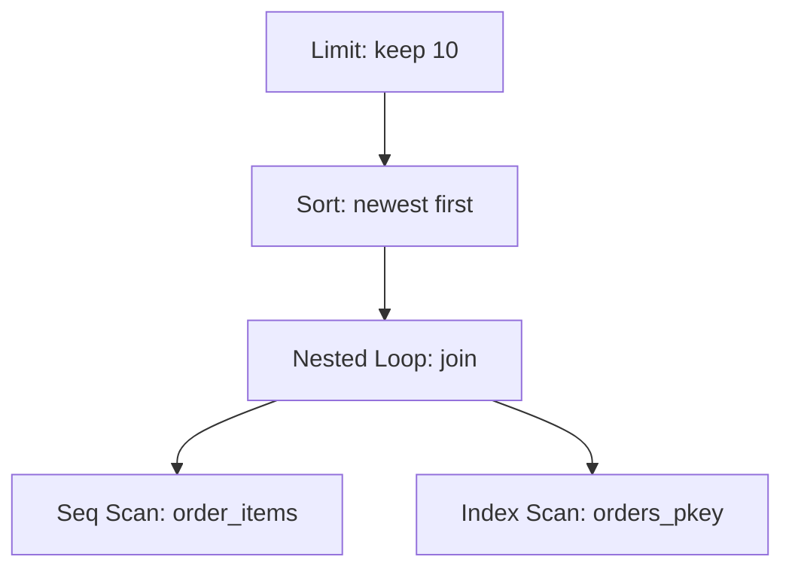

## In one line
`EXPLAIN` shows the step-by-step plan the database chose for your query, and `EXPLAIN ANALYZE` also runs it and reports the real time and row count of every step, so you can see exactly where a slow query spends its time.

## The problem it solves
Every product page in the shop shows "Recently bought": the 10 newest orders that contain this product. The query works, but it takes about 100 ms when its data isn't already in memory, and it runs on every product page view.

Without a way to look inside, people guess: "add Redis", "get a bigger server". Each guess costs days and may miss the real cause. `EXPLAIN ANALYZE` replaces guessing with evidence. Here it shows the database reading 2 million rows to find about 2,000, and which step is responsible.

## Everyday analogy
A satnav. Before you leave, it shows the planned route with estimated times per leg: that's `EXPLAIN`. Drive it with a trip recorder running, and you get the real time per leg: that's `EXPLAIN ANALYZE`. Comparing the two shows where the plan went wrong ("the estimate said 2 minutes on the ring road, it took 25").

Where it breaks down: a satnav preview never moves the car. `EXPLAIN ANALYZE` really executes the query, so an `UPDATE` or `DELETE` really changes data unless you roll it back.

## How it works
The **query planner** is the part of the database that decides *how* to run your SQL: which table to read first, whether to use an **index** (a sorted lookup structure, see [Indexes](#/topic/indexes)), and how to combine tables. It picks the cheapest option using **statistics**: summaries of each column's data, such as how many distinct values it has, collected by the `ANALYZE` command.

The plan is a **tree of nodes**. Each node is one step, such as "scan this table" or "sort these rows". The most indented nodes run first and pass their rows up to their parent, until the top node returns the result.

**How to read one line:**

```text
Seq Scan on users  (cost=0.00..2522.00 rows=500 width=18) (actual time=0.907..28.475 rows=1 loops=1)
```

- `cost=0.00..2522.00`: the planner's **estimate**, in made-up units (not milliseconds). The first number is the cost before the first row comes out, the second is the total. Use it only to compare plans.
- `rows=500 width=18`: estimated rows out of this step, and their average size in bytes.
- `actual time=0.907..28.475`: real milliseconds to the first row and to the last row (only with `ANALYZE`).
- `rows=1`: real rows out. Here the estimate (500) was far off.
- `loops=1`: how many times this step ran. Times and rows are **per loop**, so multiply by `loops` for the total.

**The node types you'll see most:**

| Node | What it does | Good or bad? |
|---|---|---|
| Seq Scan | Reads every row of the table | Fine for small tables or most rows; a warning sign for a few rows from a big table |
| Index Scan | Walks the index, fetches each matching row | Good for a few rows |
| Index Only Scan | Answers from the index alone | Best case |
| Bitmap Index Scan + Bitmap Heap Scan | Collects all matching row locations from the index, then reads each needed table page once, in page order | Good for hundreds to thousands of rows |
| Nested Loop | For each row on one side, look up matches on the other | Great when one side is small and the other is indexed |
| Hash Join | Builds an in-memory lookup table from one side, then probes it with the other | Good for joining large sets |
| Sort, Limit, Aggregate | Order, cut off, or summarise rows | Watch for sorts that spill to disk |
| Gather / Gather Merge | Combines results from parallel worker processes | Means the work was split across CPU cores |

**The reading checklist:**

1. **Find the slowest node.** A node's time includes its children, so look for the deepest node where the time jumps.
2. **Compare estimated and actual rows.** If they differ by 10 times or more, the planner chose with bad information. Run `ANALYZE` on the table and check again.
3. **Look for `Rows Removed by Filter`.** Millions removed to keep a few usually means a missing or unusable index.
4. **Multiply by `loops`.** 0.05 ms looks harmless until it runs 2,080 times.
5. **Check `Buffers`.** With the `BUFFERS` option (automatic from PostgreSQL 18), `shared hit` counts 8 kB pages found in PostgreSQL's memory and `read` counts pages fetched from the operating system or disk.


*Notice: execution starts at the bottom. Rows flow upward, and the slow step here is the scan at the bottom left.*

## Real example
**Setup:** the schema from [Relational modeling](#/topic/relational-modeling) in PostgreSQL 17 (Docker), with 1 million generated orders and 2 million `order_items`. The output is real output from that run, trimmed (parallel worker lines and planning details removed). Your timings will differ.

**1. Ask the database what it's doing:**

```sql
EXPLAIN (ANALYZE, BUFFERS)
SELECT o.id, o.user_id, o.created_at
FROM order_items oi
JOIN orders o ON o.id = oi.order_id
WHERE oi.product_id = 42
ORDER BY o.created_at DESC
LIMIT 10;
```

```text
Limit  (cost=29906.96..29908.12 rows=10 width=24) (actual time=98.840..100.430 rows=10 loops=1)
  Buffers: shared hit=5092 read=15977
  ->  Gather Merge  (...) (actual time=98.838..100.426 rows=10 loops=1)
        ->  Sort  (...) (actual time=96.288..96.289 rows=8 loops=3)
              Sort Key: o.created_at DESC
              Sort Method: top-N heapsort  Memory: 26kB
              ->  Nested Loop  (...) (actual time=0.428..95.932 rows=693 loops=3)
                    ->  Parallel Seq Scan on order_items oi  (cost=0.00..23140.69 rows=830 width=8) (actual time=0.304..60.480 rows=693 loops=3)
                          Filter: (product_id = 42)
                          Rows Removed by Filter: 665527
                          Buffers: shared hit=64 read=12667
                    ->  Index Scan using orders_pkey on orders o  (...) (actual time=0.050..0.050 rows=1 loops=2080)
                          Index Cond: (id = oi.order_id)
Execution Time: 100.484 ms
```

**2. Read it from the bottom up.**

- **Parallel Seq Scan on order_items.** Three processes (`loops=3`: two workers plus the main one) each read a third of the table. Each kept 693 rows and threw away 665,527. In total: about 2 million rows read to find 2,080. This step alone took about 60 ms and read 12,667 pages from outside PostgreSQL's memory. **This is the problem.**
- **Index Scan using orders_pkey.** For each of the 2,080 items, look up its order by primary key: `loops=2080` at 0.05 ms each. That adds up to about 35 ms per process, mostly because those pages weren't in memory yet. Worth noting, but the scan is the bigger cost.
- **Nested Loop** joins them. **Sort** keeps only the newest 10 with a "top-N heapsort", using 26 kB of memory. Fine.

Why no index? `order_items` has a primary key on `(order_id, product_id)`. That index is sorted by `order_id` first, so it can't find rows by `product_id` alone (the leftmost prefix rule).

**3. Fix it and measure again:**

```sql
CREATE INDEX CONCURRENTLY order_items_product_id_idx ON order_items (product_id);
```

```text
->  Parallel Bitmap Heap Scan on order_items oi  (...) (actual time=0.238..8.367 rows=1040 loops=2)
      Recheck Cond: (product_id = 42)
      Buffers: shared hit=62 read=1864
      ->  Bitmap Index Scan on order_items_product_id_idx  (...) (actual time=0.243..0.243 rows=2080 loops=1)
            Index Cond: (product_id = 42)
Execution Time: 13.597 ms
```

No more `Rows Removed by Filter`. Pages read from outside memory fell from 15,977 to 1,864, and the query went from about 100 ms to about 14 ms. Run again with everything cached, it was 25 ms before and 4 ms after.

**4. Explaining a write safely.** `EXPLAIN ANALYZE` executes the statement, so wrap writes in a transaction and undo them:

```sql
BEGIN;
EXPLAIN ANALYZE UPDATE orders SET status = 'cancelled' WHERE user_id = 981;
ROLLBACK;  -- the update ran for real, and is now undone
```

## How to say it in an interview

> [!INTERVIEW]
> **30 seconds:** "When a query is slow, I run EXPLAIN ANALYZE on it. EXPLAIN shows the plan the database chose, as a tree of steps like scans, joins, and sorts. ANALYZE actually runs it and shows the real time and row count for each step. I read it from the bottom up, find the step where the time goes, and look for a sequential scan that removes most of the rows, or estimates that are far off from the actual rows. Then I fix that, usually with an index, and run it again to prove it helped."

> [!INTERVIEW]
> **2 minutes:** Start with the 30-second answer, then add:
>
> "For example, a 'recently bought' widget on product pages took about 100 ms. The plan showed a parallel sequential scan over 2 million order_items rows to find 2,080 for one product. There was a composite primary key on order_id and product_id, but product_id was the second column, so it couldn't be used. An index on product_id turned that into a bitmap index scan and brought it to about 14 ms.
>
> I also compare estimated and actual rows. If the planner expects 500 rows and gets 1, it may pick the wrong scan or join, so I make sure statistics are fresh with ANALYZE.
>
> The caveats: it really executes the query, so I wrap writes in a transaction and roll back, and I test with realistic parameters on production-sized data. To find which queries to look at in the first place, I use pg_stat_statements."

## Follow-up questions interviewers ask

<details>
<summary>The plan estimates rows=500 but actually returns 1. Why, and does it matter?</summary>

The planner had no good statistics for that condition. A real example from the test data: `WHERE lower(email) = 'user981@example.com'` was estimated at 500 rows, because PostgreSQL keeps statistics on `email` but not on `lower(email)`, so it falls back to a default guess.

It matters because estimates drive choices: scan or index, nested loop or hash join. Fixes: run `ANALYZE`, create an expression index on `lower(email)` (which also gives the planner statistics for it after the next `ANALYZE`), or raise the statistics target for skewed columns.

</details>

<details>
<summary>What is a bitmap scan, and why not a normal index scan?</summary>

A plain index scan jumps to the table once per matching row, in index order, which can hit the same page many times in random order. A bitmap scan first collects every matching row location from the index, sorts them by table page, and then reads each needed page once. It suits the middle ground: too many rows for one-by-one lookups, too few for a full scan. `Recheck Cond` appears because, when memory is tight, the bitmap may remember whole pages rather than exact rows, so each row is checked again.

</details>

<details>
<summary>How do you find which query is slow in the first place?</summary>

- **pg_stat_statements**, a PostgreSQL extension that records total and average time per query shape. Sort by total time to find what costs the most overall:

```sql
SELECT calls, round(mean_exec_time::numeric, 2) AS avg_ms,
       round(total_exec_time::numeric) AS total_ms, left(query, 60) AS query
FROM pg_stat_statements
ORDER BY total_exec_time DESC
LIMIT 10;
```

It must be listed in `shared_preload_libraries` and created with `CREATE EXTENSION pg_stat_statements`.

- **The slow query log:** `log_min_duration_statement = 500` logs every query that takes over 500 ms.
- **Tracing tools**, which show which endpoint ran which queries. A slow page is often many fast queries, not one slow one. See [The N+1 query problem](#/topic/n-plus-one).

</details>

<details>
<summary>Nested loop vs hash join: when does the planner pick each?</summary>

**Nested loop** when one side is small and the other has an index on the join column, like the 2,080 order lookups above. **Hash join** when both sides are large: build an in-memory lookup of the smaller side once, then stream the bigger side through it. A nested loop over two large unindexed inputs is a classic slow plan, often caused by bad row estimates.

</details>

## Common mistakes and misconceptions

> [!MISTAKE]
> Running `EXPLAIN ANALYZE DELETE ...` on production "just to see the plan". It deletes the rows. Use plain `EXPLAIN`, or wrap it in `BEGIN` ... `ROLLBACK`.

> [!MISTAKE]
> Ignoring `loops`. A node showing 0.05 ms with `loops=2080` is about 100 ms of work in total.

> [!MISTAKE]
> "There's a Seq Scan, so it's bad." For small tables, or queries that need most of the rows, a sequential scan is the fastest plan. It's only a red flag when it removes almost every row it reads.

## Tradeoffs: when NOT to use it
- **It runs the query.** A query that takes 10 minutes takes 10 minutes to explain. Start with plain `EXPLAIN` for those.
- **It measures one execution, on one dataset.** A user with 11 orders and one with 50,000 can get different plans, a cold cache is slower than a warm one, and a dev database with 100 rows hides problems entirely. Test realistic values on production-sized data.
- **It only sees the database.** If the slowness is in your Node.js code, the network, or 50 separate queries per request, the plan of any single query will look fine. Measure the whole request first. See [Finding performance bottlenecks](#/topic/performance-bottlenecks).

## Check yourself

<details>
<summary>1. A node shows actual time=0.002..0.002 rows=1 loops=50000. Is it cheap?</summary>

No. Times and rows are per loop. 0.002 ms × 50,000 loops is about 100 ms, and it returned 50,000 rows in total. Something above it is calling it once per row, usually a nested loop.

</details>

<details>
<summary>2. You see Seq Scan with Rows Removed by Filter: 999,989 and rows=11. What does that suggest?</summary>

The database read the whole table to keep 11 rows. A suitable index on the filtered column would let it jump straight to those rows. Check that the condition can use an index (no function wrapped around the column, right column order).

</details>

<details>
<summary>3. What is the difference between EXPLAIN and EXPLAIN ANALYZE?</summary>

`EXPLAIN` shows the planned steps with estimates only, without running anything. `EXPLAIN ANALYZE` executes the query and adds real times, real row counts, and loop counts for each step.

</details>

## Go deeper
- [PostgreSQL docs: using EXPLAIN](https://www.postgresql.org/docs/current/using-explain.html)
- [PostgreSQL docs: EXPLAIN command reference](https://www.postgresql.org/docs/current/sql-explain.html)
- [PostgreSQL docs: statistics used by the planner](https://www.postgresql.org/docs/current/planner-stats.html)
