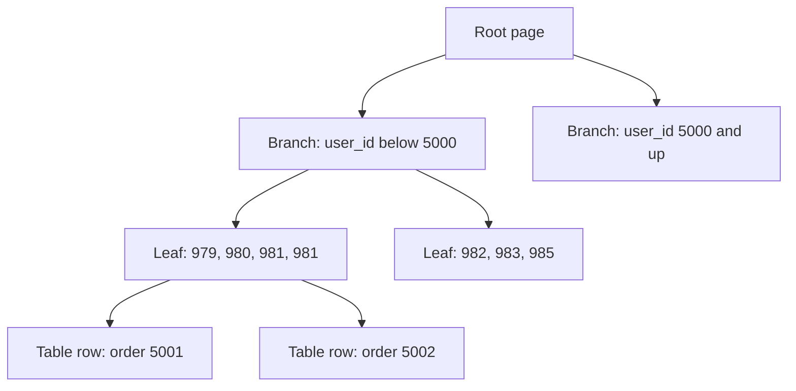

## In one line
An index is a separate, sorted copy of one or more columns (usually a B-tree) that lets the database jump straight to the matching rows instead of reading the whole table, at the cost of extra disk space and slower writes.

## The problem it solves
The "My orders" page runs this query for user 981:

```sql
SELECT id, status, created_at FROM orders
WHERE user_id = 981 ORDER BY created_at DESC LIMIT 20;
```

The `orders` table has 1 million rows. PostgreSQL stores a table as a pile of fixed-size blocks called **pages** (8 kB each), with rows in no useful order. This table fills 7,766 pages. Without an index, the only way to find user 981's orders is a **sequential scan**: read every page and check every row. In a test run, that meant reading about 61 MB and throwing away 999,989 rows to return 11.

It took 13 ms with the data already in memory, and 44 ms when it wasn't. That sounds small, but it grows with the table, and a hundred users opening the page at once means a hundred full scans fighting for the same disk and CPU.

## Everyday analogy
The index at the back of a textbook. Terms are sorted alphabetically, and each points to page numbers. You find "replication" in seconds, then turn straight to page 212, instead of reading the whole book.

Where it breaks down: a book's index is written once. A database index must be updated on every insert, update, and delete, and the database may decide that reading the whole "book" is faster after all.

## How it works
Two terms first:

- **Selectivity** is how few rows a condition matches. `user_id = 981` (11 of 1 million rows) is highly selective. `status = 'paid'` (one in five rows) is not.
- The **query planner** is the part of the database that decides *how* to run a query: scan the table, use an index, which join method. It estimates the cost of each option from statistics about the data.

**The B-tree.** Almost every index you create is a **B-tree** (balanced tree). It is built from the same 8 kB pages, arranged in levels:

- **Leaf pages** (bottom level) hold every indexed value in sorted order, each with a pointer to its row in the table. Each leaf also links to its neighbour, so you can walk along them in order.
- **Branch pages** (middle levels) hold signposts: "values below 5000 are in that page, values from 5000 are in this one".
- The **root page** (top) is where every search starts.

To find `user_id = 981`:

1. Read the root page. Follow the signpost whose range contains 981.
2. Read that branch page. Follow the next signpost down.
3. Reach the leaf page. Find the entries for 981. They sit next to each other because leaves are sorted.
4. Follow each entry's pointer to fetch the actual row from the table.


*Notice: a lookup walks one path from root to leaf, reading a handful of pages, then fetches only the matching rows from the table.*

**Why it's so fast: O(log n).** Each page holds hundreds of entries, so each level multiplies the reach by hundreds. In the test database, the index on 1 million orders had exactly three levels: 1 root page, 19 branch pages, and 3,832 leaf pages holding about 260 entries each. Finding user 981 meant reading 3 index pages plus 1 table page per match, instead of 7,766 pages. Growing the table 100 times would typically add only one more level. That is what **O(log n)** means: the work grows with the *number of levels*, not the number of rows.

**Sorted order is a bonus.** Because leaves are sorted and linked, the same index also serves ranges (`created_at > '2026-10-01'`) and `ORDER BY` without a separate sort step.

**Composite indexes and column order.** An index on several columns, such as `(user_id, created_at)`, is sorted by `user_id` first, then by `created_at` *within* each user, like a phone book sorted by surname, then first name. So it helps:

- `WHERE user_id = 981` (the leading column),
- `WHERE user_id = 981 AND created_at > '2026-10-01'`,
- `WHERE user_id = 981 ORDER BY created_at DESC`.

It does not help much with `WHERE created_at > '2026-10-01'` alone, just as a phone book can't quickly list everyone named "Asha". This is the **leftmost prefix rule**. The usual order: columns compared with `=` first, then the range or sort column. (PostgreSQL 18 added "skip scan", which can still use such an index when the leading column has only a few distinct values.)

**Covering indexes.** If every column the query needs is inside the index, PostgreSQL can answer from the index alone and skip the table. This is an **index-only scan**. `INCLUDE` adds extra columns to the leaf pages without making them part of the sort order.

**Other index types:** **GIN** for "contains" searches in `jsonb`, arrays, and full-text; **GiST** for geometry and ranges; **BRIN** for huge time-ordered tables like logs; **Hash** for equality only.

**The costs.** Every index is a second structure to maintain:

- **Writes get slower.** Each insert must also add an entry to every index on the table, and updates to indexed columns move entries around.
- **Disk and memory.** The `(user_id, created_at)` index on 1 million orders took 30 MB, about half the size of the table itself, and it competes with table data for space in memory.

## Real example
**Setup:** the `orders` table from [Relational modeling](#/topic/relational-modeling), *without* its `orders_user_id_idx` index, filled with 1 million generated rows in PostgreSQL 17 in Docker. The output below is real output from that run, trimmed to the lines that matter. Your timings will differ.

**1. Before: a sequential scan.** `EXPLAIN ANALYZE` runs the query and shows how the database did it. See [Reading a slow query with EXPLAIN](#/topic/explain-analyze).

```text
EXPLAIN ANALYZE SELECT id, status, created_at FROM orders
WHERE user_id = 981 ORDER BY created_at DESC LIMIT 20;

 ->  Parallel Seq Scan on orders  (actual time=3.571..10.077 rows=4 loops=3)
       Filter: (user_id = 981)
       Rows Removed by Filter: 333330
 Execution Time: 13.345 ms
```

Three processes shared the work (`loops=3`), each discarding a third of the table.

**2. Add the index.** On a live production table, add `CONCURRENTLY` so writes are not blocked while it builds:

```sql
CREATE INDEX CONCURRENTLY orders_user_id_created_at_idx
  ON orders (user_id, created_at DESC);
```

```text
 ->  Bitmap Index Scan on orders_user_id_created_at_idx  (actual time=0.004..0.004 rows=11 loops=1)
       Index Cond: (user_id = 981)
 Execution Time: 0.026 ms
```

From about 13 ms to about 0.03 ms on the same warm data, because the database read a few pages instead of all 7,766. This composite index also covers every query the single-column `(user_id)` index served, so you'd keep only one of them.

**3. The leftmost prefix rule, live.** A query on `created_at` alone ignores the new index and scans the whole table again:

```text
EXPLAIN ANALYZE SELECT count(*) FROM orders WHERE created_at > now() - interval '1 day';
 ->  Parallel Seq Scan on orders  (actual time=0.091..29.210 rows=428 loops=3)
       Filter: (created_at > (now() - '1 day'::interval))
       Rows Removed by Filter: 332905
```

**4. The write cost, measured.** Copying 300,000 orders into a table with only a primary key took 219 ms. Into an identical table with three extra indexes, it took 955 ms. Roughly four times slower, for every bulk write.

**5. Find indexes nobody uses**, so you can drop them:

```sql
SELECT relname AS table_name, indexrelname AS index_name, idx_scan,
       pg_size_pretty(pg_relation_size(indexrelid)) AS size
FROM pg_stat_user_indexes
WHERE idx_scan = 0                     -- never used since stats were last reset
ORDER BY pg_relation_size(indexrelid) DESC;
```

Check replicas too before dropping anything, and keep indexes that enforce `UNIQUE` or primary keys even if they show zero scans.

## How to say it in an interview

> [!INTERVIEW]
> **30 seconds:** "An index is a sorted structure, usually a B-tree, that lets the database find rows without scanning the whole table. The tree has a root, branch pages, and sorted leaf pages that point to the rows, so a lookup reads only three or four pages even with millions of rows. I add indexes for columns I filter, join, or sort on, like orders.user_id. The tradeoff is that every index takes disk space and slows down inserts and updates, so I only add ones that real queries need."

> [!INTERVIEW]
> **2 minutes:** Start with the 30-second answer, then add:
>
> "For a 'My orders' page I'd use a composite index on user_id and created_at. Column order matters: the index is sorted by user_id first, so it serves 'this user's orders, newest first' directly, but it won't help a query on created_at alone. I put equality columns first and the range or sort column last.
>
> Indexes don't help low-selectivity filters. An index on status, where one value matches a fifth of the table, often ends up touching every page anyway, so the planner may prefer a sequential scan. And wrapping a column in a function, like lower(email), stops a plain index from being used unless I create an expression index.
>
> The tradeoff is reads versus writes. On a write-heavy table, like video view events, each extra index adds work to every insert, so I'd keep indexes minimal there. I always confirm with EXPLAIN ANALYZE before and after, I create indexes CONCURRENTLY in production so writes aren't blocked, and I check pg_stat_user_indexes for unused ones."

## Follow-up questions interviewers ask

<details>
<summary>Why not just index every column?</summary>

Because each index slows every write to that table, uses disk and memory, and many would never be used. In the test above, three extra indexes made bulk inserts about four times slower. Single-column indexes on everything also rarely match real queries, which usually need composite indexes. Index for the queries you actually run.

</details>

<details>
<summary>I added an index, but EXPLAIN shows a sequential scan. Why?</summary>

Common reasons:

- **Low selectivity.** In the test data, `status = 'paid'` matches 200,569 of 1 million rows. Even with an index, the plan touched all 7,766 table pages (`Heap Blocks: exact=7766`) and ran slightly slower than a plain scan.
- **A function on the column.** `WHERE lower(email) = '...'` can't use an index on `email`. Create one on `lower(email)` instead.
- **Wrong column order** in a composite index (leftmost prefix rule).
- **A leading wildcard.** `LIKE '%mug'` can't use a B-tree, because the start of the value is unknown.
- **Small table, or stale statistics.** For a few hundred rows a scan really is cheaper. Run `ANALYZE` if estimates look wrong.

</details>

<details>
<summary>What is a covering index, and when does an index-only scan happen?</summary>

An index that contains every column the query reads. For example:

```sql
CREATE INDEX ON orders (user_id, created_at DESC) INCLUDE (status);
```

`SELECT created_at, status FROM orders WHERE user_id = 981` can then be answered from the index alone. In the test, the plan showed `Index Only Scan ... Heap Fetches: 0` and touched 5 pages instead of 17. It only skips the table for pages that **VACUUM** (PostgreSQL's cleanup process) has marked as "all visible", so very recently changed rows still need a table check.

</details>

<details>
<summary>What is a partial index?</summary>

An index over only the rows matching a condition. If the admin page only ever lists videos still processing:

```sql
CREATE INDEX videos_processing_idx ON videos (created_at) WHERE status = 'processing';
```

It's small because it ignores finished videos, and cheap to maintain. Queries must include the same condition to use it.

</details>

<details>
<summary>B-tree vs hash index?</summary>

A hash index only answers "equals". A B-tree answers equals, ranges (`<`, `>`, `BETWEEN`), and sorting. In PostgreSQL, B-tree is the default and the right choice almost always.

</details>

## Common mistakes and misconceptions

> [!MISTAKE]
> "PostgreSQL indexes foreign keys automatically." It doesn't. Primary keys and `UNIQUE` columns get an index, but `orders.user_id` does not. Add one when you filter or join on it, or when parent rows get deleted.

> [!MISTAKE]
> Creating separate indexes on `user_id` and `created_at` and expecting them to work like one composite index. PostgreSQL can sometimes combine two indexes, but a single `(user_id, created_at)` index answers "this user's newest orders" far more directly.

> [!MISTAKE]
> Running a plain `CREATE INDEX` on a large, busy production table. It blocks inserts, updates, and deletes on that table until it finishes. Use `CREATE INDEX CONCURRENTLY`, which is slower but lets writes continue.

## Tradeoffs: when NOT to use it
- **Low-selectivity columns on their own**, like a boolean or a status with a handful of values. Use a partial index or a composite instead.
- **Write-heavy tables read in bulk**, like event logs or video view counts. Every index slows each insert. Keep only what queries need, or consider BRIN for time-ordered data.
- **Small tables.** A few thousand rows fit in a few pages, and a scan is already instant.

## Check yourself

<details>
<summary>1. You have an index on (user_id, created_at). Which of these can use it well: (a) WHERE user_id = 981, (b) WHERE created_at > '2026-10-01', (c) WHERE user_id = 981 ORDER BY created_at DESC?</summary>

(a) and (c). Both start with the leading column `user_id`. (b) skips the leading column, so a B-tree sorted by user first can't jump to it (PostgreSQL 18's skip scan helps only when `user_id` has few distinct values).

</details>

<details>
<summary>2. Why does a B-tree lookup stay fast as the table grows from 1 million to 100 million rows?</summary>

Each page holds hundreds of entries, so each extra level multiplies capacity by hundreds. Going from 1 million to 100 million rows typically adds about one level, so a lookup reads one more page.

</details>

<details>
<summary>3. Name two costs of adding an index.</summary>

Slower writes (every insert, and every update to an indexed column, must also update the index) and extra disk and memory use. A third: more for the planner to consider and more for you to maintain.

</details>

## Go deeper
- [PostgreSQL docs: indexes](https://www.postgresql.org/docs/current/indexes.html)
- [PostgreSQL docs: multicolumn indexes](https://www.postgresql.org/docs/current/indexes-multicolumn.html)
- [Use The Index, Luke: anatomy of an index (Markus Winand)](https://use-the-index-luke.com/sql/anatomy)
