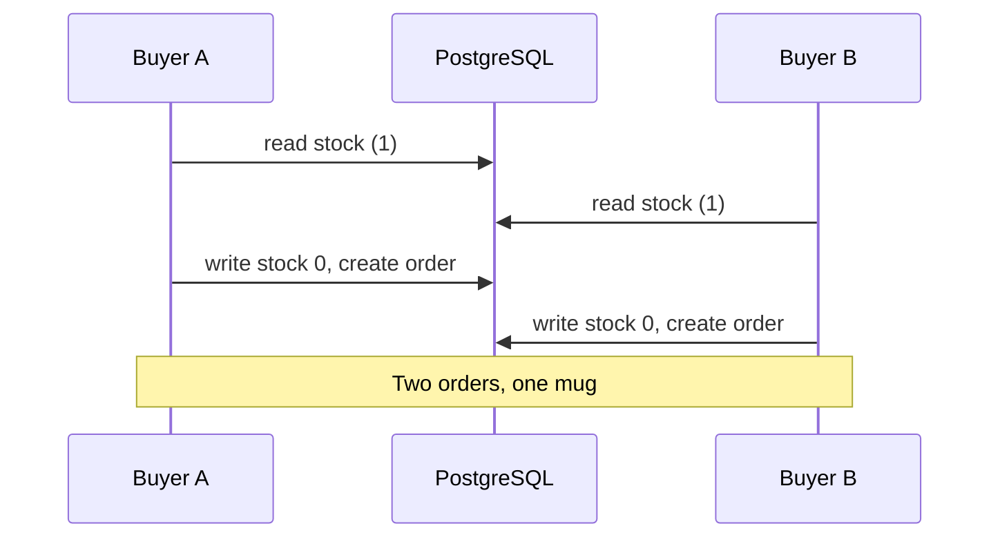

## In one line
An isolation level decides how much transactions running at the same time can see of each other's changes: weaker levels are cheaper but allow race conditions like two buyers getting the last item, and stronger levels prevent them by making one transaction fail and retry.

## The problem it solves
Product 42, the ceramic mug, has 1 left in stock. Two customers press "Buy" within the same few milliseconds. Each request runs this logic in its own transaction:

1. Read the stock: 1.
2. Check it's at least 1: yes.
3. Write the new stock: 0. Create the order.

Both requests read 1 before either writes. Both pass the check. Both write 0 and create an order. You have sold two mugs and own one.

This is a **race condition**: the result depends on the exact timing of two overlapping operations. It never shows up when you test alone, only during a sale when many people want the same thing. And wrapping the code in a transaction did not help, which surprises many developers.

## Everyday analogy
Two cashiers in different branches both check the same printed stock sheet at 9:00. It says "1 mug left". Both sell it. The sheet was correct when each of them read it. The problem is that neither knew the other was about to act on it.

Where it breaks down: cashiers can't see each other, but a database can. It can make the second cashier wait (a lock), or notice the conflict afterwards and cancel one sale (a serialization error).

## How it works
**Background: snapshots.** PostgreSQL uses **MVCC** (multi-version concurrency control). An update writes a new *version* of the row instead of overwriting it. Each statement or transaction reads from a **snapshot**: the set of row versions that were committed at a certain moment. This is why readers never wait for writers. The isolation level controls *when* the snapshot is taken and what extra checks run.

**The anomalies.** These are the specific things that can go wrong when transactions overlap. Interviewers expect you to name them:

1. **Dirty read.** You read another transaction's change before it commits. If it rolls back, you acted on data that never existed.
2. **Non-repeatable read.** You read the mug's price twice in one transaction and get 1299, then 1499, because another transaction committed a change in between.
3. **Phantom read.** You run "orders for user 981 today" twice and a new row appears the second time, because another transaction inserted one that matches.
4. **Lost update.** Two transactions read the same value, both compute a new value from it, and the second write silently overwrites the first. The mug story above.
5. **Write skew.** Two transactions read the same data, then each writes something *different* based on it. Each is fine alone; together they break a rule. Example: two browser tabs each check "has user 981 used the WELCOME10 coupon?", both see no, and both insert a redemption.

**The levels in PostgreSQL**, from weakest to strongest:

| Level | Dirty read | Non-repeatable read | Phantom read | Lost update | Write skew |
|---|---|---|---|---|---|
| Read committed (default) | No | Possible | Possible | Possible | Possible |
| Repeatable read | No | No | No | No (one fails) | Possible |
| Serializable | No | No | No | No (one fails) | No (one fails) |

How each one works:

- **Read committed** takes a new snapshot for *every statement*. You only see committed data, but two statements in the same transaction can see different data. Row locks still apply: if two transactions update the same row, the second waits for the first to finish, then re-checks its `WHERE` condition against the new version.
- **Repeatable read** takes one snapshot at the *first statement* and uses it for the whole transaction. If you try to update a row that someone else changed after your snapshot, PostgreSQL aborts you with "could not serialize access due to concurrent update".
- **Serializable** adds tracking of who read what and who wrote what (called **SSI**, serializable snapshot isolation). If the overlapping transactions could not have produced this result when run one after another, it aborts one of them. The result always equals *some* one-at-a-time order.

> [!NOTE]
> The SQL standard also defines **read uncommitted**, which allows dirty reads. PostgreSQL accepts the name but behaves like read committed, so dirty reads never happen there. The standard also allows phantoms at repeatable read; PostgreSQL's snapshot-based version prevents them. MySQL's InnoDB engine defaults to repeatable read, and its rules differ again, so always check your database's docs.

Both stronger levels fail with error code `40001` (a **serialization failure**). That's not a bug. It's the database saying "retry this transaction", and your code must be ready to do so.


*Notice: neither write is wrong on its own. The bug is that both decisions were based on the same old read.*

## Real example
**Setup:** the schema from [Relational modeling](#/topic/relational-modeling), PostgreSQL 17, mug stock reset to 1 before each run. `npm install pg`, `"type": "module"`. The pause stands in for the few milliseconds of real work between read and write.

```js
import pg from 'pg';
const pool = new pg.Pool({ connectionString: process.env.DATABASE_URL });
const sleep = (ms) => new Promise((r) => setTimeout(r, ms));

// BUGGY: read the stock, decide in JavaScript, write the result back.
async function buyMug(userId) {
  const client = await pool.connect();
  try {
    await client.query('BEGIN'); // default level: READ COMMITTED
    const { rows } = await client.query('SELECT stock FROM products WHERE id = 42');
    if (rows[0].stock < 1) throw new Error('Out of stock');
    await sleep(50); // the gap where another request sneaks in
    await client.query('UPDATE products SET stock = $1 WHERE id = 42', [rows[0].stock - 1]);
    await client.query('INSERT INTO orders (user_id) VALUES ($1)', [userId]);
    await client.query('COMMIT');
    return 'bought';
  } catch (err) {
    await client.query('ROLLBACK');
    return `${err.message} [${err.code ?? 'app'}]`;
  } finally {
    client.release();
  }
}

console.log(await Promise.all([buyMug(981), buyMug(982)]));
```

Real results from running both buyers at once. For the other rows, only the `BEGIN` line changed (to `BEGIN ISOLATION LEVEL REPEATABLE READ` or `SERIALIZABLE`), or `FOR UPDATE` was added to the `SELECT`:

| Run | Buyer 981 | Buyer 982 | Orders |
|---|---|---|---|
| As written (read committed) | bought | bought | **2 (oversold)** |
| Repeatable read | bought | error 40001: could not serialize access | 1 |
| Serializable | bought | error 40001 | 1 |
| Read committed + `FOR UPDATE` | bought | Out of stock | 1 |

**The fixes, from simplest to most general:**

1. **Make it one atomic statement.** Let the database check and change in one step:
   ```sql
   UPDATE products SET stock = stock - 1 WHERE id = 42 AND stock >= 1 RETURNING stock;
   ```
   In the same test, the second buyer's update waited for the first to commit, re-checked `stock >= 1`, and matched 0 rows. Zero rows means "sold out". Best for counters and stock.
2. **Lock the row you read: `SELECT ... FOR UPDATE`.** The second transaction waits at the `SELECT` until the first commits, then reads the new stock. Use it when the decision needs logic in your code.
3. **Optimistic locking.** Add a `version` column. Update with `WHERE id = 42 AND version = 7` and set `version = version + 1`. If 0 rows change, someone else got there first: reload and retry, or show a conflict. Good for edit forms where conflicts are rare.
4. **A constraint for "only once" rules.** `UNIQUE (user_id, code)` on coupon redemptions makes the second insert wait for the first, then fail with a duplicate key error (`23505`), at any isolation level. `INSERT ... ON CONFLICT DO NOTHING` turns that into a quiet no-op.
5. **Serializable plus a retry loop**, for complex rules that no single constraint or lock covers. In a test of the coupon example, both tabs succeeded at read committed and at repeatable read (write skew), and one failed with `40001` at serializable.

## How to say it in an interview

> [!INTERVIEW]
> **30 seconds:** "Isolation levels control what concurrent transactions can see of each other. The anomalies are dirty reads, non-repeatable reads, phantoms, lost updates, and write skew. PostgreSQL defaults to read committed, which prevents dirty reads but still allows lost updates, so two requests can both read stock 1 and both sell the last item. I fix that with an atomic UPDATE with a WHERE condition, a SELECT FOR UPDATE lock, or a stricter level like serializable, where the database aborts one transaction and I retry it."

> [!INTERVIEW]
> **2 minutes:** Start with the 30-second answer, then add:
>
> "Under the hood, PostgreSQL uses MVCC. At read committed each statement gets a fresh snapshot; at repeatable read the whole transaction uses one snapshot, and updating a row someone else changed fails with a serialization error. Serializable adds tracking of read and write dependencies, so even write skew is caught, like two tabs both redeeming a one-time coupon.
>
> In practice I don't raise the isolation level for everything. For stock I use `UPDATE ... SET stock = stock - 1 WHERE stock >= 1`, which is atomic at the default level. For 'only once' rules I use a unique constraint. I use FOR UPDATE when I need to read and decide in code, and keep that transaction short because others wait on the lock.
>
> The tradeoff is correctness versus throughput and complexity. Stricter levels and locks make transactions wait or fail more under contention, so the app needs retry logic for error 40001, with a small backoff and a limit."

## Follow-up questions interviewers ask

<details>
<summary>What's the difference between pessimistic and optimistic locking?</summary>

- **Pessimistic:** assume conflicts will happen, so lock first (`SELECT ... FOR UPDATE`). Others wait. Good when conflicts are frequent, like a flash sale on one product.
- **Optimistic:** assume conflicts are rare, so don't lock. Check at write time with a `version` column, and retry or report a conflict if it changed. Good for things like two admins rarely editing the same product description.

</details>

<details>
<summary>How do you retry a serialization failure in Node.js?</summary>

Rerun the *whole* transaction, not just the failed statement, a few times with a short delay:

```js
async function withRetry(runTransaction, attempts = 3) {
  for (let i = 1; ; i++) {
    try {
      return await runTransaction();
    } catch (err) {
      const retryable = err.code === '40001' || err.code === '40P01'; // serialization, deadlock
      if (!retryable || i === attempts) throw err;
      await new Promise((r) => setTimeout(r, 20 * i)); // brief, growing backoff
    }
  }
}
```

The transaction must not have side effects outside the database (emails, payments), because they'd repeat on every retry.

</details>

<details>
<summary>What is a deadlock, and how does PostgreSQL handle it?</summary>

Transaction A locks row 1 and wants row 2. Transaction B locks row 2 and wants row 1. Both wait forever. PostgreSQL checks for this after a short wait (`deadlock_timeout`, 1 second by default), aborts one of them with error `40P01`, and the other continues. Prevent it by always locking rows in the same order, for example sorted by id.

</details>

<details>
<summary>Why not just make every transaction serializable?</summary>

You can, and some teams do. The costs: extra tracking overhead, more aborted transactions under contention, and every code path needs retry logic. Read-only reports may also fail and retry. Many apps get the same safety more cheaply with targeted fixes (atomic updates, constraints, row locks) and keep the default level.

</details>

## Common mistakes and misconceptions

> [!MISTAKE]
> "It's inside a transaction, so it's safe from races." At the default read committed level, a read-then-write in a transaction can still lose updates, as the test above showed.

> [!MISTAKE]
> Checking in code, then inserting: "if no redemption exists, insert one". Two requests can both pass the check. Let the database enforce it with a unique constraint.

> [!MISTAKE]
> Raising the isolation level without adding retry logic. Errors with code `40001` then reach users as 500 errors during busy periods.

> [!MISTAKE]
> Holding a `FOR UPDATE` lock while calling a slow external API. Every other buyer of that product waits behind it. Lock, update, commit, then call out.

## Tradeoffs: when NOT to use it
**When NOT to raise the isolation level:**
- The race is on a single row and fits in one atomic `UPDATE`. That's simpler and faster.
- The rule fits a constraint (`UNIQUE`, `CHECK`). The database enforces it at any level.
- High-contention hotspots, like one product in a flash sale. Serializable would abort most attempts; an atomic update or a queue that processes purchases one at a time works better.

**When NOT to use `FOR UPDATE` locks:** in long transactions or ones that wait on the network (locks turn into queues), and for rarely conflicting edits, where optimistic locking avoids waiting entirely.

## Check yourself

<details>
<summary>1. Two requests both read a video's like count as 100, add 1 in JavaScript, and write 101. Which anomaly is this, and what's the simplest fix?</summary>

A lost update. The simplest fix is an atomic statement: `UPDATE videos SET like_count = like_count + 1 WHERE id = 301`. The database applies both increments, giving 102.

</details>

<details>
<summary>2. What does PostgreSQL's default isolation level protect against, and what doesn't it?</summary>

Read committed prevents dirty reads. It does not prevent non-repeatable reads, phantoms, lost updates, or write skew.

</details>

<details>
<summary>3. Your transaction fails with error code 40001. What does it mean, and what should the app do?</summary>

A serialization failure: the database aborted this transaction because it conflicted with a concurrent one at repeatable read or serializable. The app should retry the whole transaction, a limited number of times, with a short backoff.

</details>

## Go deeper
- [PostgreSQL docs: transaction isolation](https://www.postgresql.org/docs/current/transaction-iso.html)
- [PostgreSQL docs: explicit locking (row locks, deadlocks)](https://www.postgresql.org/docs/current/explicit-locking.html)
- [PostgreSQL docs: introduction to MVCC](https://www.postgresql.org/docs/current/mvcc-intro.html)
