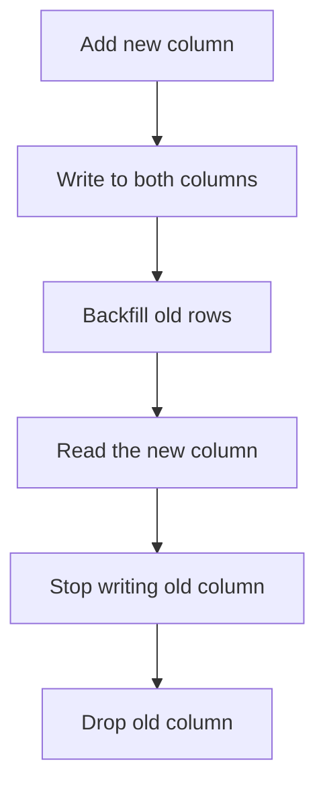

## In one line
A migration is a versioned script that changes the database's structure, and a zero-downtime migration is one done in small, backward-compatible steps so the running app never breaks.

## The problem it solves
Your app needs to rename `users.name` to `users.display_name`. The obvious way is one statement plus a deploy:

```sql
ALTER TABLE users RENAME COLUMN name TO display_name;
```

On a live system this breaks things:

- **Old code is still running.** In a **rolling deploy**, servers are updated one at a time, so for a minute or more some still run the old version. The moment the rename runs, every old server's `SELECT name FROM users` fails.
- **Rollback is broken.** If the new code has a bug and you roll back, the old code expects a column that no longer exists.
- **Locks can freeze the site.** Most `ALTER TABLE` statements need an exclusive **lock** on the table, a claim that stops other queries from using it until the change is done. One badly timed migration can stall every request touching `users`.

On top of that, every developer's laptop, the test database, staging, and production must end up with the same structure, in the same order. Migrations, plus a careful pattern for changing them, solve both problems.

## Everyday analogy
Renovating a shop's main entrance while it stays open. You don't brick up the old door on day one. You build the new door, put up signs pointing to it, wait until everyone uses it, and only then close the old one.

Where it breaks down: in a shop, people adapt by themselves. In software, old code never adapts. It keeps using the old door until it is redeployed, so you must keep both working until it is.

## How it works

### The migration system
1. Each change is a numbered or timestamped file, such as `20261026_add_display_name.sql`, committed to Git with the code that needs it.
2. The database has a **tracking table** listing which migrations have already run (Prisma calls it `_prisma_migrations`, Knex calls it `knex_migrations`).
3. A migration tool compares the files with the tracking table and runs the missing ones, in order.
4. PostgreSQL can run most structure changes inside a transaction, so a failing migration rolls back cleanly instead of leaving a half-changed schema.
5. A deploy pipeline runs pending migrations before or during deployment (see [CI/CD](#/topic/ci-cd)).

Popular Node.js tools: Prisma Migrate, drizzle-kit, Knex, and node-pg-migrate. All follow this pattern.

### Locks: why "a quick ALTER" can take the site down
Most `ALTER TABLE` forms take PostgreSQL's strongest lock, which blocks even plain reads. The change itself is often instant, but the danger is the queue:

1. A slow report has been reading `users` for 30 seconds.
2. Your migration asks for the exclusive lock and **waits** for the report.
3. Every new query on `users`, even a simple `SELECT`, now queues **behind your migration**.
4. Until the report finishes, the whole users table is frozen.

The fix: set a short `lock_timeout` in migrations. If the lock isn't granted quickly, the migration fails and you retry later, instead of freezing traffic.

### Expand and contract
The **expand and contract** pattern (also called parallel change) splits a breaking change into safe steps. Each step works with both the code before it and the code after it:

1. **Expand:** add the new column `display_name`, nullable. Old code ignores it.
2. **Dual write:** deploy code that writes to both `name` and `display_name`, and still reads `name`.
3. **Backfill:** copy old values into `display_name` in small batches.
4. **Switch reads:** deploy code that reads `display_name`.
5. **Stop old writes:** deploy code that no longer touches `name`.
6. **Contract:** drop the `name` column once nothing uses it.


*Notice: at every arrow, both the previous and the next version of the code still work.*

It takes several deploys instead of one, often spread over days. That is the price of never breaking a running system.

## Real example
**Setup:** PostgreSQL with the shop's `users` table, and Node.js 18+ with `npm install pg` for the backfill.

**Step 1, expand** (`20261026_01_add_display_name.sql`):

```sql
SET lock_timeout = '5s';      -- give up quickly rather than queue all traffic
ALTER TABLE users ADD COLUMN display_name text;  -- nullable, no default: instant
```

**Step 3, backfill in batches** (`backfill-display-name.js`), run after the dual-write code is live:

```js
import pg from 'pg';

const pool = new pg.Pool({ connectionString: process.env.DATABASE_URL });
const BATCH = 1000;

const { rows } = await pool.query('SELECT coalesce(max(id), 0) AS max_id FROM users');
const maxId = Number(rows[0].max_id);

for (let start = 0; start < maxId; start += BATCH) {
  // Small id ranges: each UPDATE is short and locks only a few rows
  const { rowCount } = await pool.query(
    `UPDATE users SET display_name = name
     WHERE id > $1 AND id <= $2 AND display_name IS NULL`,
    [start, start + BATCH]);
  console.log(`ids ${start + 1}-${start + BATCH}: ${rowCount} rows`);
  await new Promise((resolve) => setTimeout(resolve, 50)); // leave room for real traffic
}
await pool.end();
```

One giant `UPDATE users SET display_name = name` would lock every row for its whole run and create a huge burst of WAL (the database's change log) for replicas to replay.

**Make it required without a long lock**, once the backfill is done:

```sql
ALTER TABLE users ADD CONSTRAINT display_name_not_null
  CHECK (display_name IS NOT NULL) NOT VALID;        -- instant: checks new rows only
ALTER TABLE users VALIDATE CONSTRAINT display_name_not_null; -- scans, but allows reads and writes
ALTER TABLE users ALTER COLUMN display_name SET NOT NULL;    -- skips the scan: the check proves it
ALTER TABLE users DROP CONSTRAINT display_name_not_null;
```

**Indexes on big tables:**

```sql
CREATE INDEX CONCURRENTLY videos_user_id_idx ON videos (user_id);
```

`CONCURRENTLY` builds the index without blocking writes. It takes longer and cannot run inside a transaction, so many migration tools need a flag to run it outside one.

**Step 6, contract**, days later, after confirming nothing reads `name`:

```sql
ALTER TABLE users DROP COLUMN name;
```

## How to say it in an interview

> [!INTERVIEW]
> **30 seconds:** "Migrations are versioned scripts in the repo that change the schema, and a tool tracks which ones have run in each environment. For zero downtime I use expand and contract: add the new structure first, deploy code that works with both old and new, backfill in batches, switch reads over, and only remove the old structure once no running code uses it. And I set a lock timeout, so a migration can never freeze a busy table."

> [!INTERVIEW]
> **2 minutes:** Start with the 30-second answer, then add:
>
> "The core rule is that during a rolling deploy, old and new code run against the same database at the same time, so every schema change must be compatible with both. Renaming a column in one step breaks the old servers instantly, and breaks rollback too.
>
> For example, renaming `users.name` to `display_name` takes four or five deploys: add a nullable column, dual-write, backfill in batches of a thousand rows with a small pause, switch reads, then drop the old column a few days later.
>
> I also watch for operations that lock or rewrite large tables in PostgreSQL: changing a column's type, adding a `NOT NULL` that scans the whole table, or building an index without `CONCURRENTLY`. The tradeoff is speed: a change that could be one PR becomes a week of small steps. For a small table, or during a planned maintenance window, I'd do it in one step."

## Follow-up questions interviewers ask

<details>
<summary>Should you write down migrations for rollback?</summary>

Down migrations are useful in development. In production, most teams **roll forward**: they fix the problem with a new migration. A down migration that drops a column also drops any data written since the up migration ran. With expand and contract, rollback is mostly a code rollback, because the old structure still exists.

</details>

<details>
<summary>Should migrations run when the app starts?</summary>

Usually not. If ten instances start at once, they all try to migrate at the same time. A failed migration can also stop the app from starting at all. A safer approach is a separate step in the deploy pipeline that runs once, before the new code rolls out. Tools such as Prisma use a lock to stop parallel runs, but a single dedicated step is still clearer.

</details>

<details>
<summary>Which PostgreSQL changes are risky on a big table?</summary>

- Changing a column's type (usually rewrites the whole table).
- Adding a column with a volatile default such as `clock_timestamp()` (rewrite). A constant default is fast since PostgreSQL 11.
- `SET NOT NULL` or a new foreign key without `NOT VALID` first (full scan under a strong lock).
- `CREATE INDEX` without `CONCURRENTLY` (blocks writes during the build).

Every `ALTER TABLE` also needs a brief exclusive lock, so always use `lock_timeout`.

</details>

<details>
<summary>What if a backfill must touch 100 million rows?</summary>

Batch it by primary key range, pause between batches, make it safe to restart (the `IS NULL` check skips finished rows), and watch replica lag and database load while it runs. It may take hours. That's fine, because the app keeps working throughout.

</details>

## Common mistakes and misconceptions

> [!MISTAKE]
> Renaming or dropping a column in the same deploy as the code change. Old instances still running during the rollout fail immediately. Always expand first and contract later.

> [!MISTAKE]
> "That ALTER is instant, so it's safe." The change may be instant, but waiting for its lock behind a long query blocks every query behind it. Use `lock_timeout`.

> [!MISTAKE]
> Adding a `NOT NULL` column with no default to a table that has rows. PostgreSQL rejects it: `column "x" of relation "users" contains null values`. Add it nullable, backfill, then enforce.

> [!MISTAKE]
> Editing a migration file that has already run somewhere. That environment will never re-run it, so schemas silently drift apart. Write a new migration instead. And read ORM-generated migrations before merging them (see [ORMs](#/topic/orms)).

## Tradeoffs: when NOT to use it
Migrations themselves are always worth it. The multi-step expand and contract process is not always needed:

- **Tables that are small or not yet used in production.** A brand-new feature's table can change in one step.
- **Planned maintenance windows.** If the business accepts five minutes of downtime at 3 AM, a one-step change is simpler and less error-prone.
- **Single-instance apps with downtime deploys.** If old and new code never run at the same time, the compatibility problem shrinks, though locks still matter.

## Check yourself

<details>
<summary>1. Why can't you just rename a column during a rolling deploy?</summary>

During the rollout, old servers still run queries that use the old name. They fail the instant the rename happens. A rollback would fail the same way.

</details>

<details>
<summary>2. A one-line ALTER TABLE froze all queries on users for 40 seconds. The ALTER itself is instant. Why?</summary>

It waited for its exclusive lock behind a long-running query, and every new query on `users` queued behind the waiting ALTER. A `lock_timeout` would have made it fail fast instead.

</details>

<details>
<summary>3. Put these in order: drop old column, backfill, add new column, read new column, dual write.</summary>

Add new column → dual write → backfill → read new column → (stop writing old) → drop old column.

</details>

## Go deeper
- [PostgreSQL docs: ALTER TABLE (notes on locks and rewrites)](https://www.postgresql.org/docs/current/sql-altertable.html)
- [PostgreSQL docs: explicit locking and lock modes](https://www.postgresql.org/docs/current/explicit-locking.html)
- [Martin Fowler: Parallel change (expand and contract)](https://martinfowler.com/bliki/ParallelChange.html)
