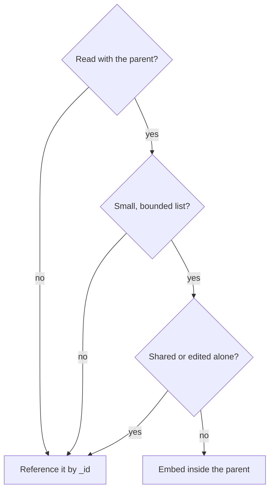

## In one line
MongoDB is a database that stores each record as a JSON-like document, so data that belongs together, like an order and its items, can be saved and read as one piece.

## The problem it solves
In PostgreSQL, one order in your shop is spread across tables: a row in `orders`, several rows in `order_items`, joined back together on every read. That is a great fit for many apps (see [SQL vs NoSQL](#/topic/sql-vs-nosql)). But two situations make it awkward:

- **Data whose shape varies.** A ceramic mug has a capacity and a colour. A T-shirt has sizes. A video course has a duration and chapters. Forcing all of them into one `products` table means many empty columns or extra tables.
- **Data that is always read as one unit.** The order page always needs the order plus all its items. Storing them together means one read, no join.

MongoDB stores each of these as one nested object, close to what your JavaScript code already works with.

## Everyday analogy
A filing cabinet of folders. Each folder (a document) holds everything about one order: the receipt, the item list, the delivery address. A drawer (a collection) holds many folders. Folders in the same drawer usually look alike, but nobody forces them to.

Where it breaks down: when you need to change something that appears in thousands of folders, such as a customer's name copied into every order, you have to update every folder. A relational database would store it once.

## How it works
The building blocks:

- **Document**: one record, a set of field-value pairs that can nest objects and arrays, like `{ userId: 981, items: [ ... ] }`. Similar to a row, but it can contain lists and sub-objects.
- **Collection**: a group of documents, like `orders` or `products`. Similar to a table, but it doesn't require a fixed set of columns.
- **Database**: a named group of collections, such as `shop`.
- **BSON** (Binary JSON): the format MongoDB actually stores and sends. It looks like JSON to you, but it is binary, faster to scan, and has extra types JSON lacks: real dates, 32-bit and 64-bit integers, `Decimal128` for exact money values, binary data, and `ObjectId`. A single document can be at most 16 MB.
- **`_id`**: every document must have a unique `_id` field, and MongoDB always indexes it. If you don't set one, the driver creates an **ObjectId**: a 12-byte value made of a 4-byte timestamp (seconds), a 5-byte random value per process, and a 3-byte counter. That makes ids roughly sortable by creation time and unique without asking the server.

### Embedding vs referencing
The big design question in MongoDB is where related data lives:

- **Embedding** puts related data inside the parent document, like an order's `items` array. One read gets everything, and an update to one document is **atomic** (it happens completely or not at all).
- **Referencing** stores only the other document's id, like `userId: 981` in an order, and the user lives in the `users` collection. You fetch it with a second query, or join with the `$lookup` stage of an **aggregation pipeline** (MongoDB's way of running multi-step queries).

How to decide:

1. Do you read this data together with the parent almost every time? If not, reference it.
2. Is the embedded list small and bounded? An order has a handful of items. A viral video can get millions of comments, which would blow past 16 MB. Unbounded lists are referenced.
3. Is the data shared and updated on its own? A user's profile appears in many orders and changes independently, so reference it. Copy only what should be frozen in time, like the product name and price at the moment of purchase.


*Notice: embedding is the answer only when all three checks pass.*

**Indexes** work much like in PostgreSQL (MongoDB also uses B-tree indexes). Without one, a query on `userId` scans every document in the collection. See [Indexes](#/topic/indexes).

## Real example
**Setup:** Node.js 18+, `"type": "module"`, `npm install mongodb`. MongoDB running locally, for example `docker run -d -p 27017:27017 mongo:8`. `MONGODB_URL` is `mongodb://localhost:27017`.

**An order document**, with items embedded and the user referenced:

```js
{
  _id: ObjectId('6adf9ea7a3bd87e2286a92f3'),
  userId: 981,                     // reference to the users collection
  status: 'pending',
  items: [                         // embedded: bounded, always read with the order
    { productId: 42, name: 'Ceramic mug', unitPriceCents: 1299, quantity: 2 }
  ],
  totalCents: 2598,
  createdAt: ISODate('2026-10-26T18:40:39.571Z')
}
```

The item copies the product name and price on purpose. If the mug's price changes tomorrow, this order must still show what the customer paid.

**Create, read, and update** (`orders.js`):

```js
import { MongoClient } from 'mongodb';

const client = new MongoClient(process.env.MONGODB_URL);
await client.connect();
const orders = client.db('shop').collection('orders');

// Run once at startup: makes "this user's latest orders" an index lookup
await orders.createIndex({ userId: 1, createdAt: -1 });

export async function createOrder(userId, items) {
  const totalCents = items.reduce((sum, i) => sum + i.unitPriceCents * i.quantity, 0);
  const { insertedId } = await orders.insertOne({
    userId, status: 'pending', items, totalCents,
    createdAt: new Date(),        // stored as a BSON date, not a string
  });
  return insertedId;              // an ObjectId the driver generated
}

export function getOrdersForUser(userId) {
  return orders.find({ userId }).sort({ createdAt: -1 }).limit(20).toArray();
}

export function markPaid(orderId) {
  // Atomic: only matches if still pending, and $set changes just that field
  return orders.updateOne({ _id: orderId, status: 'pending' }, { $set: { status: 'paid' } });
}
```

Calling `createOrder(981, [...])` then `getOrdersForUser(981)` returns the whole order, items included, in one query. `insertedId.getTimestamp()` returns the creation time stored inside the ObjectId.

**Comments are referenced, not embedded.** Each comment is its own document in a `comments` collection with `videoId`, `userId`, `text`, and `createdAt`, plus an index on `{ videoId: 1, createdAt: -1 }`. A video page loads the newest 20 with one indexed query, however many millions exist.

## How to say it in an interview

> [!INTERVIEW]
> **30 seconds:** "MongoDB is a document database. Each record is a JSON-like document stored as BSON, documents live in collections, and every document has a unique `_id`. The main design choice is embedding versus referencing: I embed data that's small, bounded, and read together, like an order's items, and reference data that grows without limit or is shared, like comments or user profiles."

> [!INTERVIEW]
> **2 minutes:** Start with the 30-second answer, then add:
>
> "In MongoDB you design around how the app reads data, not around avoiding duplication. For a shop, I'd embed line items in the order, with the product name and price copied in, because that's a snapshot of the purchase and the order page reads it in one query. Users and products stay in their own collections and are referenced by id.
>
> But I wouldn't embed a video's comments: they grow without limit, and a document is capped at 16 MB. Comments get their own collection, indexed on `videoId`.
>
> The tradeoff: copied data has to be kept in sync by my code, and cross-collection joins with `$lookup` are less natural than SQL joins. Updates to a single document are atomic, and MongoDB supports multi-document transactions on a replica set, but if most of my operations need transactions across many collections, I'd question whether a relational database fits better."

## Follow-up questions interviewers ask

<details>
<summary>Is MongoDB schemaless?</summary>

Not really. The database doesn't force a shape by default, but your application always assumes one. Without care, you get documents where `price` is sometimes a number and sometimes a string. In production, enforce shape with MongoDB's built-in **schema validation** (a `$jsonSchema` rule on the collection), an ODM (object-document mapper, the MongoDB version of an ORM) such as Mongoose, or validation in your API. "Flexible schema" is the accurate phrase.

</details>

<details>
<summary>What is an ObjectId, and can I use my own _id?</summary>

An ObjectId is a 12-byte id: a 4-byte creation timestamp in seconds, a 5-byte random value per process, and a 3-byte counter. The driver can generate it without asking the server, it is unique in practice, and it sorts roughly by creation time.

You can use any unique value as `_id`, such as an email or a number, as long as it never changes. `_id` cannot be updated after insert.

</details>

<details>
<summary>Does MongoDB support transactions?</summary>

Every write to a single document is atomic, including its embedded arrays. That is why good embedding removes most of the need for transactions.

Multi-document transactions exist too, but they need a **replica set** (a group of MongoDB servers holding copies of the same data) or a sharded cluster, not a single standalone server. They cost more than single-document writes, so use them when an operation truly spans documents, like moving stock between two warehouses. See [Transactions and ACID](#/topic/transactions-acid).

</details>

<details>
<summary>How do you join collections in MongoDB?</summary>

Either with a second query from your code (fetch the orders, collect the `userId`s, then `users.find({ _id: { $in: ids } })`), or with the `$lookup` stage in an aggregation pipeline. Avoid looking up each related document inside a loop, which is [the N+1 problem](#/topic/n-plus-one) again. If you need joins everywhere, your data may be relational.

</details>

## Common mistakes and misconceptions

> [!MISTAKE]
> Embedding an unbounded list, such as every comment on a video or every order a user has ever placed. The document grows without limit, every update rewrites it, and eventually it hits the 16 MB cap. Reference anything that can grow forever.

> [!MISTAKE]
> Designing MongoDB like relational tables: one collection per entity and `$lookup` everywhere. You get the costs of both worlds. Design documents around the queries your pages make.

> [!MISTAKE]
> Storing dates as strings or money as floating-point numbers. Use BSON dates for time, and integer cents or `Decimal128` for money, so sorting and arithmetic stay correct.

> [!MISTAKE]
> "MongoDB doesn't need indexes because it's fast." Without an index, a filter on any field other than `_id` reads every document in the collection. Index the fields you query and sort on.

## Tradeoffs: when NOT to use it
- **Highly connected data.** Orders, users, products, refunds, and reports that join them all in different ways are what SQL was built for.
- **Heavy reporting and ad-hoc queries.** Analysts usually know SQL, and complex joins and aggregations are easier there.
- **Lots of duplicated data that changes.** If a copied field (like a username) changes often, every copy must be updated, and your code is responsible for keeping them consistent.
- **"We'll figure out the schema later."** Flexibility doesn't remove design work. It moves it into your application code.

## Check yourself

<details>
<summary>1. Should a user's shipping addresses (usually 1 to 3) be embedded or referenced?</summary>

Embedded. The list is small and bounded, belongs only to that user, and is read with the user's profile at checkout.

</details>

<details>
<summary>2. Why does an order store the product name and price instead of just productId?</summary>

It is a snapshot of the purchase. If the product's price or name changes later, the order must still show what the customer actually bought and paid. Keeping `productId` as well lets you link back to the current product page.

</details>

<details>
<summary>3. What three parts make up an ObjectId?</summary>

A 4-byte timestamp (seconds since 1970), a 5-byte random value unique to the generating process, and a 3-byte incrementing counter. Together they make ids unique without coordination and roughly ordered by creation time.

</details>

## Go deeper
- [MongoDB docs: data modeling](https://www.mongodb.com/docs/manual/data-modeling/)
- [MongoDB docs: BSON types, including ObjectId](https://www.mongodb.com/docs/manual/reference/bson-types/)
- [MongoDB docs: Node.js driver](https://www.mongodb.com/docs/drivers/node/current/)
