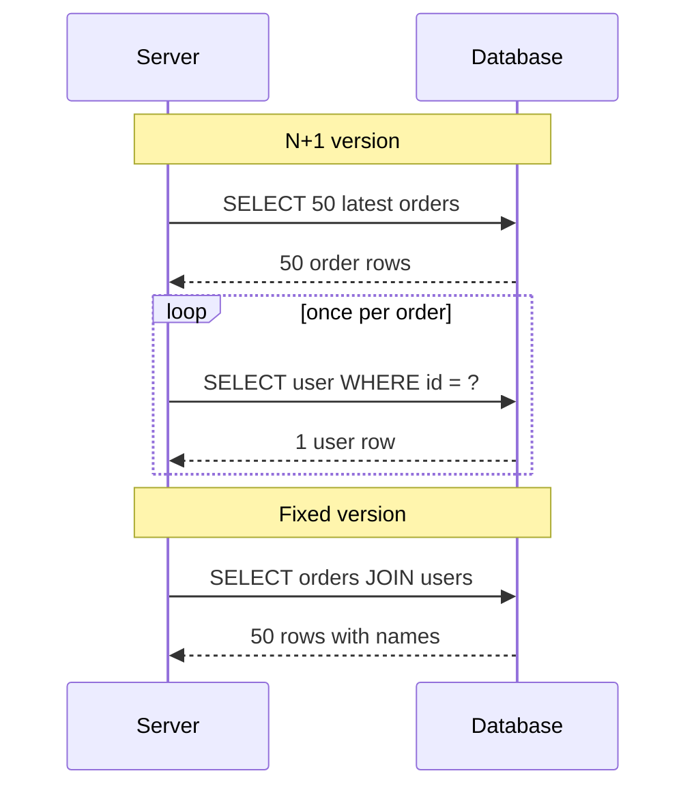

## In one line
The N+1 query problem is when code runs one query to get a list, then one more query for every item in that list, so showing 50 orders costs 51 trips to the database instead of one or two.

## The problem it solves
Your admin dashboard shows the 50 most recent orders, each with the customer's name. The code looks innocent: get the 50 latest orders (1 query), then loop and look up each order's user (50 queries). That is **N+1 queries**: 1 for the list, plus N for the items. Each query is tiny and fast. The cost is the **round trip**: the time for a message to travel to the database and for the answer to come back. Inside one data center that is often around 1 ms. So 51 round trips add roughly 50 ms of pure waiting before any real work.

It gets worse quietly. On your laptop there are 5 orders, so nobody notices. In production the page shows 500 orders: 501 queries. If the database is in another region, each round trip can take tens of milliseconds, and the page takes seconds. Meanwhile the request holds a database connection the whole time, starving the rest of the app.

## Everyday analogy
You need 20 items from the supermarket. You could drive there, buy one item, drive home, and repeat 20 times. Or you could take the whole list and make one trip. Each trip is short, but the travel time is what kills you.

Where it breaks down: database trips take milliseconds, so the waste stays invisible until the list gets long or the network gets slow.

## How it works
A few terms first:

- An **ORM** (object-relational mapper) is a library that lets you work with database rows as JavaScript objects, for example Prisma or Sequelize. See [ORMs and query builders](#/topic/orms).
- **Lazy loading** means related data is fetched only when your code first touches it, such as `order.user`. Convenient, but each touch can be a hidden query.
- **Eager loading** means you tell the code up front which related data you need, so it fetches it in bulk.
- A **JOIN** is SQL that combines rows from two tables in one query, matching them on a column like `orders.user_id = users.id`.

How N+1 happens, step by step:

1. Code fetches a list: `SELECT ... FROM orders LIMIT 50`.
2. It loops over the list.
3. Inside the loop it needs related data, and fetches it one item at a time, either with an explicit query or through lazy loading.
4. The database answers 51 small questions, each paying a full round trip.

There are two standard fixes:

- **JOIN:** ask for orders and user names together. One query.
- **Batch the lookups:** fetch the orders, collect the unique `user_id`s, then fetch all those users at once with `WHERE id = ANY($1)`. Two queries, however many orders.


*Notice: the N+1 version's trips grow with the list, the fixed version always makes one.*

**How to spot it.** The signature is many identical queries with different ids inside one request. You can see it in:

- your ORM's query log (turn it on in development),
- an **APM** tool (application performance monitoring, such as Datadog or New Relic), which draws each request's queries as a timeline,
- PostgreSQL's `pg_stat_statements` extension, which counts how often each query shape runs.

To stop it coming back, some teams assert in integration tests that an endpoint's query count stays the same when more rows are added.

## Real example
**Setup:** Node.js 18+, `npm install pg`, `"type": "module"` in `package.json`, and PostgreSQL with `users` and `orders` tables (`orders.user_id` references `users.id`). `db` is a `pg.Pool`, a set of reusable database connections (see [Connection pooling](#/topic/connection-pooling)).

**The N+1 version:**

```js
export async function getRecentOrdersSlow(db) {
  const { rows: orders } = await db.query(
    'SELECT id, user_id, status FROM orders ORDER BY created_at DESC LIMIT 50'
  );                                                   // 1 query

  for (const order of orders) {
    const { rows } = await db.query(
      'SELECT name FROM users WHERE id = $1', [order.user_id]
    );                                                 // +1 query per order
    order.customerName = rows[0].name;
  }
  return orders;                                       // 51 queries in total
}
```

**Fix 1, a JOIN (one query):**

```js
export async function getRecentOrdersJoin(db) {
  const { rows } = await db.query(`
    SELECT o.id, o.status, u.name AS customer_name
    FROM orders o
    JOIN users u ON u.id = o.user_id
    ORDER BY o.created_at DESC
    LIMIT 50`);
  return rows;
}
```

**Fix 2, batch the lookups (two queries):**

```js
export async function getRecentOrdersBatched(db) {
  const { rows: orders } = await db.query(
    'SELECT id, user_id, status FROM orders ORDER BY created_at DESC LIMIT 50'
  );
  const userIds = [...new Set(orders.map((o) => o.user_id))];  // unique ids only
  const { rows: users } = await db.query(
    'SELECT id, name FROM users WHERE id = ANY($1)', [userIds]  // one query for all
  );
  const nameById = new Map(users.map((u) => [u.id, u.name]));
  return orders.map((o) => ({ ...o, customerName: nameById.get(o.user_id) }));
}
```

`ANY($1)` takes a whole array as one parameter, so the query text stays the same for any number of ids. It also stays safe from **SQL injection** (an attacker sneaking their own SQL in through input), because the ids never become part of the SQL text.

In one test run against PostgreSQL in Docker on the same laptop, the N+1 version made 51 queries and took about 9 ms per call. The JOIN and the batched version each took about 1 ms or less, roughly 10 times faster. Your numbers will differ, but over a real network the gap grows, because every one of those 51 trips pays the network delay.

## How to say it in an interview

> [!INTERVIEW]
> **30 seconds:** "N+1 is when you load a list with one query and then run another query for each item, like fetching 50 orders and then each order's customer separately. Each query is fast, but you pay 51 network round trips, and it scales with the list size. I fix it with a JOIN, or by collecting the ids and loading them in one batched query. In an ORM that means eager loading instead of lazy loading."

> [!INTERVIEW]
> **2 minutes:** Start with the 30-second answer, then add:
>
> "It hides in harmless-looking loops and ORM code, and never shows up locally because the dev database has five rows. I catch it with query logging in development, and in production with tracing or `pg_stat_statements`, where one query shape has a huge call count.
>
> A JOIN is great for many-to-one data, like an order's customer. For one-to-many data, like orders and their items, a JOIN repeats each order on every item row, so I often prefer a second query with `WHERE order_id = ANY($1)`. In GraphQL, where resolvers run per item, I use DataLoader to batch the lookups."

## Follow-up questions interviewers ask

<details>
<summary>Why not just run the 50 queries in parallel with Promise.all?</summary>

It cuts the waiting time, but the database still does 51 queries of work. Each parallel query also needs its own connection from the pool. A `pg.Pool` defaults to 10 connections, so one page can grab all of them and make every other request wait. You moved the problem; you did not fix it. See [Connection pooling](#/topic/connection-pooling).

</details>

<details>
<summary>JOIN or a second batched query: which do you choose?</summary>

- **Many-to-one** (each order has one customer): a JOIN is simple and efficient.
- **One-to-many** (each order has many items): a JOIN returns each order once per item, repeating the order's columns. With several such relations joined together, rows multiply. Two queries (orders, then `order_items WHERE order_id = ANY($1)`) avoid that duplication.

Both are fine. The goal is a fixed number of queries, not exactly one.

</details>

<details>
<summary>What is DataLoader and why does GraphQL need it?</summary>

In GraphQL, each field has a resolver function that runs once per object. Asking for 50 orders and each order's `customer` calls the customer resolver 50 times, which is N+1 by default.

**DataLoader** is a small library that gives each resolver a `load(id)` function. It collects every id requested during the same tick of the [event loop](#/topic/event-loop), then calls your batch function once with all of them (for example one `WHERE id = ANY($1)` query). It also de-duplicates repeated ids. Create a new DataLoader per request so users never share cached data.

</details>

<details>
<summary>How do you catch N+1 before it reaches production?</summary>

Make query counts visible. In development, turn on your ORM's query logging and watch for the same query repeating with different ids. In integration tests, count the queries a request makes and fail the test if a list endpoint goes above a fixed number, so adding a lazy-loaded field breaks the build instead of the site. In production, a tracing tool shows a request with dozens of near-identical database spans, and `pg_stat_statements` shows one cheap query with a huge call count.

</details>

## Common mistakes and misconceptions

> [!MISTAKE]
> "N+1 is an ORM bug." It is an access pattern. Raw SQL inside a `for` loop causes it just as easily. ORMs only make it easier to miss, because `order.user` doesn't look like a query.

> [!MISTAKE]
> Building the batch query by gluing ids into the SQL string (`'... IN (' + ids.join(',') + ')'`). That invites SQL injection. Pass the array as a parameter: `WHERE id = ANY($1)`.

> [!MISTAKE]
> Fixing it by eager loading everything everywhere. Loading every relation "just in case" fetches data the page never shows. Load exactly what the page needs.

## Tradeoffs: when the fix isn't worth it
- **Small, fixed lists.** A settings page that always loads 3 related records makes 4 queries forever. That is fine.
- **The related data is already cached.** If customer names come from an in-memory or Redis cache, the per-item lookups are cheap. Even then, fetch many keys at once (Redis `MGET`) instead of one at a time.

## Check yourself

<details>
<summary>1. A page lists 20 videos and, for each, the uploader's name and the number of comments, each loaded separately. How many queries is that?</summary>

1 (the videos) + 20 (uploaders) + 20 (comment counts) = 41. Two relations make it "2N+1". A fixed version could do it in 1 to 3 queries no matter how many videos there are.

</details>

<details>
<summary>2. Your teammate adds an index on users.id to fix a slow N+1 page. Will it help?</summary>

Barely. `users.id` is the primary key, so it is already indexed. Indexes make each query faster. Batching reduces how many queries run, and the count is the problem here. The fix is a JOIN or a batched `WHERE id = ANY($1)` query.

</details>

<details>
<summary>3. What clue in pg_stat_statements points to N+1?</summary>

A simple query, like `SELECT name FROM users WHERE id = $1`, with an enormous call count and a tiny average time. It is cheap per call but runs far more often than the number of page views would suggest.

</details>

## Go deeper
- [Prisma docs: query optimization and the N+1 problem](https://www.prisma.io/docs/orm/prisma-client/queries/query-optimization-performance)
- [PostgreSQL docs: pg_stat_statements](https://www.postgresql.org/docs/current/pgstatstatements.html)
- [GraphQL docs: DataLoader and batching](https://graphql.org/learn/performance/)
